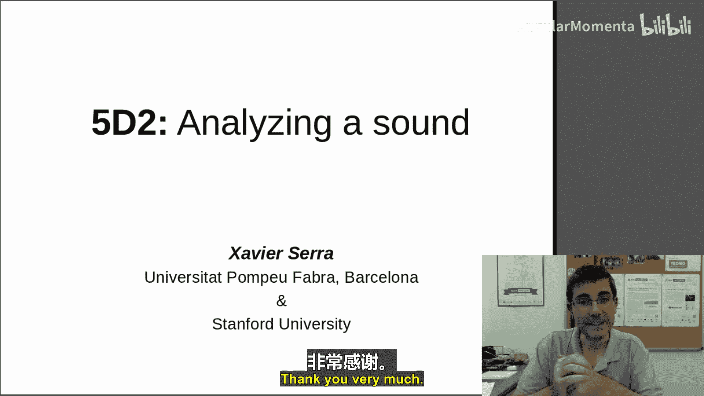

# 035：分析声音 🎵

在本节课中，我们将学习如何使用正弦波模型分析一个更复杂的真实声音——印度打击乐器马杜鼓的声音。我们将通过实践操作，探索如何选择合适的分析参数，以获得良好的声音可视化和再合成效果。

上一节我们从实践角度讨论了正弦波模型。本节中，我们将通过分析一个更复杂的声音，来进一步理解如何调整模型参数。

## 声音样本介绍

我们将分析马杜鼓的声音。马杜鼓是一种来自印度南部的打击乐器，是卡纳提克音乐传统的一部分。我们使用的样本由音乐家A.J.演奏并上传。

以下是分析步骤：

## 步骤一：获取并试听声音

首先，我们需要获取马杜鼓的声音样本。我们可以在FreeSound.org等网站找到相关音频。我们选择了一个由A.J.上传的片段作为分析对象。

试听声音有助于我们了解其特性。马杜鼓能产生多种不同音质的声音，其演奏涉及复杂的节奏结构。

## 步骤二：初始短时傅里叶变换分析

我们使用SMS Tools工具开始分析。首先进行短时傅里叶变换，以获得声音的时频表示。

初始参数设置如下：
*   **窗口类型**：汉明窗（默认选择）
*   **窗口大小**：1000个采样点
*   **FFT大小**：4096
*   **跳跃大小**：较小的值，以获得良好的时间分辨率

计算初始STFT后，我们观察频谱图。可以看到声音中存在一些稳定的共振峰（部分音）。通过测量两个连续共振峰之间的最小距离（例如，第一个在200Hz附近，第二个在400Hz附近），我们估算出所需的最小频率分辨率约为200Hz。

## 步骤三：计算合适的窗口大小

根据理论，我们可以根据所需的频率分辨率来估算更合适的窗口大小。公式如下：

`窗口大小 = (窗口主瓣宽度 × 采样率) / 所需频率分辨率`

对于汉明窗（主瓣宽度约为4），采样率44100Hz，所需分辨率200Hz：
`窗口大小 ≈ (4 × 44100) / 200 = 882个采样点`

因此，我们将窗口大小调整为约883个采样点，并相应减小跳跃大小以保持时间分辨率。

## 步骤四：应用正弦波模型分析

接下来，我们使用正弦波模型进行更精细的分析。在SMS Tools中打开正弦模型分析界面。

初始参数设置尝试：
*   **窗口大小**：883
*   **幅度阈值**：-60 dB
*   **最短轨迹持续时间**：0.05秒
*   **最大正弦波数量**：150

首次分析结果不理想，只检测到很少的正弦波，合成声音缺失严重。我们进行了以下调整：
1.  **降低幅度阈值**：因为原始录音音量不大，许多成分能量较低。
2.  **缩短最短轨迹持续时间**：因为鼓的击打声很短，需要捕捉短暂的轨迹。

调整后，分析结果和合成质量显著改善。

## 步骤五：权衡时间与频率分辨率

我们尝试增加窗口大小至3001个采样点，以获得更好的频率分辨率（能分辨更靠近的部分音）。虽然得到了更多的频谱线，但时间分辨率下降，导致合成声音的瞬态（如击打瞬间）变得模糊、不清晰。

因此，我们最终将窗口大小回调至1000个采样点，在频率分辨率和时间分辨率之间取得了较好的平衡。最终合成的声音质量不错，尽管在声音的瞬态部分，一些噪声能量可能未被正弦波完全捕捉，这将在后续课程中讨论。

本节课中，我们一起学习了如何使用正弦波模型分析马杜鼓的声音。我们实践了从STFT初步观察、计算合适窗口大小，到调整正弦模型参数（如幅度阈值、轨迹长度）的完整流程，并深入体会了音频分析中时间分辨率与频率分辨率之间的核心权衡。希望这次分析能帮助你更好地理解正弦波模型，同时也让你认识了马杜鼓这一迷人的乐器。