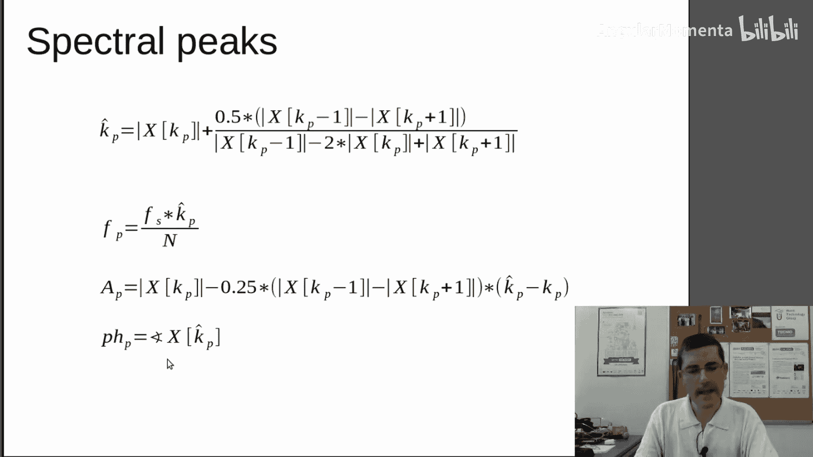
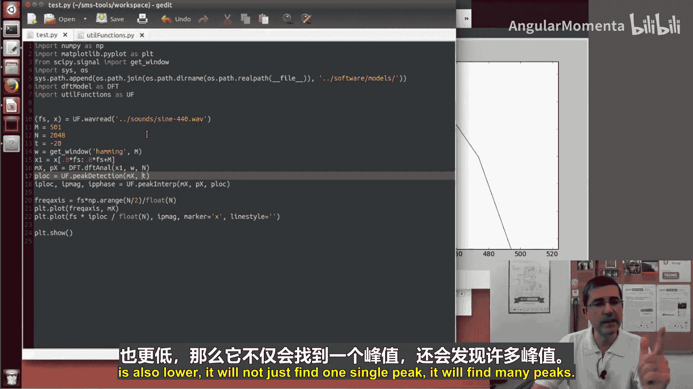
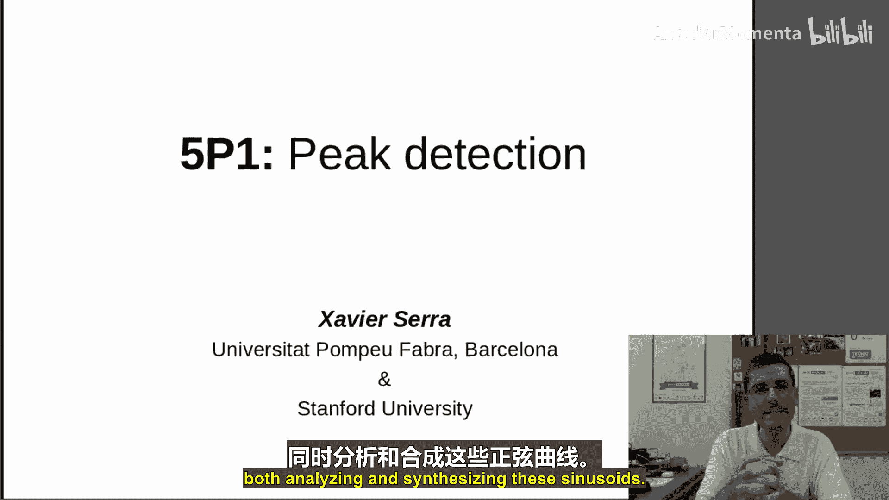

# 036：峰值检测 📊

在本节课中，我们将学习如何从音频信号的频谱中检测并测量正弦波的参数。我们将重点关注**峰值检测**技术，并使用**抛物线插值**方法来精确计算正弦波的频率、振幅和相位。

上一节我们介绍了正弦波模型及其在频域中的表示。本节中，我们来看看如何通过编程实现从频谱中自动检测峰值并测量其参数。

## 概述

正弦波在频谱中表现为一个尖峰。我们的目标是编写代码来定位这个峰值，并使用特定的数学方法精确测量出该正弦波的频率、振幅和相位。核心方法是**抛物线插值**。



以下是用于测量的核心公式：

1.  **精炼频率值**（在0到N的索引范围内）：
    `p = k + 0.5 * (X[k-1] - X[k+1]) / (X[k-1] - 2*X[k] + X[k+1])`
    其中，`k`是峰值点的索引，`X`是幅度谱。

2.  **转换为赫兹**：
    `freqInHz = p * (samplingRate / N)`

3.  **精炼振幅值**：
    `amplitude = X[k] - 0.25 * (X[k-1] - X[k+1]) * p`

4.  **精炼相位值**：
    通过在相位谱上进行线性插值获得。

## 代码实现步骤

以下是实现峰值检测与测量的主要步骤。

### 1. 导入必要库

首先，我们需要导入NumPy、Matplotlib、SciPy以及课程提供的工具函数。

```python
import numpy as np
import matplotlib.pyplot as plt
from scipy.signal import get_window
import sys, os
sys.path.append(‘../software/models/‘)
from dftModel import dftAnal
import utilFunctions as UF
```

### 2. 读取音频文件并设置参数

我们读取一个包含440Hz正弦波的音频文件，并设置分析参数，如窗函数、窗长、FFT大小和检测阈值。

```python
fs, x = UF.wavread(‘../sounds/sine-440.wav‘)
M = 501  # 窗长
N = 512  # FFT大小
t = -80  # 峰值检测阈值（分贝）
w = get_window(‘hamming‘, M)  # 汉明窗
start = int(.8*fs)  # 从音频中部开始分析
x1 = x[start:start+M]
```

### 3. 计算频谱

使用DFT计算选定音频片段的幅度谱和相位谱。

```python
mX, pX = dftAnal(x1, w, N)
```

### 4. 峰值检测

调用工具函数中的`peakDetection`来定位幅度谱中所有高于阈值`t`的局部极大值点。

```python
ploc = UF.peakDetection(mX, t)
pmag = mX[ploc]  # 获取峰值点的幅度值
```

`peakDetection`函数的工作原理如下：
*   它遍历幅度谱（忽略首尾两点）。
*   检查每个点是否满足三个条件：高于阈值、高于前一个点、高于后一个点。
*   所有满足条件的点即被识别为峰值，并返回其索引位置。

### 5. 抛物线插值精炼参数

为了获得比FFT分辨率更精确的参数值，我们对检测到的每个峰值进行抛物线插值。

```python
iploc, ipmag, ipphase = UF.peakInterp(mX, pX, ploc)
```

`peakInterp`函数执行以下操作：
*   对于每个峰值点`k`，取其自身及左右相邻点`(k-1, k, k+1)`的幅度值。
*   使用抛物线插值公式计算精炼后的频率索引`p`。
*   计算抛物线顶点的精炼幅度值。
*   在相位谱上对位置`p`进行线性插值，得到精炼相位值。

### 6. 结果可视化

最后，我们将原始频谱和检测到的峰值（包括插值前后的位置）绘制出来进行对比。

```python
freqaxis = fs * np.arange(N/2+1) / float(N)
plt.plot(freqaxis, mX)
plt.plot(fs * iploc / N, ipmag, marker=‘x‘, linestyle=‘‘, color=‘r‘)
plt.show()
```

## 实验与讨论

我们首先使用较小的FFT大小（N=512）进行分析。此时频率分辨率较低（约86Hz），检测到的峰值频率（约429Hz）与真实值（440Hz）偏差较大。

通过增大FFT大小（N=2048），分辨率提高到约21Hz，峰值频率读数改善到约430Hz，但仍不精确。

应用抛物线插值后，精炼的频率值达到了约439Hz，非常接近真实的440Hz。这证明了插值方法对于克服FFT固有分辨率限制的有效性。



对于更复杂的音频（包含多个正弦波），只需降低检测阈值，该代码即可检测并测量出频谱中的所有显著峰值。

## 总结



本节课中我们一起学习了音频信号处理中峰值检测的核心技术。我们实现了从频谱中自动定位正弦波峰值，并利用抛物线插值方法精确测量其频率、振幅和相位参数。这为后续分析真实音频中多个正弦分量，以及进行正弦模型的分析与合成打下了坚实基础。下一节编程课，我们将把这些技术应用于更复杂的真实声音。