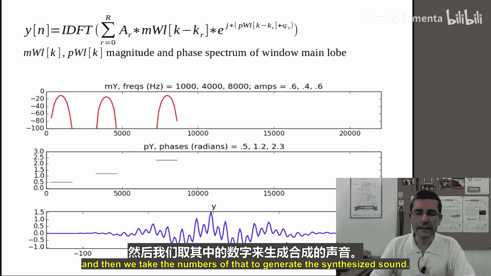
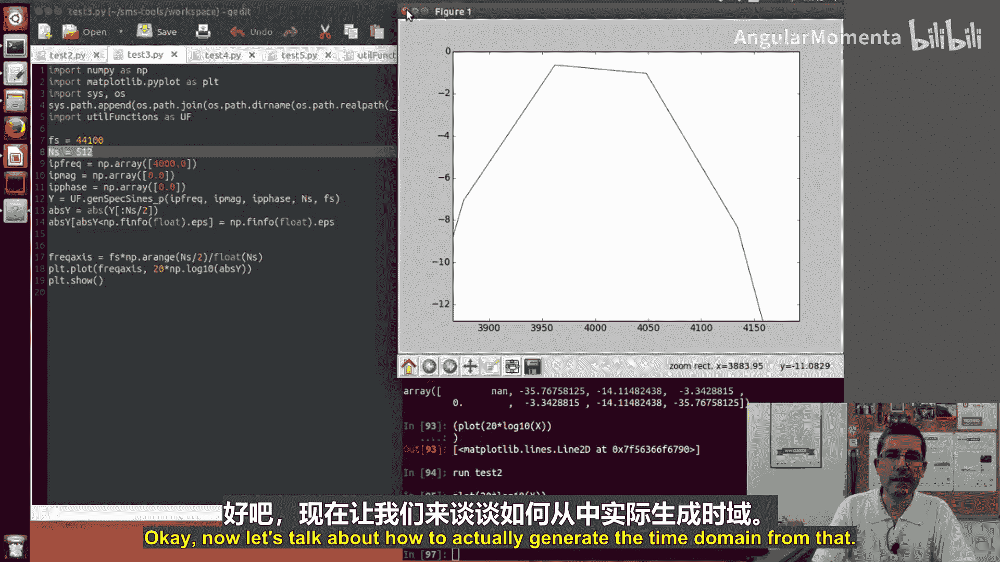
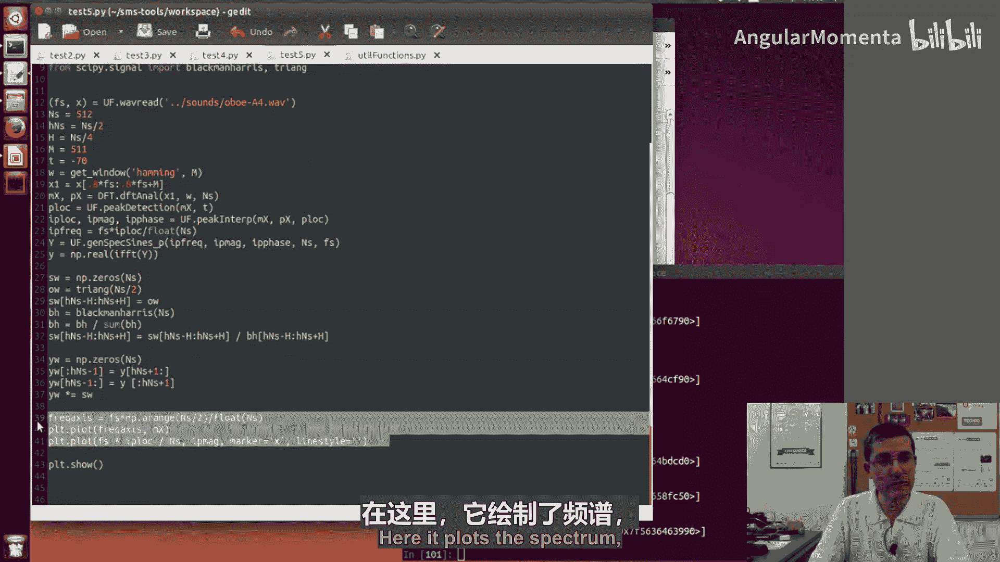
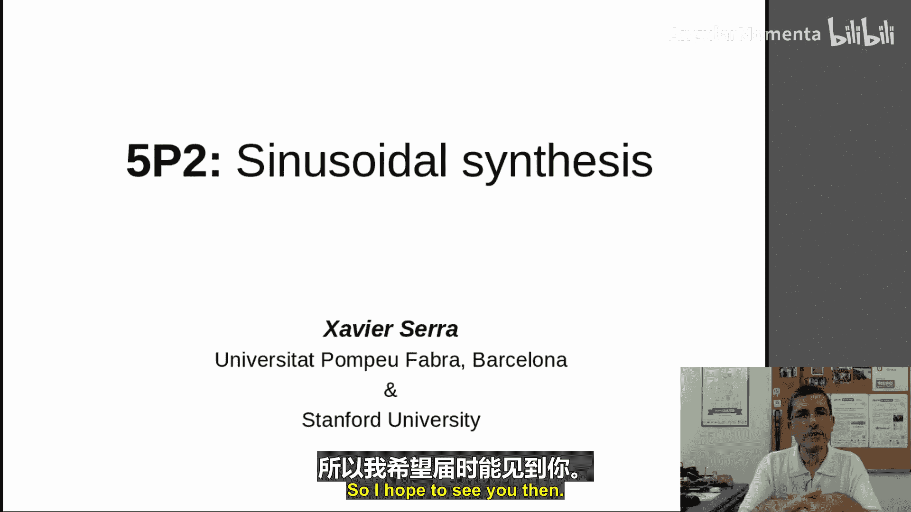

# 037：正弦波合成 🎵

在本节课中，我们将学习如何根据频谱分析得到的峰值信息，在频域中合成正弦波，从而实现基于正弦模型的加法合成。

上一节编程课中，我们讨论了频谱峰值以及如何编程检测它们的值。这是实现基于正弦模型的分析-合成系统的开端。我们识别出的频谱峰值，理想情况下对应着声音中的正弦波成分。在本节课程中，我们将介绍如何根据这些峰值信息来合成正弦波，也就是如何进行加法合成。

我们将按照理论课中讨论的方法，在频域中进行合成。其核心思想是合成布莱克曼-哈里斯窗函数的主瓣，然后对其进行逆离散傅里叶变换。



以下公式展示了这一思想：我们通过对一系列主瓣之和进行逆DFT来合成声音 `y`。

`y = IDFT( Σ 主瓣 )`

在图中，我们可以看到已经生成的主瓣及其相位，然后通过逆变换生成合成的声音。接下来，我们将展示具体实现。首先，我们需要学习如何合成布莱克曼-哈里斯窗的一个主瓣。

以下代码片段展示了这一点。我们调用一个名为 `genBhLobe` 的函数，并传入我们想要生成的样本（频点）。由于我们只想生成主瓣，我们只传入其中心附近的8个频点。

```python
# 示例：生成布莱克曼-哈里斯窗主瓣的8个中心频点
samples = [0, 1, 2, 3, 4, 5, 6, 7]
X = genBhLobe(samples)
```

首先，让我们看看这个来自 `utilFunctions` 文件的 `genBhLobe` 函数。这个函数直接在频域中实现了布莱克曼-哈里斯窗的生成。布莱克曼-哈里斯窗的频谱是四个sinc函数之和，这正是主循环所做的事情：它生成四个sinc函数并将它们加在一起。每个sinc函数都有来自布莱克曼-哈里斯窗方程的系数。

在这个sinc函数内部，我们调用另一个名为 `sinc` 的函数，它负责生成一个特定的sinc函数。同样，它只生成主瓣，而不是整个sinc函数。

通过这两个函数，我们能够生成布莱克曼-哈里斯窗的主瓣。运行这段代码，输出 `X` 是线性尺度下布莱克曼-哈里斯窗的8个样本值。中心是第五个样本，其值为1。如果我们取其绝对值，并计算 `20*log10()`，我们将在对数尺度下看到它。绘制出来，这就是布莱克曼-哈里斯窗主瓣在对数尺度下的形状。

如果我们读取的不是这些样本，而是其他序列的样本（例如，给数组中的每个值加上0.5），我们再次运行并绘图，会看到不同的样本。这基本上是在两个样本之间移动主瓣。这就是我们如何生成对应于不同频率的主瓣，因为我们正在这些样本之间移动这个主瓣。



现在，让我们使用SMS工具包中的一个函数来实现，这个函数叫做 `genSpecSines`。`genSpecSines` 接收一个包含频率、幅度和相位的输入数组，然后生成包含所有这些信息的频谱。

以下是使用该函数的代码示例：

```python
# 生成一个4000Hz、0dB、相位0的正弦波频谱
freqs = [4000.0]
mags = [0.0]
phases = [0.0]
N = 512
X = genSpecSines(freqs, mags, phases, N)
```

在这段代码中，我生成了一个频率为4000赫兹、幅度为0分贝、相位为0的单一正弦波。我生成了大小为512个样本的整个FFT频谱，然后计算其绝对值并绘制其分贝值。运行后，我们得到一个频率在4000赫兹的正弦波主瓣。如果我们放大，会看到主瓣，并且其中心恰好被移动到了4000赫兹附近。进一步放大，会看到这个峰值的尖端基本上就在4000赫兹。

接下来，我们讨论如何从频域信号生成时域信号。我们需要对其进行逆傅里叶变换。在另一个脚本中，我实现了这一点。在调用 `genSpecSines` 之后，我调用逆FFT。然后，有一段代码用于“撤销”布莱克曼-哈里斯窗的加窗效应。在理论课中我们提到，为了获得良好的重叠效果且不需要太小的跳跃大小，最好撤销布莱克曼-哈里斯窗并应用一个三角窗。这部分代码生成了一个合成窗 `sw`，它是三角窗除以布莱克曼-哈里斯窗的结果。

`sw = 三角窗 / 布莱克曼-哈里斯窗`



然后，我们将这个合成窗乘以从逆DFT得到的结果。运行这段代码，我们可以绘制各个步骤。首先绘制频谱的绝对值，这是正弦波的复频谱（仅幅度部分），我们看到正弦波的正负两侧。x轴不是以赫兹为单位，但这将对应于4000频率。然后我们计算逆FFT并绘制 `y`，这是时域中经过布莱克曼-哈里斯窗加窗的正弦波，它围绕0点中心对称。之后，我们除以布莱克曼-哈里斯窗并乘以三角窗，得到结果 `yw`。这个信号将用于重叠相加合成步骤。原始窗口大小为512，现在变为256个样本，因此我们可以重叠128个样本。

我们已经看到了根据给定正弦波的频率值进行完整合成的过程。现在，让我们将其整合到一个真实声音片段的分析-合成中。

在 `test5` 中，我们读取一个双簧管声音的片段。我们将进行DFT分析，检测峰值，然后对峰值进行插值以获得更精确的正弦波位置，接着在频域中进行合成，再进行逆FFT并撤销加窗。这里会绘制得到的幅度频谱及其峰值。

运行此测试，我们得到双簧管声音的幅度频谱，并根据给定的阈值检测到一些峰值。放大后，我们看到十字标记对应于插值后的峰值。这里抛物线插值的效果非常显著，因为我们没有进行任何零填充，且FFT尺寸相当小。从这些十字标记中，我们得到每个峰值的幅度、频率和相位，然后可以计算其逆变换。我们可以绘制 `y` 数组，它包含了所有这些正弦波的零中心逆FFT结果。现在，我们将其中心化，撤销布莱克曼窗并乘以三角窗，可以绘制 `yw`，即经过三角窗加窗的信号。这个信号将用于双簧管声音分析-合成的重叠相加步骤。



本节课中，我们一起学习了正弦模型分析的另一个组成部分。我们完成了基于峰值的合成，之前我们讨论了如何实际找到峰值。目前我们还缺少的是将其整合到一个完整的、时变的分析-合成系统中，并处理这些正弦波轨迹的连续性问题。这将是下一节编程课的内容。