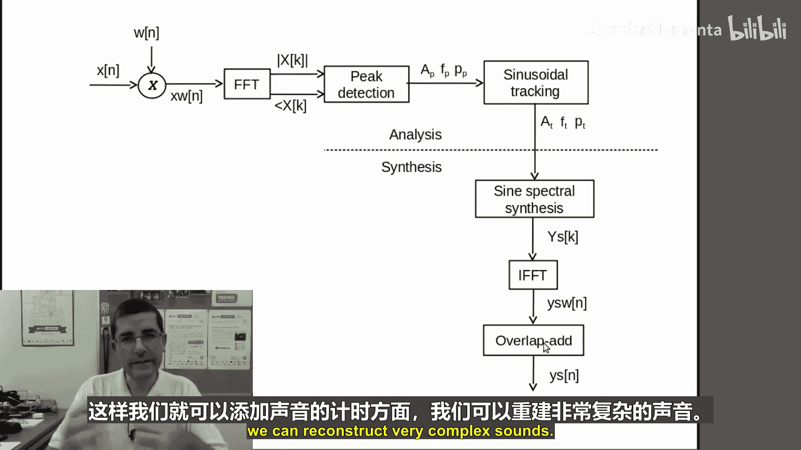
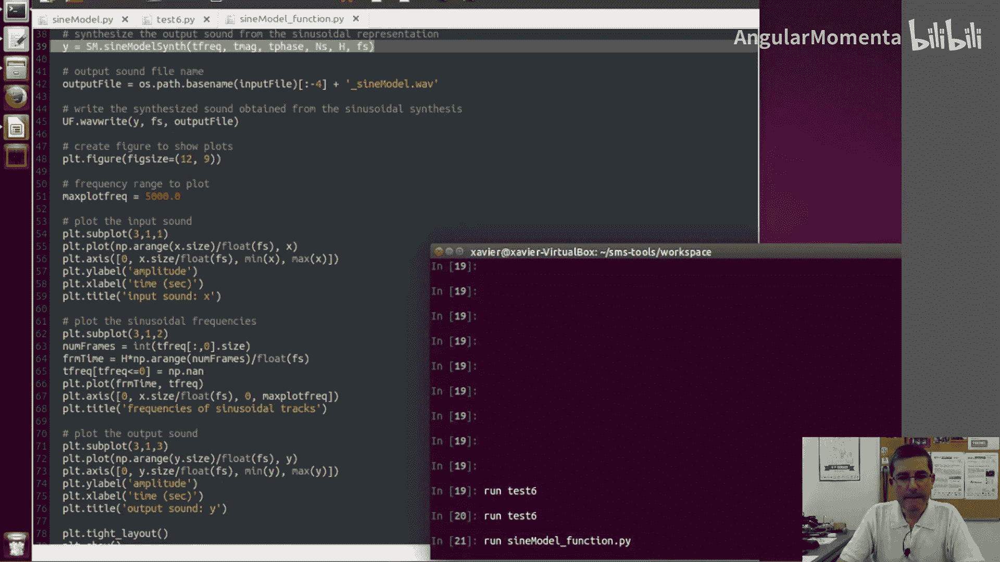
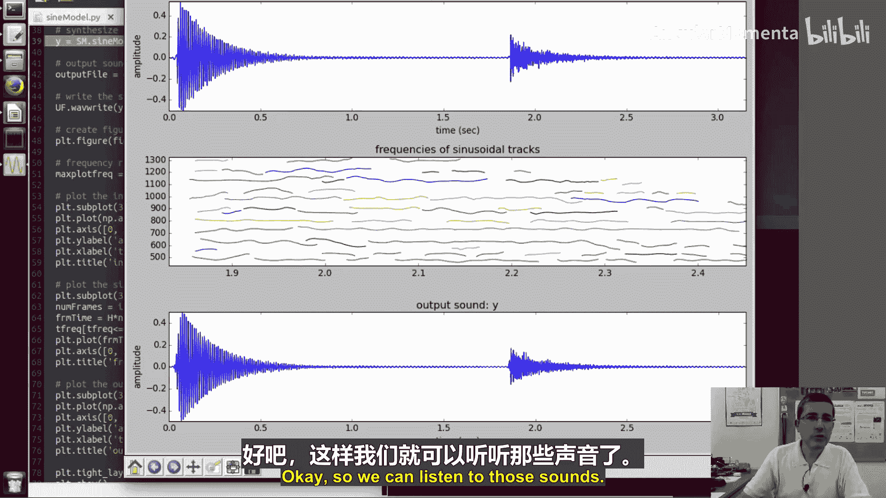
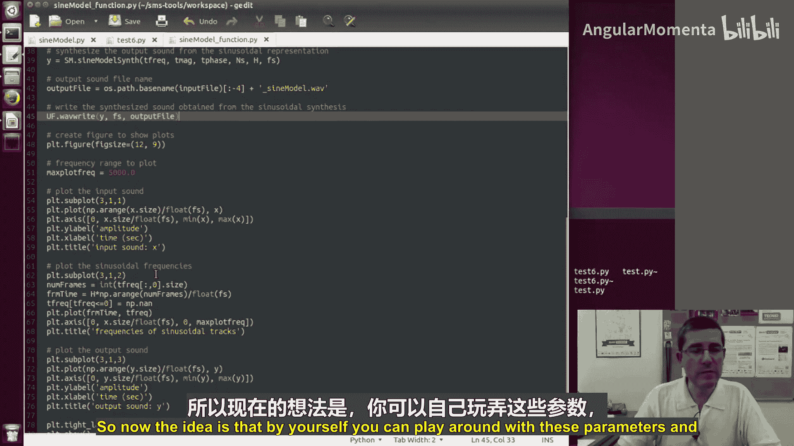
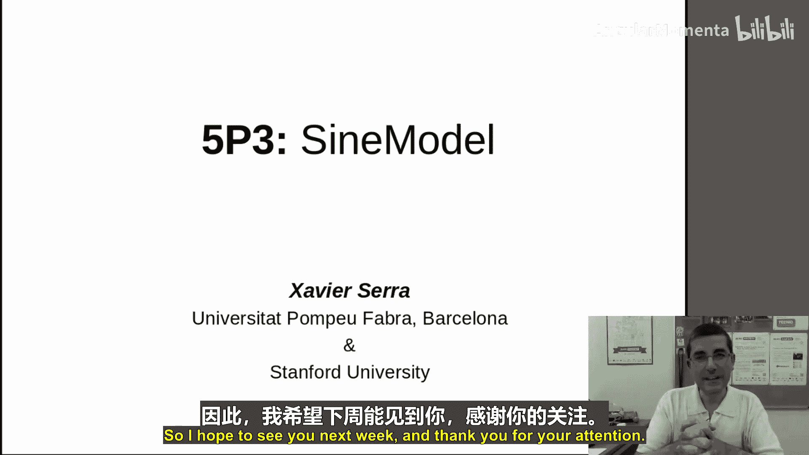

# 038：正弦模型编程实现

在本节课中，我们将学习如何将正弦模型的分析与合成部分整合成一个完整的系统。我们将使用SMS工具包中的代码，具体实现从音频信号中提取正弦轨迹并进行重新合成的过程。

## 概述

上一节我们讨论了正弦模型的峰值检测与合成。本节中，我们将把这两个部分结合起来，并加入缺失的组件——**正弦轨迹跟踪**，以实现对一个完整声音的分析与合成。我们将从原始信号 `x` 开始，经过标准的加窗、FFT处理，然后进行峰值检测以获取振幅、频率和相位。接着，我们将学习如何将这些峰值连接成随时间变化的轨迹，并最终合成出声音。

## 正弦模型分析函数

我们将使用SMS工具包中的 `sineModelAnal` 函数来完成核心分析工作。这个函数接收整个输入声音 `x`、采样率、窗函数、FFT大小、帧移等参数，并执行峰值检测与轨迹跟踪。

以下是该函数的关键参数：
*   `maxnSines`：允许同时存在的最大正弦波数量，默认值为 `100`。
*   `minSineDur`：轨迹的最小持续时间（秒），短于此值的轨迹将被删除，默认值为 `0.01`。
*   `freqDevOffset`：允许的帧间频率偏差基准值（赫兹），默认值为 `20`。
*   `freqDevSlope`：频率偏差随频率增加的斜率，允许高频有更大的变化。

函数的核心是一个循环，它对声音的每一帧执行以下操作：
1.  使用FFT算法计算DFT。
2.  进行峰值检测。
3.  进行峰值插值。
4.  将峰值分配到轨迹中。

## 正弦轨迹跟踪

轨迹跟踪是连接不同帧中峰值的关键步骤。`sineTracking` 函数负责此任务。

其核心逻辑如下：
*   对于已有的轨迹，算法会在新的一帧中寻找频率最接近的峰值。
*   如果该峰值的频率与轨迹预测频率的偏差在允许范围内（由 `freqDevOffset` 和 `freqDevSlope` 控制），则该峰值将被加入此轨迹。
*   未被分配到任何现有轨迹的峰值，可能会作为新轨迹的起点。
*   如果一个轨迹在后续帧中没有找到匹配的峰值，它将会消失。

## 轨迹清理

分析完成后，系统会调用 `cleanSineTracks` 函数进行轨迹清理。

这个函数非常简单：
*   它遍历所有已生成的轨迹。
*   检查每条轨迹的持续时间。
*   如果轨迹长度小于 `minSineDur` 参数设定的值，则将该轨迹的频率设置为零，从而将其删除。
*   这有助于消除由分析侧瓣或瞬时噪声产生的短促、不稳定的轨迹片段。

## 实践：运行分析脚本

我们可以运行一个测试脚本（例如 `test6.py`）来调用 `sineModelAnal` 函数并可视化结果。

运行脚本后，我们将看到以不同颜色绘制的正弦轨迹图。需要注意以下几点：
*   即使看起来是一条连续的线，也可能由不同颜色的线段组成，这代表旧的轨迹结束和新的轨迹开始。
*   大多数轨迹对应声音的谐波。
*   高频区域可能出现一些短暂的轨迹，它们可能对应噪声成分或分析产生的侧瓣。

通过调整 `minSineDur` 参数（例如从 `0.1` 改为 `0.01`），我们可以观察到更多、更短的轨迹被保留下来，其中可能包含更多我们不需要的伪影。

## 正弦模型合成

分析得到轨迹后，我们可以使用 `sineModelSynth` 函数进行合成。

该函数的工作流程是：
*   接收分析阶段得到的轨迹数据。
*   遍历所有轨迹。
*   为每个正弦分量生成主瓣（使用布莱克曼-哈里斯窗等）。
*   处理相位信息（可以使用分析得到的相位，也可以在合成时重新生成）。
*   最终通过逆FFT和重叠相加重建出时域音频信号。

SMS工具包中提供了一个集成的 `sineModel` 函数，它封装了完整的分析与合成流程，并可以绘制原始声音、正弦轨迹和合成声音的对比图。

运行此函数后，我们可以聆听合成出的声音（例如 `bendir_sineModel.wav`），并将其与原始声音进行比较，以评估模型的重建质量。

## 总结

本节课中，我们一起学习了正弦模型完整的编程实现流程。我们了解了如何使用 `sineModelAnal` 函数进行包含轨迹跟踪的分析，如何使用 `cleanSineTracks` 清理轨迹，以及如何使用 `sineModelSynth` 进行重新合成。通过SMS工具包提供的代码基础，我们已经可以探索许多有趣的音频处理应用。正弦模型是一个强大的工具，但它还可以被进一步扩展和约束。在下周的课程中，我们将讨论**谐波模型**，它将正弦模型限制为只跟踪谐波成分，这对于处理乐音非常有效，我们还将探索其他新的谱分析与声音合成方法。