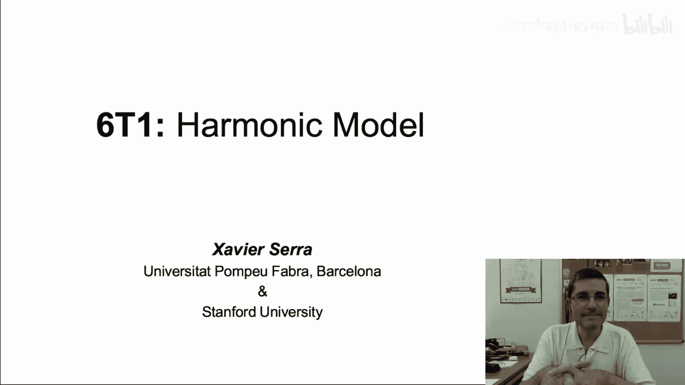

# 039：谐波模型 🎵

## 概述
在本节课中，我们将学习谐波模型。这是一种比上周学习的正弦模型更灵活、更高层次的音频表示方法，专门用于处理由周期性或准周期性振荡产生的单一声源声音，例如许多乐器发出的声音。

上一节我们介绍了正弦模型，本节中我们来看看它的一个特例——谐波模型。

## 谐波模型介绍
谐波模型的方程与正弦模型非常接近，但有一个显著区别：所有正弦波的频率都是基频的整数倍。因此，该模型仅适用于由周期性或准周期性振荡产生的单一声源声音。

输出信号 `y_h[n]` 的公式如下：
`y_h[n] = Σ_{r=1}^{R} A_r[n] cos(2π r f_0[n] n + φ_r[n])`
其中，`r` 是整数，`f_0[n]` 是时变的基频。这意味着所有正弦波要么是基频，要么是基频的整数倍。

我们也可以在频域表达该模型。一个谐波声音的时变频谱是所有谐波时变频谱的总和。总体谐波频谱是所有这些窗函数的总和，每个窗函数都有一个振幅缩放因子 `A_r` 和一个频移因子 `-r f_0`，我们将这些窗函数放置在正弦波的适当位置。

这基本上就是我们在正弦模型中讨论的内容，但现在将频率限制为基频的整数倍。

## 谐波与非谐波声音示例
以下是两个具有不同特征的声音的频谱图示例。顶部的声音是一个非谐波声音（颤音琴音符），底部的声音是一个谐波声音（人声演唱元音“a”）。

以下是两个声音的听觉示例：
*   颤音琴声音：这是一个非常简单的音，但其谱线是非谐波的，这意味着它们不是基频的整数倍。
*   人声：这是一个更复杂的声音，其正弦波谱线非常接近基频的整数倍，这是谐波声音的典型结构。

## 正弦波、分音与谐波的区别
为了更好地理解谐波的概念，区分正弦波、分音和谐波非常重要。

*   **正弦波**：是一个数学函数，具有解析表示，源于数学观点。
*   **分音**：是信号的一个组成部分，它是周期性且稳定的，可以建模为一个缓慢时变的正弦波。这个概念来自对真实信号的分析。
*   **谐波**：是声音的一个分音，且是基频的整数倍。它也可以建模为缓慢时变的正弦波，但附加了必须是给定频率整数倍的限制。

观察相同信号的相位谱也有助于理解这些概念。相位平坦的区域通常对应稳定的正弦波分量。

## 单音与复音信号
为了使用谐波模型，我们需要识别出谐波的声源。

在复音信号的情况下，存在多个声源。例如，可能同时有几种乐器在演奏，其中一些可能是谐波的，一些可能不是。目标可能是识别出其中人声的谐波，但通过观察正弦波轨迹可能并不容易。

单音信号只包含一个声源，例如独唱的人声。在这种情况下，可以更清楚地看到时变的谐波，并且识别出的正弦波轨迹可以非常清晰地显示人声的谐波。

## 如何检测谐波？
问题在于，如何在单音信号或复音信号的某个声源中识别谐波？我们只关注谐波声音。

主要问题在于识别声源的基频，这将在下一讲中讨论。因此，这里我们假设已知声音的基频。

我们将专注于谐波的概念，并将其定义为一个频率接近基频整数倍的频谱峰值。

我们可以用以下公式来表达这个想法：一个峰值 `f_p` 被认为是谐波的条件是：
`|f_p - r * f_0| < 阈值`
同时，我们定义“稳定”的概念为已经存在了一段时间，即该谐波需要在当前帧之前的若干帧中持续存在。我们定义一个大写的 `L` 作为最小帧数，一个谐波需要存在这么多帧才能被定义为谐波。

## 谐波模型的实现
谐波模型的实现是对上周看到的正弦模型的一个修改。

以下是实现流程：
1.  **基频检测算法**：这需要单独处理，我们将在下一讲讨论。
2.  **谐波检测**：即我们讨论过的选择那些是基频谐波的峰值。
3.  **其余部分**：与正弦模型完全相同。

## 分析-合成示例
这是一个使用谐波模型进行分析-合成的示例。对于之前听过的人声，其合成声音与原始声音非常接近。因此，对于这个声音，谐波模型效果很好。当然，在谐波不清晰的区域（如过渡段、辅音或静默处）可能会有些问题。

## 延伸阅读与资源
谐波振荡的概念在研究许多自然现象时经常出现，你可以在许多书籍和参考资料中找到。当然，在处理特定的音乐信号和声音的谐波性方面资料可能不多，但你仍然可以在维基百科和一些书籍中找到相关内容。

本节课中播放的声音来自 FreeSound 网站。本节展示的所有绘图代码都可以在 GitHub 代码库中找到。

## 总结
本节课中我们一起学习了谐波模型。我们可以用它来分析和合成信号。其应用可能性将比正弦模型大得多，我们将在后续看到一些例子。困难的一步在于基频的检测，这将是我们下一讲的内容。