# 040：基频检测 🎵

在本节课中，我们将学习如何检测音频信号中的基频。基频是谐波模型工作的关键，它决定了声音的音高。我们将探讨时域和频域两种主要的检测方法，并了解它们各自的优缺点。

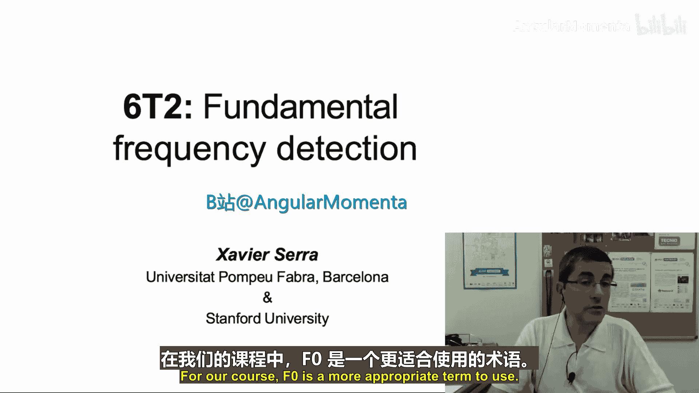

上一讲我们介绍了谐波模型，并提到为了使该模型正常工作，我们需要能够检测声音的基频，即我们通常所说的音高。我们将交替使用“基频”和“音高”这两个术语，但严格来说，它们指的是不同的概念。F0是一个信号处理概念，而P是一个感知概念。对于本课程而言，F0是更合适的术语。

## 检测方法概述

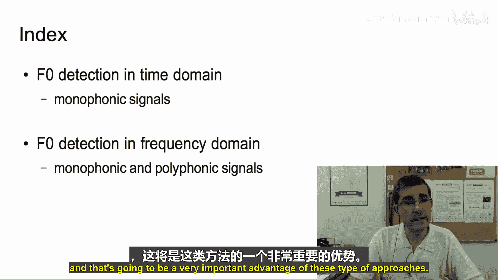

人们提出了许多方法来识别声音的基频，这些方法可以分为两类：直接在时域信号上工作的方法和在频域频谱表示上工作的方法。

时域方法在单音信号上效果良好。
频域方法不仅可以在单音信号上工作，也可以在复音信号上工作，这是这类方法的一个重要优势。

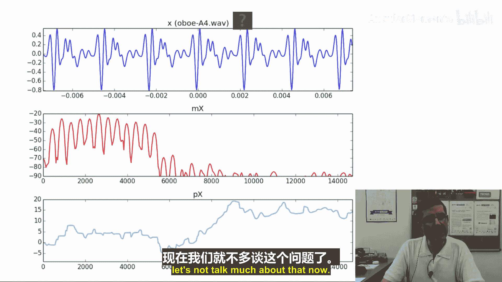

## 理解基频检测

为了理解基频检测的概念，让我们观察一些声音及其频谱。

这是一个双簧管声音的片段。时域信号清楚地显示出周期性，我们可以识别出一个不断重复的周期。这个周期的长度，其倒数就是我们所说的基频。在频域，在幅度谱中，我们也看到了周期性，基本上两个连续峰值之间的距离就是基频。因此，我们也可以设想能够测量这一点的算法。我们可以在时域或频域进行测量，这可能并不太难。

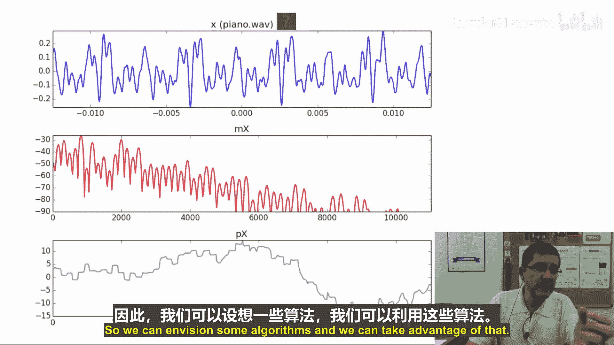

相位在某些情况下可能有用，但我们暂时不深入讨论。

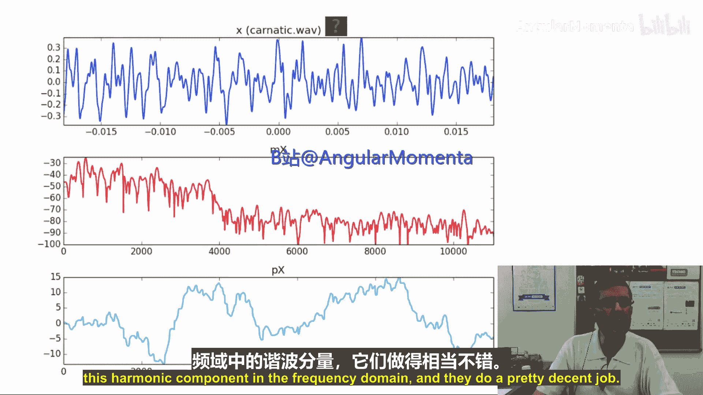

## 时域检测方法 🎹

一个钢琴单音具有清晰的音高，因此应该能够检测到它的F0。让我们听一个钢琴乐句。我们清楚地听到了这个声音的音高，但如果我们观察时域波形，情况就不那么明显了，似乎不容易识别这个声音的周期。在频谱中，情况稍好一些。我们看到一些具有周期性的峰值，因此我们可以设想一些能够利用这一点的算法。

如果我们处理复音信号，例如，这是一段声乐作品的片段。其中有多个声源，但人声是最突出的。在时域检测人声的基频基本上是不可能的。在频谱中，这也不容易，但我们会看到有一些算法试图在频域识别这个突出的人声，即这个谐波成分，并且它们做得相当不错。

### 自相关函数

要在时域检测基频，我们基本上需要识别其重复周期循环的长度。自相关函数是一种用于寻找重复模式的数学工具，它是信号与其自身的互相关。非正式地说，我们可以将其视为样本之间的相似性，作为它们之间时间滞后的函数。

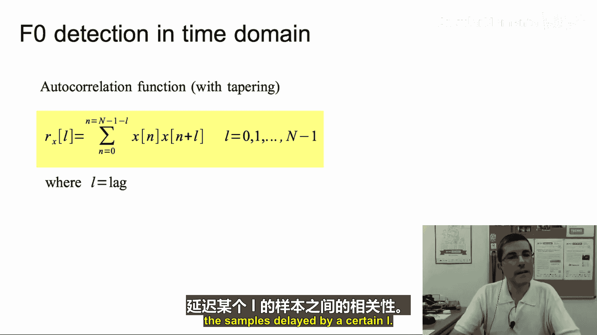

在这个方程中，我们看到了一个带有某种加窗的自相关函数版本。我们为每个滞后时间L计算这个函数，尝试不同的滞后时间，其中L是整数值的样本。我们从一个特定的时间段（声音的一个片段）开始，将声音乘以延迟了该滞后时间的声音。当然，如果延迟为零，就是同一个信号。当我们取不同的滞后时间时，乘法结果会不同。

因此，我们将得到一个关于L的函数。这样，我们将测量声音片段与延迟了某个特定L的样本之间的相关性。让我们看一个具体的例子。

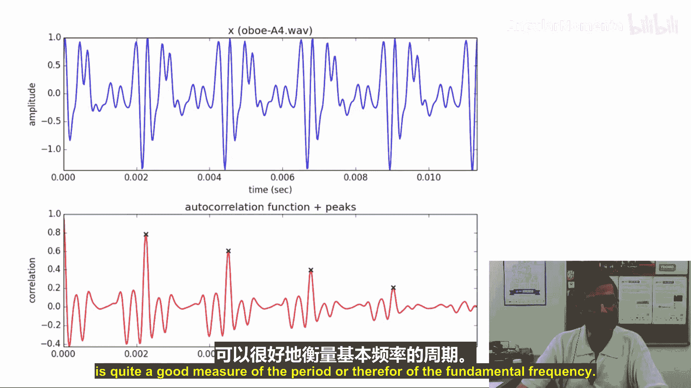

这是之前的双簧管声音，下方是自相关函数。我们清楚地看到，在滞后0处，值为1（完全相关）。然后随着滞后增加（这里我们用秒而不是样本来表示滞后时间，以便更容易与顶部信号对应），我们清楚地看到，在对应于一个周期（即0.002秒）的滞后处，存在一个局部最大值。

这显然是最大的局部最大值，因此这将是一个很好的指示，表明这就是周期，或者其倒数就是基频。然后，两个周期的滞后处也是一个局部最大值，但更小。由于存在加窗，这个值会随着滞后时间衰减。

可以说，对于如此清晰的周期性声音，自相关函数是测量周期（从而测量基频）的相当好的方法。

### YIN算法

对于钢琴声音的情况，时域波形表现不那么好。对于这个我们能清楚听到音高的钢琴声音片段，如果我们绘制不同滞后时间的自相关函数，情况就不那么清晰了，存在多个峰值。实际上，最高峰对应的是基频，但很难设定一个阈值来明确决定哪个峰值最适合识别基频。

一种类似于自相关的方法是Shiini和Kaawhara提出的YIN算法。它基于差分方程，该方程类似于自相关，我们只是取具有给定滞后的样本之间的差值，然后平方求和。当滞后等于周期长度时，此函数为0，因此我们必须找到该函数的最小值。YIN算法在此处进行了一些额外的处理，以获得对该周期的良好测量，并且对于单音信号效果相当好。事实上，它已成为语音或单音乐器基频测量中非常常见的算法。

让我们看看它对特定声音的效果。这是之前听过的声乐声音的频谱图，这里我们绘制了函数，黑线是YIN算法检测到的基频。当然，它是在时域检测的，而不是在这个频谱图上。

让我们听一下检测到的基频。这相当不错，基本上它很好地跟踪了基频。但这类方法不适用于许多声音，尤其不适用于复音信号，因此我们必须转向频域。

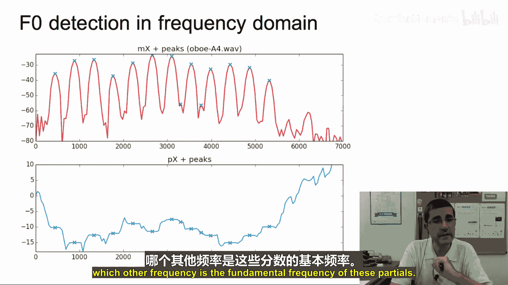

## 频域检测方法

那么，频谱中的基频是什么？

我们已经看到了如何识别声音的正弦波和分音，例如在双簧管声音上，这些叉号是峰值，其中许多对应于该声音的分音或谐波。但是，这些峰值中的哪一个（或者频谱的其他部分）是基频？我们如何识别哪些是谐波分音，然后也许从这些信息中我们可以识别出哪个频率是这些分音的基频？

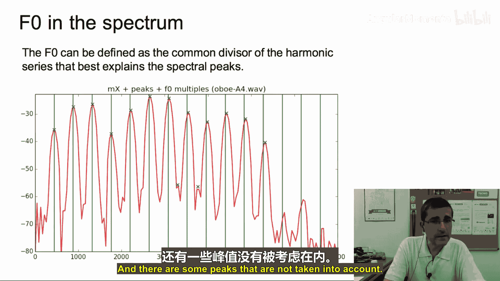

### 基频的定义

声音频谱中的基频F0，可以定义为最能解释频谱峰值的谐波序列的最大公约数。

我认为这是一个非常简洁的定义，事实上我们可以基于此开发算法。

这里我们看到双簧管声音和峰值的图，垂直绿线对应于一个谐波序列。实际上，它们对应于最能解释这些频谱峰值的谐波序列。因此，仅通过目视检查，我们清楚地看到绿线（它们都是第一条绿线的倍数）最接近谐波序列，尽管其中一些并不完全在峰值之上，并且有一些峰值未被考虑在内。

### 双向失配算法

频域中的基频检测问题可以表述为一个模式匹配问题，我们必须找到最符合频谱的谐波序列模式。Mahar和Bom提出的双向失配算法正是这样做的。

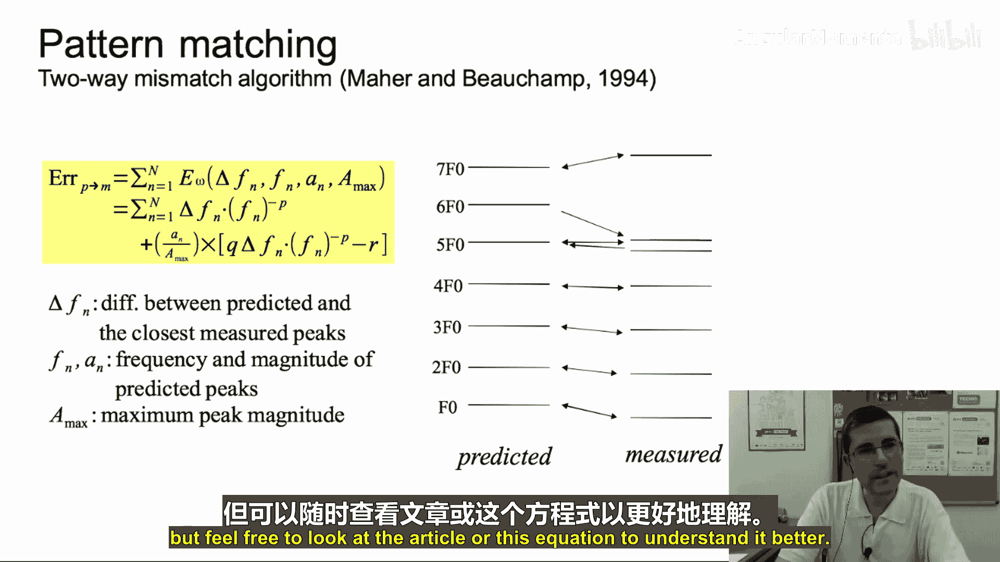

该算法的概念是，它测量实测峰值与理想谐波序列（预测峰值）之间的差异，反之亦然。因此，如果我们看图，我们在最右边看到实测峰值，这些是我们获得的峰值频率。然后我们想检查一个给定的预测谐波序列，一个给定的f0及其倍数，看它与这些实测峰值的接近程度，即它能在多大程度上解释这些实测峰值。所以我们要做的是测量这对值之间的距离。

因此，我们将测量从预测到实测的距离，以及从实测到预测的距离，这就是为什么称为“双向”失配，因为实际上这两个距离并不相同。

第一个方程是从预测到实测。我们取每个预测峰值或每个预测值，寻找最接近的实测峰值，并计算频率距离，然后根据幅度进行缩放。我们还有一个值，用于相对于高频来提升低频的重要性。这里有一些加权系数，允许我们根据想要处理的声音类型来调整这个方程。我们不会深入细节，但欢迎查阅文章或这个方程以更好地理解它。

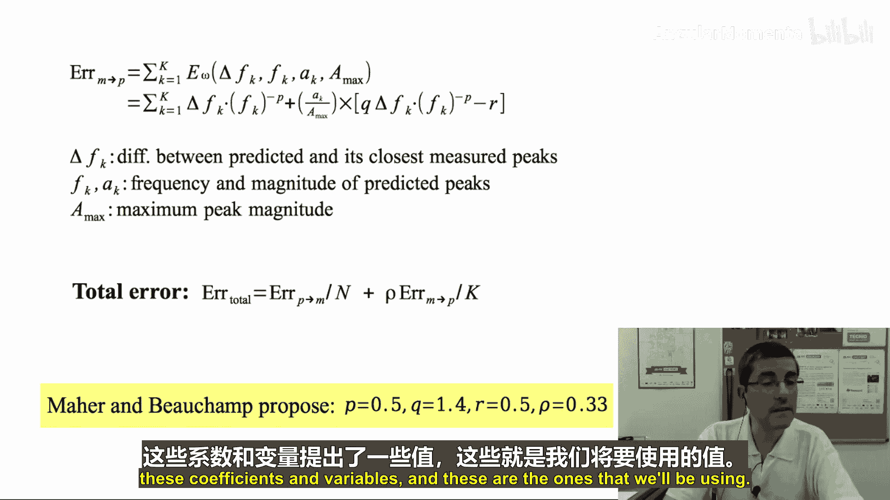

然后我们进行另一个方向的测量，即从实测到预测的误差。因此，我们首先查看所有实测峰值，寻找最接近的理想峰值或理想谐波，再次计算距离，并应用一些加权因子。然后我们得到一个总误差，即这两个误差的总和，同样我们有一些加权系数，以便我们可以根据特定情况进行设置。Bahar和Mosam为这些系数和变量提出了一些值，这些值我们将使用。

### 算法示例

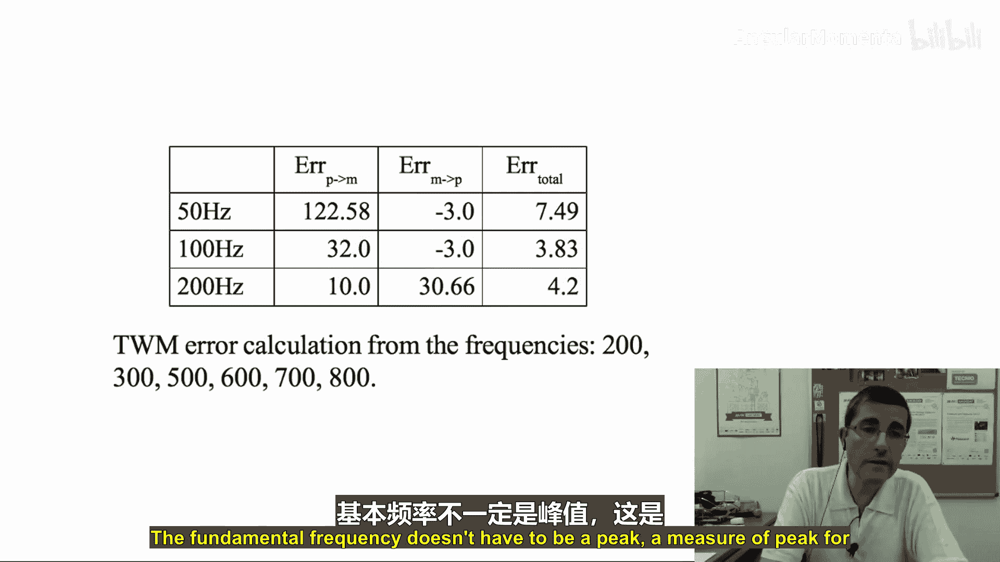

让我们举一个例子来更好地解释这个算法。例如，假设我们测量到一组峰值，具体来说，假设我们在200赫兹、300赫兹、500赫兹、600赫兹、700赫兹和800赫兹处测量到峰值。让我们检查不同的基频，检查以50赫兹为基础的谐波序列，另一个以100赫兹为基础，另一个以200赫兹为基础。

在这些指标中，我们看到对于这些不同的候选基频，从预测到实测和从实测到预测的不同误差。显然，100赫兹的结果最好。100赫兹是能最好解释这些峰值的谐波序列，尽管频率100实际上并不存在。这是该算法一个非常有趣的结果：基频不必是一个实测峰值，算法也能给出该特定点的值。

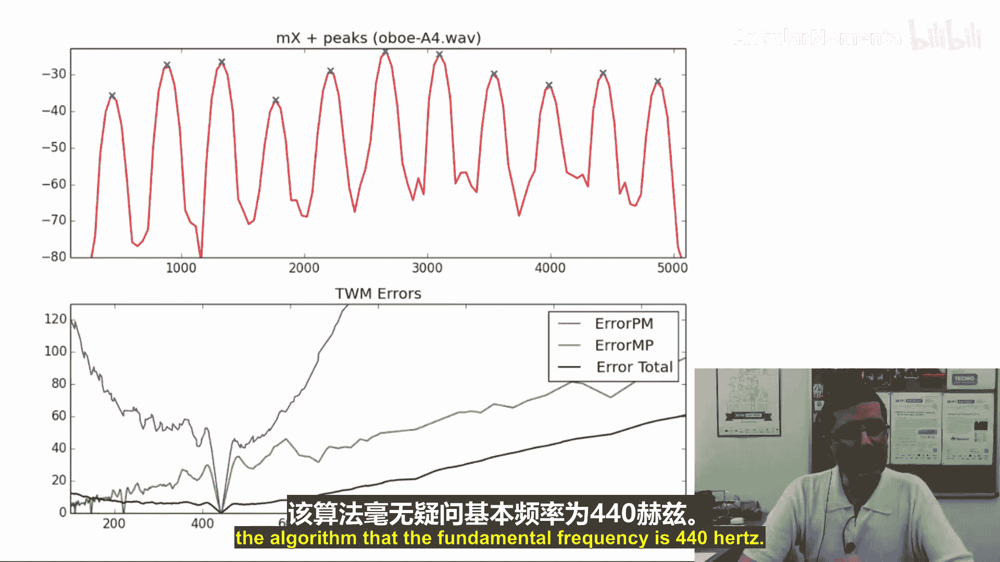

让我们举一个特定声音的误差函数例子，即我们一直在看的双簧管声音。在底部，我们有三个误差函数：蓝色是从预测到实测，绿色是从实测到预测，黑色是总误差，针对从0到1500赫兹的可能基频范围。基本上，我们扫描了所有频率范围，并以1赫兹为增量尝试了所有可能频率的算法。

我们清楚地看到有一个点存在最小值，一个局部最小值，当然它在440赫兹，这是这个双簧管声音的基频。这是一个简单的案例，因此在这里我们看到算法对于基频是440赫兹几乎没有疑问。

## 复杂信号与复音检测 🎶

但让我们看一个更复杂的声音，即之前提到的钢琴声音。这是双向失配算法识别出的该乐句最佳基频的结果。黑线是误差函数在不同音符随时间变化时的最小值。让我们先听钢琴声音，然后听这个作为正弦波的基频。嗯，存在一些毛刺，特别是在我们看到一些间隙的区域，但它在跟踪这个基频方面做得相当不错。

在复音信号中，这并不容易，要困难得多。

复音信号可以有许多声源，包括谐波和非谐波成分。复音信号中基频检测的思想是识别所有同时演奏的谐波乐器的基频，从而找到每一帧中存在的所有谐波序列。例如，在这张图中，我们展示了之前讨论过的、可以听到的信号中的谐波成分。

我们根据某种算法绘制了可能存在的谐波序列。有一个谐波求和公式，允许我们以类似于双向失配的方式测量不同谐波序列的强度，这些是最强的（或者说最响亮的）谐波序列，或者至少是候选谐波序列。因此，这些是那些谐波序列可能的基频。显然，我认为这并不完全正确，但这是对它的初步估计。

Salomon和Gomez提出了一种算法。在这种谐波求和轮廓上，能够识别哪个是主奏乐器或主唱声部，从而识别出这种情况下正在唱歌的突出谐波乐器，并且它做得相当好，就像在这个声音示例中一样。我将播放它为此声音找到的突出音高。这又相当不错了，可能有一些毛刺，特别是我看到一个毛刺，但它能够识别出整个声音中突出的音高。

## 算法参考文献

我在本课中提到的算法的最佳参考文献是提出它们的原始文章。因此，我鼓励你：对于YIN算法，查阅Shivinni和Kaawhara的文章；对于双向失配算法，阅读Mahara和Mosam的文章；对于Salomon和Gomez的旋律算法，查阅这篇IEEE Transactions文章，其中描述得相当详细。

此外，你可以找到其他信息，并且已经提出了许多用于基频和音高检测的算法。因此，我鼓励你在这方面多做一些研究，掌握这些思想背后的技术。

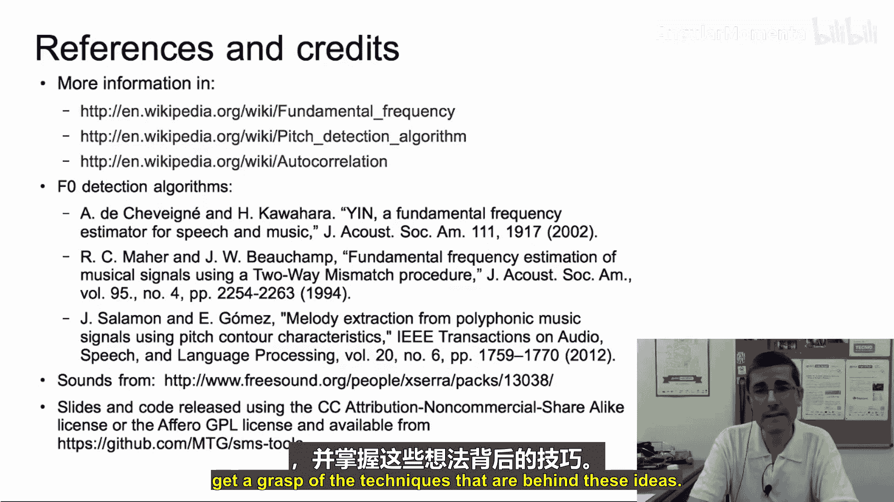

## 总结

在本讲中，我们介绍了基频检测的不同方法。这是一个尚未完全解决的研究问题，特别是对于复杂信号。为了不使事情过于复杂，我们将专注于单音信号，但从现在开始我们将解释的概念，通过将上一讲介绍的谐波模型与我们刚刚介绍的F0检测相结合，也应该适用于任何类型的信号，从而分析和合成谐波信号。但事情还没有结束。因此，我们下一讲再见，在那里我们将进一步探讨，并尝试看看当我们遇到谐波模型效果不佳的声音时会发生什么。

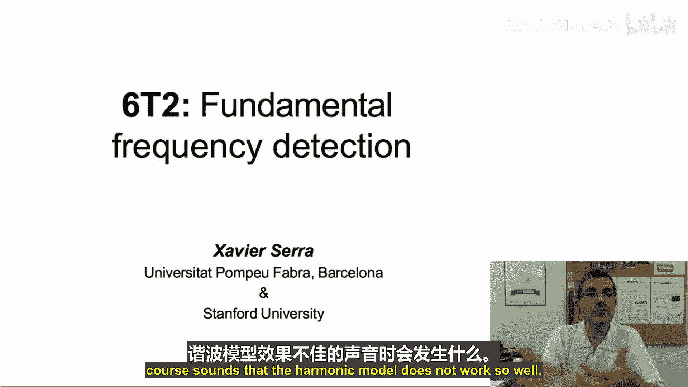

我们下节课见。