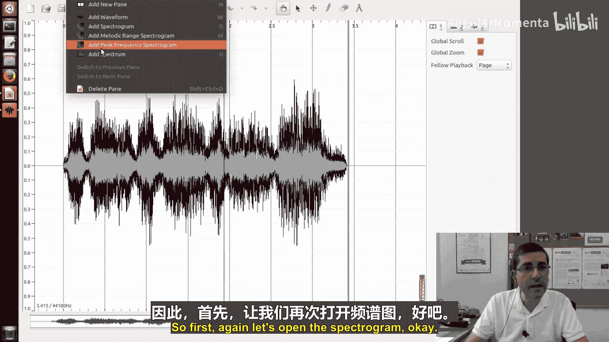
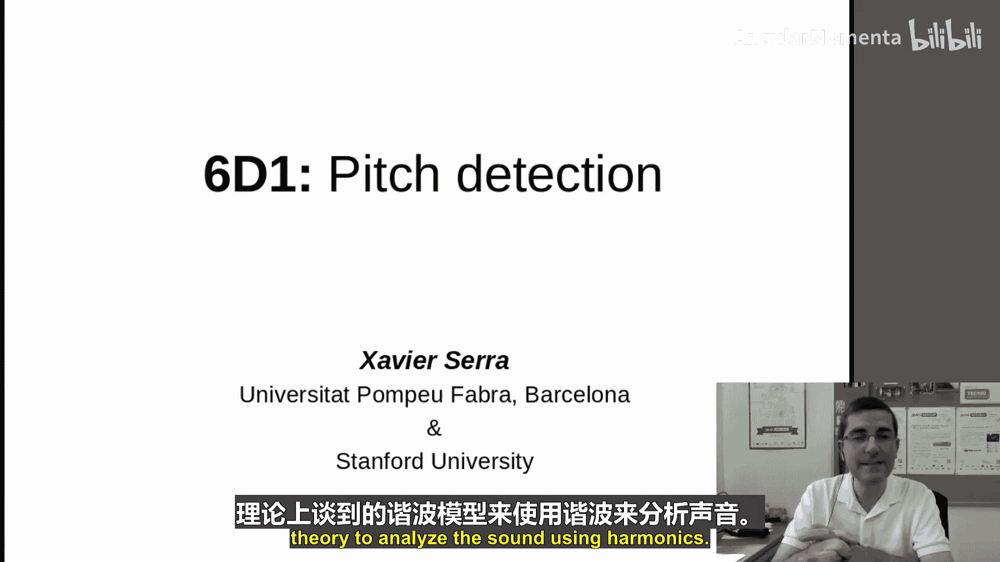

# 041：音高检测 🎵

在本节课中，我们将学习如何使用Sonic Visualizer及其插件来分析不同音频信号的音高。我们将分别对单音、语音和复音音乐进行音高检测，并比较时域和频域两种方法的差异。

## 概述

音高检测是音频信号处理中的一项基础任务，尤其对于具有明确基频的谐波声音至关重要。本节演示课将展示如何在Sonic Visualizer中利用不同插件来执行音高分析。

## 单音分析：时域方法

首先，我们分析一个清晰的女声演唱单音。这是一个音色均匀、音高明确的谐波声音。

以下是分析步骤：

1.  在Sonic Visualizer中打开来自SMS工具集的女性演唱音频文件。
2.  播放音频以确认其音高清晰可辨。
3.  打开频谱图窗格，观察声音的谐波结构。通过增大窗长（如2048点），可以更清晰地看到代表基频的第一条谐波横线。
4.  使用“audioio pitch detector”插件进行时域音高检测。该插件由Poroier开发，Chris Canan实现，我们选择其中的YIN算法。
5.  采用默认参数进行计算。计算完成后，一条紫色曲线会叠加在频谱图上，追踪音高轮廓。

结果显示，YIN算法成功追踪了整个音高轮廓，仅在起始的无声段出现了一些偏差。通过查看具体数值，我们可以看到频率从约414Hz开始，下降到371Hz，最后又回升到约443Hz。

## 语音分析：应对复杂性

接下来，我们分析一个更具挑战性的男性语音信号。语音信号通常包含无声段、辅音等非谐波成分，音高检测更为复杂。

分析过程如下：

1.  打开男性语音文件并播放。
2.  生成该语音的频谱图，并使用较大的窗长（如2048点）来更好地观察低频区域的谐波横线。
3.  使用相同的“audioio pitch detector”插件和YIN算法进行音高检测。
4.  将结果曲线的颜色改为黑色以便观察。

检测结果整体良好，但在某些片段（尤其是无声段或过渡处）出现了跳变或不准确的音高值。这提示我们，通过调整静音阈值等参数，可能获得更精确的音高轨迹。

## 复音音乐分析：频域方法

最后，我们分析一段包含人声、打击乐、小提琴和持续低音的复音音乐片段。对于这种复杂信号，时域方法不再适用，必须采用频域方法。

以下是使用频域插件“Meloia”进行分析的步骤：

1.  打开复音音乐文件并播放。
2.  生成频谱图，并调整窗长和缩放以观察可能存在的多个音高线。
3.  使用“Meloia”插件。该插件由MTG的Justin Salomon开发，其分析过程分为几步：
    *   **显著性函数计算**：首先计算显著性函数，其水平轴并非赫兹，而是用于识别所有可能的基频候选。
    *   **轮廓查找**：接着，从可能的基频中找出最突出的音高轮廓。
    *   **旋律轮廓提取**：最后，通过“Meloia提取”算法，结合音高范围、帧长、帧移等参数（例如帧移为128个样本，精度很高），以及浊音容差等设置，提取出主要的旋律轮廓。
4.  将得到的音高轮廓曲线改为黑色，并放大观察具体数值。

虽然无法在Sonic Visualizer中直接合成并聆听提取出的音高轮廓来验证，但通过视觉对比，可以看到“Meloia”算法在复音环境下对人声音高的追踪具有合理性。

## 总结

本节课中，我们一起学习了在Sonic Visualizer中使用不同插件进行音高检测的实践方法。

我们使用了两个主要插件：实现了YIN算法的“audioio pitch detector”，以及由MTG开发的、基于频域分析的“Meloia”插件。分析的声音样本来自Freesound。

音高检测在处理谐波声音的分析、理解和合成中是一个必要步骤。对于简单单音，时域方法（如YIN算法）效果很好；而对于复杂的复音音乐，则需要“Meloia”这类更先进的频域方法。希望本课为您提供了关于音高检测问题的实用视角。

在下节演示课中，我们将运用理论课所学的谐波模型，对声音进行基于谐波的分析。