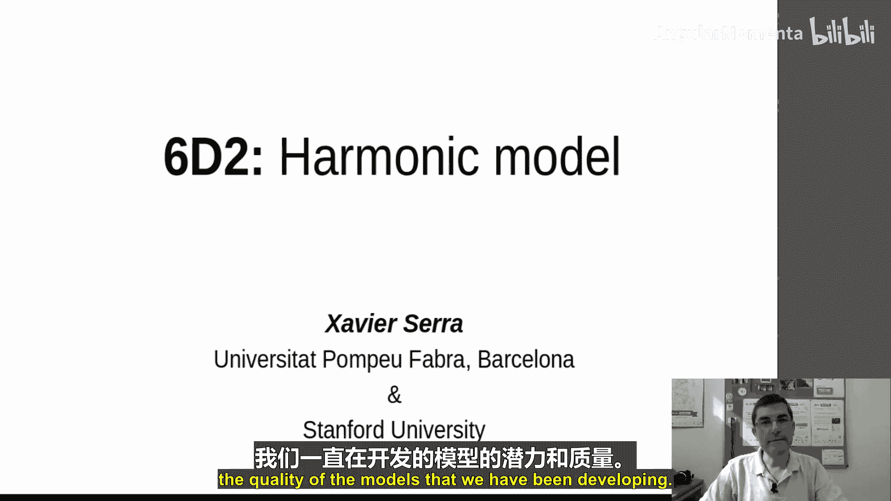
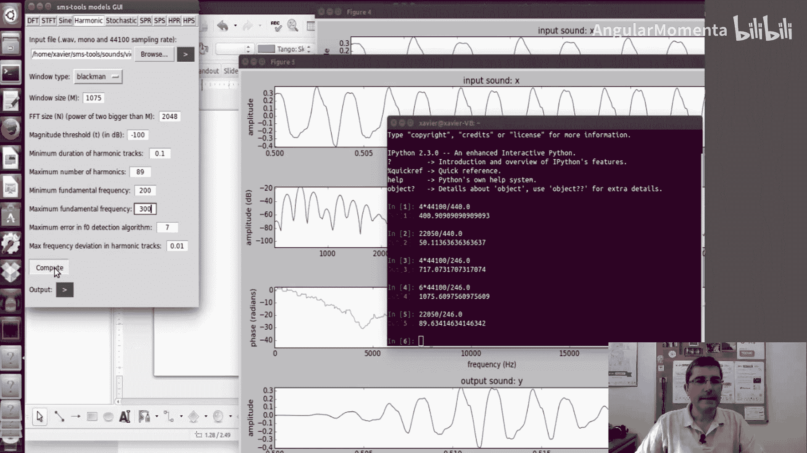
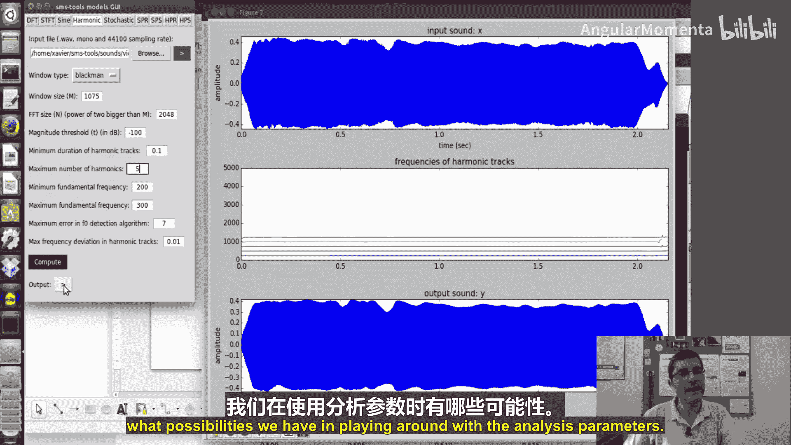
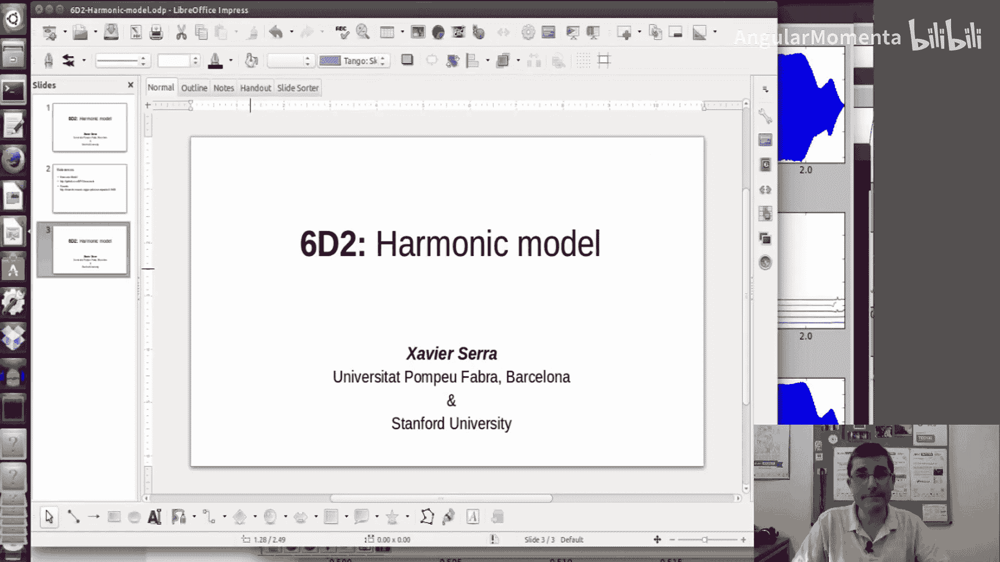

# 042：谐波模型实践

在本节课中，我们将学习如何使用SMS工具包中的谐波模型来分析简单的谐波声音。我们将通过分析电子合成音和真实的小提琴音，来理解如何设置合适的分析参数，并最终合成声音以评估模型的质量。

## 概述

我们将从基础的DFT分析开始，逐步过渡到正弦模型，最后聚焦于谐波模型。通过这个过程，我们将学习如何根据声音特性选择窗口类型、窗口大小等关键参数，以实现高质量的分析与合成。

## 从DFT分析开始

首先，我们从一个简单的电子合成音——锯齿波开始分析。这是一个基频为440Hz（标准音A4）的清晰谐波声音。

以下是分析一个简单声音的步骤：

1.  **选择窗口类型**：对于简单的电子音，窗口类型的选择并不关键。我们从汉宁窗开始。
2.  **计算窗口大小**：窗口大小 `M` 的计算公式为 `M = 4 * fs / f0`，其中 `fs` 是采样率（44100 Hz），`f0` 是基频（440 Hz）。计算结果是401个采样点，这对应了声音的4个周期。
3.  **设置FFT大小**：为了获得平滑的频谱，我们使用比窗口大小大得多的FFT点数，例如2048点。
4.  **选择分析位置**：对于这个1秒长的声音，我们选择在0.2秒的位置进行分析。

执行分析后，我们得到了该片段的频谱。在频谱中，我们可以清晰地看到对应于各次谐波的峰值，并且每个谐波处的相位都非常平坦和清晰。

## 应用正弦模型

上一节我们通过DFT观察了声音的频谱结构。现在，我们使用正弦模型来分析同一个锯齿波声音。

正弦模型需要设置额外的参数来识别声音中的“部分”（即正弦分量）。以下是关键参数设置：

*   **幅度阈值**：设置为-100 dB，以过滤掉频谱中能量过低的成分。
*   **最小持续时间**：对于稳定的电子音，此参数影响不大。
*   **最大跟踪正弦波数量**：设置为一个较大的数值，例如100。
*   **频率偏差**：对于非常稳定的声音，允许的频率变化可以设置得很小。

使用与DFT分析相同的窗口（汉宁窗，401点）进行分析，模型成功地识别出了声音中的谐波。然而，在极低频处，它也捕捉到了一些由分析窗口旁瓣引起的伪影。

为了观察旁瓣的影响，我们换用旁瓣更高的矩形窗，并增大窗口尺寸至600点。再次分析后，我们看到模型识别出了大量由旁瓣产生的正弦轨迹。尽管从合成的角度看，声音质量仍然不错，但从分析的角度看，这并不理想，因为它包含了分析过程带来的伪影。

## 核心：谐波模型分析

在了解了正弦模型后，本节我们来看看更专门的谐波模型。谐波模型强制要求识别出的正弦分量必须是某个基频的整数倍，这能有效过滤掉非谐波成分。

我们首先使用上一节中“不理想”的参数（矩形窗，600点）来运行谐波模型。除了窗口参数，还需要设置谐波模型特有的参数：

*   **谐波数量**：最大谐波数可由公式 `N = fs/2 / f0` 计算。对于440Hz的基频，`N = 22050 / 440 ≈ 50`。
*   **基频搜索范围**：为了辅助基频检测算法，我们可以指定一个范围，例如100 Hz到600 Hz。

即使输入了包含旁瓣的分析结果，谐波模型也成功地约束了搜索，只识别出了真正的谐波。接着，我们换回理想的参数（汉宁窗，401点），得到了更干净、准确的分析结果。原始声音与合成声音听起来完全相同，证明模型捕捉到了所有关键的谐波信息。

## 分析真实乐器声音

现在，我们将模型应用于一个更真实、更复杂的声音——一个小提琴的B3音符（基频约246.94 Hz）。

首先，我们再次使用DFT来确定合适的分析参数。对于小提琴这种含有更多噪声成分的自然声音，使用主瓣更宽、旁瓣更低的布莱克曼窗是更好的选择。其窗口大小的计算公式为 `M = 6 * fs / f0`，计算结果约为1075个采样点。

使用布莱克曼窗和1075点的窗口进行分析后，频谱中的谐波峰值比使用汉宁窗时更加清晰可辨。

接下来，我们使用谐波模型来分析这个小提琴音。参数设置如下：

*   **窗口**：布莱克曼窗，1075点。
*   **幅度阈值**：-100 dB。
*   **谐波数量**：`N = 22050 / 246.94 ≈ 89`。
*   **基频搜索范围**：200 Hz 到 300 Hz。

分析结果很好，模型识别出了所有谐波。合成的声音捕捉了原声的核心特质，听起来更干净、平滑，虽然在起振部分和亮度上与原声略有差异。

我们还可以通过改变参数来探索模型。例如，将分析的谐波数量限制为仅前5个，合成出的声音将是一个明显的低通滤波版本，失去了所有高频成分。

## 总结

本节课中，我们一起学习了如何利用SMS工具包中的谐波模型进行实践分析。我们从DFT基础出发，经历了正弦模型，最终深入应用了谐波模型。通过分析锯齿波和小提琴音，我们掌握了如何根据声音特性（如稳定性和频谱复杂度）选择窗口类型、计算窗口大小，并设置幅度阈值、谐波数量等关键参数。谐波模型通过强制谐波约束，能够有效地从声音中提取出谐波成分，并实现高质量的重新合成。在下一课中，我们将分析随时间变化的更复杂声音（如旋律），学习如何设置参数以捕捉谐波声音的时变特性。