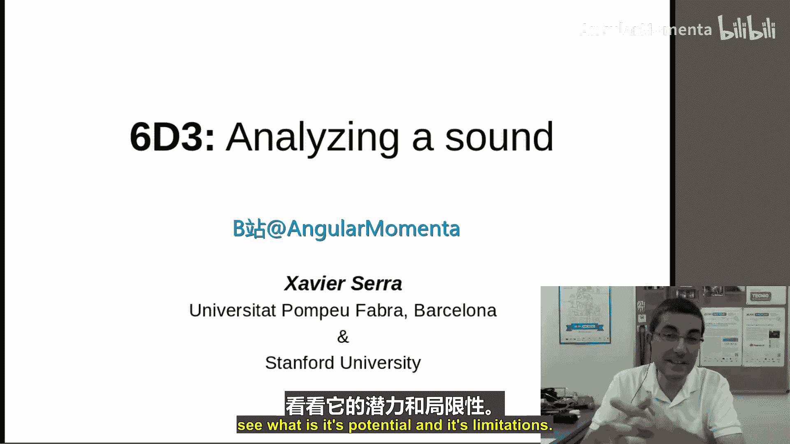
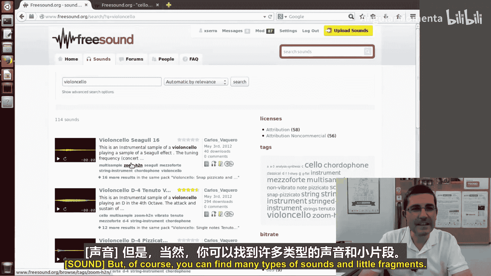
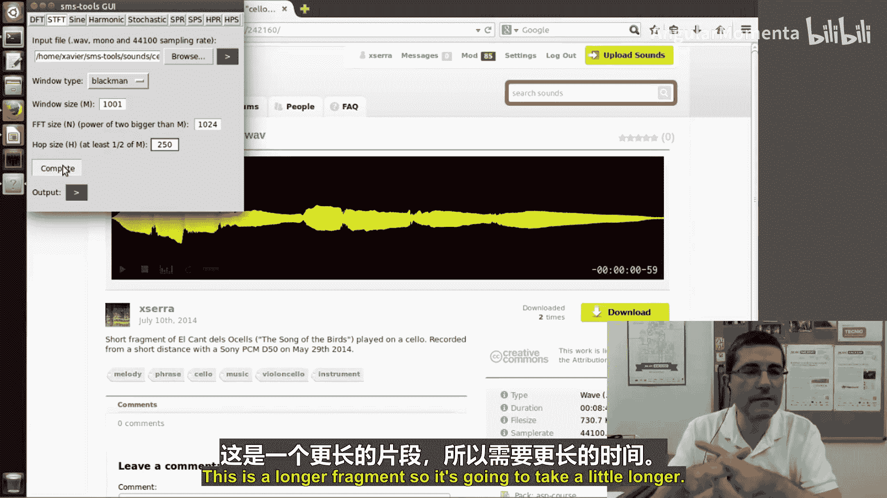
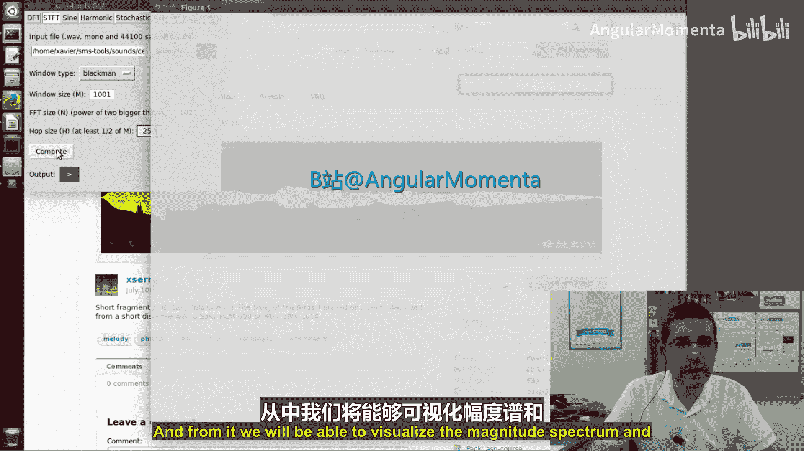
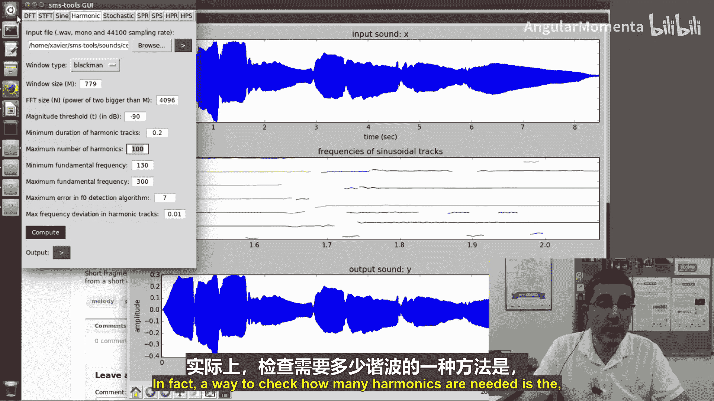
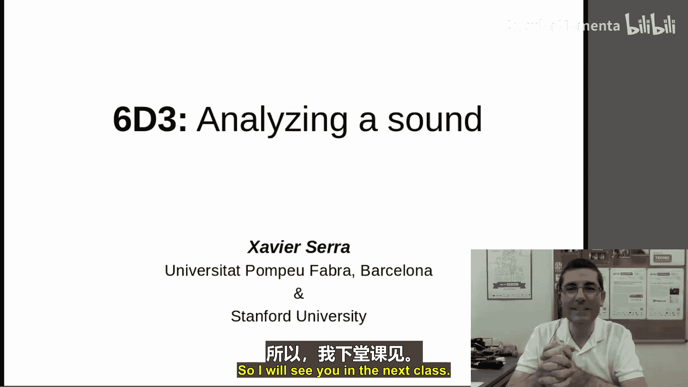

# 043：谐波模型分析演示

在本节课中，我们将学习如何使用谐波模型分析一个真实的大提琴乐句。我们将通过调整参数来探索模型的潜力与局限，并观察不同设置对分析结果的影响。

上一节我们介绍了谐波模型的基本概念，本节中我们来看看如何将其应用于实际声音分析。

## 分析大提琴乐句

我们将分析一小段来自传统加泰罗尼亚歌曲《鸟之歌》的大提琴乐句。这是一个时变声音，因此我们需要使用短时傅里叶变换来理解它。

首先，我们在SMS Tools GUI中打开声音文件 `celloPhrase.wav`。

以下是初始分析参数的设置步骤：

*   选择**布莱克曼窗**。与汉明窗相比，其主瓣更宽，但旁瓣更低，可能更适合此声音。
*   设置**窗长**为1001个采样点。
*   设置**FFT大小**为1024。
*   设置**跳跃大小**为250（至少为窗长的四分之一）。

计算后，我们可以观察幅度谱和相位谱。

## 确定关键参数

为了准确分辨乐句中的谐波，我们需要确定最低的基频，因为它决定了谐波间的最小距离。

通过观察频谱图底部，我们发现乐句起始和结尾部分的频率最低。初始频谱的频率分辨率不足，我们通过增加FFT大小至4096来获得更平滑、采样点更密的频谱。

再次观察后，测得最低音符频率约为348 Hz，最高音符频率约为456 Hz。此信息对决定窗长至关重要。

根据最低频率计算周期长度：`44100 / 340 ≈ 129` 个采样点。对于布莱克曼窗，需要约6个周期长度来分辨谐波，因此窗长设为 `6 * 129 ≈ 778` 个采样点。

## 应用正弦模型

在应用谐波模型前，我们先使用正弦模型进行分析。

参数设置如下：

*   **窗长**: 778 采样点
*   **FFT大小**: 4096
*   **幅度阈值**: -90 dB
*   **最小轨迹持续时间**: 0.1秒
*   **最大频率偏差**: 适当调高以应对音高变化

分析结果显示，谐波基本跟随旋律线，但在音符起奏和过渡部分，会出现短暂的轨迹中断或谐波间杂散成分。

## 应用谐波模型

现在，我们使用谐波模型进行更专门的分析。

参数设置如下：

*   **窗长**: 779 采样点
*   **FFT大小**: 4096
*   **幅度阈值**: -90 dB
*   **最小轨迹持续时间**: 0.2 秒
*   **最大谐波数量**: 60（根据 `22050 / 最低频率` 估算）
*   **基频搜索范围**: 300 Hz 至 500 Hz（覆盖旋律范围）
*   **误差阈值**: 初始使用默认值

分析结果良好，谐波被清晰识别。然而，在音符过渡的起奏部分，由于声音含有噪声成分，基频追踪可能出现问题。

如果我们将误差阈值从7调整为更严格的2，模型在过渡段将无法确认基频，导致谐波轨迹出现间隙，合成声音也会出现断续。

## 总结

本节课中我们一起学习了如何使用SMS Tools GUI分析一个大提琴乐句。我们先后应用了短时傅里叶变换、正弦模型和谐波模型，并通过调整参数观察了分析结果的差异。

演示表明，谐波模型能有效分析谐波结构，但在处理如起奏等含有非谐波或噪声成分的声音段落时仍存在局限。这引出了我们下一周的主题：将正弦/谐波模型扩展，纳入**残差**或**随机成分**，以构建更通用、能处理更多声音类型的模型。