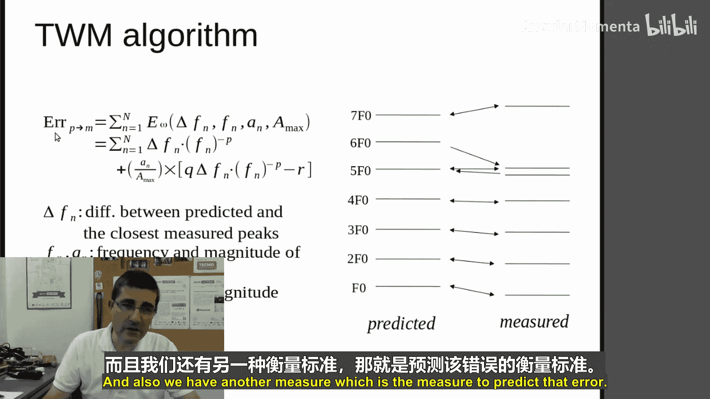
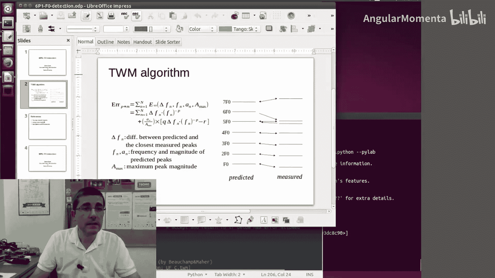
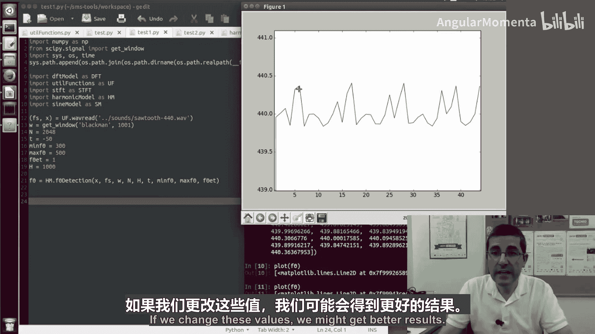
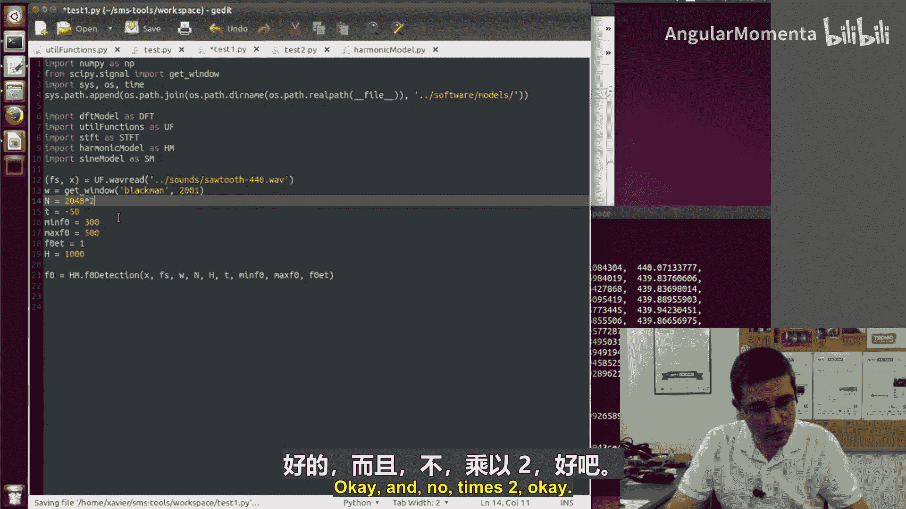
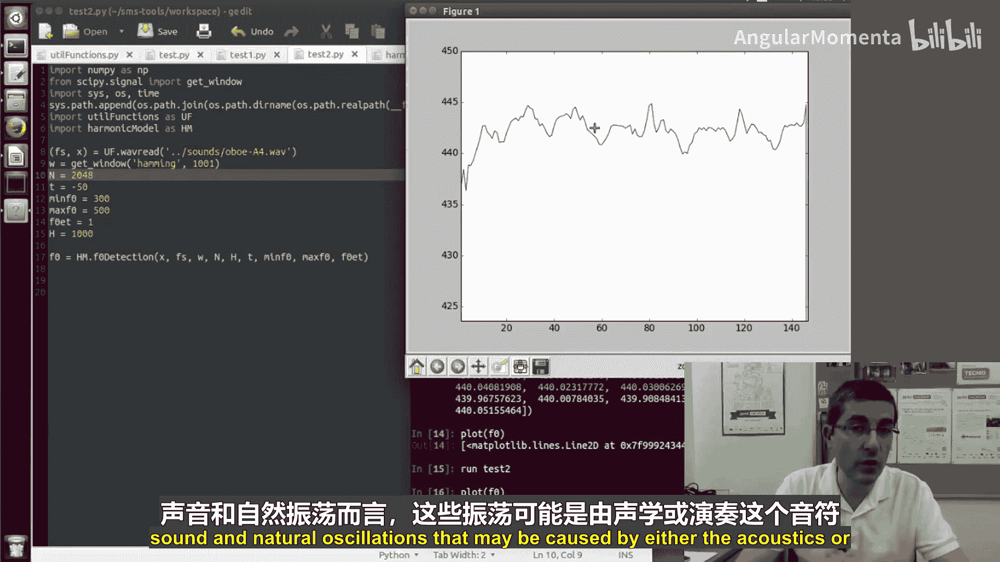
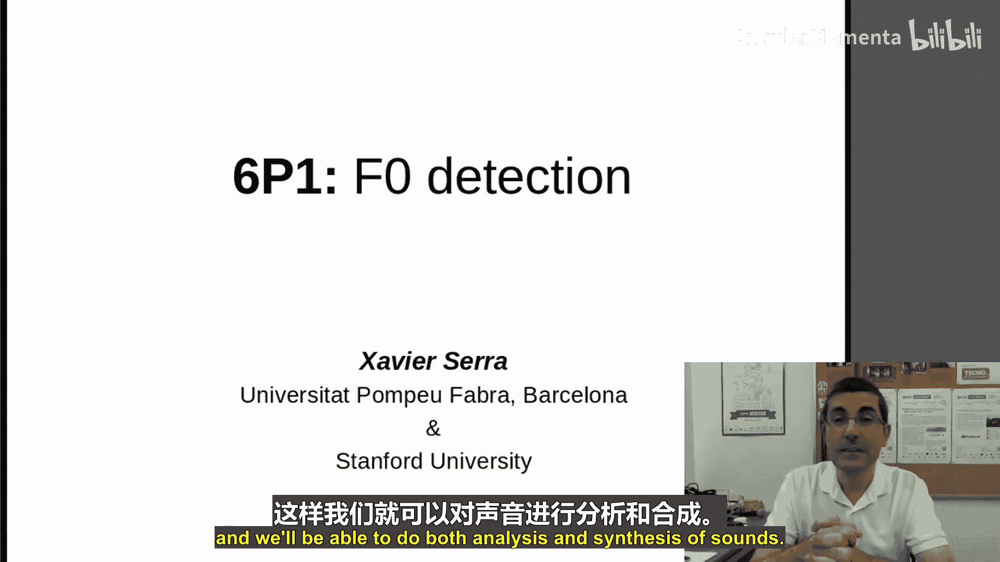

# 044：06_03_01 基频检测 🎵

在本节课中，我们将学习谐波模型实现的第一部分：基频检测。我们将重点讲解一种名为“双向失配”的算法，该算法通过比较频谱峰值与预测的谐波序列来估算声音的基频。

## 概述





上一节我们介绍了谐波模型的理论基础。本节中，我们来看看如何通过编程实现基频检测。核心任务是使用“双向失配”算法，从声音的频谱峰值中找出最匹配的谐波序列，从而确定其基频。

## 双向失配算法原理

该算法的核心思想是：给定一组从频谱中检测到的峰值（频率和幅度），以及一系列候选的基频，算法会计算每个候选基频对应的预测谐波序列与实测峰值之间的匹配误差。误差最小的候选频率即被判定为基频。

误差计算包含两个部分：
1.  **预测值到实测值的误差**：衡量预测的谐波频率与最近的实测峰值之间的距离。
2.  **实测值到预测值的误差**：衡量实测的峰值与最近的预测谐波频率之间的距离。

总误差是这两种误差的加权组合。算法会为每个候选基频计算一个总误差值。

## 代码实现详解

在SMS工具包的实用函数文件中，可以找到双向失配算法的实现。其核心是一个名为 `twomismatch` 的函数。

以下是该函数工作流程的简化描述：
```python
def twomismatch(peakFreqs, peakMags, candidateFreqs):
    errorArray = [] # 存储每个候选基频的误差
    for f0 in candidateFreqs:
        # 1. 生成基于f0的谐波序列：harmonics = [f0, 2*f0, 3*f0, ...]
        # 2. 计算预测值到实测值的误差 (errorPredToMeas)
        # 3. 计算实测值到预测值的误差 (errorMeasToPred)
        # 4. 组合两种误差得到总误差 totalError
        errorArray.append(totalError)
    # 找到最小误差对应的索引
    minErrorIndex = errorArray.index(min(errorArray))
    # 最佳基频即为该索引对应的候选频率
    bestF0 = candidateFreqs[minErrorIndex]
    return bestF0, errorArray
```
实际应用中，为了效率，我们通常使用C语言版本。Python版本有助于理解算法逻辑。

## 算法调用与候选频率生成

`twomismatch` 函数被另一个函数 `f0Twm` 封装。`f0Twm` 负责生成候选基频列表并调用核心算法。

以下是 `f0Twm` 的关键步骤：
1.  接收频谱峰值、允许的最大误差、基频搜索范围（如50-2000 Hz）等参数。
2.  从输入的峰值中，筛选出落在指定基频搜索范围内的频率作为候选基频。
3.  调用 `twomismatch` 函数计算所有候选频率的误差。
4.  选择误差最小的候选频率作为最终检测到的基频。算法还包含简单的平滑跟踪机制，利用前一帧的基频来提高时间上的稳定性。

> 注意：当前的候选生成策略较为简单（直接使用峰值），为了更精确的结果，可以有更复杂的候选生成方法，但当前实现平衡了效率与效果。

## 单帧频谱分析示例

为了理解算法行为，我们可以编写一个脚本对单帧频谱进行分析。

脚本步骤：
1.  加载一个声音（例如一个A4音高，440 Hz的乐器声）。
2.  计算一帧信号的DFT（离散傅里叶变换）。
3.  检测并插值频谱峰值。
4.  在指定范围（如50-2000 Hz）内，将峰值频率作为候选基频。
5.  调用修改后的 `twomismatch` 函数，使其返回所有候选频率的误差数组。
6.  绘制频谱和峰值，并打印候选频率及其对应误差。

运行示例后，我们可能看到类似以下输出：
```
候选基频 (Hz): [166.1, 440.0, 637.5, 833.2, 1030.8]
对应误差值: [4.8, -0.13, 2.1, 5.6, 3.9]
```
误差值越小（可能为负），表示匹配度越好。此例中，440 Hz的误差最小，被正确识别为基频。

## 完整音频文件分析

接下来，我们将算法应用于整个音频文件。这需要逐帧处理：

1.  将音频分帧，使用滑动窗口。
2.  对每一帧重复单帧分析过程：计算DFT、检测峰值、生成候选、调用 `f0Twm`。
3.  收集每一帧计算出的基频。

在SMS工具包的谐波模型文件中，`f0Detection` 函数实现了上述完整流程。它处理整个声音，并加入了时间平滑约束，以确保基频轨迹的稳定性。



通过调整分析参数（如窗口大小、FFT大小），可以观察对检测结果的影响：
*   **增大窗口和FFT尺寸**：通常能提高频率分辨率，使峰值定位更准，从而得到更稳定、误差更小的基频轨迹。
*   **参数示例**：将窗口从1001点增加到2001点，FFT尺寸相应增加，可能会使基频估计值在439.9 Hz到440.04 Hz之间波动，误差范围比之前更小。



## 双簧管声音分析实例

最后，我们将此分析应用于一段真实的双簧管声音。运行分析后，我们可以绘制出基频随时间变化的轨迹。

观察结果可能显示：
*   基频围绕442 Hz轻微波动（演奏者可能略高于标准A4音高440 Hz）。
*   波动中既包含算法（峰值检测、插值）引入的微小误差，也真实反映了演奏中的自然颤音或乐器声学特性。

这种分析有助于我们同时理解算法的性能和声音本身的特征。



## 总结

本节课中我们一起学习了基频检测的关键算法——“双向失配”算法的原理与实现。我们了解了它如何通过比较谐波序列与频谱峰值来寻找最佳基频，并探讨了从单帧分析到完整音频处理的应用过程。通过调整分析参数，我们可以平衡计算效率与检测精度。基频检测是谐波模型分析的第一步，在下一讲中，我们将在此基础上引入完整的谐波模型，实现对声音的分析与合成。



感谢学习，我们下节课再见。