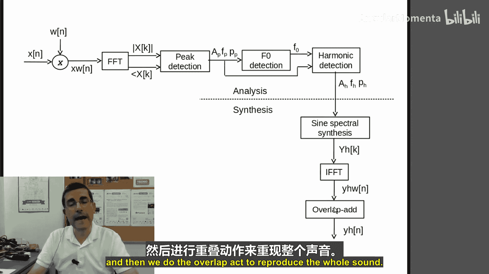
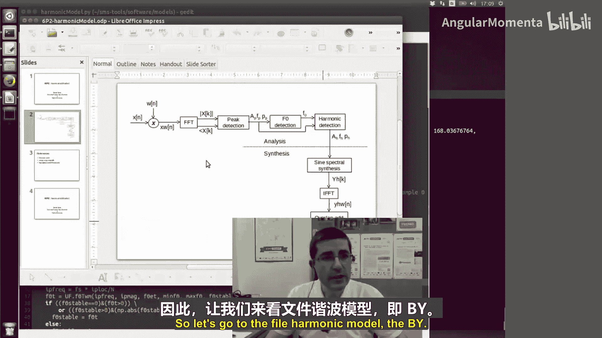
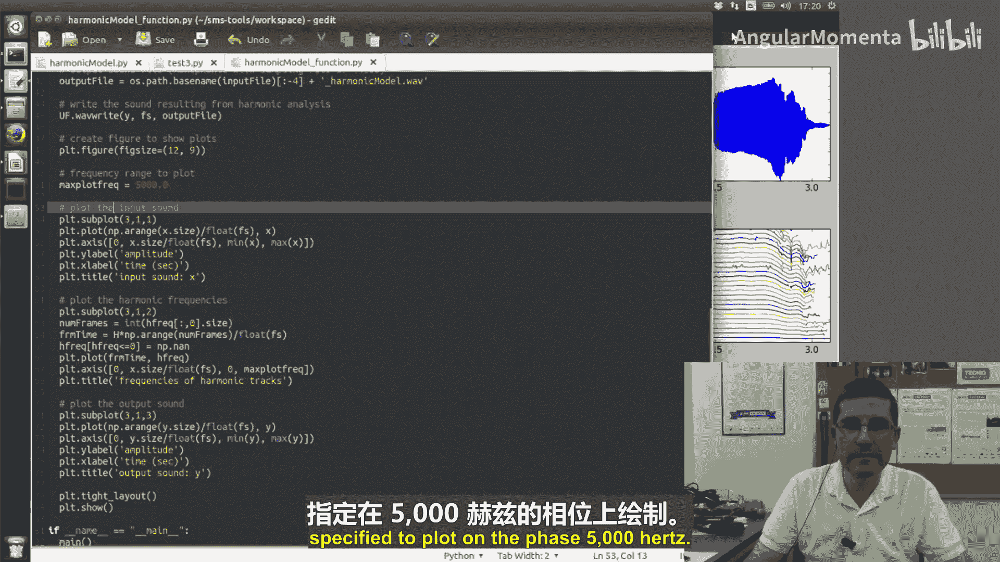
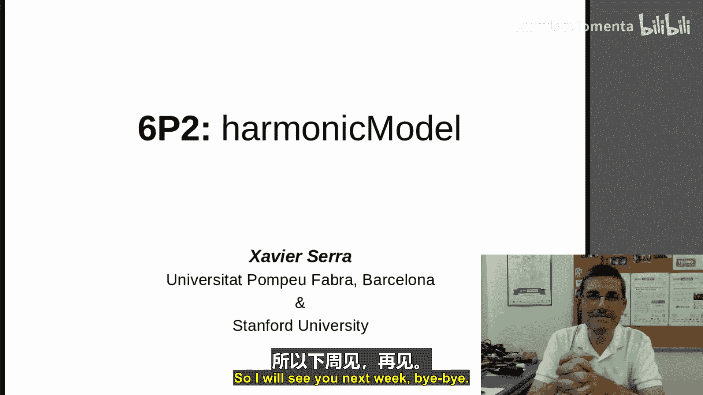

# 045：谐波模型 🎵

在本节课中，我们将学习如何将谐波模型的分析与合成部分整合起来。我们将从之前讨论过的基频检测算法出发，构建一个完整的谐波建模系统。

在上一节编程课中，我们讨论了基频检测算法，即如何识别谐波声音的基频。现在，我们已经准备好将整个谐波模型的分析与合成部分整合在一起。下图展示了我们将要解释的系统框图。它从我们在正弦波模型中已经见过的标准模块开始：对输入声音进行分窗处理，然后执行DFT变换并寻找频谱峰值。接下来的两个模块是谐波模型特有的：第一个是基频检测模块，它从峰值中识别出最佳的基频；第二个模块则基于该基频寻找谐波，这也是我们今天要讨论的内容。之后，信号进入合成阶段，其过程与正弦波模型完全相同：我们在频域生成正弦波，进行逆FFT变换，然后通过重叠相加法重建整个声音。

接下来，让我们进入代码部分。

文件 `harmonymod.py` 包含了谐波模型的大部分函数。基频检测的实际实现在 `UT functions` 文件中，但这里我们有一个包装函数，用于调用我们在上一讲中提到的基频检测算法。此外，我们还有即将讨论的谐波检测函数，以及一个完整的谐波模型函数 `harmonicModel`，它同时执行分析和合成。但该函数设计用于实时处理，因此不允许对轨迹进行清理。今天我们将分开讨论分析和合成，因为这样可以清理轨迹，并利用过去几帧的信息，从而获得更好的分析和合成结果。

让我们详细讨论 `harmonicModelAnal` 这个函数。它的输入参数包括分析所需的所有参数：样本输入数组、采样率、窗函数、窗大小、跳数大小、峰值检测阈值 `t`、允许的最大谐波数量 `nH`、基频检测的频率范围（最小基频 `minf0` 和最大基频 `maxf0`），以及作为基频检测算法一部分的误差阈值 `minErr`。对于谐波轨迹的连续性跟踪，我们还有两个参数：`harmDevSlope` 和 `minDur`。`harmDevSlope` 是允许的谐波偏离斜率，用于处理较高次谐波比较低次谐波允许更大偏离的情况；`minDur` 参数则用于控制谐波轨迹的最小持续时间，不接受短于此持续时间的轨迹。

实际的代码结构与正弦波模型非常相似。我们有一个主循环，遍历整个声音信号，持续分析频谱、寻找峰值并进行插值。从这里开始是谐波模型特有的代码：我们调用基频检测算法（即上一讲中提到的来自工具函数的算法）。接下来的几行代码确保新的基频与前一帧的基频不会相差太大，以保持一定的连续性。然后，我们调用 `harmonicDetection` 函数，该函数根据基频识别谐波。它的代码在上面。

让我们来看这个 `harmonicDetection` 函数。该函数在给定基频 `f0` 和频谱峰值的情况下，识别哪些峰值接近该基频的整数倍。我们还接受来自前一帧的一些信息作为输入，以便识别是否存在时间连续性，以及 `deviation` 参数，它表示我们允许的与完美谐波性以及与前帧完美连续性的偏离。

代码并不复杂。核心基本上是这三行，我们定义了与完美谐波性的偏离：我们将特定峰值与特定的完美谐波频率进行比较，同时也将峰值与来自前一帧的先前谐波进行比较。然后，我们基于这个谐波偏离斜率 `harmDevSlope` 定义一个阈值，只有在此阈值内的峰值才会被接受。因此，如果当前峰值在阈值内（考虑到频率和时间演变的跟踪），我们就接受该峰值作为一个谐波，并将其添加到我们创建的谐波数组中。这就是谐波检测的基本功能。

回到 `harmonicModelAnal` 函数。在谐波检测之后，有一些代码用于创建值数组，这些值不断累加到输出的整个矩阵中。最后，当整个过程完成（即遍历了整个声音）后，我们清理轨迹，删除持续时间小于给定值的轨迹，这与我们在正弦波分析中所做的相同。

我编写了一个脚本，使用这个谐波模型分析函数来分析一个声音。我们选取了这个小提琴声音，并指定了所有参数。参数开始变得相当多：窗函数、窗大小、FFT大小、阈值（这里是 `-90` dB）、最小持续时间、最大谐波数、最小和最大基频、可接受的误差阈值，以及刚刚讨论过的偏离斜率。还有两个参数通常固定，因为它们更与合成相关：合成缓冲区的FFT大小 `Ns` 和跳数大小 `H`。由于合成FFT缓冲区的要求，跳数大小通常为其四分之一，所以我们通常设 `H` 为 `128`，在图形界面中通常不允许更改这两个参数。

然后，我们读取声音，获取窗函数，并调用 `harmonicModelAnal` 函数。这里我只是绘制了这些轨迹的频率。让我们运行它。首先保存，然后运行。这是我们获得的轨迹，它们看起来不错。如果我们放大到特定区域，可能会看得更清楚。当然，放大后，我们开始看到音高转换处的问题，尤其是当谐波频率越来越高时。这是因为坐标轴是线性刻度，而这些偏离本质上是按对数变化的。实际上，随着频率升高，变化会大得多，因为它们是按对数变化的。这就是为什么我们需要之前指定的偏离斜率 `harmDevSlope`。例如，如果我们减小这个斜率，从 `0.01` 改为 `0.001`，然后再次运行，我们会发现现在轨迹少了很多，尤其是在高频部分。它限制了在高频部分允许的偏离，因此不允许这种较大的偏离。这样，我们就对跟踪过程的实现有了相当的控制。

在SMS工具包中，有一个 `harmonicModel` 函数同时执行分析和合成，实际上，它也是从界面调用的文件。在这个文件中，我们有一个主函数，它包含我们讨论过的所有参数。除了我们已经执行的分析外，它还进行合成，然后将文件保存为合成文件，并进行绘图。让我们运行这个 `harmonicModel` 函数。这会花费稍长的时间，因为它必须进行分析和合成，然后它只绘制指定的前5000赫兹。在这里，我们看到所有这些随时间演变的轨迹，合成的声音至少从波形上看非常相似。让我们听听输出声音。它创建了一个名为 `violin-harmonicModel.wav` 的文件。我可以播放它。

这是原始文件的合成版本，效果相当好。当然，从下周开始我们会发现，实际上合成中遗漏了一些东西，主要是我们缺失的残差成分。但无论如何，关于谐波模型的内容就到这里。我们回到幻灯片。

我们基本上从实现的角度看了谐波模型，通过查看代码。所有这些代码都是用Python编写的。实际上，我们使用的基频检测算法有一个C语言版本的实现，但我们也有Python版本，所有这些都包含在SMS工具包中。我强烈建议你们去研究并运行它，如果愿意的话可以使用它。关于谐波模型的编程课就到此为止，希望这能让你们深入了解实现这类模型需要什么。下周内容会变得更复杂一些，因为我们将尝试看看这个模型遗漏了什么，并尝试对这个缺失部分进行建模，这将是残差或随机成分的概念。下周见。谢谢。

本节课中，我们一起学习了如何将谐波模型的各个部分整合成一个完整的分析-合成系统。我们详细探讨了谐波检测函数的实现，它如何基于检测到的基频来识别谐波，并考虑了时间连续性和频率偏离。我们还通过实际代码示例，看到了参数（如谐波偏离斜率）如何影响谐波跟踪的结果。最后，我们运行了完整的谐波模型，生成了合成声音，并预览了下一讲将涉及的残差成分概念。