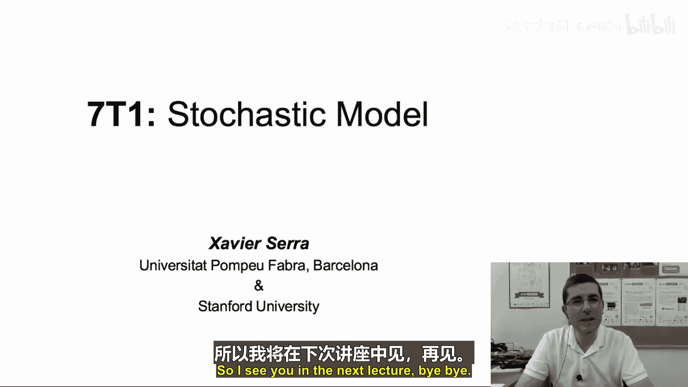

# 046：随机模型 🎵

在本节课中，我们将学习一种新的声音分析模型——随机模型。我们将了解什么是随机信号，如何对它们进行建模，以及如何利用这些模型来分析和合成声音。

---

## 什么是随机信号？🎲

上一节我们介绍了正弦模型，本节中我们来看看随机模型。随机信号无法用确定性的方式描述，只能通过概率统计的方式来描述。统计信号处理领域专门研究这类信号。

以下是随机信号的一些关键概念：
*   **概率分布**：描述信号取值的可能性。
*   **均值与方差**：描述信号的平均水平和波动程度。
*   **自相关函数**：用于测量信号的周期性或重复模式的程度。公式为：`R(τ) = Σ x(t) * x(t+τ)`。自相关函数值越低，信号越接近随机信号。
*   **功率谱密度**：描述信号功率在频域上的分布。可以看作是离散傅里叶变换（DFT）在点数趋于无穷时的极限：`P(ω) = lim(N→∞) (1/N) * |X(ω)|²`。

---

## 如何对随机信号建模？🔧

随机模型的核心思想是，一个随机信号可以表示为白噪声与一个滤波器（近似于原信号）的卷积。

从时域看，模型公式为：
`y[n] = x[n] * h[n]`
其中，`x[n]`是白噪声，`h[n]`是滤波器的冲激响应，`*`表示卷积运算。

从频域看，卷积变为乘积：
`Y(ω) = X(ω) * H(ω)`
其中，`X(ω)`是白噪声的频谱，`H(ω)`是滤波器频率响应。

由于白噪声的幅度谱是平坦的（常数），其相位谱是随机的，因此我们可以将模型简化为：
*   用原信号幅度谱的平滑近似作为`|H(ω)|`。
*   用随机数序列作为相位谱`∠Y(ω)`。

这样，我们就得到了一个随机模型：**平滑的幅度谱 + 随机相位**。

---

## 如何近似信号的幅度谱？📊

随机模型分析的关键在于如何获得输入信号时变幅度谱的良好近似。以下是两种常见方法：

### 1. 线性预测编码（LPC）

LPC模型将信号近似为过去样本的线性组合，其公式为：
`x̂[n] = Σ (a_k * x[n-k])`，其中 k 从 1 到 P。
目标是找到一组系数 `a_k`，使误差 `e[n] = x[n] - x̂[n]` 的平方和最小。LPC能很好地逼近具有共振峰特性的信号（如人声）。

### 2. 低通滤波法（本课程采用的方法）

这是一种更简单直接的方法，我们通过对信号的DFT频谱进行低通滤波来获得平滑的幅度谱近似。

步骤如下：
1.  计算信号帧的DFT，得到频谱 `A[k]`。
2.  对 `A[k]` 进行低通滤波，得到平滑后的频谱 `Ã[k]`（点数更少）。
3.  为了合成，可能需要将 `Ã[k]` 零填充到原始长度。

---

## 如何合成随机信号？🎹

当我们通过LPC或低通滤波法得到了幅度谱的近似（即滤波器系数）后，就可以进行合成。

### 1. 使用LPC系数合成

合成过程是使用得到的LPC滤波器系数来过滤白噪声。这可以通过直接型或格型等滤波器结构来实现，核心是IIR滤波方程：`y[n] = u[n] - Σ (a_k * y[n-k])`，其中 `u[n]` 是白噪声。

### 2. 使用低通滤波近似合成（本课程采用的方法）

这种方法更直接：
1.  获得平滑的幅度谱近似 `Ã[k]`。
2.  生成一个随机相位谱 `φ[k]`。
3.  计算复频谱：`Y[k] = Ã[k] * e^(j*φ[k])`。
4.  对 `Y[k]` 进行逆DFT，即可得到合成的声音帧。

---

## 完整的随机模型分析-合成系统 🔄

现在，让我们把分析和合成部分组合成一个完整的系统。

以下是系统的工作流程：
1.  **分析**：输入信号 `x[n]` -> 分帧 -> 计算每帧的DFT幅度谱 -> 对幅度谱进行低通滤波，得到平滑的随机模型参数（压缩后的幅度系数）。
2.  **合成**：对每帧的平滑幅度谱进行零填充插值 -> 为其生成随机相位 -> 进行逆DFT得到合成帧 -> 使用重叠相加法将所有帧组合成完整的输出信号。

这个系统能够捕捉并重建出原始随机信号（如海浪声、小提琴弓毛噪声）的整体听感特征，虽然波形细节不同，但感知上相似。

---

## 总结 📝

本节课中，我们一起学习了随机模型。我们了解到，对于许多不适合用正弦波描述的声音（如噪声类声音），随机模型提供了一种有效的分析和合成方法。其核心是用**平滑的幅度谱近似**加上**随机相位**来表征信号。我们介绍了LPC和低通滤波两种幅度谱近似方法，并构建了一个完整的分析-合成系统。

在下一讲中，我们将探讨如何将随机模型与我们之前学过的正弦模型结合起来，从而能够更全面、更强大地处理各种类型的声音。