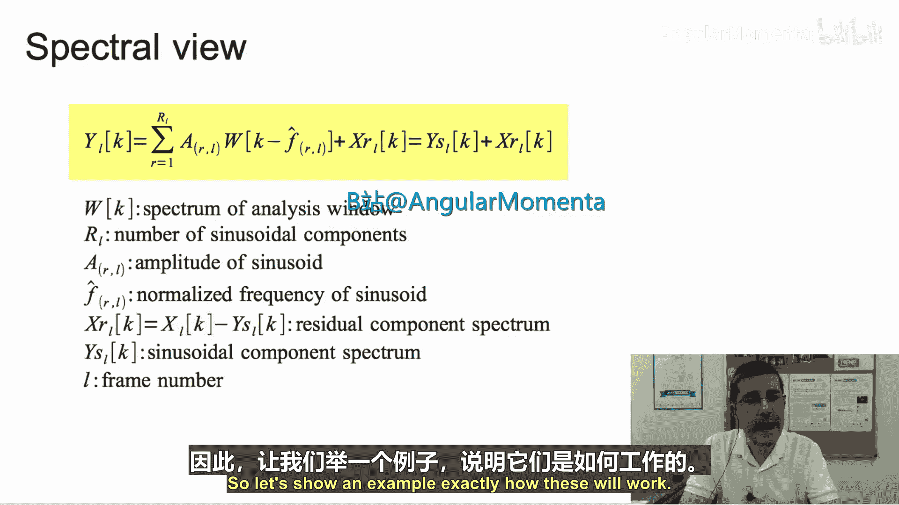
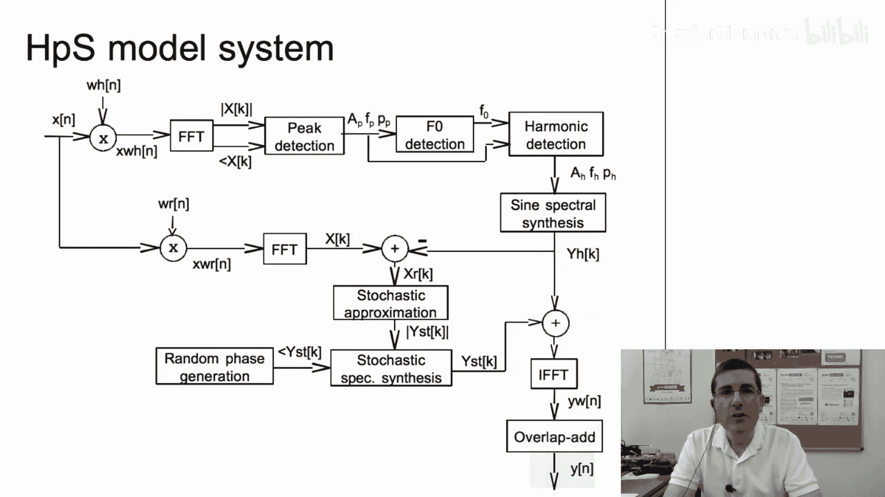
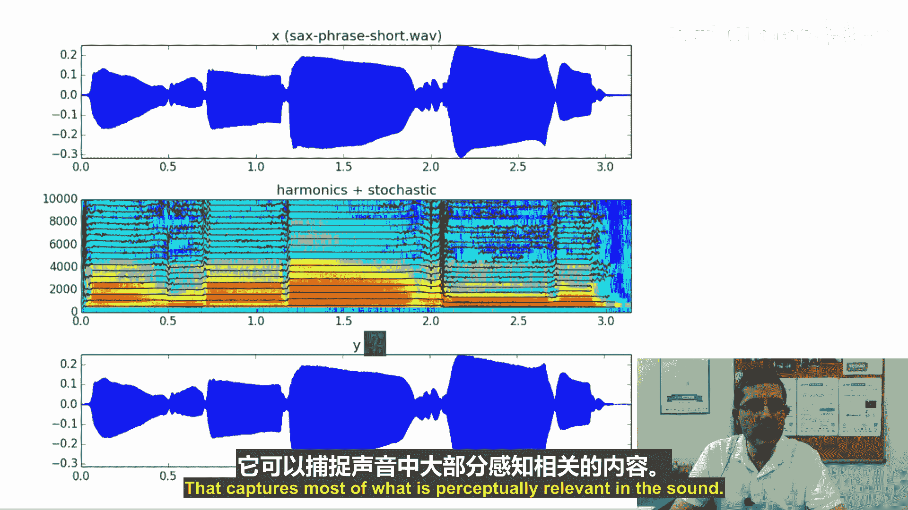
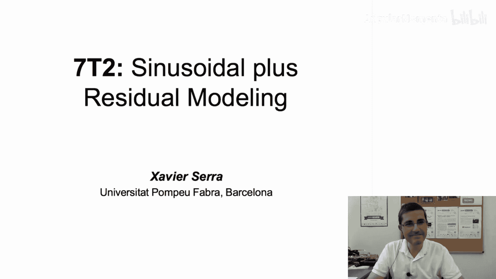

# 047：正弦加残差建模 🎵

在本节课中，我们将学习如何将之前讨论的正弦/谐波模型与随机信号模型相结合，形成“正弦加残差”或“谐波加随机”的复合建模方法。我们将分解声音为两个部分：确定性的正弦/谐波部分和残差部分，并学习如何分别建模与合成。

上一节我们介绍了随机信号及其建模方法。本节中，我们将以此为基础，扩展之前讨论的正弦与谐波模型，引入“正弦/谐波加残差”或“正弦/谐波加随机”的建模概念。

## 正弦加残差模型

正弦加残差模型是正弦模型的扩展。我们假设正弦模型无法完全表示整个声音，并且存在一个在感知上相关的残差分量，这是一个需要保留的声音成分。

以下是该模型的数学表示：

**x[n] = y_s[n] + x_r[n]**

其中：
*   **x[n]** 是原始信号。
*   **y_s[n]** 是正弦分量，由一组时变的正弦波求和得到：**y_s[n] = Σ A_l[n] cos(Φ_l[n])**。
*   **x_r[n]** 是残差信号。

残差信号 **x_r[n]** 通过从原始信号中减去合成出的正弦分量来计算：**x_r[n] = x[n] - y_s[n]**。

从频谱角度理解这个模型更为直观。整个信号的频谱可以看作是多个正弦波（其频谱是经频率平移和幅度缩放的窗函数频谱）的叠加，再加上残差分量的频谱。而残差频谱正是通过从原始信号频谱中减去正弦分量的频谱得到的。

## 谐波加残差分析示例

以下是分析单帧声音的步骤示例。

1.  **原始帧与谐波分析**（左图）：
    *   左上图显示了一段长笛声音的加窗帧。
    *   左下图展示了对该帧进行频谱分析（峰值检测）的结果，蓝色“x”标记识别出的谐波成分及其相位。

2.  **谐波合成与残差计算**（右图）：
    *   右中图（浅红/浅青色）显示了根据识别出的谐波参数合成的频谱。
    *   通过从原始频谱（使用相同窗参数重新计算）中减去这个合成谐波频谱，我们得到残差频谱（深红/深青色）。
    *   对残差频谱进行逆傅里叶变换，得到时域的残差信号（右上图深蓝色波形）。这个残差并非简单的误差，它包含了声音中重要的特征成分（如呼吸声）。

## 完整的分析-合成系统

将上述单帧分析扩展到整个信号，我们得到以下系统框图：

1.  **输入信号 x[n]**。
2.  **加窗与FFT**：对信号加窗并进行FFT，得到幅度和相位频谱 **X[k]**。
3.  **峰值检测与基频估计**：从频谱中检测峰值，并估计基频 **f0**。
4.  **谐波识别与合成**：根据基频识别谐波，并使用布莱克曼-哈里斯窗合成谐波频谱 **Y_h[k]**。
5.  **残差频谱计算**：使用与合成相同的窗参数对原始信号重新计算频谱，然后进行复数减法：**X_r[k] = X[k] - Y_h[k]**，得到残差频谱。
6.  **合成与叠加**：将谐波频谱与残差频谱相加，进行逆FFT和重叠相加，最终合成输出信号。

## 从残差到随机模型

直接得到的残差分量是一个完整的信号，难以进一步处理。我们需要用模型来近似它，这里我们引入随机模型。

于是，我们得到**正弦加随机模型**：

**x[n] = y_s[n] + e[n]**

其中 **e[n]** 不再是简单的减法残差，而是对残差进行随机建模后得到的随机分量。该随机分量可以理解为用白噪声通过一个滤波器的结果，该滤波器的频率响应近似于残差信号的频谱包络。

在频域中，随机分量的频谱可以表示为：

**E[k] = M_s[k] * e^(j * φ_rand[k])**

其中：
*   **M_s[k]** 是对残差频谱幅度 **|X_r[k]|** 的平滑近似（频谱包络）。
*   **φ_rand[k]** 是白噪声的随机相位谱。

以下是随机近似过程的频谱视图：

1.  原始信号频谱（含谐波）。
2.  合成谐波频谱 **Y_h[k]**（浅红色）。
3.  残差频谱 **X_r[k]**（通过减法得到）。
4.  对残差频谱幅度进行平滑，得到随机模型的幅度谱 **M_s[k]**（曲线近似）。

## 完整的正弦加随机分析-合成系统

该系统在谐波加残差系统的基础上，增加了一个随机近似模块：

1.  前几步与之前相同：计算原始频谱、检测谐波、合成谐波频谱、计算残差频谱。
2.  **随机近似**：对残差频谱幅度 **|X_r[k]|** 进行平滑，得到随机模型的幅度包络 **M_s[k]**。
3.  **随机分量合成**：生成具有随机相位 **φ_rand[k]** 的频谱，并将其幅度设置为 **M_s[k]**，得到随机分量的频谱 **E[k]**。
4.  **合并与合成**：将谐波频谱 **Y_h[k]** 与随机分量频谱 **E[k]** 相加，然后进行逆FFT和重叠相加，生成最终合成声音。

## 应用示例：萨克斯风声音分析

让我们听一个萨克斯风声音的分析与合成示例。

原始萨克斯风声音：

合成出的谐波分量：

合成出的随机分量（已放大音量）：

将谐波与随机分量重新合成后的声音：

合成声音捕捉了原始声音中大部分感知上重要的特征。

## 总结与延伸阅读

本节课中，我们一起学习了本课程最先进的模型之一——正弦/谐波加残差（随机）模型。我们结合了之前所有的模型，发展出可用于多种声音和应用的分析与合成技术。

关于本讲主题的入门教程材料不多，但有大量研究文章提出了不同的分析策略。你可以在MTG网站的相关链接中找到许多已发表的关于这些主题的论文以供深入阅读。

下一讲，我们将聚焦于如何利用这些模型来对声音进行变换，创造有趣的新声音。