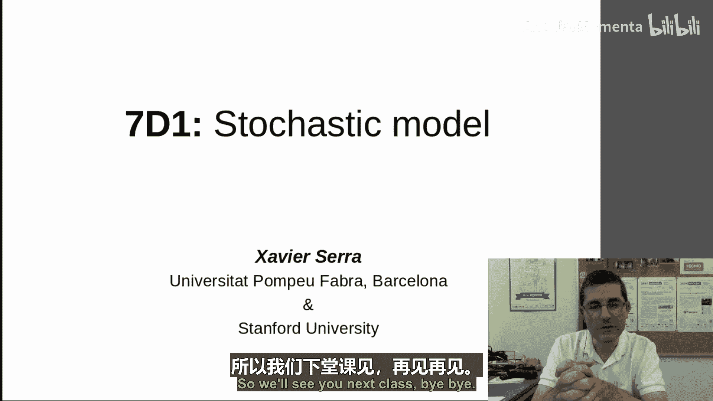

# 048：随机模型 🎵

在本节课中，我们将学习随机信号的概念，以及如何使用频谱近似法来建模这类信号。我们将通过实际操作，利用SMS工具包中的实现来探索随机模型的工作原理。

---

上一节我们介绍了随机信号的基本概念，本节中我们来看看如何使用SMS工具包中的随机模型进行实际的声音分析。

首先，我们打开SMS工具的界面，并使用短时傅里叶变换来分析一个声音。一个非常适合随机分析的声音是海浪声，因为它非常嘈杂，很适合这种近似方法。

以下是分析步骤：
1.  打开一个海浪声音文件。
2.  参数设置：窗口大小默认为1024，跳跃大小默认为512。
3.  首先聆听原始声音。
4.  然后计算其STFT。

分析结果显示，该海浪声的频谱幅度图非常“颗粒化”，缺乏重复性的结构。我们能观察到的整体结构是波浪起伏的形状，表现为图中红色区域的增加。此外，高频部分比低频部分更柔和，能量更多地集中在低频。在相位谱中，我们看到的基本上是随机数，没有特定的结构。放大观察幅度谱和相位谱，都进一步证实了其随机性。

---

现在，让我们看看之前讨论过的正弦模型在这个声音上的表现。我们使用正弦模型来分析同一个海浪声。

以下是参数设置与步骤：
1.  窗口大小设置为1000。
2.  跳跃大小为窗口的四分之一。
3.  幅度阈值设为-80 dB。
4.  正弦波数量设为200。
5.  开始分析。

分析结果产生了大量分散在各处的正弦波频率，呈现出非常颗粒化、随机的方式。然而，用这个模型重新合成的声音听起来并不理想，带有一种原始声音中没有的“音调”质感。这说明正弦模型可能并不适合这类完全随机的声音。

---

因此，我们现在转向随机模型。再次打开海浪声文件。

随机模型的参数较少，主要包括跳跃大小和关键的“平滑近似因子”。这个因子决定了我们在频域上进行平滑的程度。例如，设为0.1意味着我们将FFT尺寸减少了90%，只保留10%的频率样本，同时相位谱将由随机数生成。

以下是操作步骤：
1.  设置跳跃大小为64，以更好地捕捉时间变化。
2.  设置平滑近似因子为0.05，以获得更精细的粒度。
3.  计算随机模型近似。
4.  聆听合成结果。

与原始STFT相比，近似后的幅度谱更加粗糙，水平和垂直方向上的细节都减少了。但合成出的声音虽然与原始声音不完全相同，却具有非常相似的水流质感。通过调整参数，我们可以获得不同精度的近似效果。

---

为了进一步理解，我们尝试对一个并非完全随机的声音（例如语音）使用随机模型近似。我们打开一个男性语音文件。

操作步骤如下：
1.  设置跳跃大小为256。
2.  设置平滑近似因子为0.2。
3.  首先聆听原始语音。
4.  然后计算其随机近似。

随机近似过程去除了相位谱（用随机数替代），并平滑了幅度谱。合成出的声音听起来像耳语，完全失去了原始语音中的音高信息，因为音高信息很大程度上蕴含在相位谱以及被平滑掉的幅度谱细节中。这个实验生动地展示了随机模型如何剥离声音中的确定性（如音高）成分，保留其随机性特征。

---

本节课中我们一起学习了如何使用SMS工具包中的随机模型来近似和分析声音。我们通过海浪声和语音的例子，观察了该模型如何通过平滑幅度谱和随机化相位谱来捕捉声音的随机性成分，并对比了其与正弦模型在不同类型声音上的适用性。

在接下来的演示课程中，我们将把随机模型与我们讨论过的其他模型结合起来使用。

我们下节课再见。