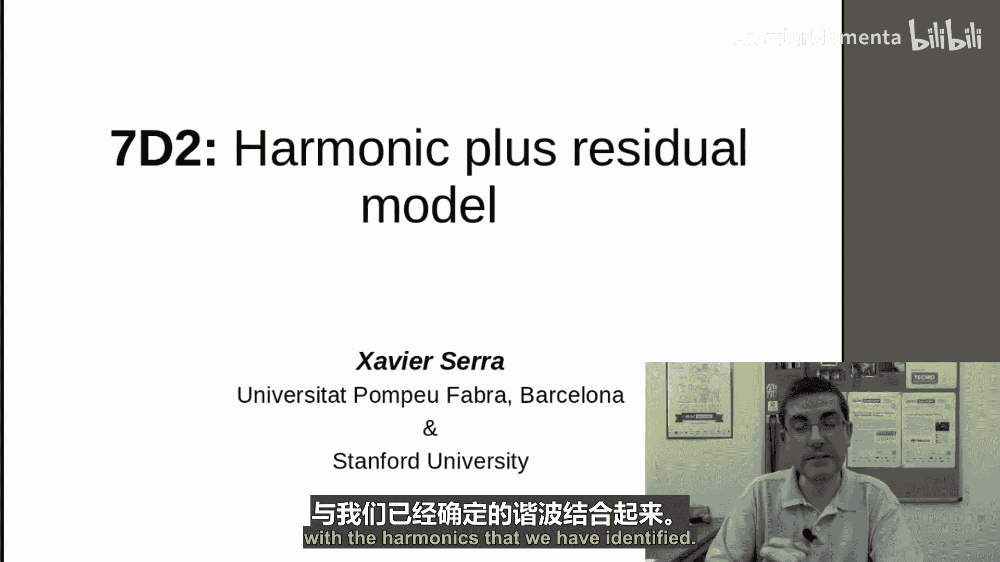
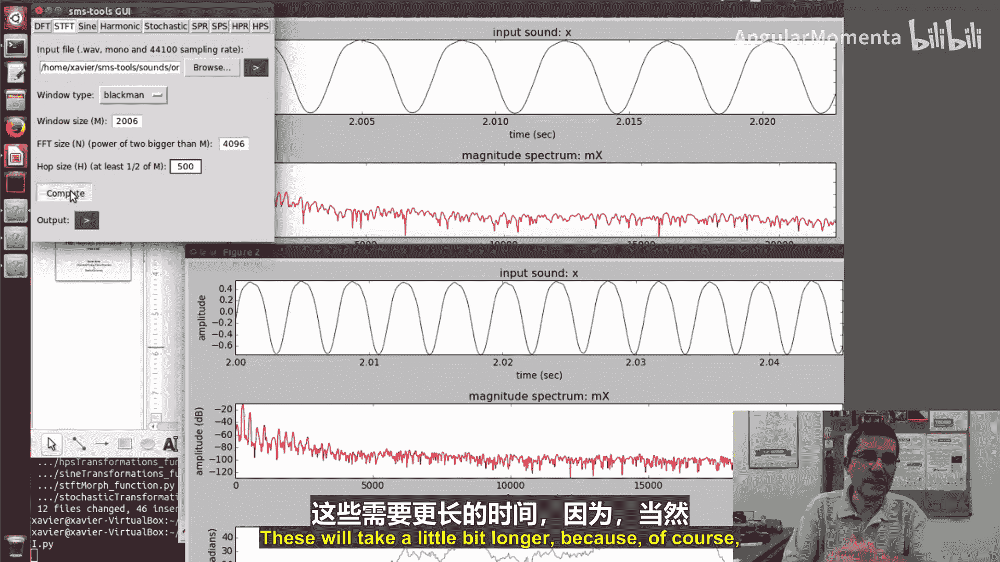
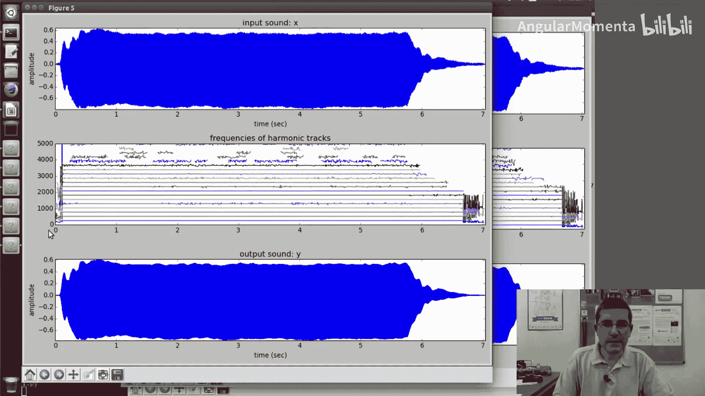
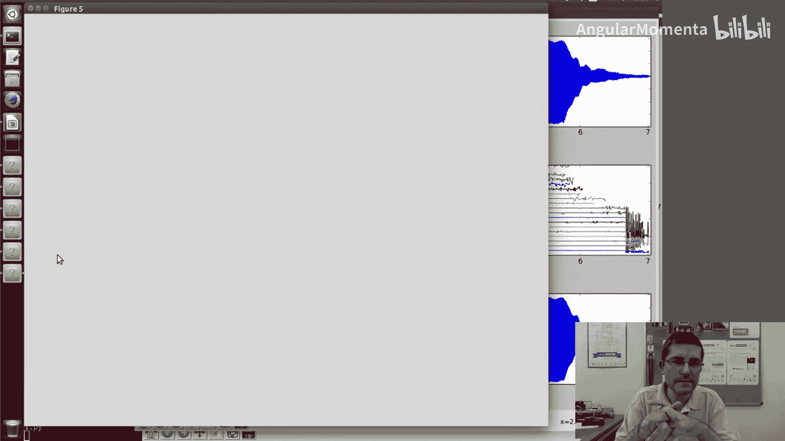
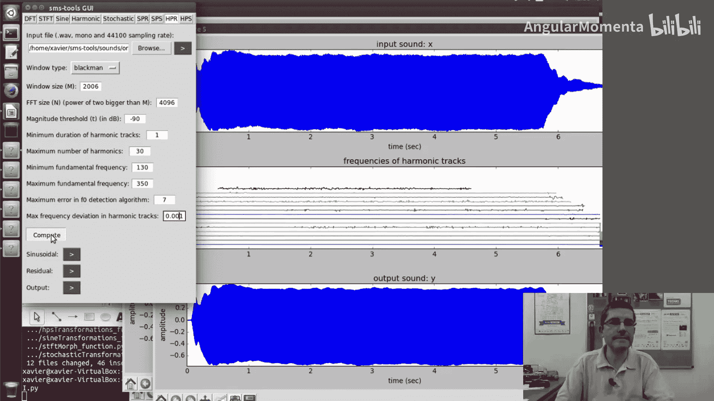
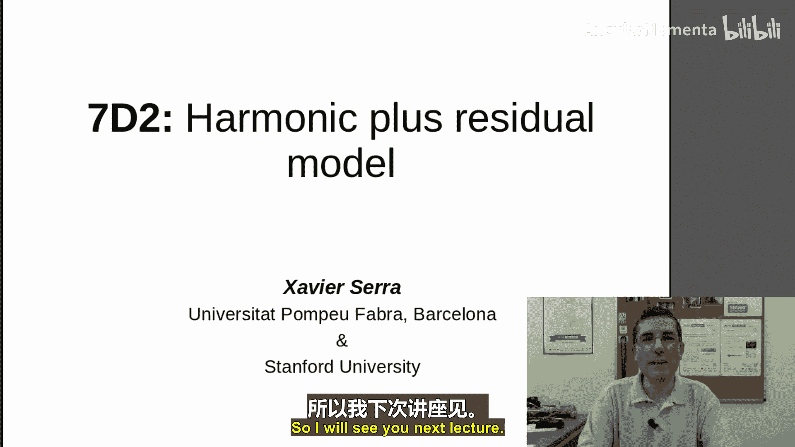

# 049：谐波加残差模型 🎵

在本节课中，我们将学习一种重要的频谱建模方法——谐波加残差模型。我们将结合前几周讨论过的正弦波与谐波分析，以及残差及其随机近似的概念，来分解和重构音频信号。

## 概述

本节课程将演示如何使用谐波加残差模型来分析声音。核心思想是：首先分析声音中的谐波成分，然后将其从原始信号中减去，从而得到残差信号。最后，我们可以将识别出的谐波与残差重新组合。

## 工具与初始设置

我们将使用课程中一直在开发和讨论的SMS工具。首先从DFT（离散傅里叶变换）开始，并使用SMS工具目录中的一个管风琴声音作为示例。

让我们先听一下这个声音。这是一个非常稳定、传统的管风琴标准音，音高为C3，频率约为264赫兹。

为了分析，我们需要选择一个合适的窗函数大小。由于这是一个非常稳定的音符，我们可以利用更长的窗来更好地分离谐波。对于Blackman窗，我们选择6个周期。

**计算窗长的公式**：
`窗长 = (采样率 / 基频) * 周期数`
代入数值：`(44100 / 264) * 6 ≈ 1002` 个样本。

为了便于计算，我们使用一个奇数的窗长，例如1003个样本。同时，我们使用2048点的FFT大小，并添加相当多的零填充。

## 频谱分析

计算完成后，我们观察频谱。我们分析了声音的6个周期，波形看起来非常正弦化。从幅度谱中可以看到，并没有非常多清晰的谐波，高频区域有相当多的能量，但并非都是清晰的正弦波。这表明声音中含有相当多的噪声或随机成分。

相位谱符合预期，重构的声音质量也相当好。这是一个不错的起点。考虑到声音的稳定性，我们可以尝试使用更大的窗长。

让我们尝试将窗长增加一倍，使用2006个样本，并将FFT大小增加到4096。这样我们分析了大约12个周期。与之前的频谱相比，现在的谐波定义更加清晰，背景成分也更多。更大的窗长有助于抑制非相干的随机成分，从而突出相干的谐波部分。

## 短时傅里叶变换分析

接下来，我们应用相同的参数进行短时傅里叶变换分析。我们打开管风琴声音，使用2006个样本的窗长和4096点的FFT大小。

我们需要选择一个跳跃大小。这里影响不大，为了效率，我们选择500个样本（约为窗长的四分之一）。计算完成后，我们得到了时频谱。重构的声音与原始声音非常相似。

观察频谱图，谐波线非常清晰，但谐波之间也存在不少成分。这是一个好的分析结果。

## 谐波分析

现在，我们使用相同的参数进行谐波分析。以下是分析参数的设置：
*   **窗函数**：Blackman
*   **窗长**：2006
*   **FFT大小**：4096
*   **幅度阈值**：-90 dB（合理的起始值）
*   **谐波最小持续时间**：由于是长而稳定的音符，我们可以要求更长的轨迹，例如0.2秒甚至更长。
*   **谐波数量**：考虑到高次谐波会消失，30或40个谐波应该足够。
*   **基频范围**：130 Hz 到 300 Hz（确保能覆盖264 Hz）。
*   **频率偏差**：允许谐波偏离完美谐波关系的程度，我们先保留默认值。

计算完成后，我们找到了许多谐波。在起振和衰减部分，声音非常不稳定，这些部分的谐波可能应该被剔除。

一些谐波非常稳定，但另一些则非常不稳定。让我们听一下仅由谐波合成的声音。它听起来不错，但与原始声音相比，明显缺少了背景中的“空气感”或噪声成分。此外，一些不稳定的高次谐波可能实际上是在追踪噪声部分。

为了改进，我们可以通过减小频率偏差来更严格地限制谐波。例如，将偏差设置为0.001。这样剔除了一些不稳定的成分。

更好的方法是确保谐波轨迹足够长。我们将最小持续时间从0.2秒增加到1秒。这样，我们剔除了大量不稳定（无论是谐波还是其他）的高频成分。

现在再听谐波合成的声音，它听起来非常干净，当然不如原始声音丰富。

## 谐波加残差模型

现在，我们可以使用相同的参数进入谐波加残差分析，即从原始信号中减去这些谐波。

我们使用相同的声音和参数（窗长2006，FFT大小4096，阈值-90 dB，轨迹最小持续时间1秒，谐波数量30，基频范围130-350 Hz）。

计算完成后，我们得到了结果。图中显示了找到的谐波（黑线），而背景的频谱图就是残差。

我们可以分别聆听不同的成分。我们已经听过谐波部分了，现在来听一下残差。这是一个非常清晰的声音，正是谐波声音中所缺失的部分。显然，如果将这两个声音加在一起，就会得到原始声音。与原始声音对比，基本上是相同的。

这个声音很好地展示了谐波加残差模型的潜力。当然，对于随时间变化的更复杂声音，调整参数可能会更具挑战性。

## 总结

本节课我们一起学习了谐波加残差模型。我们使用SMS工具分析了稳定的管风琴音，通过调整窗长、谐波持续时间和频率偏差等参数，成功地将声音分解为谐波和残差两部分，并验证了模型的有效性。

这是本周讨论的模型中的一个实例。在下一个演示课程中，我们将讨论谐波加随机模型，学习如何将本节中听到的残差建模为一个随机信号，并探索其应用。

期待下节课再见。