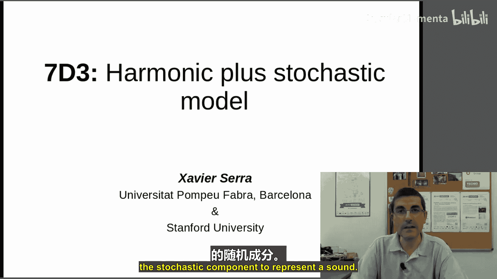
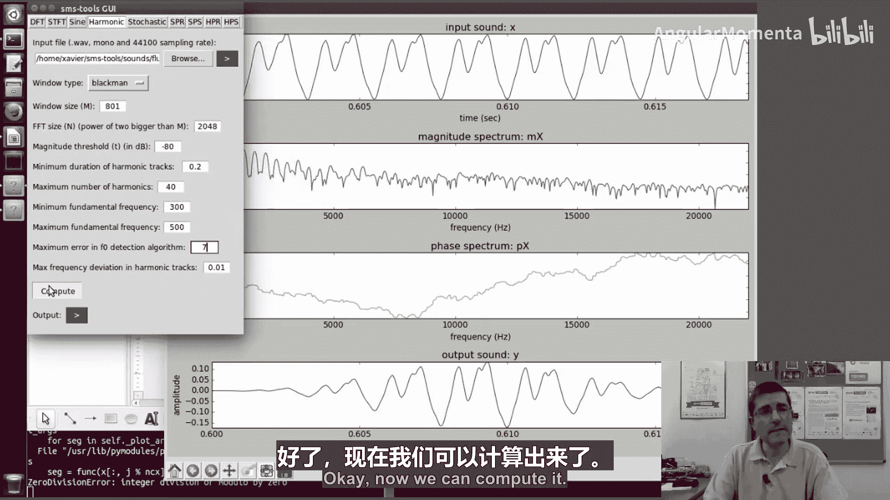
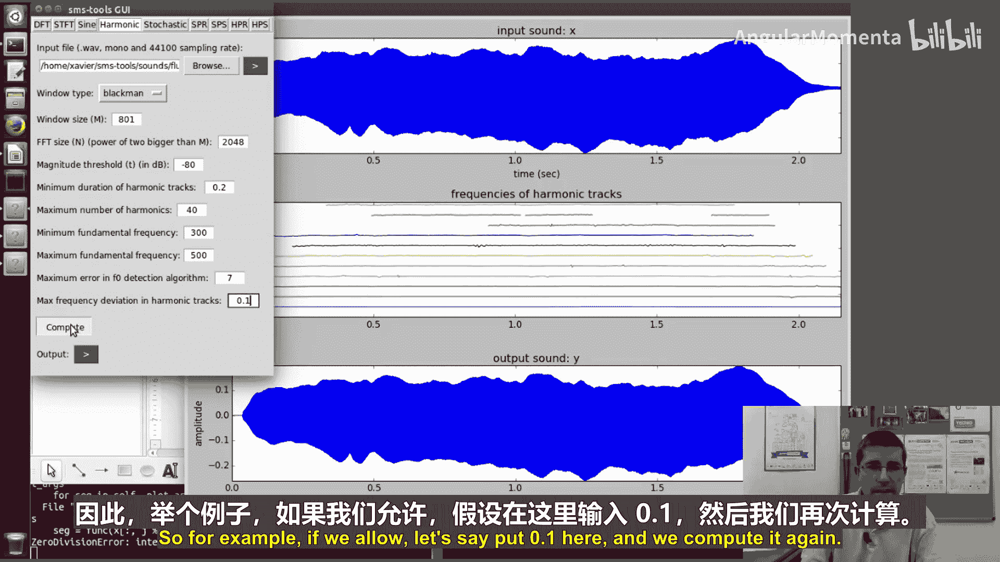
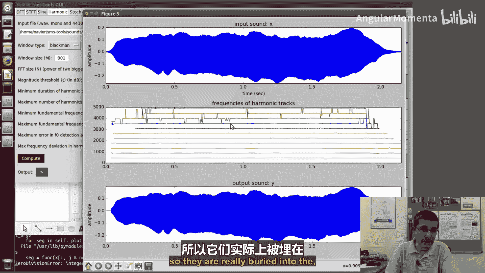
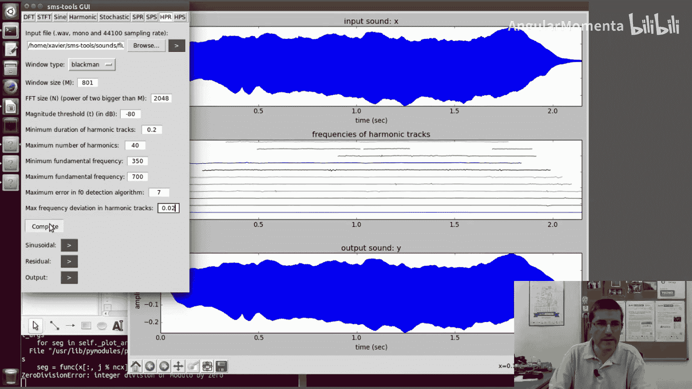
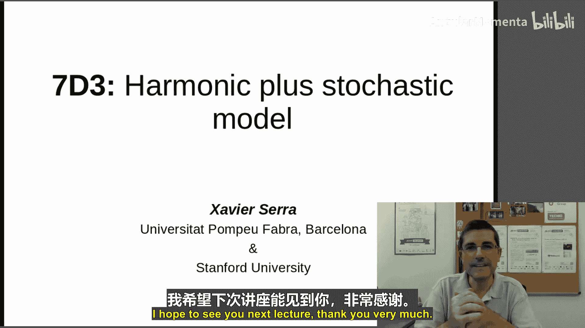

# 050：谐波加随机模型 🎵

在本节课中，我们将学习谐波加随机模型。上一节我们介绍了谐波加残差模型，并分析了如何从原始声音中分离出谐波和残差。本节中，我们将更进一步，探讨如何用随机模型来近似表示残差信号，从而构建一个由谐波和随机分量组成的更简洁的声音表示。

## 声音分析准备

首先，我们使用SMS工具打开一个长笛声音文件。这是一个非常稳定的音符，音高为A4（440 Hz），并且带有明显的呼吸声，这将是随机分量的重要来源。

为了分析，我们需要选择合适的参数。对于稳定的声音，布莱克曼窗是一个好选择，因为它能提供较低的旁瓣和良好的信噪比。窗口大小的计算公式为：

**窗口大小 = 6 × 采样率 / 基频**

对于这个采样率为44100 Hz、基频为440 Hz的声音，计算出的窗口大小约为601个样本。为了获得更好的谐波分辨率，我们选择使用801个样本的窗口。FFT大小设置为2048，以获得更平滑的频谱。我们将在声音的中间部分进行分析。

## 谐波模型分析

现在，我们直接应用谐波模型进行分析。参数设置如下：窗口801，FFT大小2048。对于峰值检测和谐波检测，我们不需要在频谱中搜索太多谐波，因为数量不多。我们将谐波的最小持续时间设置为0.2秒，最大谐波数量设为40，基频搜索范围设为300-500 Hz，峰值检测误差设为默认值0.7，偏差设为0.02。

分析结果显示，我们得到了相当数量的谐波，其中一些在高频区域出现又消失。如果只显示前5000 Hz，我们可能看不到更高频率的细节。合成的谐波声音听起来相当准确，但与原始声音相比，缺少了原始声音中更明亮的品质，这是因为原始声音包含了所有其他高频成分。

我们可以调整参数，例如将偏差设为0.01，以允许更多不稳定的高频谐波出现。然而，这些高频“谐波”实际上并不稳定，更像是被噪声或呼吸声掩盖的成分。

## 谐波加残差模型

接下来，我们使用谐波加残差模型。使用相同的参数，我们得到谐波和残差。残差信号听起来非常像噪声，清晰地包含了起振瞬态和持续的呼吸噪声。这正是一个典型的随机信号。

## 谐波加随机模型

既然残差非常接近随机信号，我们就可以应用谐波加随机模型。我们使用相同的分析参数，并引入一个随机近似因子，默认值为0.1。这意味着它将整个频谱的分辨率量化为原来的十分之一。

分析后，我们看到频谱显示范围更广（0-14000 Hz），因此能看到更多的随机分量。谐波主要集中在低频部分，5000 Hz以上基本是随机分量。合成的随机分量虽然丢失了一些残差的细节，但确实保留了呼吸噪声的特性。当它与谐波分量重新合成时，声音听起来不错，但谐波分量在很大程度上掩盖了随机分量，需要仔细聆听才能分辨。

## 总结

本节课中，我们一起学习了谐波加随机模型，并使用SMS工具进行了实践。我们分析了长笛声音，看到如何用谐波分量和随机分量来共同表示一个声音。与谐波加残差模型的主要区别在于，随机表示为我们提供了更大的灵活性。在接下来的课程中，我们将对声音进行各种变换，而随机表示将使我们能够实现这些操作，这是单纯的残差表示所无法做到的。希望本节课能让你对谐波加随机模型的潜力有所了解。