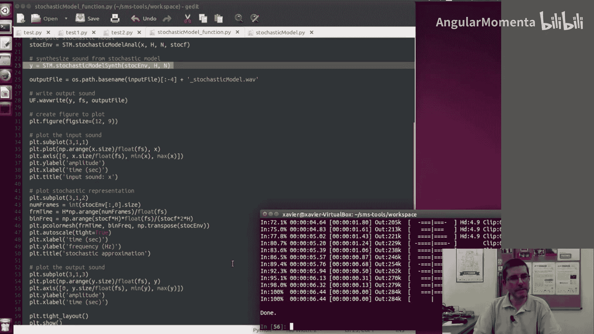
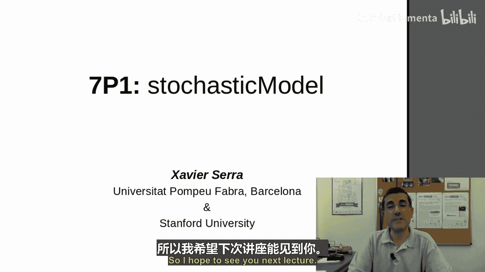

# 051：随机模型 🎵

在本节课中，我们将学习如何对音乐中的随机信号进行建模。我们将介绍一种基于统计信号处理的随机模型，它特别适用于那些无法用正弦波或谐波分析很好描述的、具有噪声特性的声音。

上一节我们介绍了频谱建模的基本概念，本节中我们来看看如何具体实现随机模型。


## 核心概念与流程

随机模型的核心思想是：对于随机性强的信号，其相位谱并不重要，建模的重点在于幅度谱。基本流程如下：

1.  对信号进行加窗和FFT变换，得到幅度谱。
2.  对幅度谱进行平滑近似，得到“随机包络”。
3.  合成时，根据平滑后的幅度谱，随机生成相位，重建复数频谱。
4.  通过逆FFT和重叠相加，生成新的信号。

其核心公式和代码描述如下：

*   **幅度谱平滑（降采样）**：使用 `scipy.signal.resample` 函数对幅度谱进行降采样，减少数据量，保留总体趋势。
    ```python
    # Mx 为原始幅度谱（dB），stocf 为随机因子（平滑/降采样因子）
    Mx_res = np.maximum(Mx, -200)
    Mx_stoc = signal.resample(Mx_res, int(Mx_res.size * stocf))
    ```
*   **频谱重建与合成**：将平滑后的幅度谱上采样回原始长度，并为其生成随机相位，以重建复数频谱。
    ```python
    # 上采样幅度谱回原始长度 N/2
    M = np.interp(np.arange(0, N/2), np.arange(0, Mx_stoc.size)/stocf, Mx_stoc)
    # 生成随机相位 (0 到 2*pi)
    P = 2 * np.pi * np.random.rand(int(N/2))
    # 重建正频率部分的复数频谱（转换为线性幅度）
    Y = np.power(10.0, M/20.0) * np.exp(1j * P)
    # 根据共轭对称性，重建完整频谱并做逆FFT
    Y_complete = np.concatenate((Y, np.conj(Y[-2:0:-1])))
    x = np.fft.irfft(Y_complete) # 或使用 np.fft.ifft 并取实部
    ```

## 单帧信号的随机建模

以下是分析单帧信号并应用随机模型的步骤。

首先，我们需要导入必要的库并设置参数。
```python
import numpy as np
import scipy.signal as signal
import matplotlib.pyplot as plt
from scipy.io import wavfile

# 读取声音文件
fs, x = wavfile.read('ocean.wav')
# 定义参数
M = 256  # 窗长
N = 256  # FFT长度（无需补零）
stocf = 0.2  # 随机因子（降采样因子）
```
接着，我们选取信号的一帧进行分析。
```python
# 生成汉宁窗
w = signal.get_window('hann', M)
# 选取一帧信号（例如从第10000个样本开始）
start = 10000
x_frame = x[start:start+M] * w
```
然后，计算该帧的幅度谱并进行随机近似。
```python
# 计算FFT和幅度谱（dB）
X = np.fft.fft(x_frame, N)
mx = 20 * np.log10(np.abs(X[:N//2]))
# 对幅度谱进行随机近似（降采样）
mx_res = np.maximum(mx, -200)
mx_stoc = signal.resample(mx_res, int(mx_res.size * stocf))
```
最后，我们可以绘制原始频谱和平滑后的近似包络进行对比。
```python
plt.figure(figsize=(10, 4))
plt.plot(mx, 'b', label='原始幅度谱')
# 拉伸平滑包络以便在同一尺度下对比
x_axis_stoc = np.arange(0, mx_stoc.size) / stocf
plt.plot(x_axis_stoc, mx_stoc, 'g', linewidth=2, label='随机近似包络')
plt.legend()
plt.title('单帧信号的随机模型近似')
plt.show()
```

## 从随机模型合成信号

在得到平滑的幅度包络后，我们可以用它来合成新的信号。

首先，将平滑包络上采样回原始频谱长度。
```python
# 将平滑包络上采样回原始长度 N/2
M_y = np.interp(np.arange(0, N//2), np.arange(0, mx_stoc.size)/stocf, mx_stoc)
```
接着，生成随机相位并重建复数频谱。
```python
# 生成随机相位
P_y = 2 * np.pi * np.random.rand(N//2)
# 重建正频率部分的复数频谱（转换为线性幅度）
Y = np.power(10.0, M_y/20.0) * np.exp(1j * P_y)
# 根据共轭对称性构建完整频谱
Y_complete = np.concatenate((Y, np.conj(Y[-2:0:-1])))
```
最后，进行逆FFT得到合成信号。
```python
# 逆FFT得到合成信号
y = np.fft.ifft(Y_complete).real
# 绘制对比
plt.figure(figsize=(10, 4))
plt.plot(x_frame, 'g', alpha=0.7, label='原始信号帧')
plt.plot(y, 'r', alpha=0.7, label='合成信号帧')
plt.legend()
plt.title('单帧信号的合成结果对比')
plt.show()
```
对于随机信号，时域波形不必相同，重要的是幅度谱的总体分布特征。

## 完整声音的分析与合成

对于一段完整的声音，我们需要逐帧进行分析与合成，并将结果保存。

以下是实现完整声音随机建模的关键步骤。

首先，定义一个函数来分析整段音频，得到所有帧的随机包络。
```python
def stochastic_analysis(x, H, N, stocf):
    """
    对输入信号x进行随机模型分析。
    x: 输入信号
    H: 帧移
    N: FFT长度
    stocf: 随机因子
    返回: 随机包络矩阵 (帧数 x 包络长度)
    """
    num_frames = int((len(x) - N) / H) + 1
    env_stoc = []
    for k in range(num_frames):
        # 加窗
        x_frame = x[k*H : k*H+N] * np.hanning(N)
        # 计算幅度谱
        mx = 20 * np.log10(np.abs(np.fft.fft(x_frame, N)[:N//2]))
        mx = np.maximum(mx, -200)
        # 随机近似
        mx_stoc = signal.resample(mx, int(mx.size * stocf))
        env_stoc.append(mx_stoc)
    return np.array(env_stoc)
```
接着，定义一个函数从分析得到的包络矩阵合成整段音频。
```python
def stochastic_synthesis(env_stoc, H, N, stocf, fs):
    """
    从随机包络合成信号。
    env_stoc: 随机包络矩阵
    H: 帧移
    N: FFT长度
    stocf: 随机因子
    fs: 采样率
    返回: 合成信号y
    """
    y = np.zeros(len(env_stoc) * H + N)
    for k, env_frame in enumerate(env_stoc):
        # 上采样包络
        M_y = np.interp(np.arange(0, N//2), np.arange(0, env_frame.size)/stocf, env_frame)
        # 生成随机相位
        P_y = 2 * np.pi * np.random.rand(N//2)
        # 重建频谱
        Y = np.power(10.0, M_y/20.0) * np.exp(1j * P_y)
        Y_complete = np.concatenate((Y, np.conj(Y[-2:0:-1])))
        # 逆FFT并重叠相加
        y_frame = np.fft.ifft(Y_complete).real * np.hanning(N)
        y[k*H : k*H+N] += y_frame
    return y
```
最后，调用这些函数处理完整音频并可视化结果。
```python
# 参数设置
H = 128
N = 2 * H  # FFT长度为窗长的两倍
stocf = 0.12

# 分析
env_stoc = stochastic_analysis(x, H, N, stocf)
print(f"随机包络矩阵形状: {env_stoc.shape}")  # (帧数, 包络长度)

# 合成
y = stochastic_synthesis(env_stoc, H, N, stocf, fs)

# 保存合成音频
wavfile.write('ocean_stochastic.wav', fs, y.astype(np.float32))

# 可视化随机包络（频谱图形式）
plt.figure(figsize=(12, 4))
plt.imshow(env_stoc.T, aspect='auto', origin='lower', cmap='hot')
plt.colorbar(label='幅度 (dB)')
plt.xlabel('帧索引')
plt.ylabel('包络系数索引')
plt.title('随机模型分析结果（包络序列）')
plt.show()
```



## 总结



本节课中我们一起学习了随机模型在音频信号处理中的应用。我们了解到，对于像海浪声这样的随机性信号，可以通过分析其幅度谱的平滑包络，并配合随机生成的相位来进行有效的建模与合成。我们逐步实现了从单帧分析、单帧合成到完整音频处理的全过程，并看到了合成声音在感知上与原声的相似性。这个模型是后续构建“谐波+随机”混合模型的重要基础，它将用于对谐波建模后剩余的残差信号进行描述。