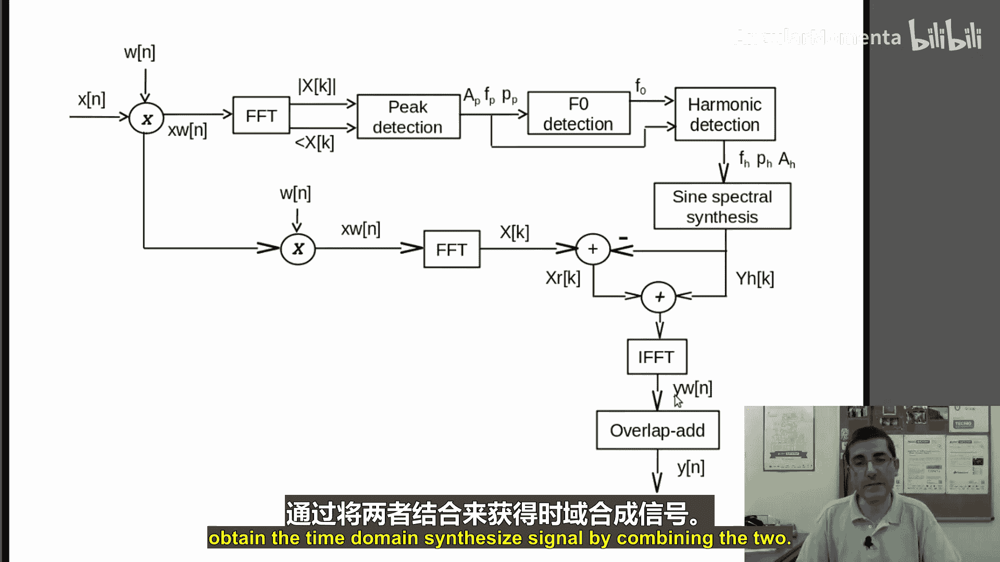
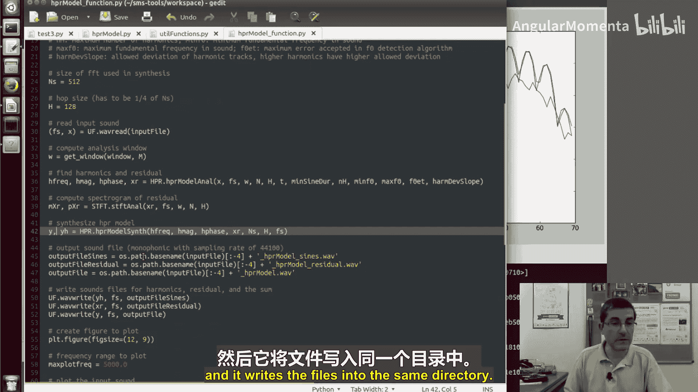
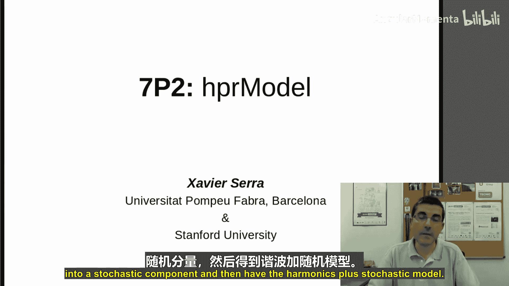

# 052：HPR模型实现 🎵

在本节课中，我们将学习如何实现谐波加残差模型。我们将从编程的角度，探讨如何从实际音频信号中减去正弦波（谐波），从而分离出残差成分。这是将前几周讨论的正弦/谐波建模思想与随机成分概念相结合的关键步骤。

## 概述



上一节我们介绍了谐波加残差模型的理论框架。本节中，我们来看看如何通过编程实现这一模型，特别是如何从原始信号中精确地减去已识别的谐波成分。

## 核心实现步骤

以下是实现HPR模型分析一个单帧信号的核心代码逻辑概述。我们将使用SMS工具包中的函数。

首先，导入必要的库并设置分析参数。

```python
import numpy as np
import matplotlib.pyplot as plt
from scipy.signal import get_window
import sys
sys.path.append(‘../../software/models/‘)
import utilFunctions as UF
import harmonicModel as HM
import sineModel as SM
import stft
import IPython.display as ipd
```

接着，读取音频文件并定义关键参数，如分析位置、窗函数大小、FFT大小、峰值检测阈值、基频搜索范围等。

```python
inputFile = ‘../../sounds/violin-B3.wav‘
fs, x = UF.wavread(inputFile)
M = 801
N = 2048
t = -80
minf0 = 200
maxf0 = 300
f0et = 7
harmDevSlope = 0.01
nH = 60
```

然后，计算分析窗，并确保使用零相位窗以使信号在时域完美对齐，这对于后续的频谱减法至关重要。

```python
start = 40000
hM1 = int(np.floor((M+1)/2))
hM2 = int(np.floor(M/2))
w = get_window(‘blackman‘, M)
x1 = x[start-hM1:start+hM2]
```

对选定的音频片段进行FFT变换，检测频谱峰值，并通过抛物线插值提高精度。随后，使用双路失配算法检测基频，并识别其谐波。

```python
mX, pX = stft.stftAnal(x1, w, N)
ploc = UF.peakDetection(mX, t)
iploc, ipmag, ipphase = UF.peakInterp(mX, pX, ploc)
ipfreq = fs * iploc / N
f0 = UF.f0Twm(ipfreq, ipmag, f0et, minf0, maxf0, 0)
hfreq, hmag, hphase = HM.harmonicDetection(ipfreq, ipmag, ipphase, f0, nH, [], fs, harmDevSlope)
```

识别出谐波后，我们在频域合成这些谐波的主瓣。

```python
Ns = 512
H = 128
hNs = 256
Yh = UF.genSpecSines_p(hfreq, hmag, hphase, Ns, fs)
```

## 谐波减法

现在进入本周的核心内容：从原始信号中减去这些谐波。为此，我们需要使用与合成谐波时相同的窗函数（布莱克曼-哈里斯窗）重新计算原始信号的频谱。

以下是实现减法的关键步骤：
1.  从原始信号中选取与合成窗相同长度（Ns）的片段。
2.  应用布莱克曼-哈里斯窗并进行零相位中心化。
3.  计算该片段的频谱。
4.  执行复数频谱减法：`Xr = X2 - Yh`。

```python
x2 = x[start-hNs:start+hNs] * get_window(‘blackmanharris‘, Ns*2)
fftbuffer = np.zeros(Ns)
fftbuffer[:hNs] = x2[hNs:]
fftbuffer[hNs:] = x2[:hNs]
X2 = fft.fft(fftbuffer)
Xr = X2 - Yh
```

运行代码后，我们可以比较原始频谱、合成谐波频谱以及相减后得到的残差频谱。残差频谱清晰地显示了去除谐波后剩余的成分。

## SMS工具包中的HPR模型

SMS工具包中提供了完整的HPR模型实现。在 `models` 目录下的 `hprModel.py` 文件中，主要包含三个函数：
*   `hprModel_anal()`： 执行分析，调用谐波分析函数和正弦波减法函数。
*   `hprModel_synth()`： 执行合成，将合成的谐波与残差信号相加。
*   `hprModel()`： 一个封装函数，依次执行分析和合成，并绘制中间结果。

其中，正弦波减法功能在 `utilFunctions` 目录下的 `sineSubtraction()` 函数中实现。它遍历每一帧，重新读取输入信号，使用指定窗函数，合成谐波频谱，然后从输入频谱中减去，最终通过逆变换和加窗得到时域残差信号。



我们可以运行工具包中提供的示例文件 `hprModel_function.py` 来体验整个过程。它会分析一段萨克斯风声音，分别生成并保存谐波信号、残差信号以及两者的合成信号。通过对比聆听，可以直观感受谐波成分（乐音）与残差成分（噪声或瞬态）的区别。

## 总结

本节课中，我们一起学习了谐波加残差模型的编程实现。我们掌握了从单帧信号中识别谐波、在频域合成谐波、并使用精确的窗函数对齐技术从原始频谱中减去谐波以得到残差的核心步骤。虽然从信号处理原理上看并不复杂，但在编程实现上需要格外小心，确保相位对齐和复数减法的正确性，才能得到有效的实数残差信号。



下一讲，我们将在此基础上更进一步，从编程角度探讨如何将计算得到的残差成分转换为随机成分，从而实现完整的谐波加随机模型。