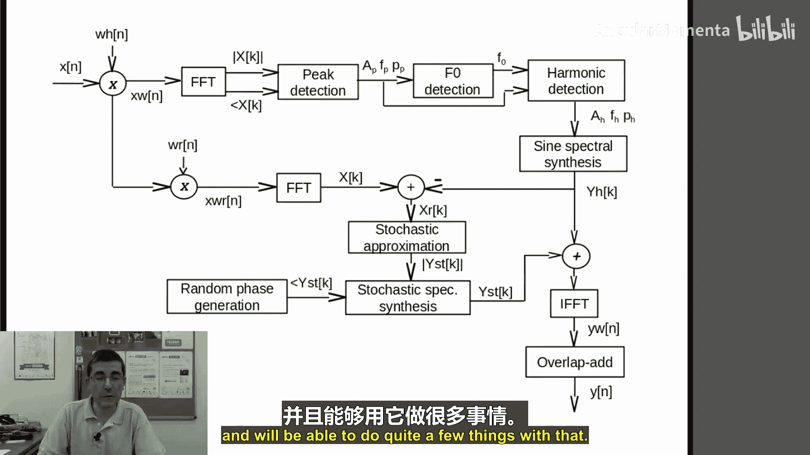
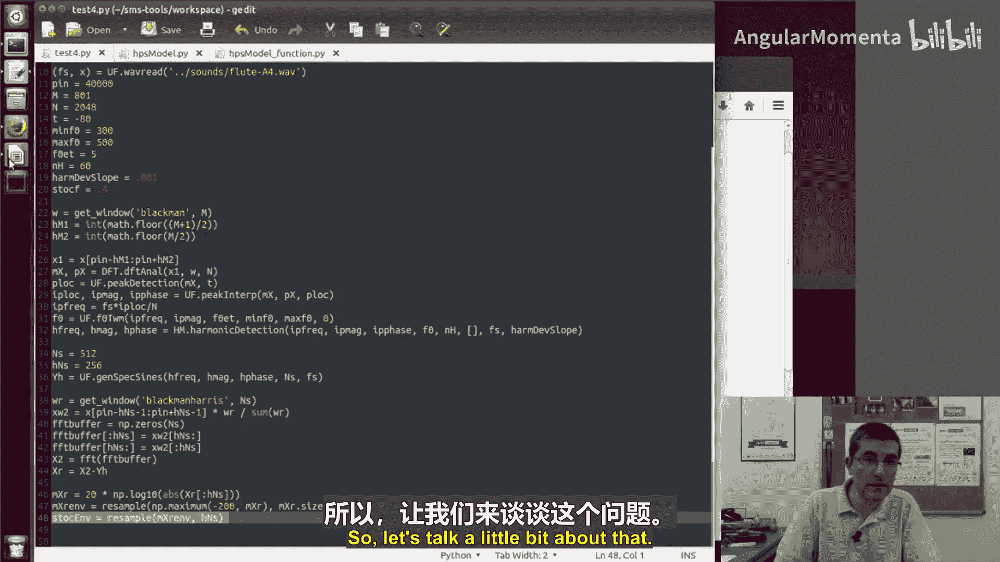
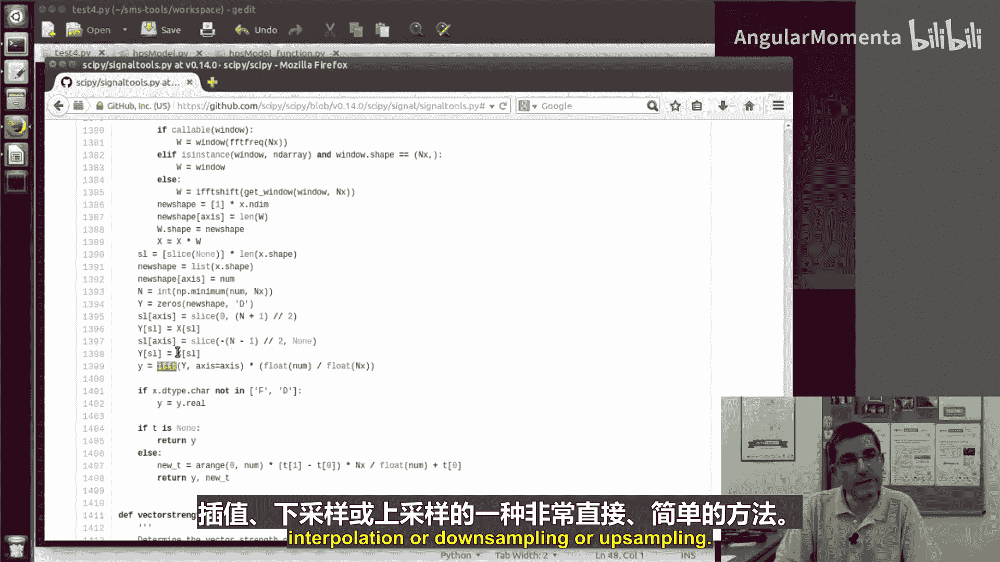
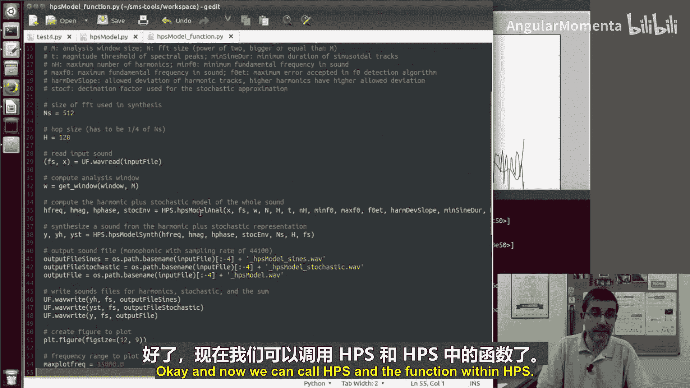
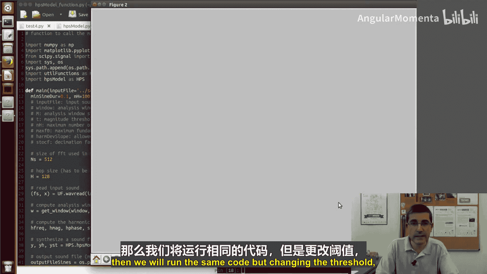
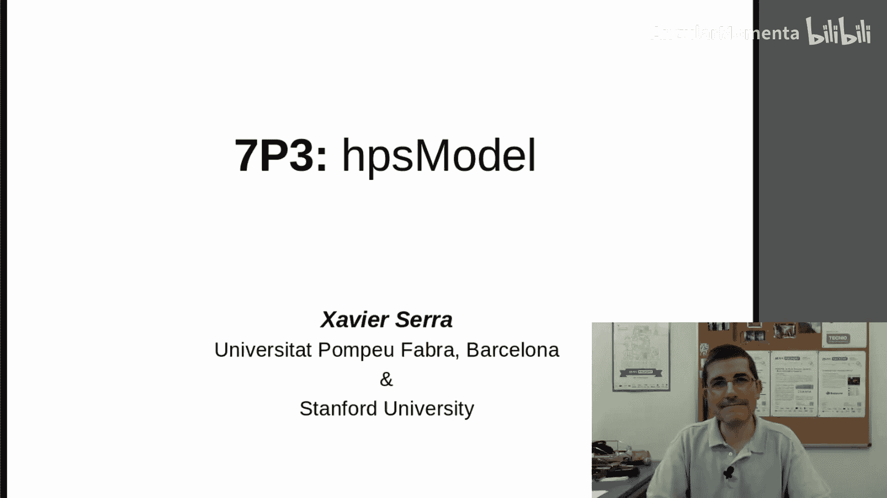

# 053：HPS模型

在本节课中，我们将学习谐波加随机模型。上一节我们介绍了谐波加残差模型，本节中我们来看看如何将残差部分进一步建模为随机成分，从而获得更灵活、更紧凑的音频表示。

## 概述

HPS模型是HPR模型的扩展。其核心思想是将音频信号分解为**谐波成分**和**随机成分**。分析过程与HPR模型类似，但在获得残差频谱后，我们不再直接使用它，而是通过平滑其幅度谱来获得一个**随机近似**。合成时，则为该平滑后的幅度谱生成随机相位，并与谐波成分相加，以重构信号。



## 从HPR到HPS

上一节我们介绍了HPR模型及其在SMS工具包中的实现。现在，我们更进一步，探讨HPS模型。该模型的关键改进在于对残差部分进行**随机建模**。

以下是HPS模型分析流程的核心步骤：

1.  执行谐波分析，提取谐波成分。
2.  从原始信号中减去谐波成分，得到残差信号。
3.  对残差信号的幅度谱进行平滑和下采样，得到随机模型的参数（包络）。
4.  在合成阶段，为平滑后的幅度包络生成随机相位，并与谐波成分相加。

这种方法的优势在于，随机近似不仅**减少了重建信号所需的信息量**，使表示更紧凑，而且提供了**更高的灵活性**，便于后续对声音进行各种处理操作。

## 代码实现解析



我们从上一讲的代码开始，该代码使用长笛声音进行分析。它通过FFT和基频检测进行谐波分析，合成这些谐波，然后从原始信号中减去它们，从而得到残差。

本讲的重点在于对残差进行随机近似。以下是实现这一步骤的三行核心代码：



```python
mXr = 20 * np.log10(abs(Xr[:hN])/N) # 转换为分贝尺度
stocEnv = resample(np.maximum(-200, mXr), mXr.size*stocf) # 下采样平滑
stocEnv = resample(stocEnv, hN) # 上采样回原始尺寸
```

首先，将残差频谱的幅度转换为分贝（dB）尺度。然后，调用 `resample` 函数对这个频谱进行下采样，下采样因子由 `stocf`（随机因子）控制，例如0.4意味着输出数组是原频谱的40%。最后，再次上采样回原始尺寸，以便后续合成。

## `resample` 函数的工作原理

`resample` 函数使用基于傅里叶变换的方法进行重采样。其过程可以概括为以下步骤：

1.  对输入信号执行FFT。
2.  根据目标输出长度，对频谱进行**截断**（下采样）或**补零**（上采样）。
3.  对修改后的频谱执行逆FFT。

这种方法为频谱插值或下采样提供了一种简单直接的方式。

## 可视化随机近似效果

运行代码后，我们可以绘制原始残差频谱和平滑后的包络进行对比。当设置 `stocf = 0.4` 时，绿色平滑线能较好地跟随原始信号的轮廓。如果将 `stocf` 改为 `0.1`，平滑效果会更强，得到的包络线将更加平滑，这体现了随机近似对频谱的平滑作用。

## SMS工具包中的HPS模型

在SMS工具包中，HPS模型的实现包含分析、合成以及帧级处理函数。分析函数在HPR模型的基础上增加了一个输入参数 `stocf`。分析步骤包括谐波分析、计算残差，然后调用随机模型处理残差。

需要注意的是，随机模型使用的窗口尺寸通常较小（例如两倍的跳距大小），这有助于更好地捕捉残差成分中的瞬态信息，如音符的起振过程。



合成部分则分别合成正弦波成分和随机成分，最后将它们相加。工具包中的 `hpsModel` 函数整合了完整的分析与合成流程，并允许通过参数调整来观察不同设置下的效果。

## 参数调整与实践

我们可以直接调用 `hpsModel` 函数并修改其默认参数来进行实验。例如，将谐波检测的阈值从 `-100` dB 改为 `-40` dB，系统将检测到更少的谐波，更多的能量会被归类到随机成分中，从而改变合成声音的特性。



通过调整声音文件、最小谐波持续时间等参数，我们可以深入探索HPS模型的行为和影响。

## 总结



本节课我们一起学习了谐波加随机模型。作为本课程中最复杂的模型，HPS模型综合了谐波分析和随机建模的思想。理解这个模型，有助于融会贯通我们讨论过的许多音频分析与合成概念。该模型通过将信号分解为确定性的谐波和随机性的残差，为实现高质量、高灵活性的音频处理提供了强大的框架。