# 054：声音变换1 🎵

在本节课中，我们将学习如何将之前介绍的音频分析与合成技术付诸实践，用于实际的音乐应用。我们将重点探讨声音变换，即如何修改声音的表示形式，并重新合成为一个经过修改的新声音。

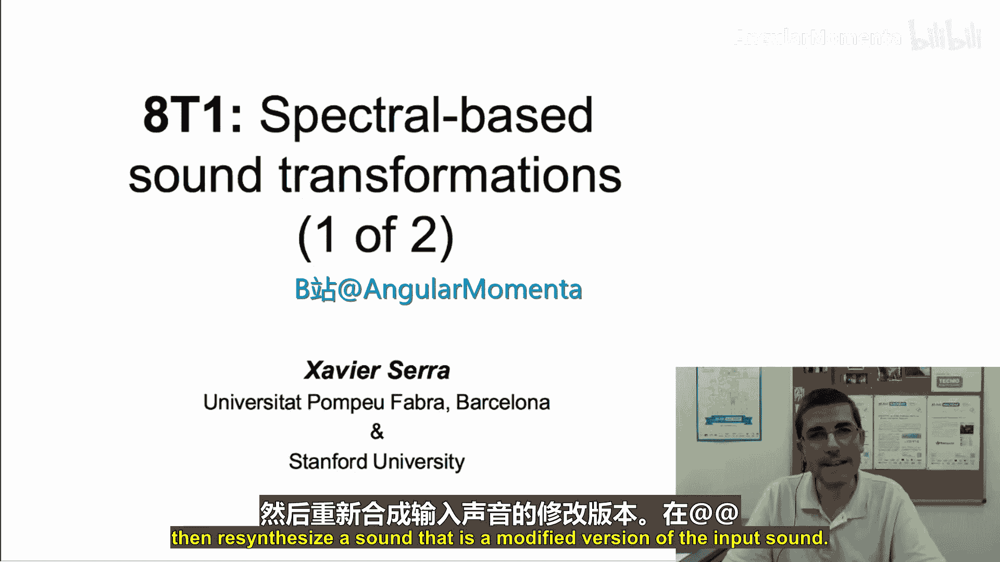

## 短时傅里叶变换与变换框架

上一节我们介绍了多种声音分析与合成技术。本节中，我们来看看如何利用短时傅里叶变换框架来实现声音变换。

下图展示了基本的处理流程：我们逐帧选取声音片段，计算其频谱（包括幅度谱和相位谱），然后引入一个**变换模块**。该模块会生成新的幅度谱和相位谱，最终通过逆变换合成出经过修改的声音。

我们将重点讨论两种基于此框架的变换：**滤波**和**变形**。同时，我们也会探讨**正弦模型**，以及如何用它来实现频率缩放和时间缩放。

## 基于短时傅里叶变换的滤波 🎛️

我们之前课程中讨论过滤波。滤波可以在时域通过卷积实现，也可以在频域通过乘法实现。这里我们使用短时傅里叶变换，在频谱域通过乘法应用滤波。

具体操作是：将输入声音每一帧的复数频谱与滤波器的频率响应（同样包含幅度和相位）相乘。严格来说，幅度谱是相乘，而相位谱是相加。

以下公式展示了这一思想。输出声音 `Y[l]` 的复数频谱，等于滤波器频率响应 `H` 与输入声音第 `l` 帧频谱 `X[l]` 的乘积：

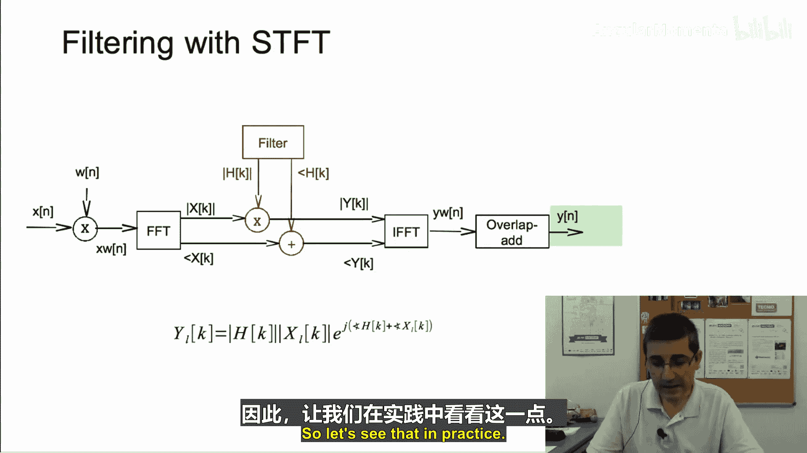

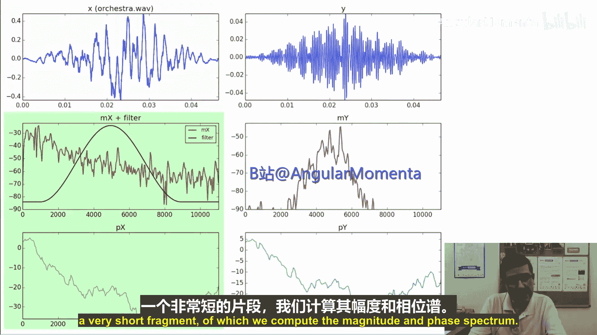

`Y[l] = H * X[l]`

其中，幅度部分相乘：`|Y[l]| = |H| * |X[l]|`；相位部分相加：`∠Y[l] = ∠H + ∠X[l]`。

然后对 `Y[l]` 执行逆傅里叶变换，即可得到输出声音。

让我们看一个实例。左上角是一个很短的管弦乐声音片段。

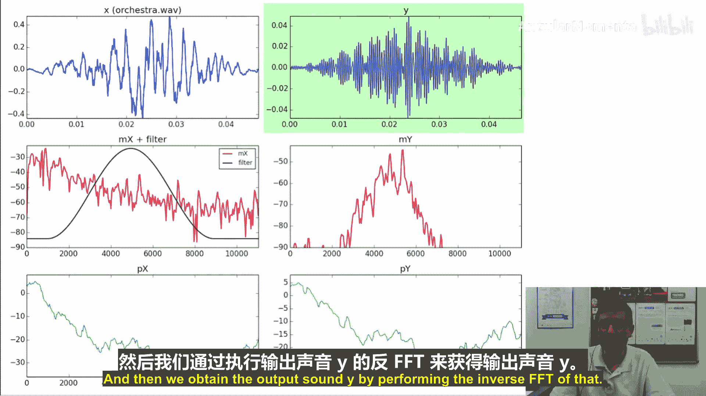

我们计算了它的幅度谱（红色曲线）和相位谱。

同时，我们有一个滤波器的幅度谱（滤波器通常可以设为零相位，因此其相位影响常被忽略）。在应用时，我们将滤波器幅度谱与输入声音的幅度谱相乘（由于采用对数dB刻度，实际操作是相加）。右侧的形状就是两者相加后的结果，即修改后的频谱。相位谱基本保持不变。最后通过逆FFT得到输出声音 `y[n]`。

现在来看一个完整声音的例子。顶部是之前听过的完整管弦乐声音的声谱图。中间是我们要应用的滤波器幅度形状。我们对输入声音的每一帧幅度谱都乘以这个形状（在对数域是相加），得到了底部的声谱图。听一下结果声音，可以明显感觉到声音变柔和了，因为我们只让大约1000Hz附近的频率通过（这是一个带通滤波器），其他频率都被大幅衰减，整体能量减少了很多。

## 基于短时傅里叶变换的声音变形 🌀

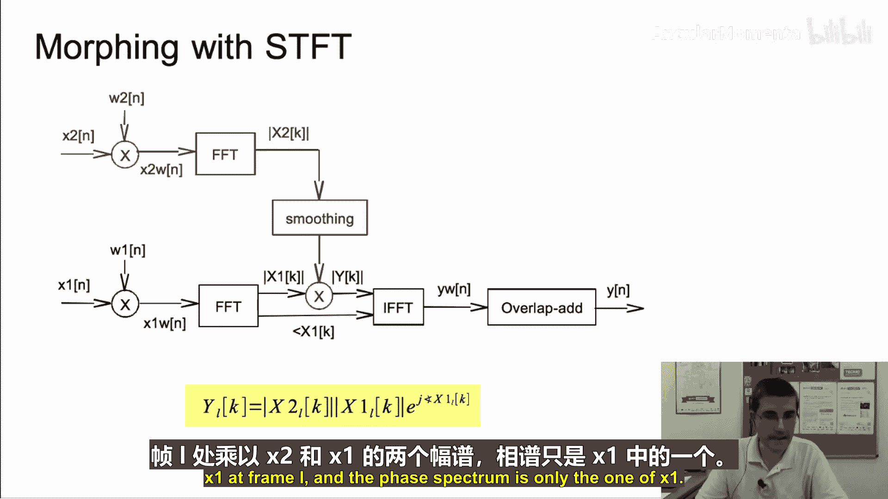

接下来，我们使用短时傅里叶变换进行另一种变换：**声音变形**。

在变形中，我们从声音 `x1` 开始，对其进行短时傅里叶变换分析-再合成。在每一帧，我们将其幅度谱与另一个随时间变化的声音 `x2` 的幅度谱相乘。换句话说，我们对声音 `x2` 进行并行的短时傅里叶变换分析，但只使用其幅度谱，然后将其“塑造”到 `x1` 上。

以下公式与滤波概念相似，但这里的 `x2` 是时变的，拥有自己的帧索引 `l`：

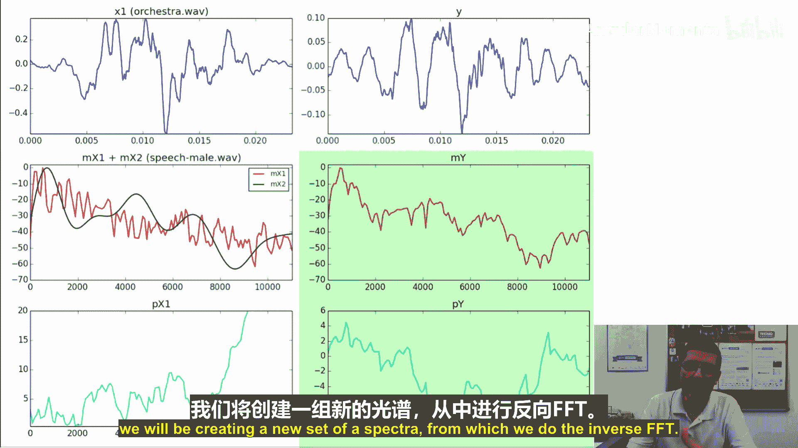

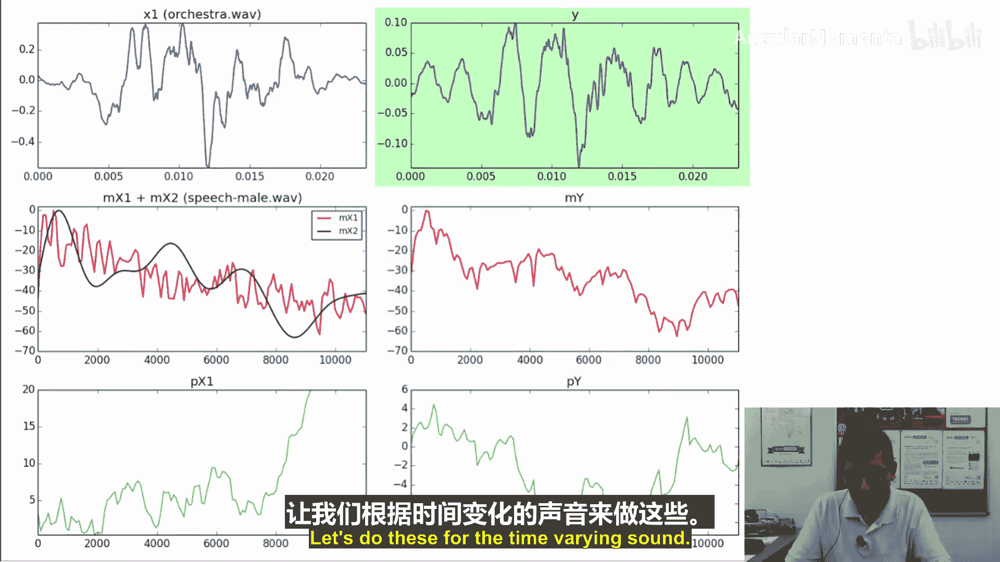

`Y[l] = |X2[l]| * |X1[l]| * exp(j * ∠X1[l])`

我们只使用 `x1` 的相位谱。

让我们看一个实践例子。同样是之前的管弦乐声音及其频谱。现在，黑色曲线是另一个声音的平滑幅度谱，它会像管弦乐声音一样随时间变化。我们将这两个频谱在对数域相加，创建出一组新的频谱，然后进行逆FFT。

现在对这个时变声音进行操作。

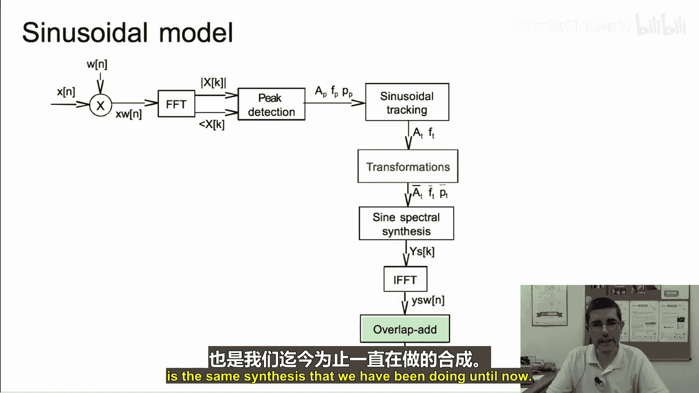

顶部是管弦乐声。我们来听一下另一个声音 `x2`，这是一段男性语音。中间的声谱图是这段语音 `x2` 的平滑版本，它没有 `x2` 的细节，只有其大致形状。我们将这两个声谱图逐帧相加，得到了底部的声谱图 `My`。它既不是 `x1`，也不是 `x2`，而是两者的混合体。听听这个修改后的版本，它明显带有管弦乐的特征，但由于其幅度谱的整体形状来自语音，我们基本上能听懂语音内容。可以这样理解：仿佛管弦乐队正在通过这位男性的声道演奏，从而复现了语音的音素纹理。

## 基于正弦模型的变换 ⏱️🎚️

现在让我们转到之前已经介绍过的正弦模型。

我们再次通过峰值检测和正弦跟踪进行正弦模型分析。但这里有一个小变化：在进行变换时，我们不直接使用原始的相位值，因为相位非常敏感，变换时很难处理。因此，我们改为从频率值重新生成相位。

具体流程是：我们修改分析得到的正弦波的幅度和频率值，然后基于修改后的频率值重新生成相位。这些新的幅度、频率和再生相位将作为合成的输入，合成过程与之前相同。

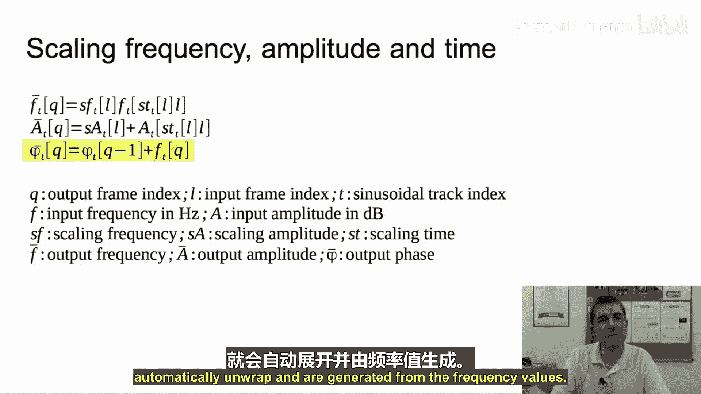

我们对正弦分析输出的具体操作如下：

*   **频率缩放**：新的频率是输入频率乘以一个缩放因子 `SF`。
*   **时间缩放**：读取输入频率的速率由一个时间缩放因子控制，这允许我们减慢或加快读取声音的速度，从而实现时间伸缩。
*   **幅度缩放**：由于幅度在对数域（dB）操作，新的幅度是输入幅度加上一个幅度缩放因子。
*   **相位再生**：相位不是来自原始声音。它们从一个初始相位（可以是0或随机值）开始，在每一帧根据新的频率值累加生成，从而实现相位的自动展开。

`f_out[l] = SF * f_in[l]`
`A_out[l] = A_scale + A_in[l]` (dB域)
`φ_out[l] = φ_out[l-1] + 2π * f_out[l] * hop_size / fs`

例如，这是一个时间缩放包络。横轴是输入时间，纵轴是输出时间。通过改变输入时间的读取位置，我们修改了声音的长度。

让我们看一个时间缩放的具体例子。我们从一个马林巴琴声音开始，并用正弦模型分析它。顶部的声谱图显示了原始信号及其正弦轨迹。听一下原始声音。下面的声谱图是变换后的正弦轨迹。我们以不同的速度读取它们，因此时间轴差异很大：原始声音长约2秒，输出声音长约3秒，被拉伸了1.5倍。让我们听听再合成后的修改声音。我们改变了持续时间，并且不是恒定缩放，而是通过扭曲时间信息，使所有音符起始点间隔相似，从而让声音变得更长。这里的可能性是无限的，我们可以按任何方式调整这种映射关系。

对于另一种变换——应用于正弦波的频率缩放——我们同样需要一个时变的缩放包络。横轴是时间，纵轴是缩放因子。这意味着在声音开始时，我们将所有正弦波的频率乘以0.8；在声音结束时，乘以1.2。因此频率会从较低开始，最终变得较高。

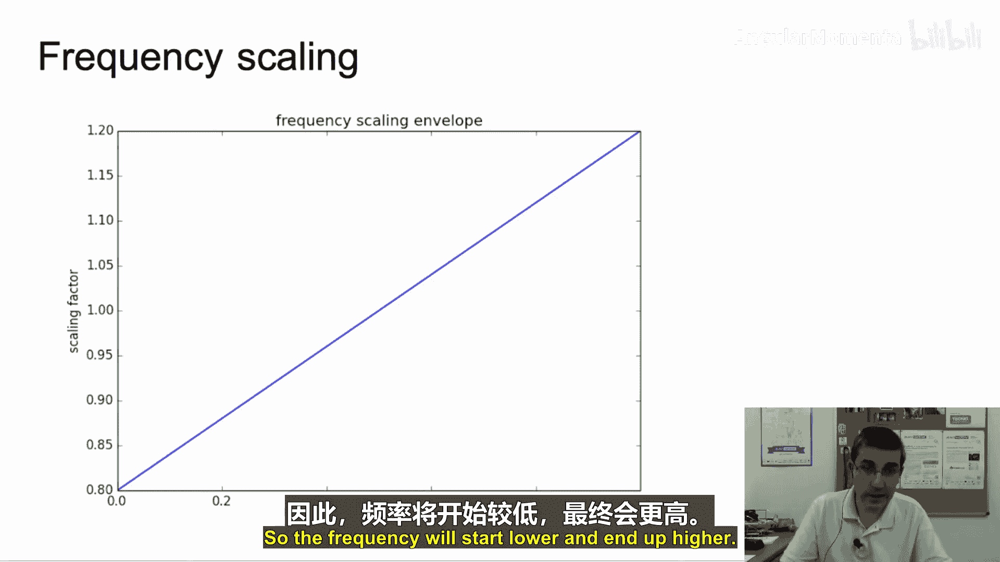

让我们看一个具体声音的例子。这是我们已经听过的管弦乐声音，图中显示了它的正弦分析（原始声谱图和正弦轨迹）。下方是根据上述曲线变换后的正弦轨迹。可以看到，在开头正弦波更密集（频率更低），在结尾则更高（因为乘以了1.2）。让我们听听这个修改后的管弦乐声音。当然，这听起来不自然，因为通常不会这样做，并且会产生一些失真，但通过应用这类技术并进行优化，可以获得一些好的效果。

关于如何对声音应用这类变换的细节信息不多，但如果你查阅维基百科，可以找到一些关于音效、均衡、以及如何应用时间缩放和音高修改的初步参考资料。

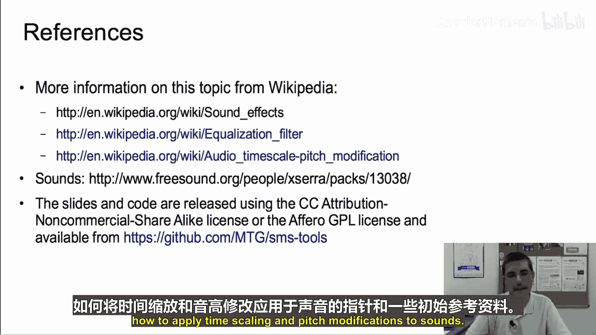

## 总结

本节课中，我们一起学习了如何利用短时傅里叶变换和正弦模型进行特定的声音变换，包括滤波、变形、频率缩放和时间缩放。在下一节理论课中，我们将继续探讨其他已介绍的模型，并学习如何将它们用于其他类型的变换。

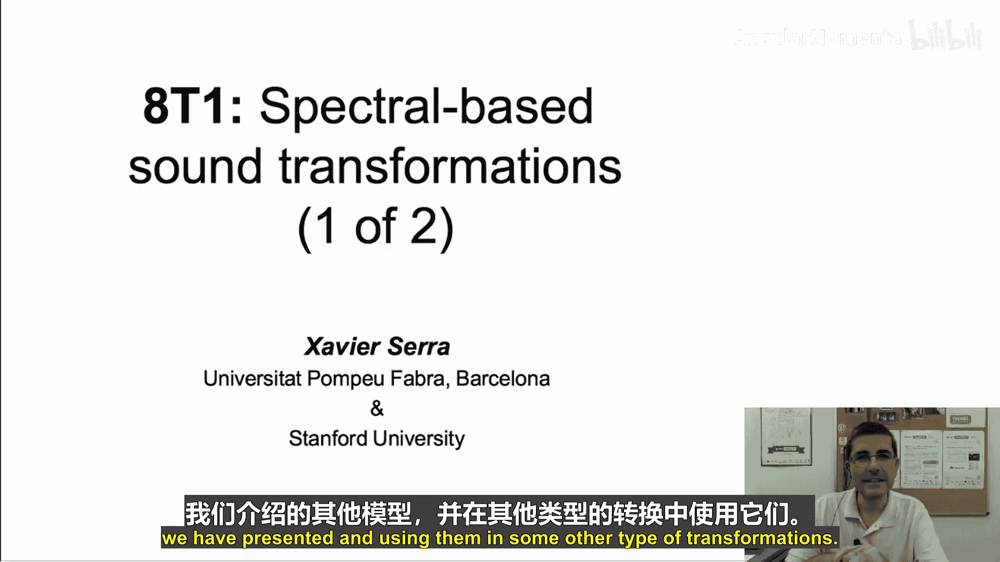

下节课再见。