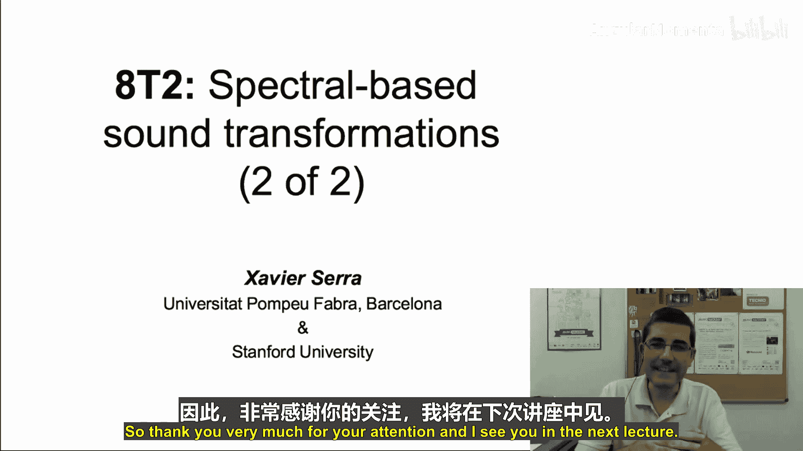

# 055：声音转换-2

欢迎回到音乐应用中的音频信号处理课程。在上一节理论课中，我们开始讨论声音转换，特别是如何使用短时傅里叶变换和正弦模型来操控声音。在本节理论课中，我们将继续这个话题。

我们将探讨**谐波加残差模型**及其如何用于转换谐波频率，然后介绍**谐波加随机模型**及其如何用于时间拉伸和声音融合操作。这里的“融合”与使用短时傅里叶变换所能实现的效果有很大不同。当然，这些只是示例操作，这些模型的实际应用可能性要广泛得多。

## 谐波加残差模型

让我们从谐波加残差模型开始。这是我们之前见过的框图：从输入声音中，我们分析频谱，找到峰值，然后找到基频和谐波，并从原始信号中减去这些谐波。我们需要再次计算原始信号的频谱，以便从一个可以正确减去这些谐波的频谱中推导出残差。

转换操作应用于谐波的频率和振幅上，我们不对残差应用任何转换。为了对残差进行转换，为其建立一个模型是有意义的，这就是我们接下来要介绍的模型——谐波加随机模型。

在谐波上的转换，与正弦模型类似，只应用于频率和振幅，相位被忽略。我们将在转换后重新合成相位。这样做的主要原因是相位对转换非常敏感，处理起来非常困难，因此最好在转换后重新生成它们，效果通常不错。

转换后，我们可以将这些新的谐波与残差信号相加。由于残差信号不包含任何确定性或谐波信息，它们会很好地融合，从而产生一个具有原始残差特性但谐波已被修改的声音。

以下是可应用于这些谐波频率的几种常见转换类型：

*   **频率平移**：将所有频率乘以一个给定的因子。这对应于移调。例如，乘以2对应升高一个八度，乘以0.5对应降低一个八度。公式表示为：`f_new = f_original * scaling_factor`。
*   **频率偏移**：将所有频率加上一个常数因子。这会将所有谐波偏移一个固定的量，从而可能产生非谐波系列的声音。
*   **频率拉伸**：应用一个依赖于谐波次数的频率变化。公式表示为：`f_new = f0 * (harmonic_number ^ scaling_factor)`，其中`f0`是基频。这意味着较高的谐波比较低的谐波改变得更多，可以创造出有趣的效果。

## 谐波加随机模型

现在，让我们转向谐波加随机模型。它与前一个模型非常相似，但现在转换既应用于残差信号的建模，也应用于谐波分量。

我们有一个随机近似，因此可以很容易地进行转换，因为这个模型大大简化了残差世界，并且在操控方面非常灵活。转换后，我们得到随机分量和谐波正弦波的频率、振幅，然后可以合成两者并将它们相加。

实际操作与我们在正弦模型中介绍的非常相似。现在我们引入对随机分量的类似转换。谐波的频率可以被一个因子缩放，读取这些频率值的时间也可以改变，以实现时间缩放操作。我们有一个缩放函数。振幅的处理方式相同，随机分量的处理方式也相同。相位是生成的，从初始相位开始，然后加上我们想要生成的每个谐波的频率，从而生成瞬时相位。

## 声音融合操作

现在，让我们讨论使用这种谐波加随机模型进行声音融合。这里我们简化了框图：有两个声音，x1和x2。我们将要做的是对这两种表示进行插值。

从x1中，我们获得谐波的频率、振幅和残差的随机近似。对声音2也做同样的事情。然后，我们对这两组函数进行插值：我们插值谐波的频率和幅度，并插值残差的随机包络。当然，我们可以通过生成随机分量和正弦分量来重新合成输出声音。

## 总结

在本节课中，我们一起学习了声音转换的进一步内容。我们探讨了谐波加残差模型如何用于频率转换，并引入了更强大的谐波加随机模型，该模型允许我们对谐波和随机残差都进行灵活的操作，例如时间拉伸和声音融合。

正如课程所强调的，这是一个非常应用的课题，需要通过编程和实践演示来更好地理解和掌握。鼓励大家尝试这些技术，培养自己对什么有效、什么无效的直觉。

感谢你的关注，我们下节课再见。