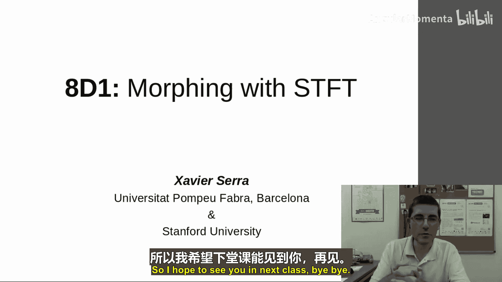

# 056：基于STFT的形态变换 🎵➡️🌊

在本节课中，我们将学习如何使用短时傅里叶变换（STFT）对两个声音进行形态变换（Morphing）。我们将以海浪声和男性语音为例，通过SMS工具，将它们的频谱特征进行融合，创造出新的声音效果。

## 课程概述

在理论课程中，我们讨论了用于声音变换的各种模型。本节演示课将从实践角度出发，主要利用SMS工具来理解和实现基于STFT的形态变换。我们将把海浪声作为基础声音，并将语音的频谱特征叠加其上。

## 声音分析与参数设置

首先，我们需要分析并理解将要进行变换的两个声音。我们将使用SMS工具中的分析模块。

### 分析海浪声

海浪声将作为基础声音（`x1`），我们主要会利用它的相位谱。其频谱的总体特征比细节更重要，因此参数设置可以相对宽松。

以下是分析海浪声的建议参数：
*   **窗函数**： 汉宁窗（Hann window）。这是一个简单的窗函数，便于实现50%的重叠。
*   **窗大小**： 512。无需过大，因为不追求高频率分辨率。
*   **零相位窗**： 不需要。使用奇数大小的窗也没有问题。
*   **跳跃大小**： 128。设置较小的跳跃大小以保留海浪声的时间信息。
*   **零填充**： 不需要。

使用这些参数计算STFT后，我们会看到一个类似波浪的、随机类型的频谱形状。

### 分析语音

接下来分析男性语音。我们不需要与海浪声使用完全相同的参数，但跳跃大小必须保持一致，以便后续进行逐帧的形态变换。

同样，由于我们只关心语音频谱的总体形状，而非精确的谐波细节，频率分辨率无需过高。因此，我们可以沿用相似的参数设置。

在语音的幅度谱图中，可以清晰地看到时间信息以及频谱形状，例如不同元音对应的共振峰结构。

## 使用SMS变换工具进行形态变换

完成声音分析后，我们进入SMS工具的变换接口目录，运行主界面文件 `TranssGI`。在打开的界面中，选择 **“STFT Morph”** 变换。

默认情况下，界面已加载海浪声和男性语音。现在，我们需要设置变换参数。

### 设置变换参数

核心的形态变换参数有两个：

1.  **平滑因子**： 此参数用于在应用语音频谱前对其进行平滑处理，以捕获其总体特征，避免过于细节的波动。其值范围在0到1之间。`0`表示最大程度的平滑（仅保留最粗略的形状），`1`表示不进行平滑。默认值`0.5`是一个不错的起点。
2.  **平衡因子**： 此参数控制最终频谱中两个声音的混合比例。其值范围也在0到1之间。`0`表示结果完全接近海浪声；`1`表示结果主要由平滑后的语音幅度谱决定。

### 执行变换并试听

例如，将平衡因子设置为`0.8`（即80%的语音频谱特征，20%的海浪声频谱特征），然后应用变换。

变换完成后，界面会显示：
*   原始海浪声（输入声音 `x`）
*   海浪声的幅度谱图
*   形态变换后的频谱图（结合了海浪声和平滑后语音的频谱）
*   合成后的新声音

试听合成声音，你会听到清晰的语音内容，但由于相位信息完全来自海浪声，语音听起来像是一种“耳语”或气声，并混合了海浪的背景质感。

为了听到更多海浪声的特性，可以将平衡因子调低，例如设为`0.2`（20%语音，80%海浪）。此时，频谱图更接近海浪声，但仔细聆听，仍能辨识出语音的轮廓。有趣的是，一旦你事先知道这是语音，大脑会努力去解析它；但如果第一次听，可能完全无法理解。

## 总结

本节课中，我们一起学习了基于STFT的形态变换。我们首先使用SMS工具分析了海浪声和语音的频谱特性，然后利用SMS变换工具包中的`STFT Morph`接口，成功将这两个来自Freesound的声音进行了融合。通过调整**平滑因子**和**平衡因子**，我们可以获得各种不同的声音混合效果，这很好地展示了此类技术和工具的潜力。

在接下来的课程中，我们将转向正弦模型、谐波加残差模型以及随机模型，来探索其他类型的声音变换。