# 057：时间缩放 ⏱️

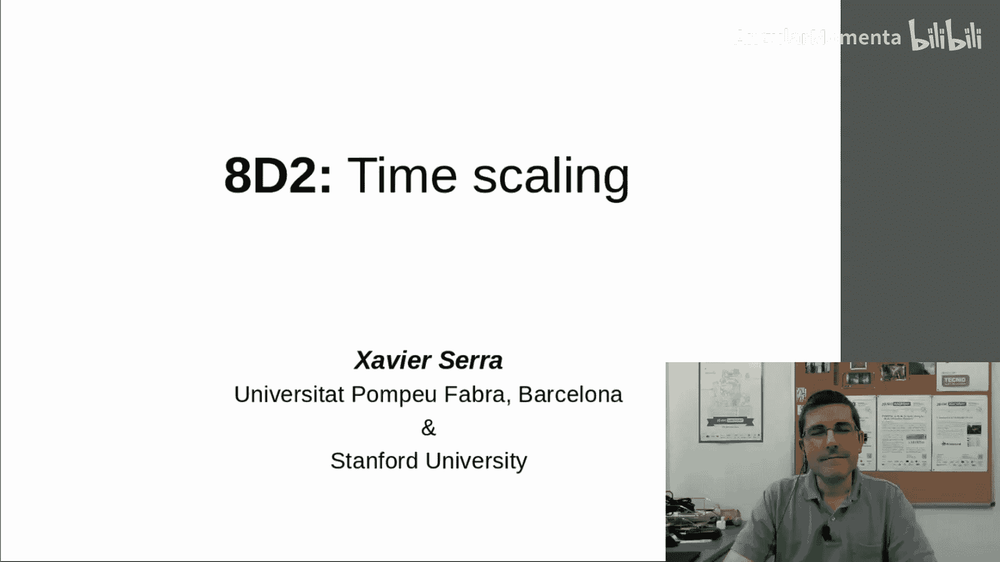

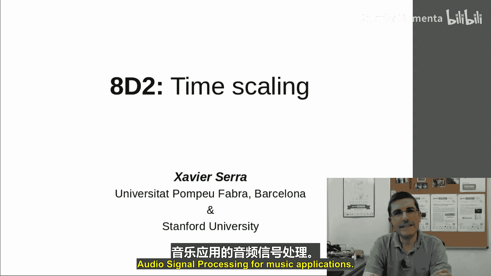

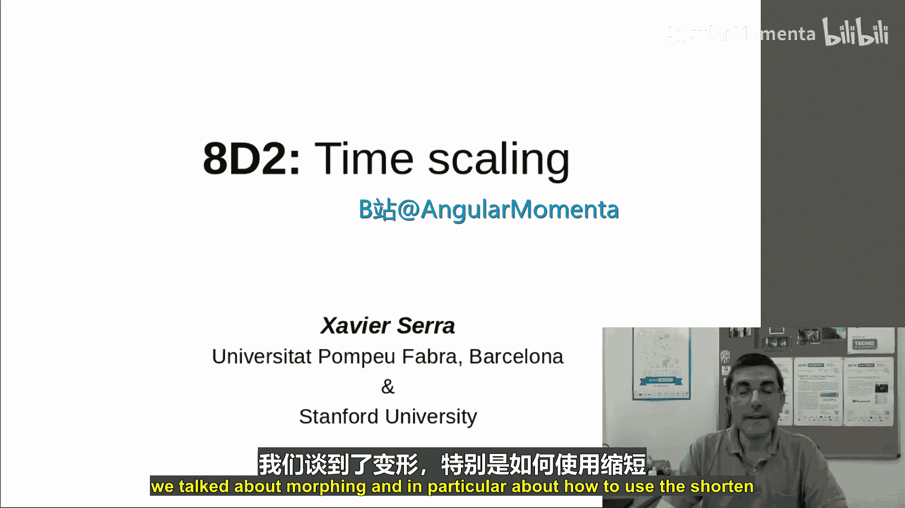

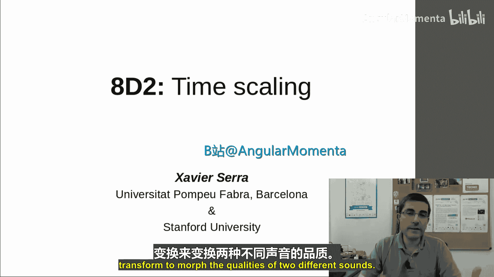

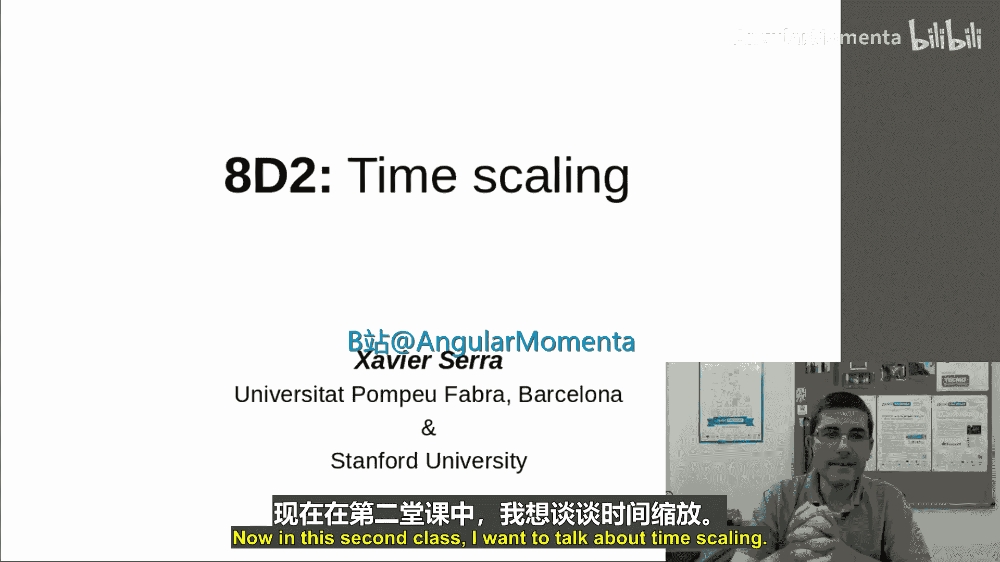

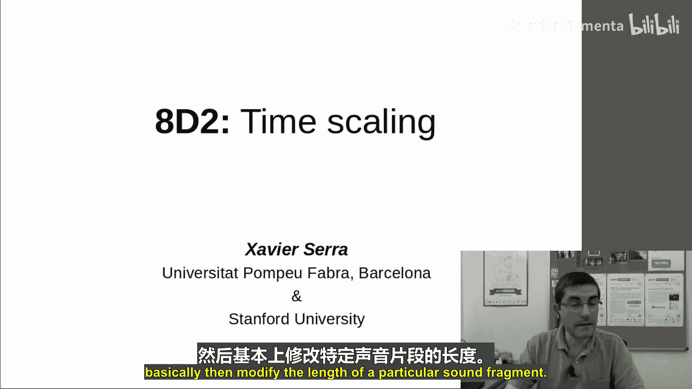

在本节课中，我们将要学习如何改变音频的时长，即时间缩放。我们将探讨两种不同的方法：一种是使用Audacity软件中的现成算法，另一种是使用基于正弦模型的SMS工具包进行更精细的控制。

上一节我们介绍了声音的变形技术，本节中我们来看看如何独立地改变声音的时长而不影响其音高。

## 概述：时间缩放的目标

时间缩放的目标是修改一段声音片段的长度。最直接的方法是改变播放速度，但这会同时改变声音的频率和时长。更理想的方法是只改变时长，同时保持声音原有的频率和音质不变。

## 使用Audacity进行时间缩放

以下是使用Audacity软件进行时间缩放的基本步骤。

### 1. 改变播放速度（简单方法）
这种方法直接修改样本的读取速度，会同时影响时长和频率。
*   在“效果”菜单中，选择“改变速度”。
*   例如，将速度提高30%，声音会变短、音调变高。

### 2. 使用滑动时间缩放/音高变换（高级方法）
这个算法基于正弦模型，可以独立控制时长和音高变化，质量更好。
*   在“效果”菜单中，选择“滑动时间缩放/音高变换”。
*   该算法允许设置起始和结束的时长变化百分比。
*   例如，可以设置起始时减慢22%，结束时加快30%。算法会基于正弦模型重新合成声音，在改变时长的同时保持音高不变。

## 使用SMS工具包进行时间缩放

现在，让我们转向我们自己的实现，使用基于正弦模型的SMS工具包来进行更自定义的时间缩放。

上一节我们使用了Audacity的黑盒算法，本节我们将手动设置参数，获得完全的控制权。

### 1. 正弦模型分析与再合成
首先，我们需要对原始声音进行正弦模型分析，并验证再合成的效果。
*   **选择分析参数**：对于钢琴这类谐波声音，需要设置合适的参数来区分频谱峰值。
    *   窗函数类型：汉明窗
    *   窗大小：例如1000个样本
    *   峰值阈值：例如-100 dB
    *   最大正弦波数量：例如200
*   **执行分析与再合成**：使用这些参数对原始钢琴音进行分析，并生成再合成的声音。通过对比原始音和再合成音，可以验证模型的有效性。

### 2. 应用时间缩放变换
在确认模型分析有效后，我们可以应用时间缩放变换。
*   **设置频率缩放曲线**：要只改变时间而不改变音高，需将频率缩放因子始终设置为1。
*   **设置时间缩放曲线**：通过定义时间映射点来控制时长的变化。
    *   **均匀拉伸**：例如，将终点时间映射设置为2，即可将声音拉伸为原长的两倍。
    *   **非线性拉伸**：可以设置多个控制点来实现复杂的时长变化。例如，起点映射为0，中点映射为0.5（加速），终点映射为1.3（减速），从而实现先加速后减速的效果。

## 总结

本节课中我们一起学习了时间缩放的两种实现方式。
*   我们首先使用Audacity软件演示了简单的速度改变和基于正弦模型的高级时间缩放算法。
*   接着，我们使用SMS工具包的正弦模型，通过手动设置分析参数和时间映射曲线，实现了自定义的、高质量的时间缩放变换。

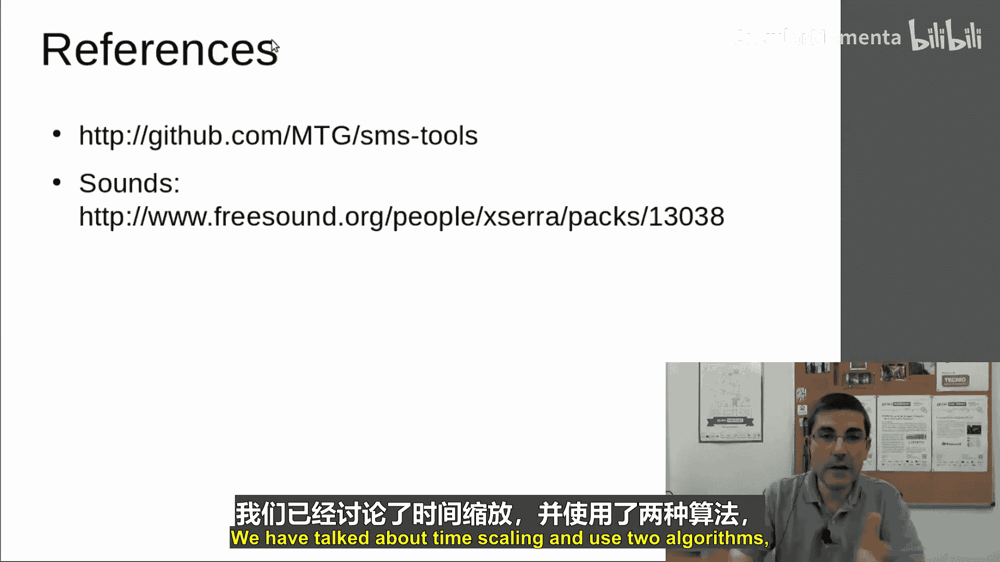

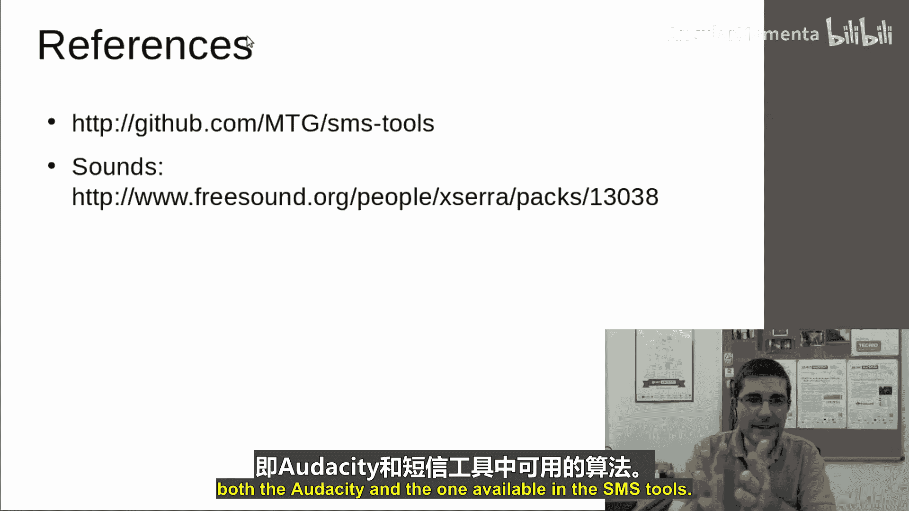

正弦模型在时间缩放操作中展现出巨大潜力，这是一种被广泛应用于多种场景的、非常有趣的变换。

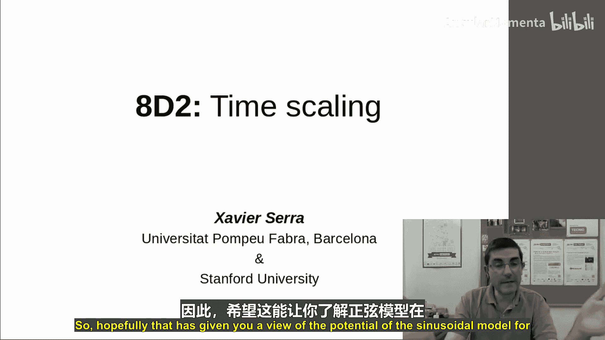

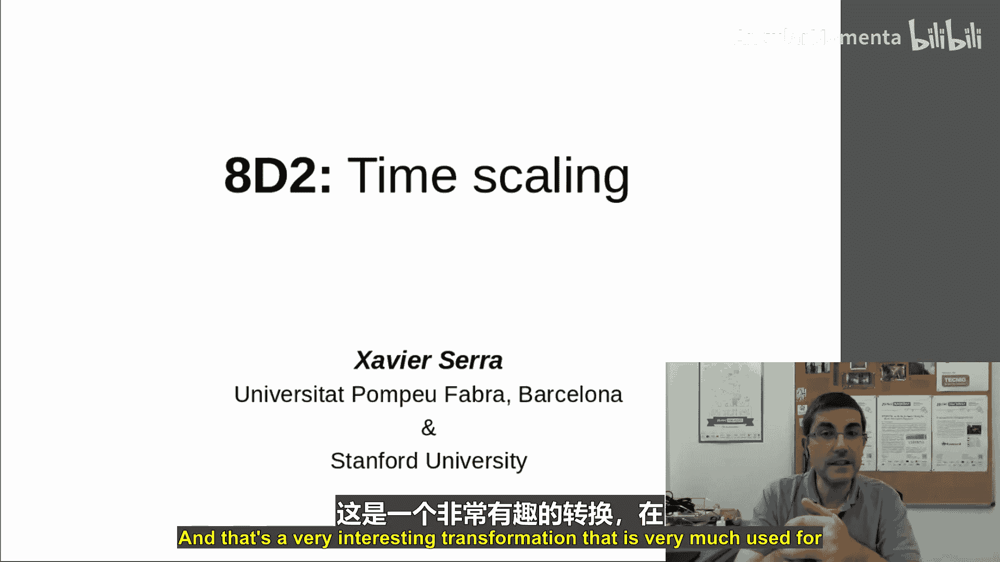

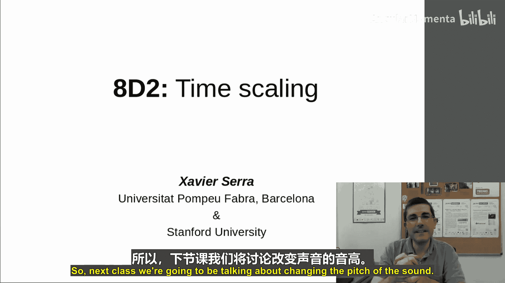

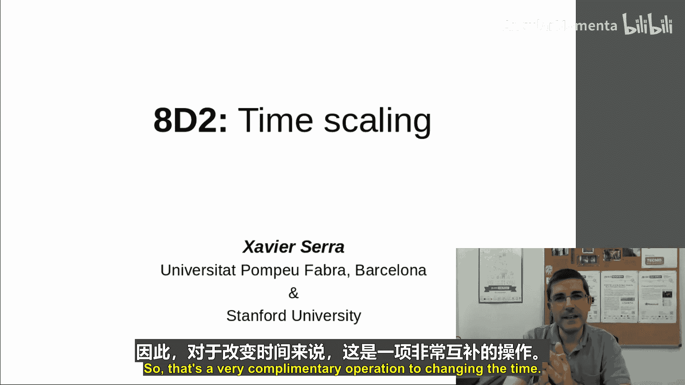

下一节课，我们将讨论如何改变声音的音高，这是与改变时长相辅相成的一项操作。