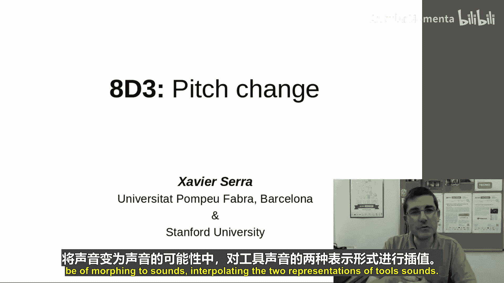

# 058：音高变化 🎵

在本节课中，我们将学习如何使用谐波加随机模型来改变声音的音高。我们将通过一个具体的萨克斯风声音示例，演示如何分析声音并应用音高变换。


## 概述


上一节我们讨论了如何使用正弦模型进行时间缩放。本节中，我们来看看如何使用谐波加随机模型来改变声音的频率，即实现音高变化。我们将学习如何分析声音以确定合适的模型参数，然后应用频率缩放和频率拉伸两种变换。

## 声音分析与参数设定

为了使用谐波加随机模型，我们需要先理解目标声音的特性。我们以一个萨克斯风声音为例。

以下是分析声音并确定模型参数的步骤：

1.  **观察频谱图**：通过观察声音的频谱图，特别是基频（第一谐波）的变化，我们可以了解声音中基频的范围。这有助于我们确定合适的分析窗长。
2.  **确定频率范围**：在频谱图中，我们可以找到最低和最高的基频值。例如，在这个萨克斯风声音中，最低音大约在450赫兹，最高音大约在650赫兹。
3.  **计算窗长**：窗长需要足够长，以准确分析最低的频率成分。一个常用的经验法则是：窗长（采样点数） = (采样率 / 最低频率) × 主瓣宽度系数。对于布莱克曼窗，其主瓣宽度约为6个采样点。因此，窗长可计算为 `(44100 / 400) * 6 ≈ 661`。我们选择一个奇数长度，例如661。

## 使用SMS工具进行分析

现在，我们使用SMS工具中的谐波加随机模型来分析声音。

以下是需要设置的关键参数及其解释：

*   **窗函数**：`blackman`（布莱克曼窗，旁瓣较低）。
*   **窗长**：`661`（基于上述计算）。
*   **FFT大小**：`2048`（使用零填充以获得更平滑的频谱）。
*   **峰值检测阈值**：`-100`（dB，用于检测谐波）。
*   **最小正弦波持续时间**：`0.1`（秒）。
*   **最大谐波数量**：`100`（一个足够覆盖所有可能谐波的安全值）。
*   **基频搜索范围**：`400` 到 `650`（赫兹，基于频谱图观察）。
*   **基频检测误差阈值**：`7`（允许的微小偏差）。
*   **随机成分近似因子**：`0.4`（控制随机成分的平滑度）。

分析完成后，我们可以分别聆听合成出的谐波成分、随机成分以及它们的和，以验证分析的质量。

## 应用音高变换

分析完成后，我们就可以进入变换阶段。我们主要关注两种频率变换：频率缩放和频率拉伸。

### 1. 频率缩放

频率缩放会按一个比例因子整体平移所有谐波的频率，从而改变音高，同时（如果启用频谱包络保持）尽量保持声音的频谱形状或“音色”。

**核心操作**：
*   设置一个缩放因子，例如 `0.8`，表示将所有频率降低到原来的80%。
*   启用 `频谱包络保持`（设置为1），这会使变换后的声音听起来更自然。

**代码示例（概念）**：
```
变换后频率 = 原始频率 × 缩放因子
```

### 2. 频率拉伸

频率拉伸会对谐波系列施加一个指数因子，使各次谐波不再保持等间距，从而产生非谐波频谱，改变声音的质感（例如，使其听起来更“金属化”）。

**核心操作**：
*   设置一个拉伸因子，例如从 `1.0`（起始，无拉伸）变化到 `1.1`（结束）。
*   这会导致高频谐波比低频谐波移动得更多，破坏了谐波关系。

**公式描述（概念）**：
```
第k次谐波变换后频率 = 基频 × k ^ 拉伸因子
```
当拉伸因子为1时，上式退变为标准的谐波关系。当拉伸因子大于1时，高频谐波间距会变大。

## 实践与探索

在演示中，我们首先应用了频率缩放（因子0.8），听到了音高降低但音色基本保持的萨克斯风声音。接着，我们应用了频率拉伸（因子从1.0线性增加到1.1），听到了声音逐渐从谐波变为非谐波、质感发生改变的效果。

你可以自由尝试这些参数：
*   尝试不同的频率缩放因子（如1.2来升高音高）。
*   尝试不同的频率拉伸曲线。
*   结合时间缩放参数，同时改变声音的时长和音高。

## 总结

本节课中，我们一起学习了如何使用谐波加随机模型进行音高变化。我们首先通过Sonic Visualizer等工具分析声音，确定模型参数；然后使用SMS工具进行分析与合成；最后，重点实践了**频率缩放**和**频率拉伸**两种变换，并理解了`频谱包络保持`参数对声音自然度的影响。音高变换是声音处理中的强大工具，谐波模型因其对声音结构的理解而在此类任务中表现出色。



在接下来的课程中，我们将探讨如何使用谐波加随机模型进行另一种有趣的变换——声音变形，即在两个声音的表示之间进行插值。