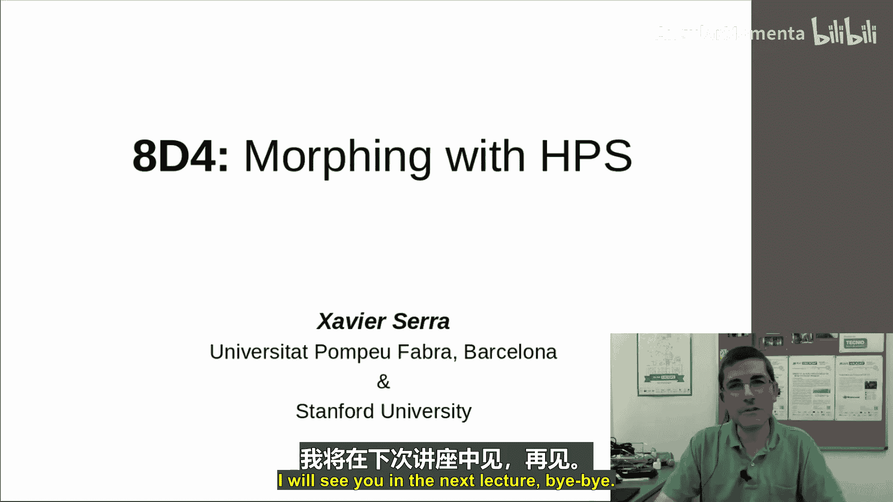

# 059：采用HPS的变形技术 🎵

在本节课中，我们将学习如何使用谐波加随机模型进行声音变形。我们将通过分析小提琴和女高音两种声音，并演示如何在这两种声音的参数之间进行插值，来实现不同于短时傅里叶变换的变形效果。

上一节我们介绍了使用短时傅里叶变换进行变形的方法，本节中我们来看看如何使用谐波加随机模型实现另一种形式的变形。该模型允许我们对声音的谐波频率、幅度以及随机成分进行独立的插值控制，从而提供更精细和多样化的变形可能性。

## 声音分析 🎻

要进行变形，首先需要对参与变形的每个声音进行良好的分析。我们将使用SMS工具中的谐波加随机模型。

以下是分析小提琴声音的步骤：
1.  选择**布莱克曼窗**，因其旁瓣较低，适合分析稳态音符。
2.  确定**窗长**。公式为：`窗长 = 6 * 采样率 / 基频`。小提琴音符B3的基频约为246 Hz，采样率为44100 Hz，因此计算得到窗长约为1075个样本。
3.  设置**FFT大小**为4096，以获得足够的零填充。
4.  设置**幅度阈值**为-100 dB。
5.  设置**正弦轨迹最小持续时间**为0.5秒，以获得更长的轨迹便于插值。
6.  设置**最大谐波数量**为100，以捕获尽可能多的谐波成分。
7.  设置**基频检测范围**为200至300 Hz。
8.  设置**基频检测误差阈值**为7%。
9.  设置**频率偏差**为0.1。
10. 设置**随机成分近似因子**为0.8，以保留较高质量的残差信号。

完成分析后，可以分别试听重构的正弦成分和随机成分，以验证分析质量。

接下来，以相似的步骤分析女高音声音（E4，基频约330 Hz）：
1.  窗长计算为：`6 * 44100 / 330 ≈ 801`个样本。
2.  基频检测范围设置为250至400 Hz。
3.  其他参数（如窗函数、FFT大小、谐波数量、随机因子等）保持与小提琴分析时一致，以确保后续插值的一致性。

## 执行变形 🧬

完成两个声音的分析后，即可进行变形处理。

以下是执行变形的具体步骤：
1.  打开SMS工具的**变换**界面，选择**HPS变形**选项。
2.  载入已分析好的两个声音（通常为默认设置）。
3.  根据之前的分析结果，分别设置两个声音的**分析参数**，包括窗长、FFT大小、阈值、谐波数量等。
4.  在变形界面中，我们可以独立控制三组参数的插值：
    *   **谐波频率**：控制音高的演变。
    *   **谐波幅度**：控制音色或共振峰结构的演变。
    *   **随机成分**：控制噪声或气息声成分的演变。
5.  通过设置**插值包络**，可以定义这些参数如何随时间从源声音过渡到目标声音。例如：
    *   让频率始终保持为小提琴的频率，而幅度从女高音过渡到小提琴，则会得到具有女高音音色的小提琴音高效果。
    *   让所有参数都从声音A（0时刻）线性过渡到声音B（1时刻），则会实现一个完整的声音变形过程。
6.  应用变形并试听结果。可以观察到，由于模型参数是独立插值的，变形过程可能产生非常平滑或具有特定艺术效果的过渡，这与基于STFT的频谱直接混合有本质区别。

## 总结 📝

本节课中我们一起学习了使用谐波加随机模型进行声音变形。关键点在于，该模型将声音分解为可控的谐波和随机成分，允许我们对这些成分的参数进行独立和精细的插值。这使得变形技术不再局限于简单的频谱混合，而是可以创造出在音高、音色和纹理上都可控的中间声音。虽然都称为“变形”，但所选用的模型从根本上决定了技术所能提供的可能性和最终的艺术效果。