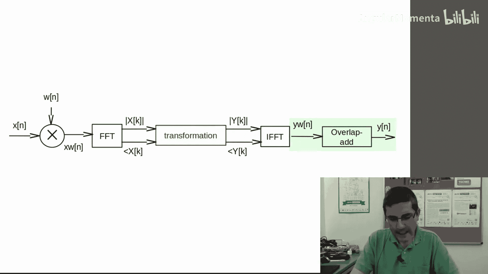
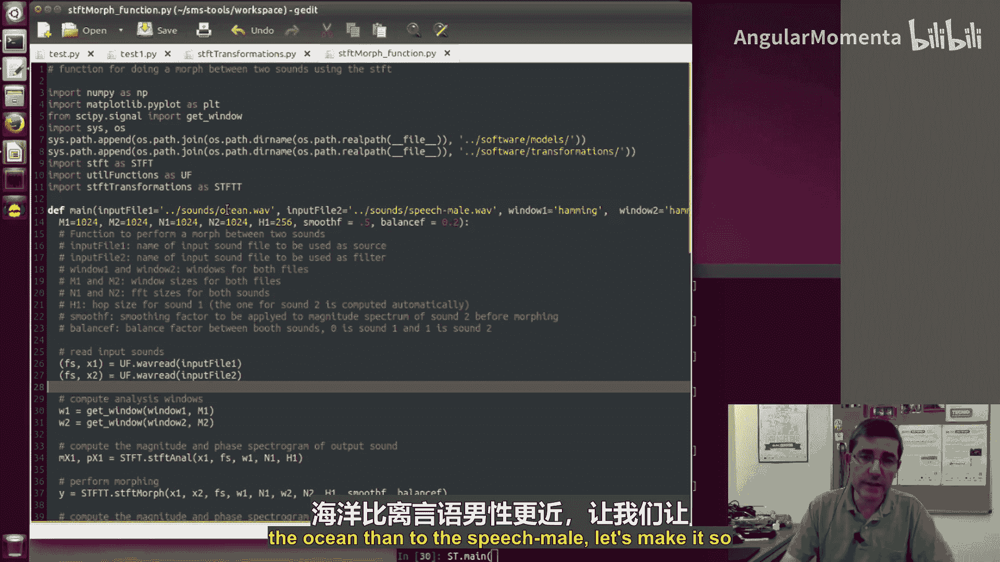
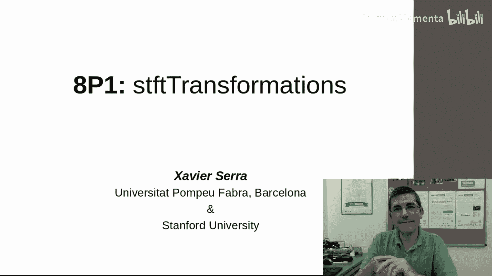

# 060：短时傅里叶变换转换 🎵

在本节课中，我们将学习如何利用短时傅里叶变换对音频信号进行转换。我们将重点介绍两种基本操作：频域滤波和声音形态混合。通过理解这些核心概念和代码实现，你将能够开始对音频的频谱特性进行修改和创造。

## 概述

上一节我们介绍了频谱建模方法的基本概念。本节中，我们来看看如何利用短时傅里叶变换对音频信号进行具体的转换操作。我们将通过分析代码，学习如何对单帧音频进行滤波，以及如何将两个声音的频谱进行混合。

## 频域滤波操作

首先，我们探讨如何对音频信号的一个帧进行滤波。其核心思想是在对声音进行STFT分析后，在频域对其幅度谱进行修改，然后再通过逆傅里叶变换合成新的声音。

以下是实现该过程的步骤：

1.  **读取音频信号**：将音频文件加载到数组 `X` 中。
2.  **定义窗函数**：创建一个与FFT长度 `N` 相同的窗函数（如汉宁窗）。
3.  **选取音频片段**：从原始音频中截取一帧，长度为512个样本。
4.  **设计频域滤波器**：在分贝尺度上定义一个平滑的形状作为滤波器。例如，可以使用一个倒置的汉宁窗形状，并将其乘以-60分贝以产生衰减效果。公式表示为：
    `filter = -60 * hanning_window`
5.  **计算频谱**：计算选定音频片段的幅度谱 `M` 和相位谱 `P`。
6.  **应用滤波器**：将滤波器形状叠加到原始幅度谱的特定频段上。例如，将长度为30个样本的滤波器以第40个频率样本为中心进行应用。
7.  **逆变换与合成**：将修改后的幅度谱与原始相位谱结合，进行逆傅里叶变换，得到处理后的时域信号 `y`。

运行此代码后，可以观察到原始信号的波形、滤波器形状、原始幅度谱、修改后的幅度谱以及最终输出信号的波形。通过对比原始信号（绿色）和滤波后信号（蓝色），可以清晰地看到特定频率成分被衰减的效果。

## 声音形态混合

接下来，我们讨论一个更有趣的操作：声音形态混合。这个操作旨在将一个声音的频谱特征平滑地融合到另一个声音中。

以下是实现两个声音单帧混合的步骤：

1.  **准备两个声音**：例如，一个雨声 `sound1` 和一个女高音 `sound2`。
2.  **选取对齐的帧**：从两个声音中分别截取长度相同的音频片段。
3.  **计算频谱**：分别计算两个片段的幅度谱 `MX1` 和 `MX2`。
4.  **平滑处理**：对第二个声音的幅度谱 `MX2` 进行平滑处理，以获取其大致的频谱包络。这可以通过下采样再上采样插值来实现，平滑因子控制平滑程度。
5.  **线性混合**：将第一个声音的幅度谱与平滑后的第二个声音幅度谱进行线性组合。混合公式为：
    `M = (1 - balance) * MX1 + balance * MX2_smooth`
    其中，`balance` 参数控制第二个声音的贡献比例。
6.  **合成新声音**：使用混合后的幅度谱 `M` 和第一个声音的相位谱 `P1` 进行逆傅里叶变换，生成混合后的音频帧 `y`。

通过调整 `balance` 参数（例如从0.7改为0.1），可以观察到输出频谱更接近雨声（`balance` 值小）或更接近人声（`balance` 值大）。这直观地展示了频谱插值的效果。

## 完整音频文件的处理

上述操作是针对单帧的演示。在实际的SMS工具包中，`stftTransformations.py` 文件提供了可应用于整个音频文件的函数。

*   **`stft_filtering` 函数**：实现了对整个音频信号进行频域滤波的流程，其核心是一个循环，对每一帧重复执行分析、滤波和合成操作。
*   **`stft_morph` 函数**：实现了对整个音频信号进行形态混合的流程。它接收两个声音信号、窗函数参数、平滑因子和平衡因子，并对所有帧执行混合操作。
*   **主程序接口**：一个名为 `main` 的函数集成了读取音频、STFT分析、形态混合、绘制频谱图（声谱图）以及输出最终音频文件的功能。通过调用此接口并调整参数（如 `balance=0.9`），可以生成一个更接近人声特性的、基于海洋声音时长的新音频文件。

## 总结

本节课中我们一起学习了利用短时傅里叶变换进行音频转换的基础方法。我们掌握了两种核心操作：
1.  **频域滤波**：通过修改特定频段的幅度谱来衰减或增强声音的某些成分。
2.  **声音形态混合**：通过线性插值两个声音的幅度谱，创造出一个兼具两者频谱特征的新声音。

这些是基于频谱工具最简单但非常实用的转换类型，为许多音频应用提供了创意可能。在下一讲中，我们将探讨如何在正弦模型中使用SMS工具实现类似的转换。