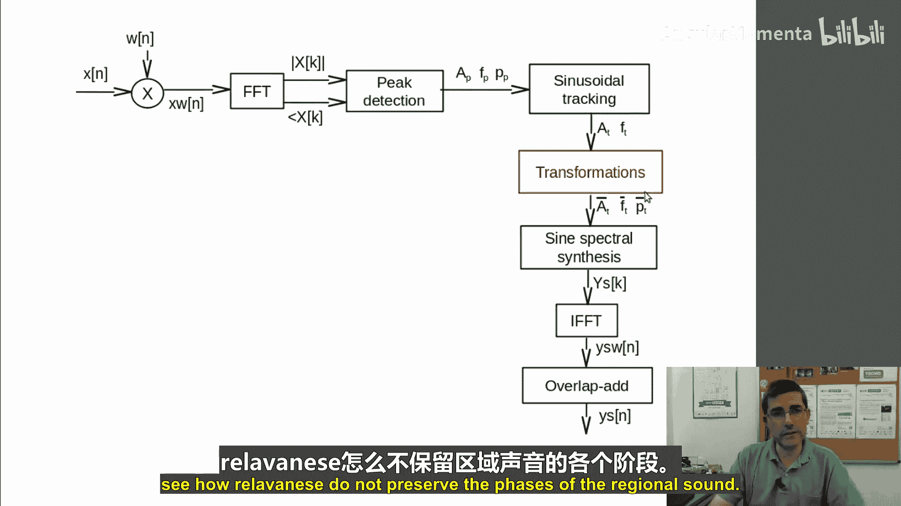
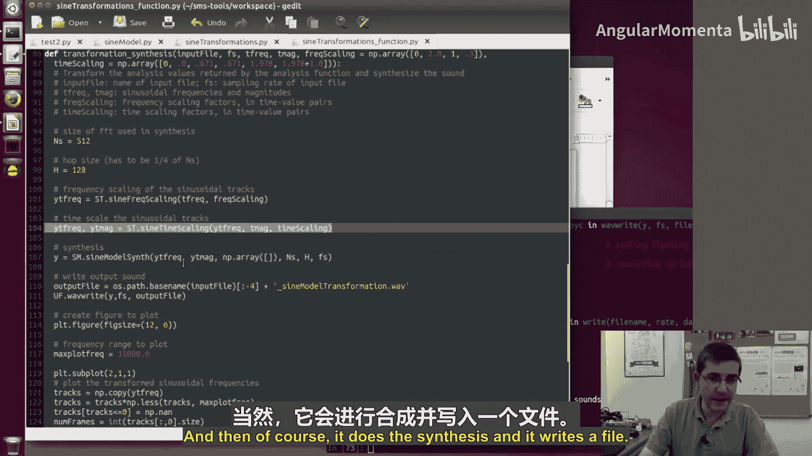
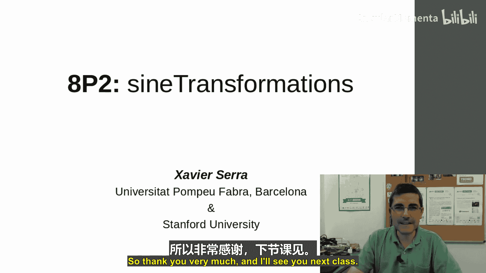

# 061：正弦变换

在本节课中，我们将学习如何对正弦模型表示的声音进行变换。我们将通过分析SMS工具包中的代码，理解如何操作正弦分量的幅度和频率来实现时间拉伸和频率变换。

## 概述

在之前的课程中，我们介绍了频谱建模策略。本节我们将聚焦于正弦模型，探讨如何通过修改其分析参数（幅度和频率）来变换声音。我们将看到，大多数变换操作需要重新生成相位信息，而非使用原始相位。

## 正弦模型的相位处理



上一节我们介绍了正弦模型的整体框架。本节中我们来看看相位在合成过程中的作用。

正弦模型的合成通常不直接使用分析得到的原始相位。这是因为当改变声音的时间或频率时，相位关系会随之改变，原始相位不再适用。合成器会根据频率轨迹重新生成相位，以保持相位连续性。

以下是一个演示脚本，它分析了钢琴声音，并分别使用原始相位和重新生成的相位进行合成。

```python
# 导入必要的包
import numpy as np
import matplotlib.pyplot as plt
from scipy.io import wavfile
# ... 其他导入

# 分析参数设置
window = ‘hamming’
M = 2048
N = 4096
t = -80
minSineDur = 0.1
maxnSines = 20
freqDevOffset = 10
freqDevSlope = 0.001

# 读取音频文件
fs, x = wavfile.read(‘piano.wav’)

# 调用正弦模型分析函数
hM1, hM2 = int(np.floor((M+1)/2)), int(np.floor(M/2))
x1 = np.append(np.zeros(hM2), x)
x1 = np.append(x1, np.zeros(hM2))
plt.plot(x1)
plt.show()

# 分析得到频率、幅度和相位
tfreq, tmag, tphase = SM.sineModelAnal(x1, fs, window, N, H, t, maxnSines, minSineDur, freqDevOffset, freqDevSlope)

# 使用原始相位进行合成
y = SM.sineModelSynth(tfreq, tmag, tphase, M, H, fs)
```

运行上述代码后，对比原始声音和用原始相位合成的声音，两者非常接近。然而，如果我们传入一个空数组代替相位参数，让合成器重新生成相位，结果会如何？

```python
# 使用重新生成的相位进行合成（传入空相位数组）
y_regenerated = SM.sineModelSynth(tfreq, tmag, np.array([]), M, H, fs)
```

此时，合成声音的波形形状与原始声音差异显著，尽管听觉上可能仍相似。这表明相位信息对波形形态影响很大，但在正弦模型中，为了适应变换，我们选择重新生成相位。

## 正弦模型合成代码解析

为了理解相位是如何重新生成的，我们需要查看`sineModelSynth`函数中的相关代码。

```python
# 在合成主循环中
if phase.size > 0:
    # 使用输入的相位
    synthesis_phase = phase[:, frame]
else:
    # 重新生成相位：基于前一帧相位和当前频率计算
    synthesis_phase = previous_phase + 2 * np.pi * freq[:, frame] * H / fs
```

代码逻辑是：如果输入了有效的相位数组，则直接使用；否则，算法从一个随机初始相位开始，后续每一帧的相位根据当前帧的频率和帧移`H`计算得到，从而保证变换后的相位连续性。

## 正弦变换的类型与实现

理解了相位处理后，我们来看看具体的变换操作。SMS工具包中的正弦变换主要分为两类。

以下是两种核心变换的实现思路：

### 1. 时间缩放
此变换通过操作正弦模型的帧序列来改变声音的时长。
*   **原理**：它接受频率和幅度轨迹，通过插入或跳过帧来延长或缩短声音。
*   **核心操作**：生成新的频率和幅度矩阵，在其中重复或删除原始帧，以匹配目标时长，同时保持帧率不变。
*   **公式/代码概念**：
    `new_frames = interpolate_or_repeat(original_frames, time_scaling_factor)`

### 2. 频率缩放
此变换通过缩放每个正弦分量的频率来改变声音的音高。
*   **原理**：它接受频率轨迹，并将每一帧中所有正弦分量的频率乘以一个缩放因子。
*   **核心操作**：缩放因子可以随时间变化，实现对声音的连续变调。
*   **公式**：
    `f_transformed(t) = f_original(t) * scaling_factor(t)`

## 变换流程集成

SMS工具包提供了一个集成的函数来执行完整的分析-变换-合成流程。



以下是该流程的步骤：
1.  **分析**：使用默认参数对输入声音进行正弦模型分析，并绘制频谱等中间数据。
2.  **变换**：调用上述的时间缩放或频率缩放函数，对分析得到的频率和幅度数据进行修改。
3.  **合成**：使用修改后的数据（及重新生成的相位）进行合成，并输出音频文件。

调用该函数后，我们可以得到并对比原始声音谱图、重新合成的声音谱图以及变换后（如频率被缩放、时间被拉伸）的声音谱图。

## 总结

本节课中我们一起学习了正弦模型下的声音变换技术。我们了解到，由于变换操作会破坏原始的相位关系，因此合成时需要基于频率轨迹重新生成相位。我们探讨了两种基本的正弦变换：**时间缩放**（通过插帧改变时长）和**频率缩放**（通过乘因子改变音高），并通过代码了解了其实现原理。这些变换为我们提供了灵活的声音处理能力，能够创造出时间拉伸和音高变化的效果。



下一讲，我们将继续探讨另一种模型——谐波加随机模型——下的变换技术，特别是声音渐变（Morphing），并分析其实现代码。