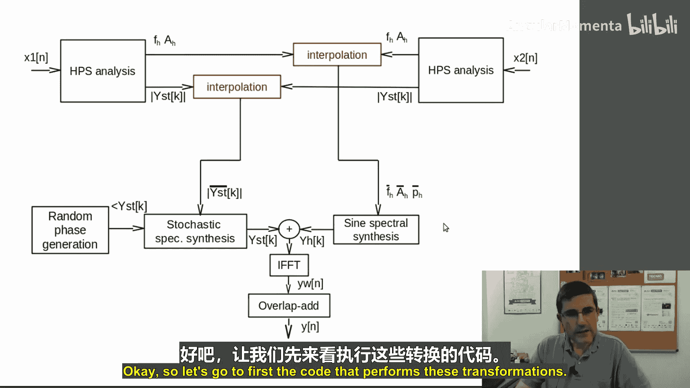
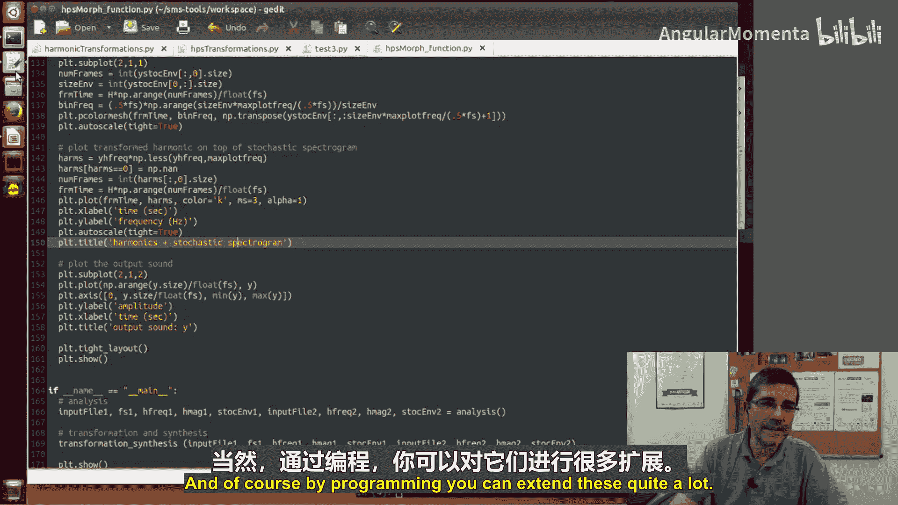
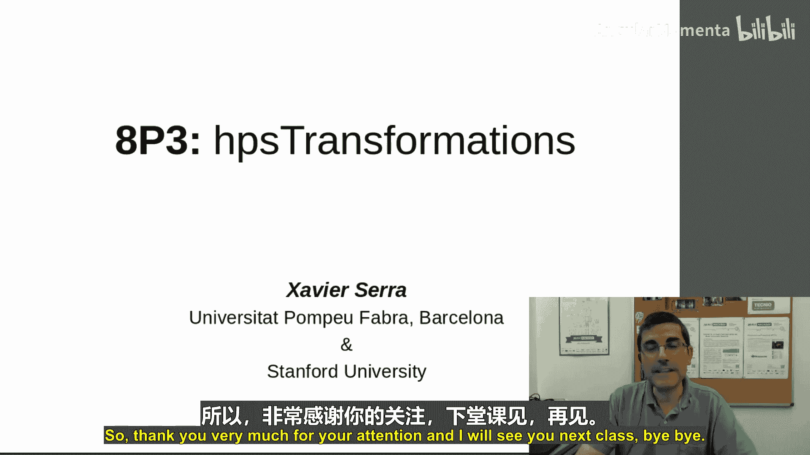

# 062：HPST变换 🎵

在本节课中，我们将学习谐波加随机模型中最复杂的变换操作。我们将探讨如何对谐波成分和随机成分分别进行变换，并深入了解声音形态变换的实现原理。

上一节我们介绍了频谱建模的基本概念，本节中我们来看看如何对谐波加随机模型进行具体的变换操作。

## 概述

谐波加随机模型是我们在本课程中涵盖的最复杂的模型。其核心思想是将声音分解为谐波成分和随机成分，然后分别对它们进行变换处理。这种模型允许我们进行多种高级的声音操作，包括频率缩放、时间拉伸以及声音形态变换。

## 谐波变换

谐波变换专门处理模型中的谐波成分。在SMS工具包中，相关的代码位于 `harmonicTransformations.py` 文件中。该文件实现了三种主要的变换操作。

以下是三种核心的谐波变换：

1.  **频率缩放**：对谐波频率进行统一的乘法缩放，实现声音的移调。
    *   **公式**：`f_scaled = f_original * scale_factor`
2.  **频率拉伸**：以非谐波的方式拉伸频率，改变声音的频谱结构。
    *   **公式**：`f_stretched = f_original * (stretch_factor ** harmonic_number)`
3.  **音色保持**：在变换频率的同时，调整谐波幅度以保持原始声音的频谱包络形状，从而保留音色。

## 组合变换与形态变换

除了单独的谐波变换，还有针对谐波与随机成分组合的变换。相关代码位于 `HTransformations.py` 文件中。

以下是两种主要的组合变换：

*   **时间缩放**：同时对谐波的频率、幅度以及随机包络进行时间维度的拉伸或压缩。其核心是通过插值或删减帧来实现。
*   **声音形态变换**：这是最复杂的变换。它需要分析两个声音，然后在它们的谐波参数（频率、幅度）和随机包络之间进行插值，从而生成一个介于两个原始声音之间的新声音。

形态变换的核心逻辑是寻找两个声音在同一帧中都存在的谐波，然后对这些共有的谐波参数进行插值计算。这要求两个声音的帧数、谐波数量以及随机包络的断点数量最好保持一致。

## 代码实现与使用

在SMS工具包中，形态变换的功能由 `H_morph` 函数封装。该函数内部主要分为两个部分：

1.  **分析函数**：对两个输入声音进行分析，提取它们的谐波与随机参数。
2.  **变换与合成函数**：对分析得到的参数进行插值变换，然后重新合成出新的声音。

你可以直接运行 `H_morph.py` 文件来体验整个流程，也可以单独导入文件并调用这两个函数进行更灵活的操作。

## 总结

本节课中我们一起学习了谐波加随机模型的变换技术。作为最复杂的模型，它能对符合谐波特性的声音进行丰富而有趣的变换。关键在于进行正确的分析，并妥善控制这些更复杂的声学表示。如果声音满足该模型的前提条件，我们能实现的声音处理可能性将非常巨大。