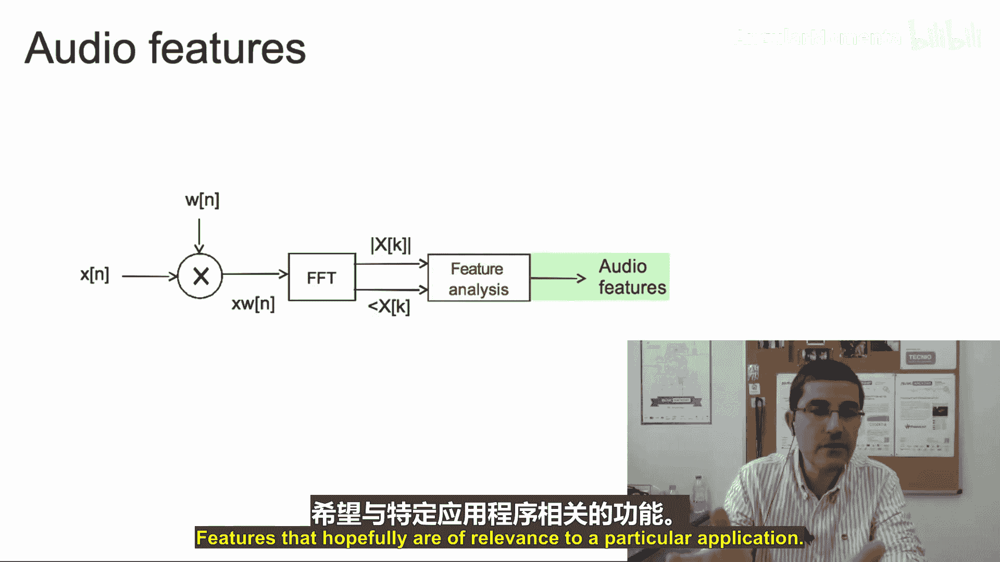
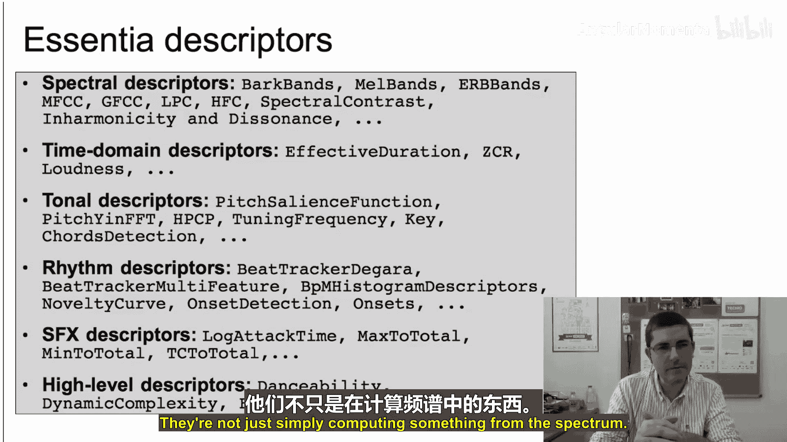
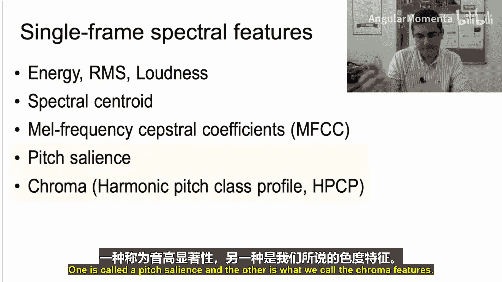
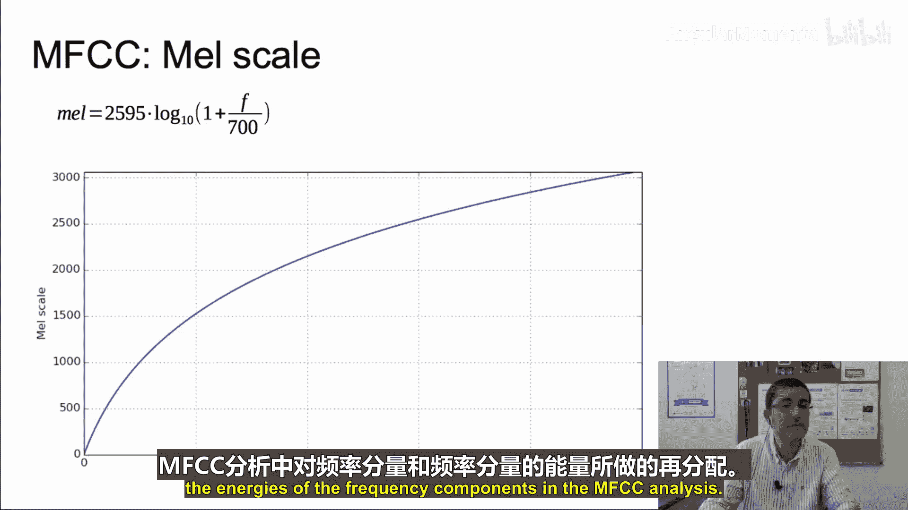
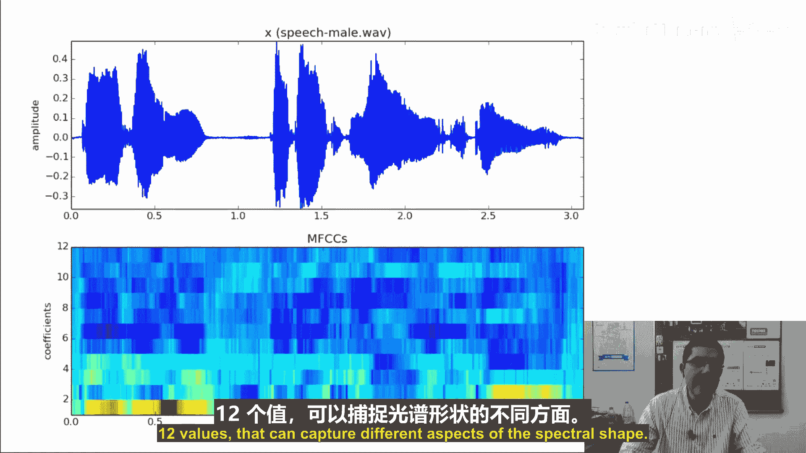
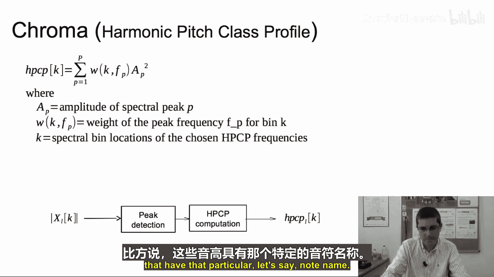
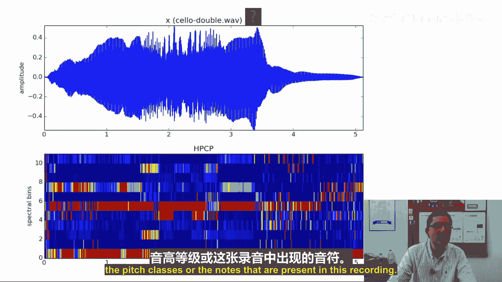
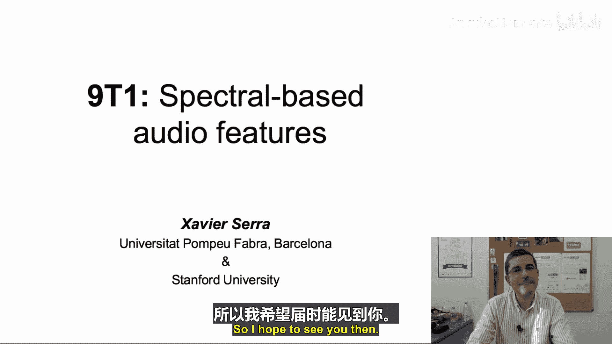

# 063：音频特征 🎵

在本节课中，我们将学习如何描述声音，具体介绍一系列可以从音频信号中提取的音频特征。我们将从单帧频谱中提取的特征开始，然后讨论需要多帧分析的特征。

上一周我们讨论了频谱建模技术在声音变换方面的应用。本节中，我们将转向另一类应用——声音描述。

## 音频特征提取概述

音频特征提取通常基于频谱分析。以下是其通用处理流程框图：

我们从信号 `x` 开始，用窗函数截取一段，然后通过快速傅里叶变换计算其频谱，得到幅度谱和相位谱。正是从这里，我们提取出音频信号的相关特征，这些特征对于特定应用至关重要。

## 音频特征分类

我们将使用开源音频分析库 **Essentia** 来提取音频特征。Essentia 包含大量用于音乐描述的算法。以下是其主要特征类别：

*   **频谱描述符**：直接从频谱中提取的特征，例如频带能量、梅尔频带、MFCC、LPC等。
*   **时域描述符**：直接从时域信号中提取的特征，例如时长、过零率。
*   **音高相关描述符**：通常也使用频谱技术，例如音高显著度、HPCP（谐波音级轮廓）、调性识别。
*   **节奏描述符**：用于识别节拍、速度、起始点等节奏相关信息。
*   **音效描述符**：描述声音的标准特性，例如起音、能量。
*   **高级描述符**：试图描述更高层次的音乐概念，例如可舞性、声音复杂度。

大多数特征是按帧计算的。接下来，我们来看一些具体例子。

## 单帧音频特征示例

我们将首先讨论与能量相关的描述符，然后是与频谱形状相关的描述符，最后介绍两个与音高信息相关的特征。

### 能量相关特征

音频帧的能量可以从幅度谱计算，也可以直接从时域信号计算。

*   **能量**：通过对幅度谱的平方求和计算。
    `能量 = Σ |X[k]|²`
*   **均方根**：能量的修正版本，是能量算术平均值的平方根。
    `RMS = sqrt( (1/N) * Σ |x[n]|² )`
*   **史蒂文斯幂定律（响度）**：一种试图模拟感知强度的度量，通过对3000赫兹纯音的声压级进行感知归一化来实现。这是一个简单的响度近似度量。

下图展示了从一段钢琴音中计算的这三个能量相关特征。它们高度相关，但各有不同，可用于测量声音的整体能量或响度。

### 频谱形状特征

上一节我们介绍了能量特征，本节中我们来看看如何描述声音的频谱形状。

*   **频谱质心**：表示频谱的“质量中心”，感知上与声音的明亮度印象高度相关。它计算为信号中频率的加权平均值。
    `频谱质心 = (Σ k * |X[k]|) / (Σ |X[k]|)`
    下图展示了一段男性语音及其频谱质心随时间的变化。无声或噪声部分质心较高，浊音部分质心较低。

    

*   **梅尔频率倒谱系数**：以更复杂的方式表征频谱形状。MFCC 是幅度谱的一种表示，通过对在对数梅尔尺度上的幅度谱进行余弦变换得到。
    梅尔尺度近似于人耳的频率分辨率，将感知频率与实际测量频率联系起来，使频谱特征更贴近我们的听觉感受。
    处理流程为：幅度谱 -> 梅尔尺度滤波器组 -> 取对数 -> 离散余弦变换 -> MFCC系数。
    通常使用前12个系数（第0个系数与能量相关，常被忽略）。第一个系数描述频谱的整体形状，更高阶的系数描述更细微的变化。MFCC 提供了频谱形状的紧凑向量表示。

    

### 音高相关特征

现在，让我们探讨一些与声音音高信息相关的特征。

*   **音高显著度**：衡量信号中音高声音存在程度的度量。Essentia 中的实现从频谱峰值开始，通过求和每个可能基频的谐波加权能量，计算每个峰值处的显著度。通常取每帧中的最大显著度，来表示该帧存在良好音高声音的概率。
    下图展示了一个中国管弦乐片段的音高显著度，可以可视化地估计每帧中音高声音的存在。

    

*   **色度特征与HPCP**：色度是音乐感知和理论中的一个概念，代表了音高组织的内在循环性——不同八度中相同音高的音符具有相同的色度。**谐波音级轮廓**（HPCP）是色度特征的一种具体实现，它是信号能量在一组预定义音级上的分布。
    分析将频谱折叠到一个八度内（通常分为12个半音），并计算每个音级（如C, C#, D等）的能量。
    下图展示了大提琴双音片段的HPCP分析，可以清楚地看到持续存在的稳定音高（A和D）。

    

## 多帧音频特征

前面介绍的特征主要基于单帧分析。现在，我们转向需要分析多帧序列（即声音片段）才能计算的特征。

以下是三个例子：

1.  **音频分割与起始点检测**：通过计算衡量频率内容变化的频谱特征来实现。
    *   **频谱通量**：比较连续频谱的差异，对其绝对值（L1范数）求和，得到频谱变化度量，可用于检测声音变化点。
        `频谱通量 = Σ | |X_t[k]| - |X_{t-1}[k]| |`
    *   **高频内容**：检测高频成分的含量，并与前一帧比较。声音起始（起音）通常伴随着高频成分的增加，因此可用于起始点检测。
    下图展示了同一段语音的频谱通量和归一化的起始点检测函数。

    

2.  **主要音高**：在更复杂的声音中测量主要旋律音高。该算法从幅度谱和峰值开始，计算音高显著度，然后识别不同的音高轮廓，并从中选择最突出的一个作为主要旋律。下图展示了从一段复调音乐中提取的主要旋律线（绿色）。

3.  **特征统计聚合**：大多数帧级特征可以在完整录音或声音片段上聚合，通过计算统计量来获得特征更整体的行为视图。通常计算矩：
    *   **一阶矩（均值）**：特征的平均值。
    *   **二阶矩（方差）**：特征的变化程度。
    *   **三阶矩（偏度）**：特征分布偏离对称（高斯）分布的程度。
    通过这三个统计量，可以很好地了解特定音频特征在片段中的行为。

## 总结与参考资料

本节课中，我们一起学习了声音描述的应用，讨论了几种可以从音频信号中提取并用于表征声音的音频特征。我们涵盖了能量、频谱形状、音高相关的单帧特征，以及需要多帧分析的起始点检测、主要音高和统计聚合特征。

在下一讲中，我们将把这个特征提取的概念扩展到对声音集合进行表征。

**参考资料**：
*   Essentia 库文档及其引用的原始论文是了解这些描述符的起点。
*   维基百科上关于频谱质心、MFCC、响度、HPCP、起始点检测和矩等主题有大量信息。
*   本讲座中展示图表的代码可在 SMS Tools 的 GitHub 页面上找到。

---
*内容翻译整理自巴塞罗那庞培法布拉大学《音乐应用中的音频信号处理》课程第09讲。*