# 064：声音与音乐描述 🎵

在本节课中，我们将学习如何描述单个声音以及声音集合。我们将介绍音乐信息平面的概念，并区分通用声音描述与音乐特定描述之间的差异。课程将涵盖声音集合的描述方法，包括相似性度量、聚类和分类，并简要探讨音乐描述中更高级、更复杂的挑战。

## 音乐信息平面 🎼

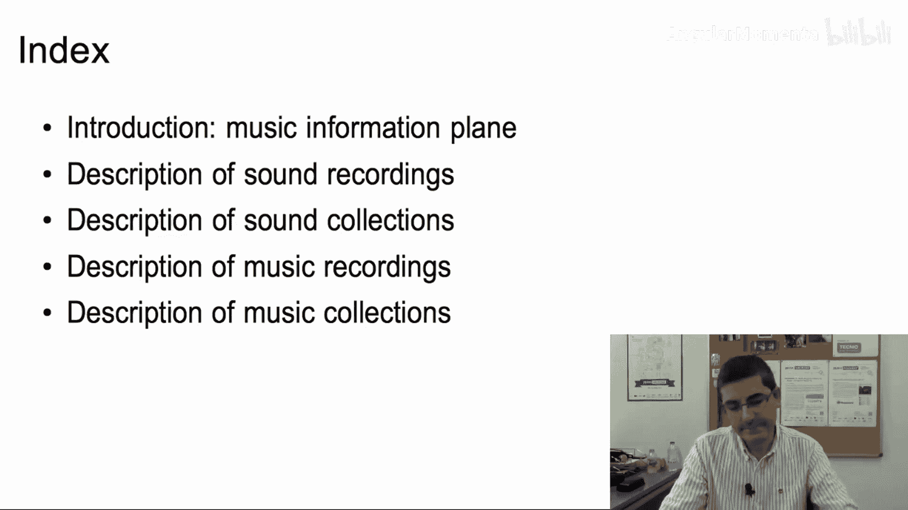

上一节我们介绍了音频特征，本节中我们来看看如何将这些特征置于一个更宏观的框架中，以理解音乐描述的不同层次。音乐信息平面是一个帮助我们理解音乐描述在不同语境下含义的框架。

它考虑了从物理层面到认知层面的不同抽象级别。

*   **物理层面**：这是最低的层面，涉及声音的基本物理属性。例如，频率、持续时间、频谱（及其特征如质心）和强度。
*   **感官层面**：这一层面将物理属性转化为人类的感知。例如，音高（对应频率）、感知时长（对应持续时间）、音色（对应频谱）和响度（对应强度）。
*   **感知层面**：这一层面涉及与音乐概念更相关的感知主题。例如，音高相关的连续或同时的音程（音符）、时间的结构化（如节拍）、音色的可识别特征（如频谱包络）以及音乐的力度。
*   **形式化层面**：这一层面以更形式化的方式讨论音乐概念。例如，旋律、调性、节奏型、速度、节拍、乐器或人声的识别，以及发音方式。
*   **认知层面**：这是最高层面，涉及人类主观的音乐聆听体验。例如，情感、音乐风格或语义概念。这一层面整合了所有较低层次的描述，并且具有很强的主观性和文化性。

我们将主要关注声音的低层次描述，目标是达到对用户应用有足够相关性的描述级别。

## 通用声音描述 🔊

如果我们想以通用的方式描述声音（例如在免费音效库中找到的声音），可以将音频特征分组。

以下是音频特征的主要类别：

*   **音色相关特征**：例如频谱质心、梅尔频率倒谱系数、高频内容等。
*   **动态相关特征**：主要指响度和录音电平。
*   **音高相关特征**：例如基频或音高显著性。
*   **形态特征**：描述声音随时间演变的特征，例如包络、起始速率等。

我们已经学习了许多这样的描述符。现在有趣的是，我们可以基于这些特征来分析声音集合。

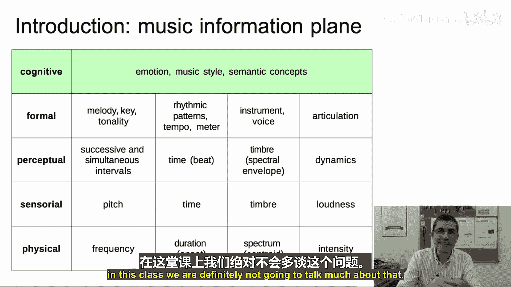

## 描述声音集合 📊

上一节我们介绍了单个声音的特征，本节中我们来看看如何描述声音的集合。描述声音集合有多种方法，我们将聚焦于三个基本概念。

以下是描述声音集合的三个核心步骤：

1.  **相似性**：这是最基本的概念。我们需要度量声音之间的相似性，才能形成集合或对其进行分组。
2.  **聚类**：一旦能够度量相似性，我们就可以根据某些标准对声音进行聚类或分组。
3.  **分类**：如果我们已知一些用于描述特定声音组的现有标签（类别），就可以对声音进行分类，为其分配类别。

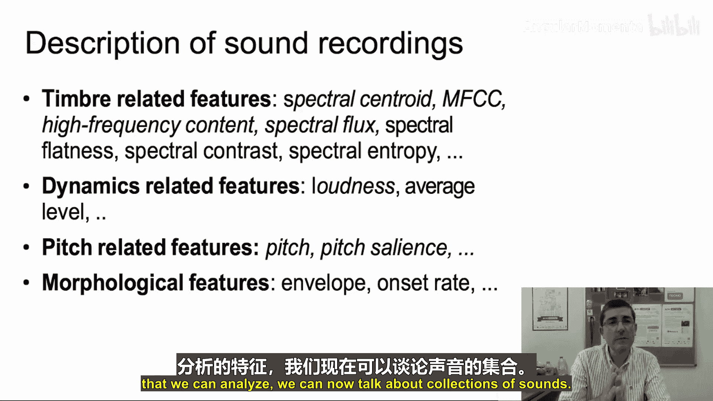

### 声音的空间表示与距离度量

在我们的上下文中，声音集合可以用图表表示。我们将一个声音视为一组音频特征值。为了简化，假设一个声音只用两个特征表示，那么它可以被显示为二维空间中的一个点。

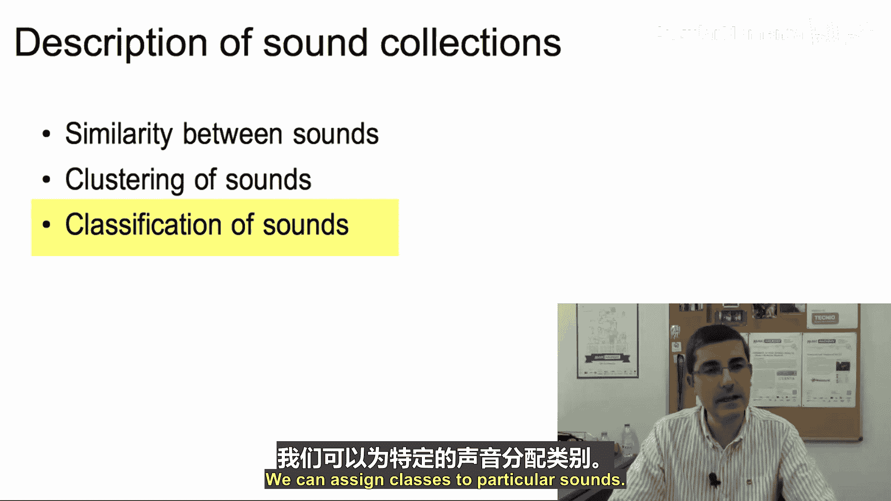

例如，水平轴可以是频谱质心的均值，垂直轴可以是梅尔频率倒谱系数第二个系数的均值。通过分析小提琴、长笛和小号的声音，我们可以看到这些乐器根据这两个特征在空间中形成了不同的区域。

为了在这个空间中操作，最基本的是测量声音（点）之间的距离。**欧几里得距离**是衡量多维空间中两点距离的最简单方法之一。

给定两个声音 **P** 和 **Q**，每个声音有 *D* 个特征，欧几里得距离公式为：
`distance(P, Q) = sqrt( sum_{i=1}^{D} (P_i - Q_i)^2 )`

在只有两个特征的二维空间中，这就是连接两点的线段的长度。

### 聚类声音：K均值算法

知道了如何测量距离，我们就可以对声音进行聚类。**K均值**是一种聚类算法。

如果我们给算法指定期望的聚类数量 *K*，它将创建聚类并返回每个聚类的均值（中心点）。

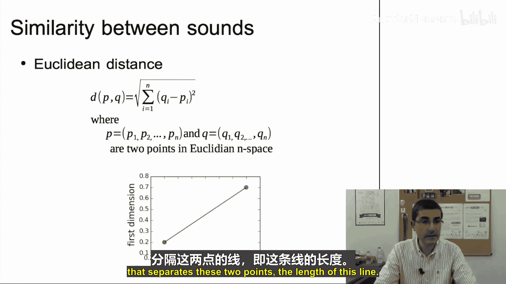

K均值聚类旨在将 *N* 个观测值（即声音）划分为 *K* 个聚类，每个观测值属于具有最近均值的聚类。这个均值充当了该聚类的原型。

寻找这些均值（聚类）的问题在计算上是困难的（NP难），但存在高效的经验算法能快速收敛到局部最优解。

其目标是最小化以下公式的总和，为每个聚类 *k* 找到均值 **μ_k**：
`minimize sum_{k=1}^{K} sum_{x in S_k} ||x - μ_k||^2`
其中 *S_k* 是第 *k* 个聚类中的点集。

通过迭代优化，算法可以从随机初始化的聚类中心开始，逐步调整，最终将声音聚类到特征相似的分组中。

### 分类声音：K近邻算法

最后，我们来讨论声音集合的分类。这意味着我们已知一些声音类别，目标是给定一个新声音，将其分类到已知的类别之一。

**K近邻** 分类器是用于此类任务的算法。

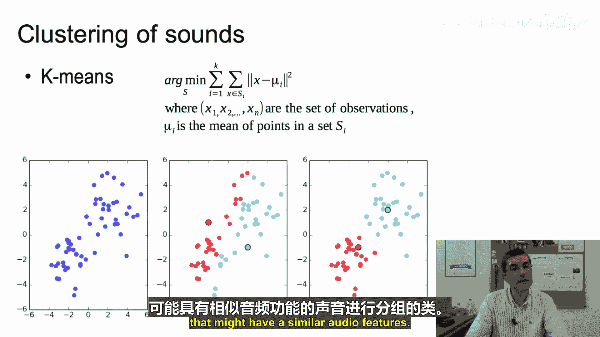

KNN实现的规则是：通过将查询声音分配给其 *K* 个最近邻居中最常见的类别来对其进行分类。

这个过程可以概括为：从查询声音（新声音）开始，计算它与所有已标记样本的欧几里得距离，选取距离最近的 *K* 个邻居，然后根据这 *K* 个邻居的类别进行多数投票，将得票最多的类别分配给查询声音。

这是一种简单但有效的对声音（或任何其他类型数据）进行分类的方法。

## 音乐描述 🎶

现在，如果我们转向音乐声音，即音乐片段的录音，需要分析的特征应该更具体，并且与音乐及有意义的概念更相关。

让我们尝试定义一些与音乐相关的特征或描述符类别。

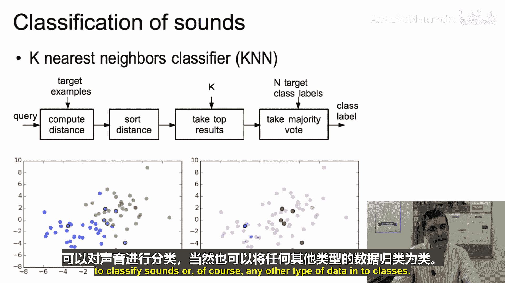

以下是音乐相关的描述符类别：

*   **音色相关描述符**：例如乐器特征化、配器特征化，甚至音乐录音的混音方式。
*   **旋律与和声相关描述符**：包括乐句、动机、主音。对于非西方音乐传统，如印度音乐的拉格或土耳其音乐的玛卡姆。
*   **节奏相关描述符**：包括节奏型、速度、节拍。在许多音乐传统中，节拍循环的概念是思考节奏的重要方式。
*   **结构描述符**：描述音乐作品的结构，定义其段落或乐章。

这些描述通常不能仅通过音频分析获得。我们通常从音频特征开始，但必须开发结合多个特征的模型来捕捉每个概念的本质。这超出了本课程的范围，是一个活跃的研究领域。

## 音乐集合描述 🎧

描述音乐集合则更加困难。如果我们想执行与音乐相关的任务，音乐集合的描述可能非常复杂。这被称为**音乐信息检索**领域。

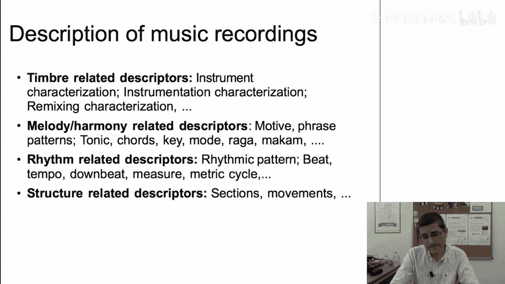

我们希望能够自动对音乐作品进行分类，并执行诸如推荐音乐或查找相关音乐等任务。

我们为声音讨论的概念在这里也适用，但必须进行调整。相似性仍然是基本概念，但我们可以从不同方面来定义它，例如节奏相似性、配器相似性、旋律相似性、和声相似性、结构相似性等。这些相似性显然不是简单的欧几里得距离，我们需要开发更复杂的相似性度量。

然后，我们可以根据不同的标准对音乐作品进行分类和聚类，例如按流派、风格、艺术家或音乐传统所属的学派进行分类。

这远远超出了本课程所能涵盖的内容，但它是我们所讨论内容的一个自然延续，也是一个引人入胜的话题。

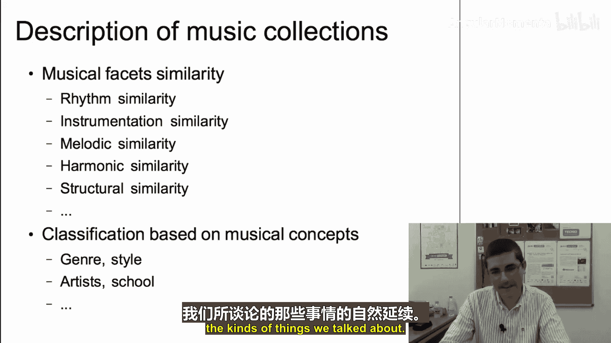

## 延伸阅读与总结 📚

鉴于这是一个非常开放的研究问题，参考文献通常来自研究论文，大量研究被归类在**音乐信息检索** 领域。维基百科上关于音乐信息检索的条目是一个很好的起点。

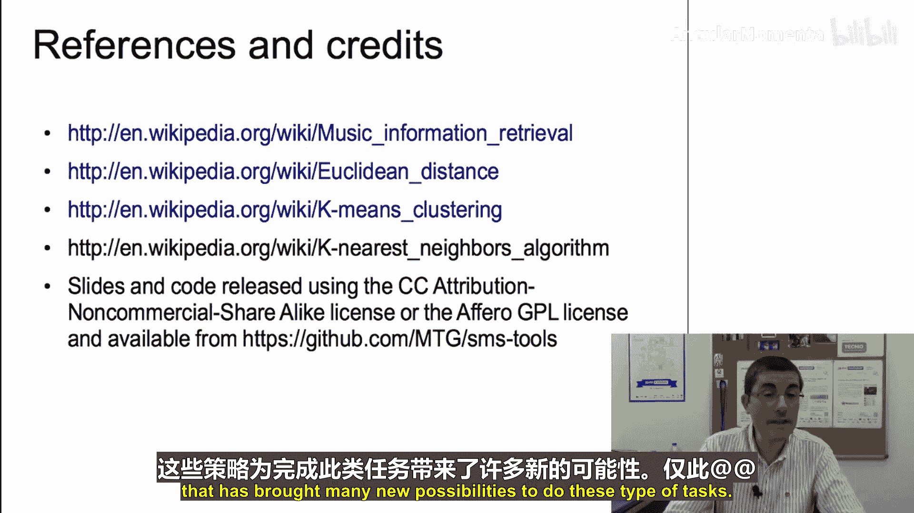

对于我们所讨论的更具体的内容，您可以查看维基百科上关于欧几里得距离、K均值聚类或K近邻分类的特定条目。当然，这些只是众多聚类和分类策略中的两个例子，机器学习领域带来了许多执行此类任务的新可能性。

本节课中，我们开启了一扇通往庞大研究领域的大门，该领域旨在自动描述和组织大量的声音和音乐录音集合。我们只是介绍了一些可以用于开始研究此主题的基本概念和具体方法。

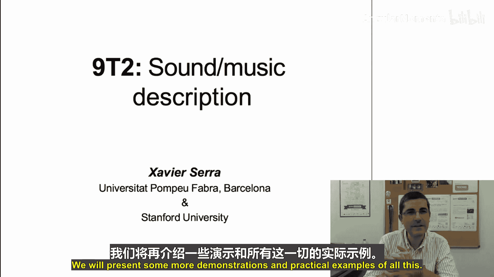

在编程讲座中，我们将展示一些如何实际进行这些操作的示例，但显然我们无法完全展现这个研究领域的全貌。希望您能对其有所了解。下节课我们将展示更多关于所有这些内容的演示和实际例子。