# 065：声音描述符提取演示

在本节课中，我们将学习如何使用 Sonic Visualizer 软件来提取和分析音频信号的特征描述符。我们将通过实际操作，演示如何计算起始点、梅尔频率倒谱系数和色度特征，从而直观地理解这些在理论课中介绍过的概念。

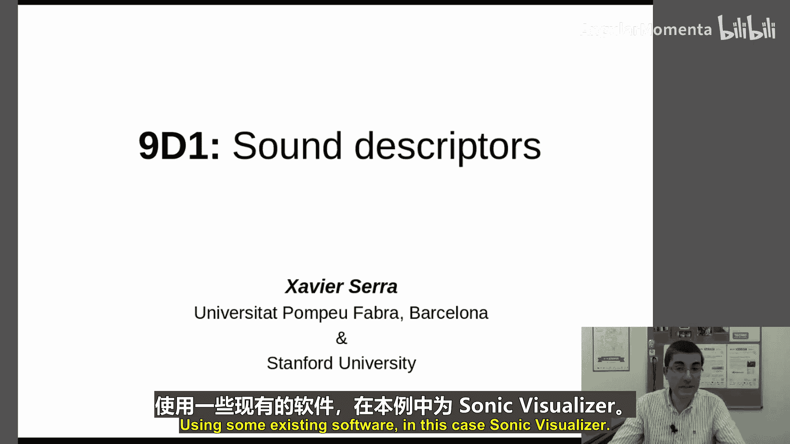

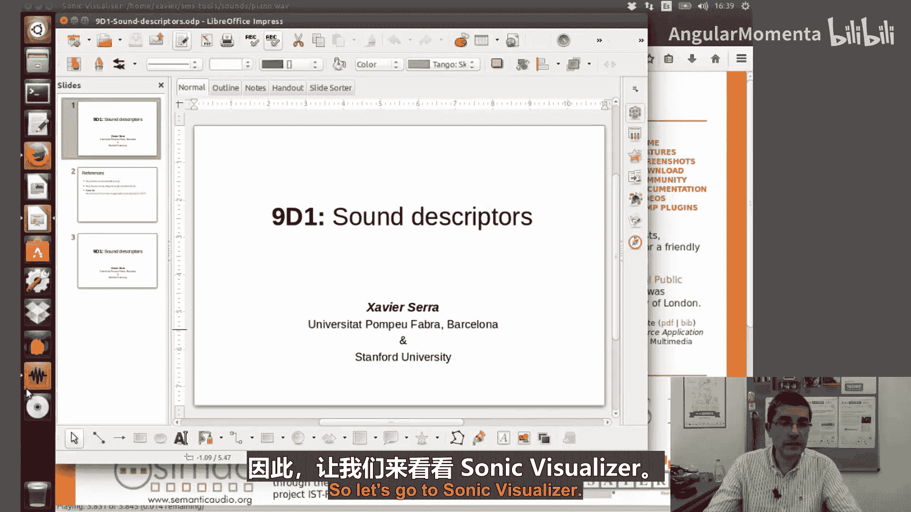

---

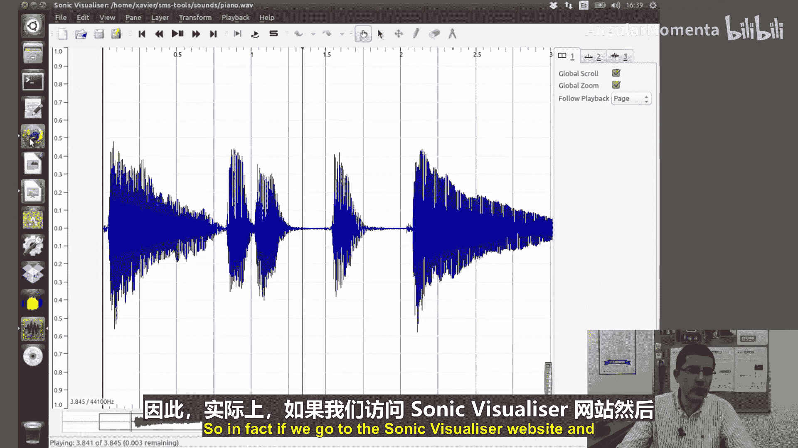

## 🎵 打开音频文件

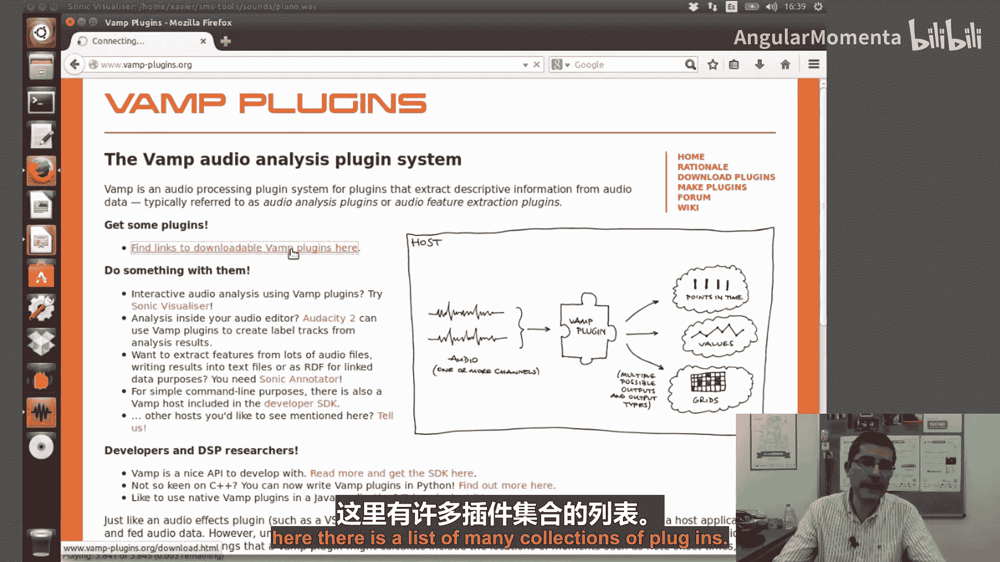

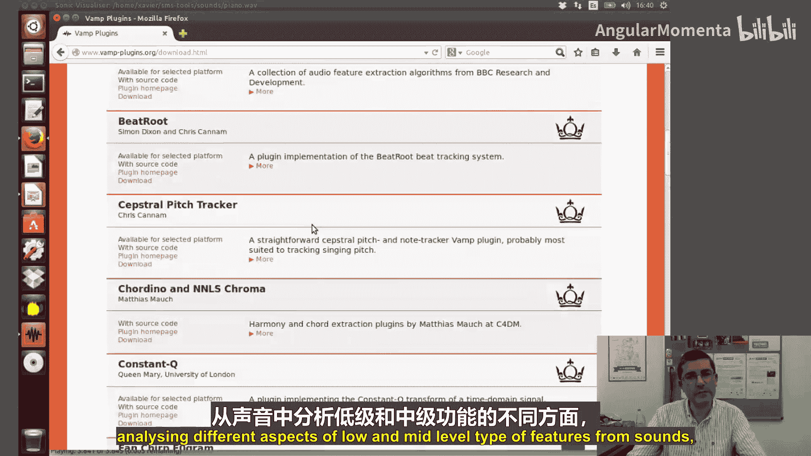

首先，我们打开一个熟悉的钢琴音频文件。

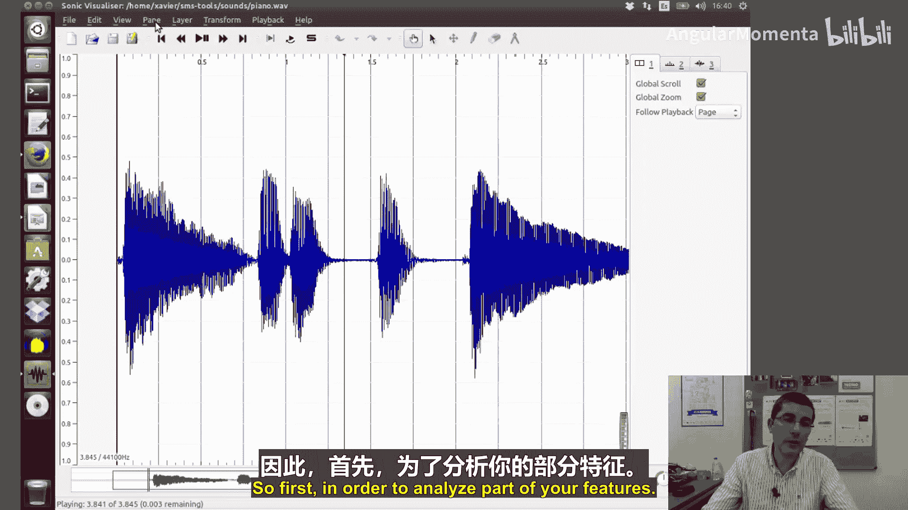

## 🔌 安装与使用插件

Sonic Visualizer 的强大功能依赖于各种插件。我们可以从其官网下载。

以下是获取插件的步骤：
1.  访问 Sonic Visualizer 网站。
2.  进入 “Bump Plugins” 菜单。
3.  从列表中选择并下载所需的插件集合。

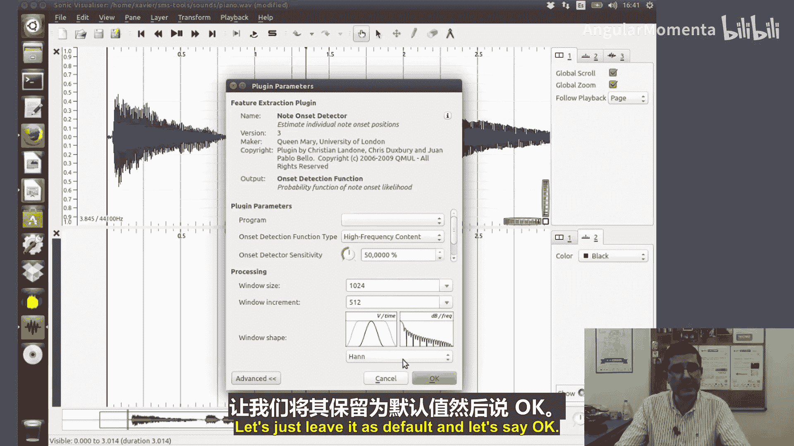

这些插件大多用于分析声音的低层和中层特征。我已经下载了来自开发方 Queen Mary 大学的一些核心插件。

为了进行分析，我们需要先创建一个空白的图层来显示特征。

## ⏱️ 提取起始点特征

上一节我们介绍了如何准备分析环境，本节中我们来看看如何提取时间域特征，例如起始点。

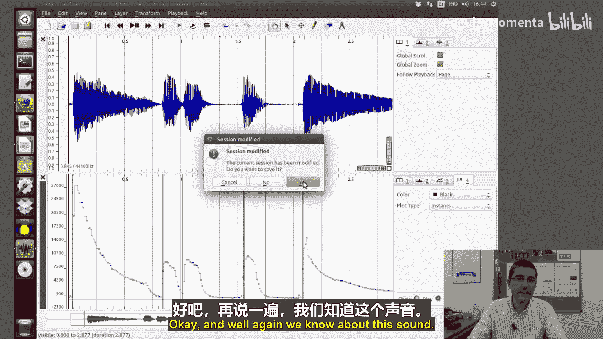

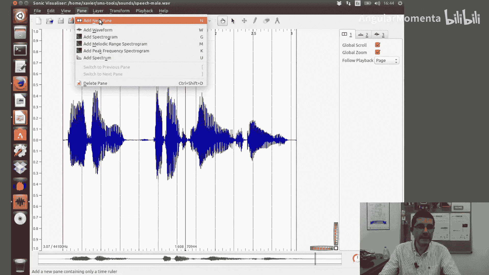

在 “Transform” 菜单下，选择 “Analysis by Category”，里面分类列出了不同类型的特征。我们进入 “Time-Domain Features” 下的 “Onsets”。

这里有一个起始点检测插件，由 Queen Mary 大学开发。其参数包括使用的特征类型、窗口大小和跳跃大小等。在理论课中，我们提到过高频内容特征，这里我们选择它，并暂时使用默认参数。

点击确定后，软件会高效地计算出起始点函数。结果显示，该函数清晰地反映了信号的动态变化，峰值通常出现在音符的起振时刻。

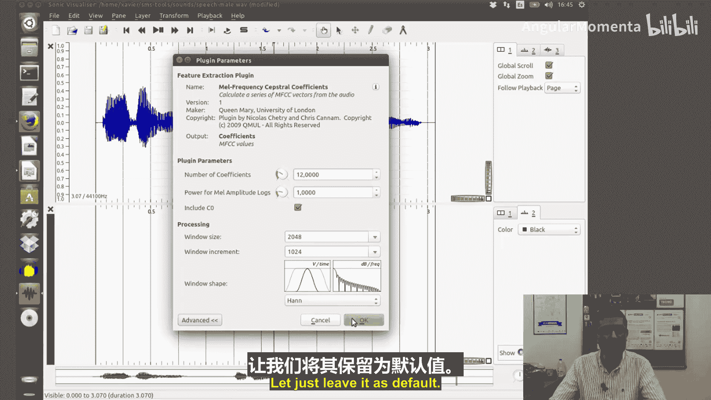

如果我们想精确定位起始点的位置，可以使用同一插件组中的峰值拾取功能。

以下是设置峰值拾取参数的步骤：
*   再次选择高频内容作为特征。
*   调整灵敏度参数。首次分析时，算法可能将衰减部分误判为起始点。
*   将灵敏度调低（例如设为19%）后重新分析。
*   此时，检测到的起始点就准确地对应了每个音符的开始。

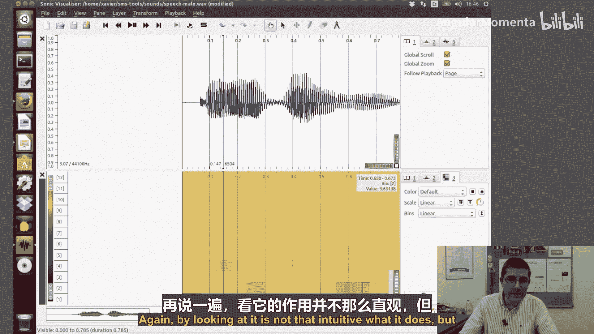

## 🗣️ 分析梅尔频率倒谱系数

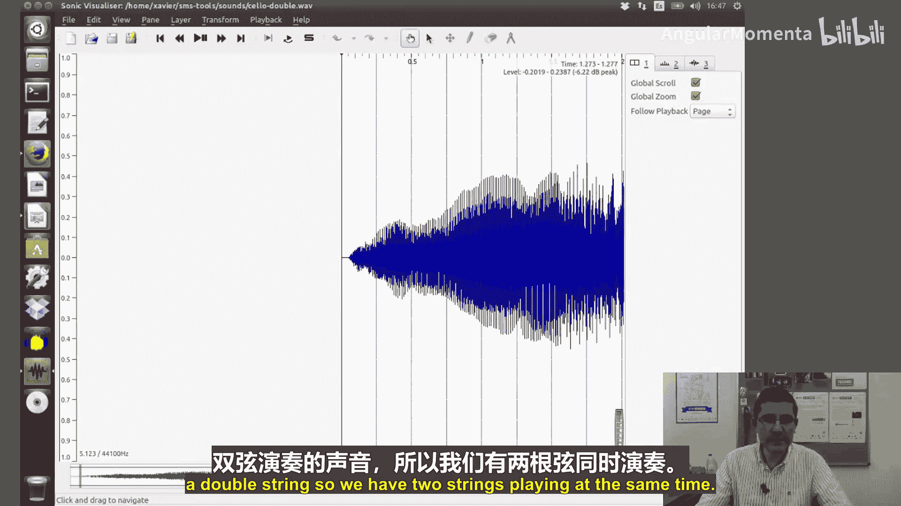

接下来，我们打开一个语音文件，并分析其 MFCC 特征。

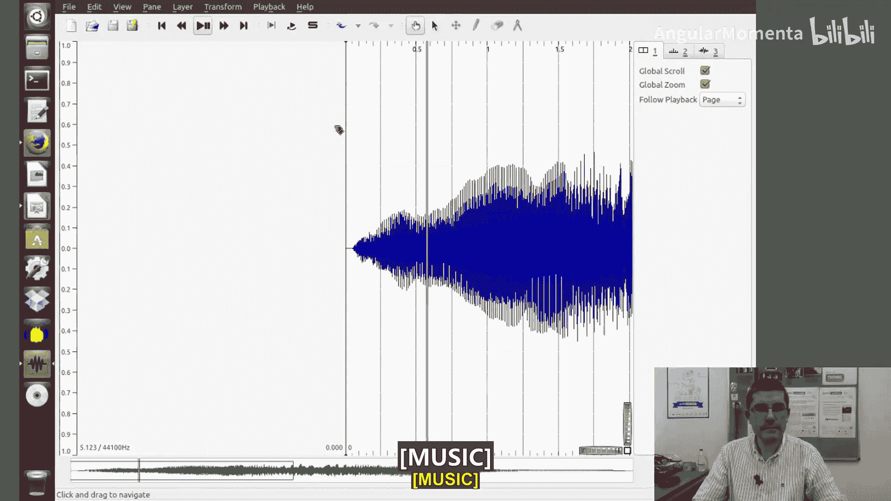

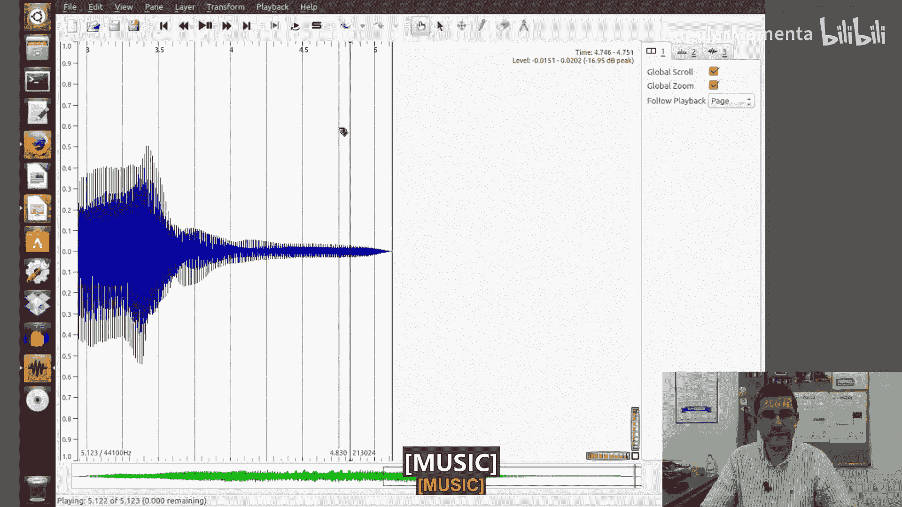

我们创建一个新图层，然后在 “Analysis by Category” 中选择 “Low-Level Features” 下的 “Mel-Frequency Coefficients”。

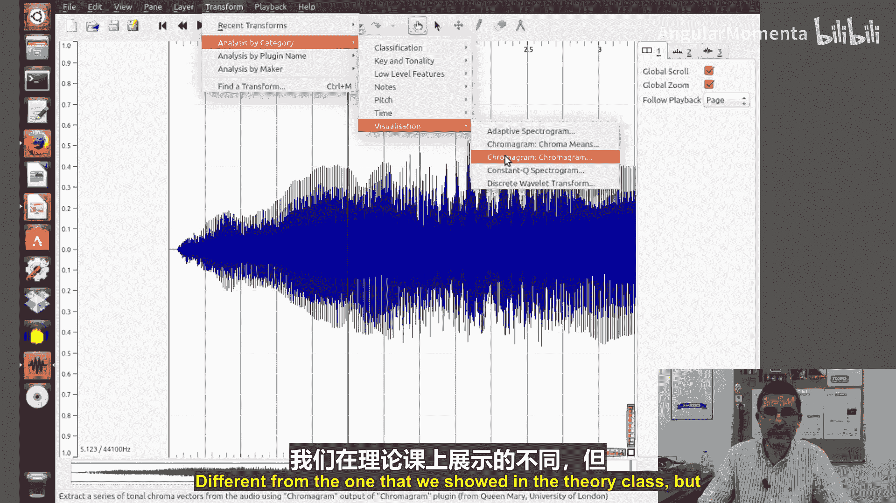

这个插件同样由 Queen Mary 大学提供。在音乐分析中，我们通常使用比语音分析更多的系数。对于语音，12个系数通常足够。我们可以选择是否显示第0个系数，它大致代表了信号的响度能量。我们保留显示它，并使用默认的频谱分析参数。

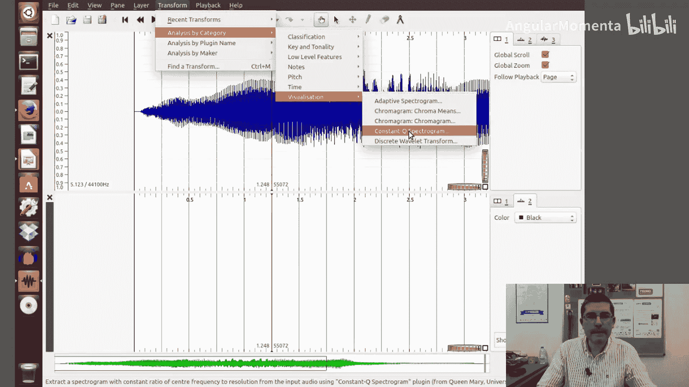

计算完成后，我们可以看到所有系数随时间变化的曲线。展开视图，还能看到具体的数值。第一个系数代表声音的响度，后续系数则描述了频谱包络的形状。虽然直观理解这些系数并不容易，但它们是语音识别和音色分析中非常紧凑且有效的描述符。

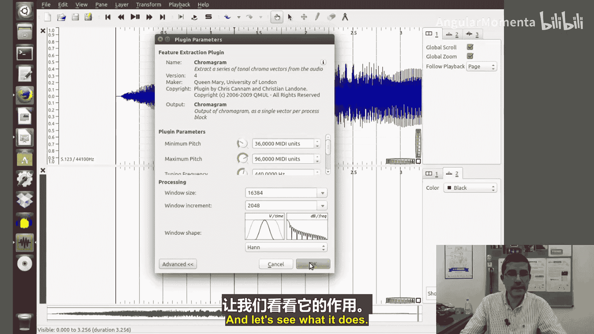

## 🎻 提取色度特征

最后，我们分析一个双弦演奏的大提琴声音，这个声音适合分析其和声色彩。

我们再次创建一个空白图层。这次，在 “Visualization” 分类下，选择 “Chromagram” 进行分析。

色度分析插件有几个关键参数：分析的频率范围、基准调音频率（用于在平均律上对齐滤波器）、每八度的划分数量（西方音乐通常为12个半音）。为了获得精细的频率分辨率，我们需要使用较大的窗口尺寸和跳跃尺寸。我们使用默认参数进行计算。

分析结果以色度图形式呈现。图中，横轴是时间，纵轴是12个音高类别（C, C#, D, ..., B）。我们可以看到，持续的低音 D 在整个过程中都很明显。同时，上方声部在 A 弦上演奏的一个小音阶也清晰可辨。色度分析将不同八度的相同音高类别折叠在一起，因此高八度的 D 音也被归入 D 类别中。这种表示方法对于研究和弦、调性等音乐属性非常有帮助。

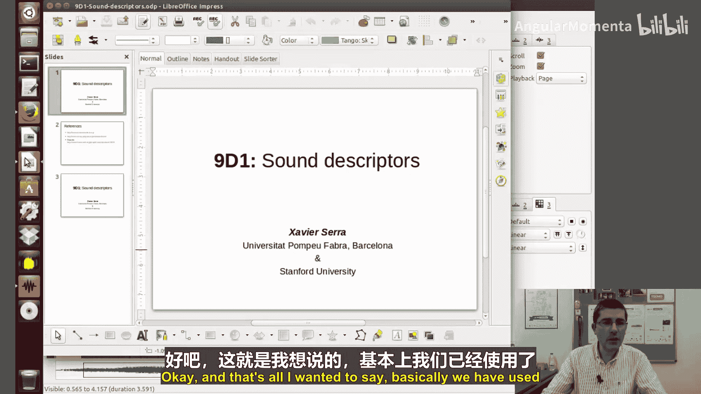

## 📝 总结

本节课中，我们一起学习了如何使用 Sonic Visualizer 软件来提取和分析音频特征描述符。我们通过三个实例，实际操作了起始点检测、MFCC 提取和色度特征分析，将理论课的概念应用于具体的音频分析中。

这些特征不仅帮助我们直观地理解声音属性，更是进行声音比较、分类和更高级定量分析的基础。你可以访问 Sonic Visualizer 官网的插件页面，下载更多功能强大的分析工具。

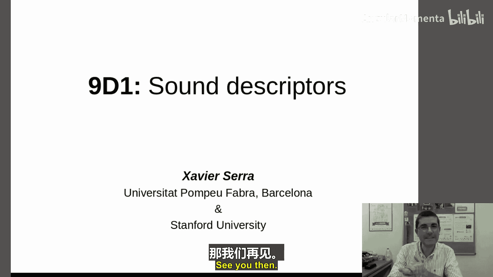

下节演示课，我们将介绍与音频合成相关的另一个演示。谢谢大家。