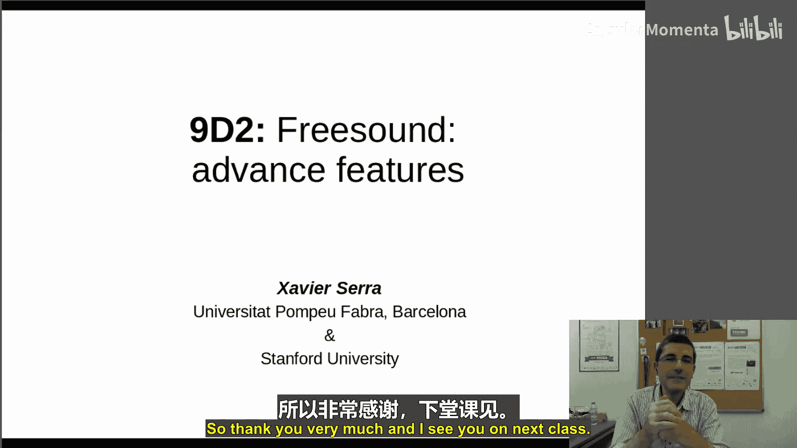

# 066：Freesound 高级功能指南 🎵

在本节课中，我们将深入学习 Freesound 平台的一些高级功能。Freesound 是一个庞大的声音共享社区，拥有超过 22.4 万个声音样本。除了基本搜索，我们将探索如何利用标签、地理位置信息、声音分析描述符和混音关系来更精确地查找和管理声音资源，这对于完成本周的作业将非常有帮助。

## 浏览与搜索声音 🔍

上一节我们介绍了 Freesound 的基本概念，本节中我们来看看如何高效地浏览和搜索声音。

### 通过标签云搜索

Freesound 鼓励用户为上传的声音添加描述性标签。以下是利用标签云进行精确搜索的步骤：

1.  在“声音”页面，找到“标签”区域。这里显示了用户最常使用的标签。
2.  点击一个标签，例如 `multisample`，可以找到所有使用该标签的声音。
3.  为了进一步筛选，可以点击另一个标签旁边的加号（如 `string instrument`），将两个标签组合搜索。
4.  此时，标签云会更新，显示与当前组合标签最常一起出现的其他标签。字体越大，表示该标签的使用频率越高。通过这种方式，可以快速定位到特定类型的声音，例如小提琴或大提琴的采样。

### 通过地理位置标签搜索

并非所有声音都有地理位置标签，但对于那些在特定地点录制的声音，这是一个有用的筛选维度。

1.  点击“浏览地理位置标签”选项。
2.  页面会显示一张世界地图，声音密集的区域会以簇的形式显示，并标注数量。
3.  放大特定区域（例如巴塞罗那），可以查看更精确的声源分布，甚至定位到具体街道或校园。

### 使用高级搜索筛选器

当基本关键词搜索（如 `clarinet`）返回结果过多时，可以使用高级搜索功能。

1.  在搜索结果页面，点击“高级搜索”。
2.  可以设置多种筛选条件，例如：
    *   **时长**：设置为 0 到 5 秒，以找到短促的单音。
    *   **标签**：添加 `single-note` 标签，进一步筛选出单音符样本。
3.  结合使用这些筛选器，可以高效地找到符合特定需求的声音素材。

## 基于内容的声音相似性查找 🎼

找到感兴趣的声音后，可以利用 Freesound 基于音频内容分析的“查找相似声音”功能。

1.  在任意声音的详情页，点击“查找相似声音”。
2.  系统会基于音频特征（而非文本标签），在整个数据库中寻找音色相近的声音。例如，一个单簧管的声音可能会找到其他单簧管音色，但也可能找到音色相似的瀑布声。

这个功能背后的技术，是通过 `Essentia` 音频分析库为每个声音计算出一系列**音频描述符**。这些描述符包括 MFCC（梅尔频率倒谱系数）、频谱质心等特征的统计值（如均值、方差、直方图）。相似度是通过比较这些描述符数据之间的距离来计算的。

**核心概念公式**：
`声音相似度 = f(描述符向量A, 描述符向量B)`
其中，`描述符向量` 包含了如 `{MFCC均值， 频谱质心方差， ...}` 等统计信息。

## 管理声音关系：混音树 🌳

Freesound 允许用户明确标注声音之间的衍生关系，这对于跟踪声音素材的来源和修改历史非常重要。

1.  在用户个人主页或声音详情页，可以找到“混音树”图标。
2.  点击后，会显示该声音的源文件以及由它衍生出的其他声音。例如，一个“语音残差”声音可能源自某个“语音”文件，而该“语音”文件又可能是从另一位用户的原始录音中剪辑、处理得来的。
3.  明确标注这些关系，有助于构建清晰的声音素材谱系，尊重原作者的贡献，并方便后续的协作与使用。

## 总结

本节课中我们一起学习了 Freesound 平台的一系列高级功能。

我们首先探讨了如何超越简单关键词搜索，利用**标签云**和**地理位置标签**进行高效浏览。接着，我们介绍了如何使用**高级搜索筛选器**精确查找特定属性（如时长、标签）的声音。然后，我们深入了解了基于音频内容分析的**“查找相似声音”**功能，其核心是利用 `Essentia` 库计算的**音频描述符**进行相似度匹配。最后，我们学习了如何通过**混音树**来管理和追溯声音之间的衍生关系。

掌握这些功能将极大地提升你在 Freesound 上查找、筛选和管理声音素材的效率，并为本周需要处理音频分析描述符的作业打下坚实基础。Freesound 的价值源于社区的贡献，希望你在利用这些资源的同时，也能积极上传和标注优质的声音，丰富这个共享生态。