# 067：Essentia 入门简介 🎵

在本节课中，我们将学习如何使用 Essentia 库进行音频分析和音乐描述。Essentia 是一个强大的开源 C++ 库，专门用于音频分析和基于音频的音乐信息检索。我们将介绍如何安装 Essentia，并通过一个简单的 Python 示例来提取音频特征。

## 概述

Essentia 是一个用于音频分析和音乐信息检索的开源 C++ 库。它提供了大量算法和工具，可以方便地提取音频特征，并支持 Python 包装器，使得在 Python 环境中调用 C++ 库变得简单高效。本节课将指导您完成 Essentia 的安装过程，并通过一个计算 MFCC（梅尔频率倒谱系数）的示例来展示其基本用法。

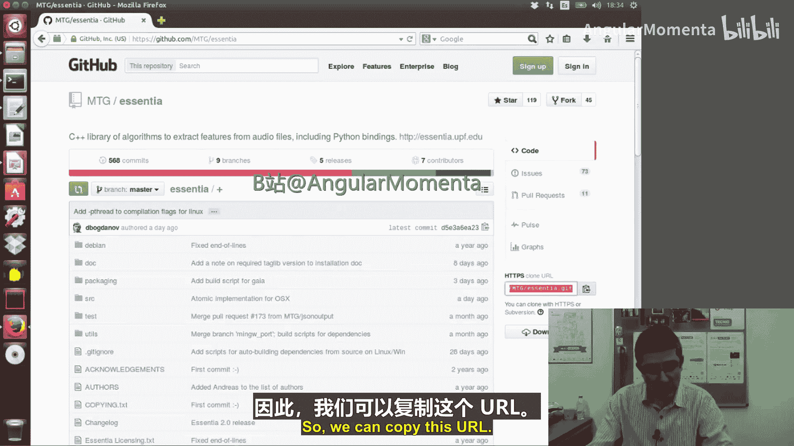

## 安装 Essentia

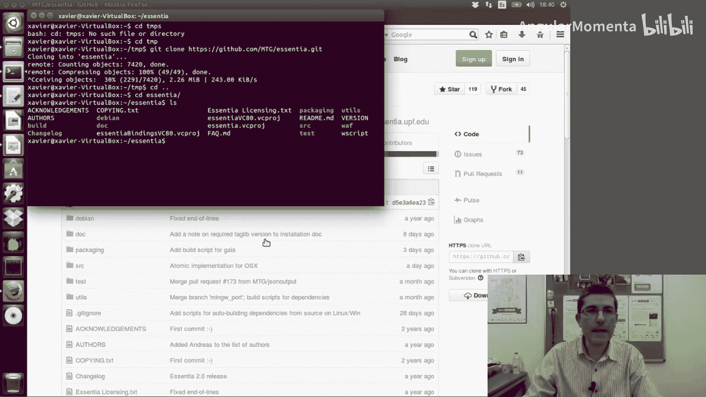

上一节我们介绍了 Essentia 的基本概念，本节中我们来看看如何安装它。

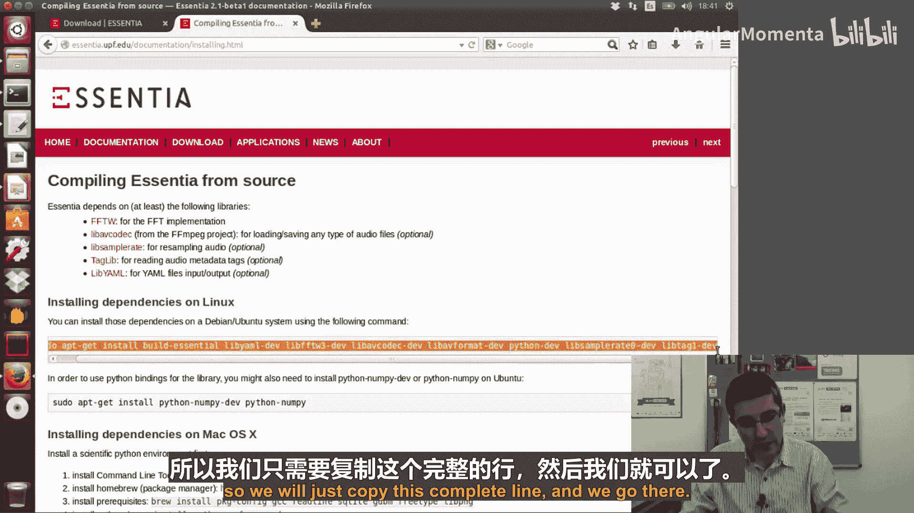

首先，访问 Essentia 的官方网站 [essentia.upf.edu](http://essentia.upf.edu)，您可以在其中找到文档、下载链接以及其他相关信息。Essentia 的源代码托管在 GitHub 上。

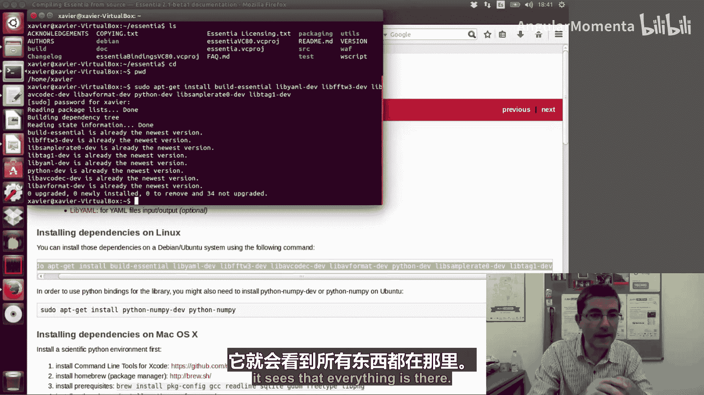

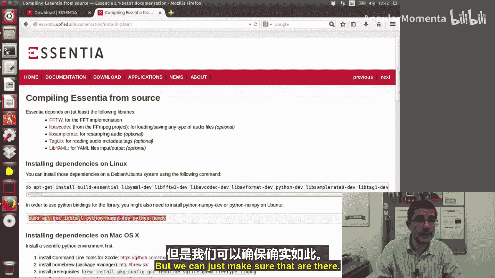

以下是安装步骤：

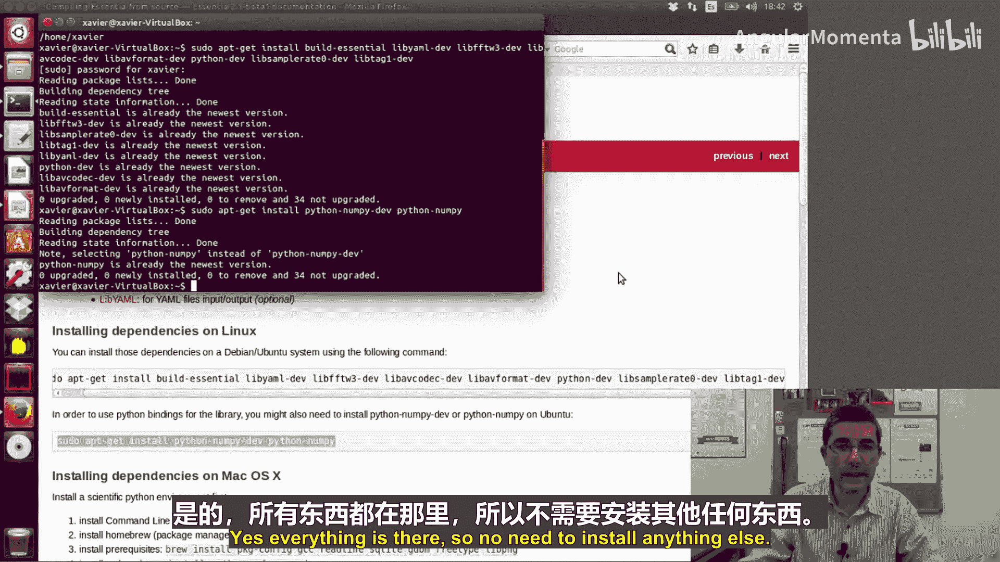

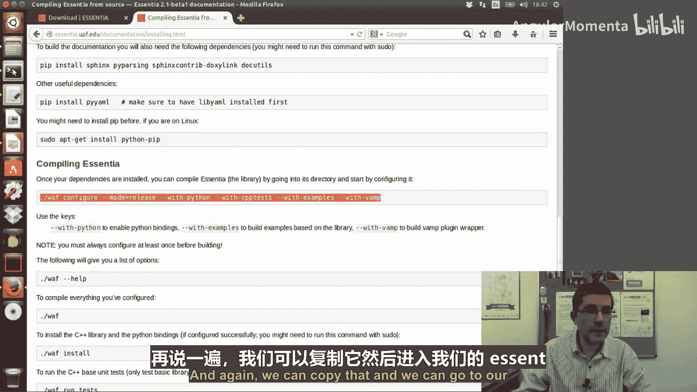

1.  **克隆仓库**：使用 Git 克隆 Essentia 的源代码仓库到本地计算机。
    ```bash
    git clone https://github.com/MTG/essentia.git
    ```

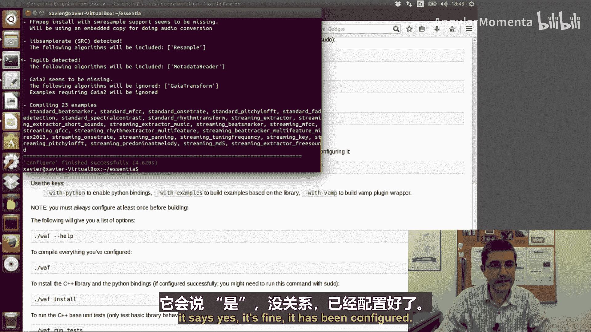

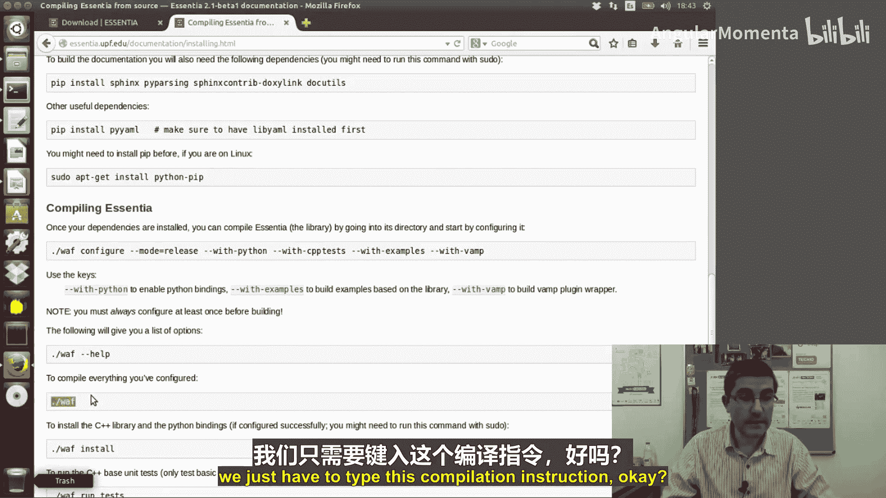

2.  **安装依赖**：Essentia 依赖于一些其他库，如 FFTW 和 FFmpeg。在 Ubuntu 系统中，可以使用以下命令安装这些依赖。
    ```bash
    sudo apt-get install build-essential libyaml-dev libfftw3-dev libavcodec-dev libavformat-dev libavutil-dev libavresample-dev python-dev libsamplerate0-dev libtag1-dev
    ```

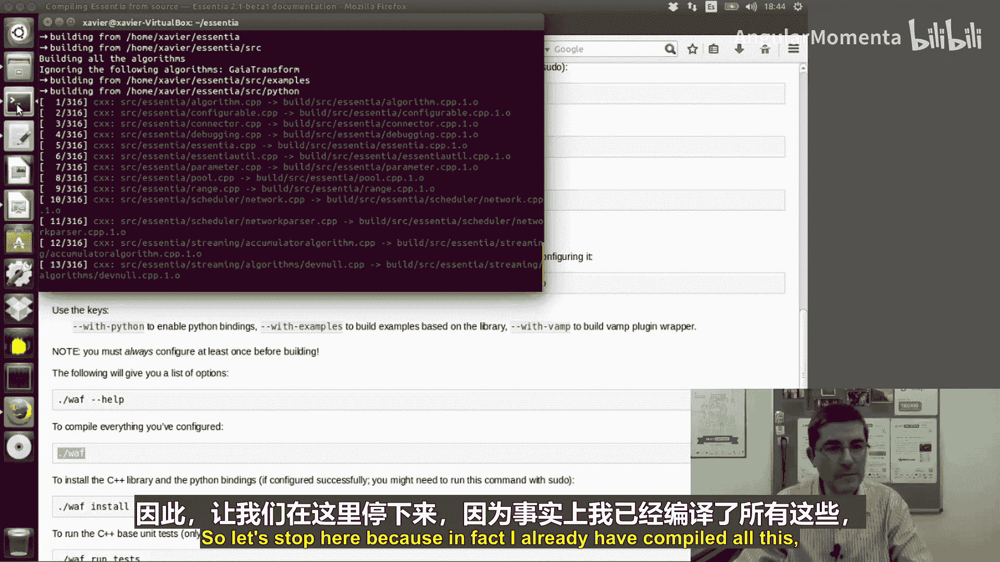

3.  **配置和编译**：进入 Essentia 目录，运行配置和编译命令。
    ```bash
    cd essentia
    ./waf configure
    ./waf
    ```

4.  **安装**：编译完成后，运行安装命令。
    ```bash
    sudo ./waf install
    ```

安装完成后，您就可以在 Python 中使用 Essentia 了。

## 使用 Essentia 提取 MFCC 特征

现在我们已经安装了 Essentia，本节中我们将通过一个 Python 示例来学习如何使用它提取 MFCC 特征。

以下是一个计算音频文件 MFCC 特征的 Python 脚本的核心部分：

```python
import essentia.standard as es
import numpy as np

# 初始化算法
frameSize = 1024
hopSize = 512
spectrum = es.Spectrum(size=frameSize)
window = es.Windowing(size=frameSize, type='hann')
mfcc = es.MFCC(numberCoefficients=13, inputSize=frameSize/2 + 1)

# 加载音频文件
loader = es.MonoLoader(filename='your_audio_file.wav', sampleRate=44100)
audio = loader()

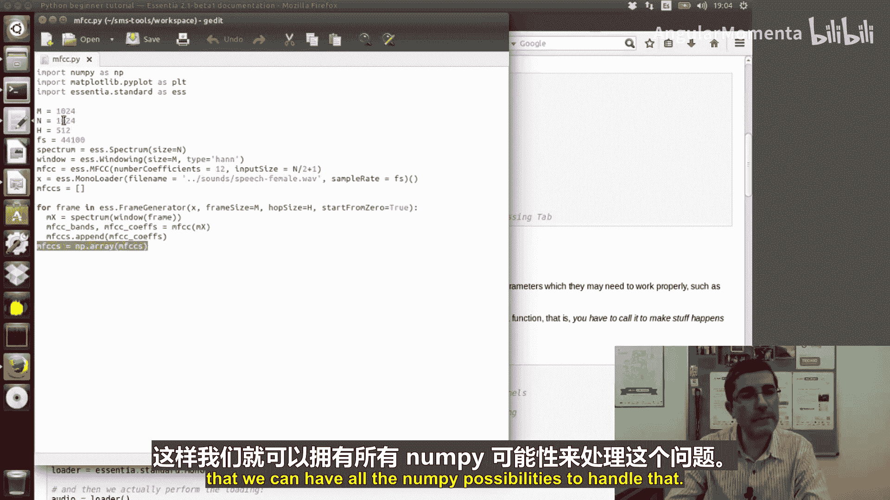

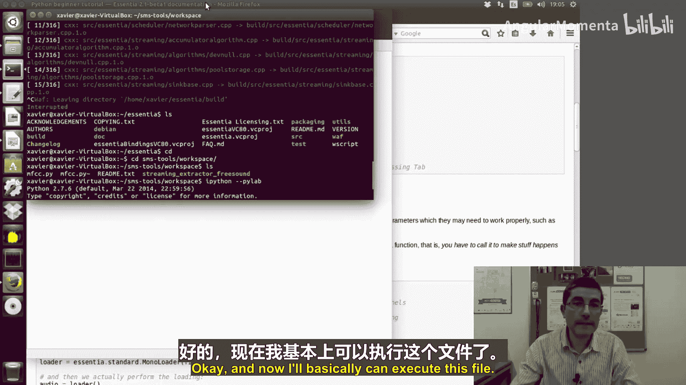

# 初始化输出数组
mfccs = []

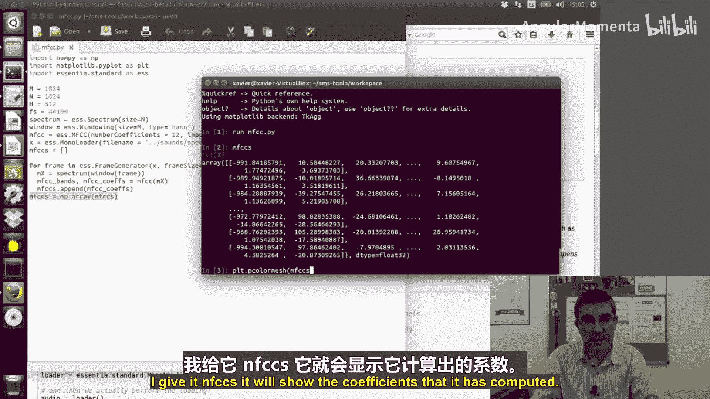

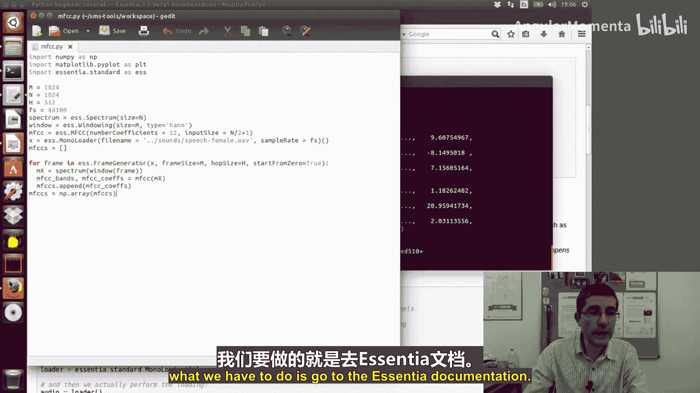

# 逐帧处理音频
for frame in es.FrameGenerator(audio, frameSize=frameSize, hopSize=hopSize):
    windowed_frame = window(frame)
    spec = spectrum(windowed_frame)
    mel_coeffs, mel_bands = mfcc(spec)
    mfccs.append(mel_coeffs)

# 转换为 NumPy 数组以便进一步处理
mfccs = np.array(mfccs)
```

这段代码首先初始化了频谱计算、加窗和 MFCC 提取算法。然后，它加载一个音频文件，并逐帧计算 MFCC 系数，最后将结果存储在一个 NumPy 数组中。

## Essentia 的提取器工具

除了直接使用算法，Essentia 还提供了一些预构建的“提取器”，可以一次性计算多种音频特征。

例如，`streaming_extractor_freesound` 提取器被 Freesound 项目用于为其音频库中的每个声音提取低级特征。您可以在 Essentia 的 `build/src/examples` 目录中找到这些已编译的提取器二进制文件。

使用方式如下：
```bash
./streaming_extractor_freesound input_audio.wav output_features.json
```
该命令会生成一个包含所有分析结果的 JSON 文件。

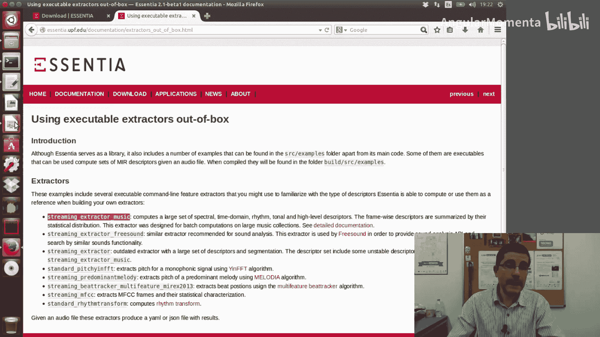

## 总结

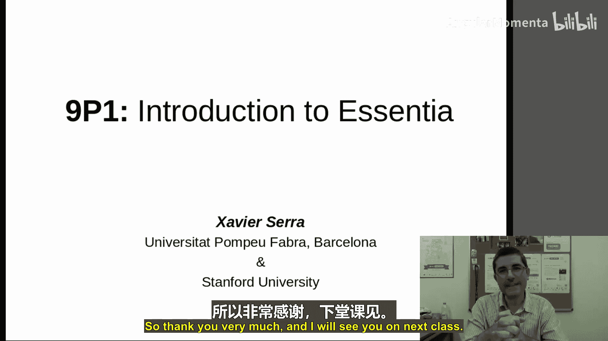

本节课中我们一起学习了 Essentia 音频处理库的基础知识。我们介绍了 Essentia 的用途和特点，完成了在 Linux 系统上的安装步骤，并通过一个 Python 示例演示了如何提取 MFCC 特征。此外，我们还了解了 Essentia 提供的预构建特征提取器工具，这些工具可以高效地计算复杂的音频描述符。Essentia 功能强大，虽然深入使用可能涉及较多细节，但其 Python 接口为初学者提供了一个易于上手的入口。在接下来的课程中，我们将探索如何利用这些特征进行更深入的声音描述和分类。