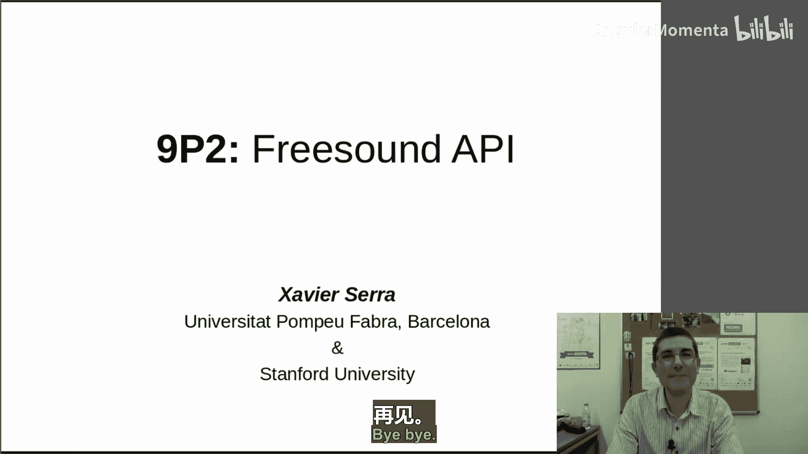

# 068：Freesound API 使用指南 🎵


在本节课中，我们将学习如何通过编程方式访问和分析声音集合，这是进行声音描述、比较和分类的基础。为此，我们将重点介绍 **Freesound API**，这是一个强大的工具，允许我们以程序化的方式查询和获取Freesound数据库中的声音及其分析数据。

## 什么是API？🔌


API（应用程序编程接口）本质上是一种协议。对于Web API而言，它基于HTTP协议，允许我们通过发送特定的HTTP请求来查询数据库中的内容，而无需使用网页界面。这为我们以编程方式处理声音数据提供了可能。

## 探索Freesound API文档 📖

要学习如何使用API，我们首先需要访问Freesound网站的“开发”部分。文档中详细说明了如何访问不同类型的信息资源。

例如，在“搜索资源”部分，我们可以了解到如何进行文本搜索。这意味着我们可以通过编程方式执行标准的文本查询，并应用各种过滤器，从而访问Freesound中所有带有文本标签的信息。

但API的功能远不止于此。我们还可以基于声音的内容进行分析搜索，例如，根据其低层级声学特征进行筛选。


以下是一个API调用的示例URL，它展示了如何获取特定声音ID的完整信息摘要：
```
https://freesound.org/apiv2/sounds/<sound_id>/
```
此调用会返回一个JSON对象，包含该声音的核心信息（如ID、URL、文件名、用户标签、描述等）、技术细节（如比特率、时长）以及分析数据（如频谱特征统计信息）。

## 使用Python客户端库 🐍

为了更便捷地使用API，Freesound社区提供了多种语言的客户端库。我们将使用 **Python客户端库**。这个库封装了API调用，简化了我们的工作流程。

首先，我们需要获取该库的代码，并申请一个个人专用的 **API密钥**。这个密钥是访问API的凭证，需要妥善保管。

库的核心文件是 `freesound.py`，它定义了一系列用于执行API查询的类和方法。此外，`examples.py` 文件提供了实用的代码示例，展示了如何获取声音信息、分析数据或查找相似声音。


以下是一个基础的使用示例代码框架：
```python
import freesound

# 使用你的API密钥初始化客户端
client = freesound.FreesoundClient()
client.set_token(“<你的API密钥>”)

# 获取特定ID的声音
sound = client.get_sound(12345)
print(sound.name)

# 获取该声音的低层级特征分析结果
analysis = sound.get_analysis()
mfccs = analysis.lowlevel.mfcc.mean
print(mfccs)
```


## 实战：下载并分析声音集合 💻


在本次课程的作业中，我们提供了一个实用的Python脚本，用于简化从Freesound下载声音集合的过程。

该脚本的核心是一个 `download_sounds_freesound` 函数。你可以通过指定查询文本、标签、时长范围、API密钥、存储目录、结果数量和文件格式来调用它。


例如，以下代码会下载符合条件的前20个“bassoon”声音：
```python
import sound_download
API_KEY = “<你的API密钥>”
sound_download.download_sounds_freesound(query=“bassoon”，
                                          tag=“multisample”，
                                          duration=(0， 5)，
                                          api_key=API_KEY，
                                          output_dir=“./tmp”，
                                          top_n_results=20，
                                          feature_ext=“.mp3”)
```
运行后，脚本会在指定目录下为每种乐器创建子文件夹，并下载对应的MP3音频文件以及包含低层级特征描述（如频谱质心、MFCC等）的JSON文件。

## 可视化与分析 📊


下载声音集合后，我们可以使用作业中提供的另一个分析脚本进行探索。其中一个函数可以将所有声音的指定特征在二维平面上可视化。

例如，我们可以绘制所有声音的“频谱质心”与“第一个MFCC系数”的散点图：
```python
import sound_analysis as sa
# 指定存储声音的目录和要绘制的特征索引
sa.plot_features(“./tmp”， descriptors=[0， 12])
```
生成的图表可能显示，低音乐器（如巴松管）的频谱质心集中分布在较低区域，而小提琴和吉他的数据点则可能混合在一起，这反映了它们在音色和音高上的某些相似性与差异性。通过结合听觉判断，我们可以更好地理解特征分布背后的声学含义。

## 总结与资源 📚


本节课我们一起学习了Freesound API的核心用途和基本操作方法。我们了解到，API是程序化访问大规模声音数据库的关键。通过Python客户端库，我们可以方便地搜索、下载声音并获取其丰富的分析特征，进而为声音的分类、聚类和描述等任务奠定基础。

**核心资源链接：**
*   **申请API密钥**：`https://freesound.org/apiv2/apply/`
*   **API官方文档**：`https://freesound.org/docs/api/`
*   **Python客户端库**：`https://github.com/MTG/freesound-python`



要复现本节课的演示，请参考本周的课程作业，其中包含了完整的 `sound_download.py` 和 `sound_analysis.py` 脚本。掌握这些工具，你将能够在实际编程中灵活运用本周所学的声学分析与音乐描述知识。