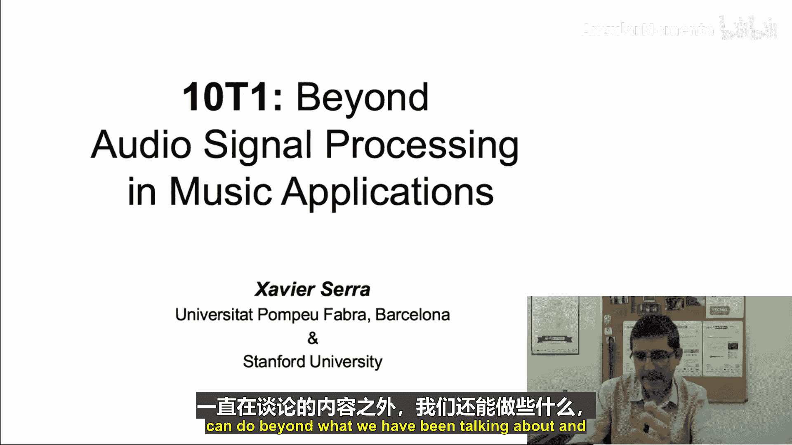
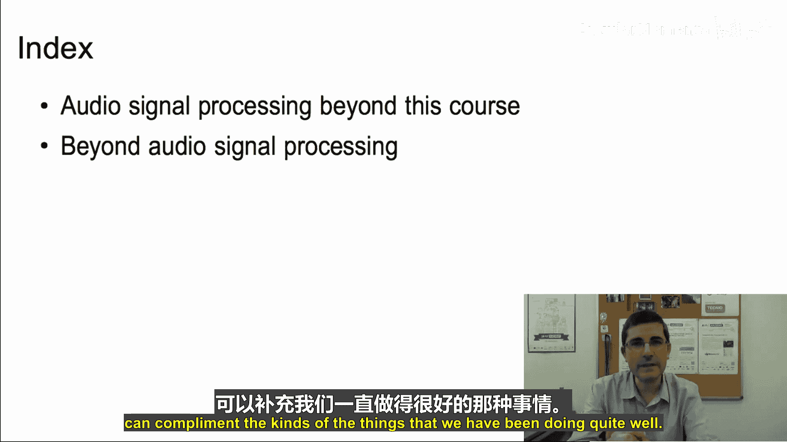
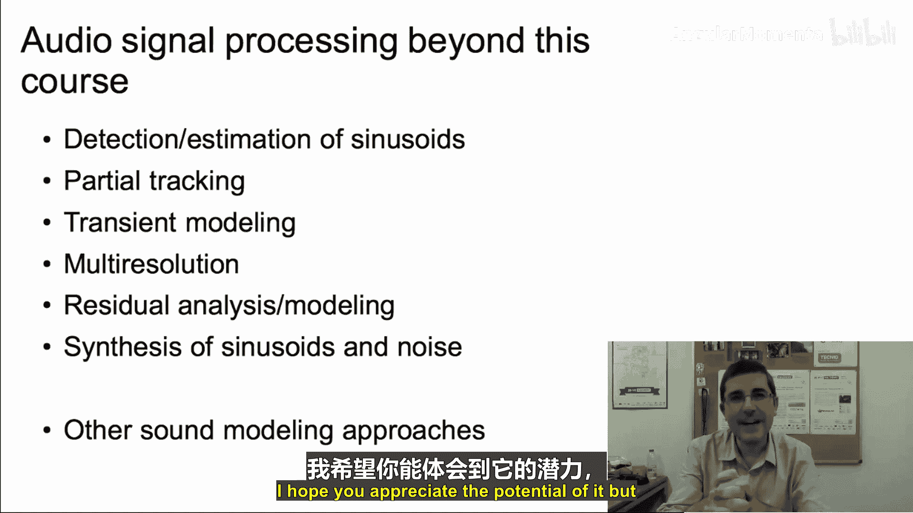
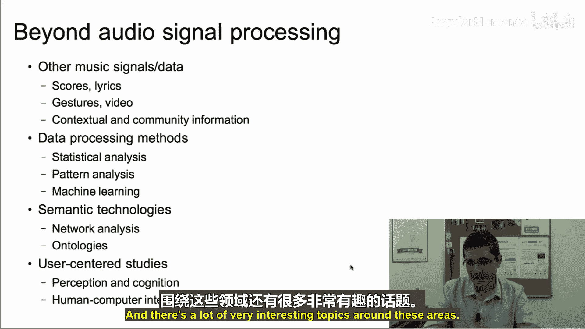
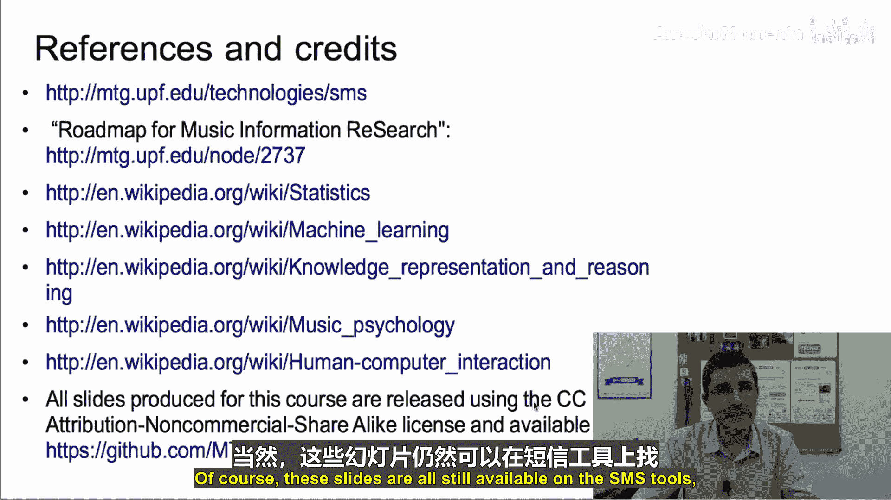
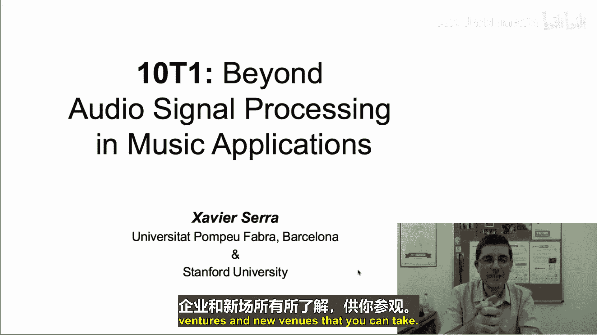

# 069：超越音频处理 🎵

在本节课中，我们将探讨音乐应用音频信号处理课程之外的广阔领域。我们将回顾本课程已涉及但可深入研究的主题，并介绍一些虽不严格属于音频信号处理范畴，却能有效补充音乐信息分析的其他方法与研究方向。

上一节我们完成了对核心音频处理技术的系统学习，本节中我们来看看如何将视野拓展到更广阔的领域。

## 音频信号处理的深入方向 🔍

我们首先探讨在本课程基础上，音频信号处理领域内值得进一步深入研究的几个方向。以下是部分关键主题：

*   **正弦波检测与估计**：本课程对此问题进行了初步简化处理。实际上，存在许多更先进的技术和方法，可用于在复杂信号中更精确地检测和估计正弦波的参数。
*   **部分（谐波）追踪**：我们使用了一种相对简单的技术来追踪音频信号中的谐波或部分。该技术可进一步复杂化，发展出能更精确追踪部分随时间变化行为的更复杂方法。
*   **瞬态建模**：我们未涉及此主题。在分析和合成声音时，瞬态部分（如音符的起音或信号的急剧变化）通常更难建模。存在多种专门的方法来识别和处理这些瞬态，独立于可使用我们所学技术分析的稳态或更稳定的声音部分。
*   **多分辨率分析**：快速傅里叶变换的一个主要局限是其线性频率分辨率。然而，人类的听觉感知系统并非线性。因此，出现了许多考虑多分辨率的方法，旨在开发具有不同频率范围不同分辨率的频谱分析技术。实际上，这也可以通过FFT实现，本周的实验环节提供了相关探索选项。
*   **残差分析**：我们对信号的残差进行了相对简单的分析，使用了一个简单的随机模型来近似。在近似这个残差方面，无论是从感知角度还是声源角度，都有很大的发展空间，可以为特定类型的信号开发专门的模型。
*   **合成方法**：我们使用逆FFT高效地合成了正弦波和滤波噪声。此外，还存在许多其他合成正弦波和噪声的替代方法提案。
*   **完全不同的建模方法**：我们采用的是基于频谱的建模方法。除此之外，还存在大量其他可用于音乐应用的建模方法，例如基于物理建模的方法，或使用傅里叶变换之外的其他变换的方法。

总而言之，音频信号处理在音乐应用领域内容非常丰富。本课程提供的只是一个特定且有力的视角，但该领域远不止于此。

## 超越音频信号处理的其他领域 🌐

现在，让我们探讨一些真正超越传统音频信号处理范畴的主题。当我们希望从工程角度研究音乐时，所涉及的远不止音频信号本身。音乐是更复杂的现象，我们可以获取不同类型的数据来研究它。

例如，仅关注数据类型和信号，我们还可以分析乐谱或歌曲歌词，研究表演录像中的手势，并应用一些信号处理相关的方法来分析这些类型的信号。此外，我们还可以获得大量文本类型的数据、上下文或社区信息（如对音乐的评论和描述），从中提取有意义的音乐信息。

在分析这类数据的方法论方面，除了信号处理，数学和工程学的其他一些领域也非常有用：

*   **统计分析**：这是一个庞大的领域，我们已略有提及。其中许多有趣的方法可用于表征音乐等复杂现象。
*   **模式分析**：我们将许多此类数据视为某种时间信息，模式提取是一个非常重要的概念。在该领域，已出现许多通用的模式识别方法，可应用于这些音乐信号。
*   **机器学习**：我们上周介绍了用于声音聚类或分类的机器学习。该领域已发展出非常复杂的方法论，可应用于广泛的问题和数据，实现从数据中自动提取知识。
*   **语义技术（语义网）**：这是一个较新的研究领域，为理解数据、提取数据信息带来了新方法。
*   **网络分析**：当拥有一个数据语料库并希望发现数据点之间的关系时，网络分析可以为我们提供关于这些关系结构的深刻见解。
*   **本体论**：这是计算机科学中源自语义网方法的一个领域，为结构化数据提供了很好的方式。开发本体、构建描述特定知识领域（此处是音乐）内实体关系的结构化方法，能极大地帮助我们描述和分析这些数据。
*   **以用户为中心的研究**：音乐不仅关乎数据，还涉及人与关系。因此，各种以用户为中心的研究（如感知、认知研究，以及关于人与音乐交互的实验）能为我们理解音乐提供深刻见解。
*   **人机交互**：界面研究也是一个成果丰硕的领域。我们与乐器、与音乐互动需要界面，研究这些界面及其与我们理解或使用音乐方式的关系，同样有助于我们理解和建模音乐信号。

以上只是一些重点介绍，希望能让你对相关领域有更广阔的视野。显然，我们的研究领域可以扩展到许多不同的方向、学科和方法论，这些领域周围存在着大量非常有趣的主题。

## 延伸阅读与参考资料 📚

由于涉及内容广泛，参考资料非常丰富。以下是一些起点：

*   在MTG的SMS页面上，可以找到一些信息，特别是延伸我们已学的分析合成技术、介绍其他声音建模、参数化和合成方法的文章链接。
*   最近发布的《音乐信息研究路线图》（链接已在课程中提供）也是一个很好的资源，概述了与获取音乐信息相关的各个研究方向，并汇集了所有这些不同的新研究领域。
*   关于统计学、机器学习、语义分析（也称为知识表示与推理）等方法论领域，可以在维基百科上找到大量参考资料。
*   对于用户研究类型，可以查阅音乐心理学、人机交互等领域的资料，其中不乏以音乐为核心但从不同视角进行研究的文献。

本节课是本周的一次讲座，旨在开阔我们在音频信号处理内部及外部的视野。希望这能为你指明新的探索方向和途径。

本节课中，我们一起回顾了音频信号处理中可深入探索的主题，并了解了分析音乐信息时可用的其他跨学科方法，从而对音乐技术领域形成了更全面的认识。