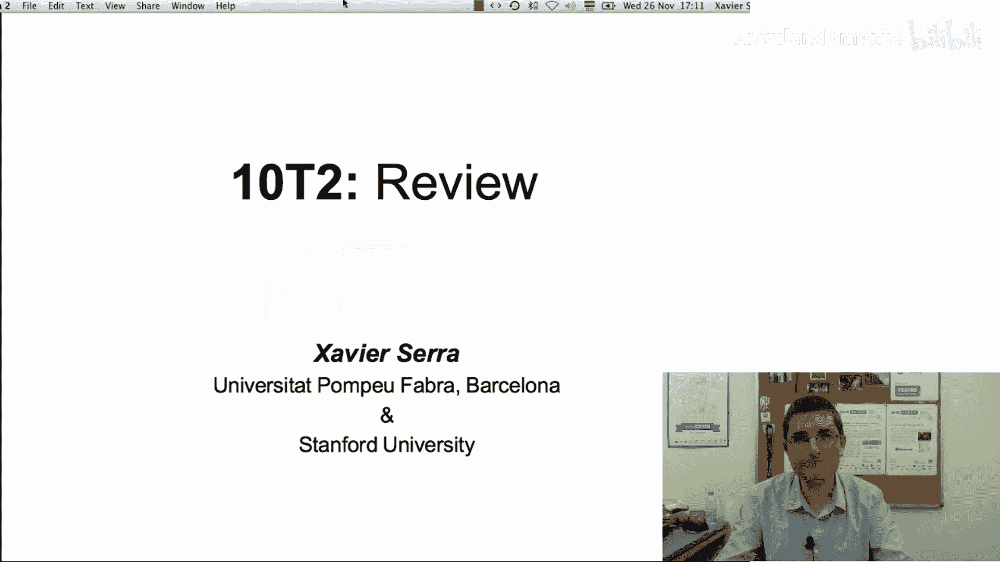

# 070：课程回顾与总结 🎵

在本节课中，我们将回顾整个课程的核心框架与关键概念。我们将从频谱图这一基本思想出发，逐一重温每周的主题，包括声音频谱、正弦与谐波模型、残差与随机成分，以及声音的变换与描述。最后，我们将简要展望音频信号处理领域的未来方向。

---

## 课程核心框架 🧩

上一节我们介绍了课程的整体目标，本节中我们来看看贯穿整个课程的基本分析框架。

我们所有分析与处理技术的起点，是声音的**频谱表示**。虽然声音的基本表示是时域波形，但对我们而言，其用处有限。因此，我们首先将声音转换到频域，即获取其频谱。这一做法有其感知上的动机，因为人类的听觉过程本身就在进行类似的分析。

我们的基本工作流程可以概括为以下步骤：
1.  从输入信号 `x[n]` 开始。
2.  通过**快速傅里叶变换** 获得频谱。
3.  从频谱中提取峰值，进而得到声音的**部分音**或**谐波**。
4.  将这些成分从原始信号中减去，得到**残差**信号。

基于这个流程，我们可以进行特征分析以获取基频等信息，也可以对正弦成分和残差成分进行变换，从而合成出新的、经过修改的声音。如果不变换任何参数，理想情况下合成的声音应与原始声音非常相似。这个框架构成了我们所有分析、描述与合成技术的基础。

---

## 声音的频谱 📊

上一节我们概述了整体框架，本节中我们来看看第一个核心概念：声音的频谱。

我们有两种主要的频谱视图：
*   **离散傅里叶变换**：用于分析一个非常短的声音片段，得到一个单一的频谱。
*   **短时傅里叶变换**：用于分析随时间变化的声音，得到一系列连续的频谱，表示为 `X_l[k]`。

STFT可以视为我们的第一个有用的分析-合成模型，它是一个恒等系统，理论上可以捕获并完美重建任何声音。

---

## 正弦与谐波模型 🎶

在频谱分析的基础上，我们建立了**正弦模型**与**谐波模型**。

*   **正弦模型**：旨在捕获声音中具有**稳定性**和**相干性**的正弦成分，这些成分通常代表了声音声学特性中有意义的部分。
*   **谐波模型**：是正弦模型的进一步特化。对于大量声音（如乐音），其正弦成分之间存在**谐波关系**，即所有谐波频率都是基频的整数倍。利用这一约束，我们可以获得更强大、更紧凑的声音表示，为后续的描述与变换提供了巨大潜力。

---

## 残差与随机成分 🌫️

正弦或谐波成分并不能捕获声音的全部。当我们从原始声音中减去这些成分后，剩下的部分称为**残差**。

有时残差是感知上不重要的细微部分，可以丢弃。但在许多情况下，它是声音的重要组成部分，需要被保留和建模。我们可以选择直接保留残差信号，或者使用**随机模型**（如滤波白噪声）来近似它。这样就构成了一个完整的**正弦+随机**或**谐波+随机**模型，能够有效地建模许多类型的声音。

---

## 声音的变换 🎛️

当我们拥有了上述模型表示（包括正弦/谐波的频率、幅度、相位，以及随机成分）后，就可以对声音进行各种变换。

以下是一些常见的变换操作：
*   时间伸缩
*   音高移位
*   对参数进行任意修改

我们在课程中涵盖了一些基础变换，但实际应用中还存在更多可能性。

---

## 声音的描述 🏷️

除了变换声音，我们还探讨了如何**描述**声音。这是一个非常广阔的领域，我们仅触及了冰山一角。

声音描述涵盖了不同层次的抽象。我们主要关注的是较低层次的描述符，包括物理的、感官的以及一些感知层面的描述符，这些对于描述声音和音乐信号非常有用。这为我们利用频谱分析技术，去描述更完整的音乐作品乃至音乐库，打开了一扇大门。

---

## 超越本课程 🚀

在上一讲中，我们初步展望了本课程之外更广阔的天地。

音频信号处理领域远比我们在本课程中探讨的内容丰富，存在许多其他方法用于分析、描述和变换声音。更重要的是，我们试图理解的“声音与音乐”信息，其内涵远不止音频信号本身。近年来，一个新兴的探索方向是利用**音频之外的其他信息源**（如乐谱、文化背景、用户数据等）来分析和描述声音与音乐，这为未来开辟了非常有趣的新应用和发展领域。

---

## 总结 📝

本节课中我们一起回顾了整个《音乐应用中的音频信号处理》课程。我们从频谱图这一核心思想出发，系统重温了声音的频谱分析、正弦与谐波建模、残差处理、声音变换与描述等关键主题。最后，我们展望了结合多模态信息进行声音分析的未来方向。希望这次回顾能帮助你更好地理解课程的整体脉络和各主题之间的连贯性。