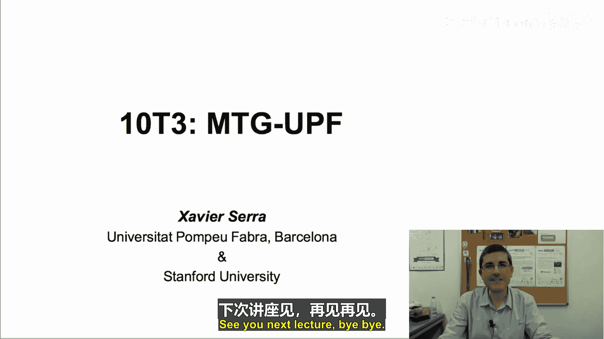

# 071：音乐技术研究组介绍 🎵

在本节课中，我们将了解本课程背后的研究团队——庞培法布拉大学音乐技术组（MTG）。我们将介绍该小组的研究领域、主要项目以及它们与课程内容的联系。

---

## 概述

我们已进入课程的最后一周。本周我们将探讨几个不同的小主题，旨在总结课程内容，并向大家介绍一些课程中未能深入探讨的领域，例如未来的研究方向，以及大家在完成本课程后可能感兴趣探索的主题。

在本节讲座中，我将向大家介绍我的研究团队——庞培法布拉大学的音乐技术组。目的是让大家更好地了解我们，特别是我们所从事的、与过去几周课程内容相关的研究类型。

---

## 大学与研究组背景

庞培法布拉大学位于西班牙东北部的巴塞罗那。大学在市区有三个校区，我们位于传播校区。我们隶属于工程系，但与新闻与视听传播系、语言学系等共同构成了一个跨学科的传播研究环境。

我们的研究组主要隶属于信息与通信技术系。因此，我们的教学职责涉及计算机科学、电气工程，甚至生物医学工程。我们教授与音乐、音频相关的课程，以及编程、机器学习等通用主题。

在研究生层面，我们提供更具体的项目。例如，我们开设了“声音与音乐计算”硕士项目，它非常契合我们研究组的方向。事实上，本Coursera课程正是该硕士项目中的一门课。当然，在硕士项目中，我们可以通过线下活动来补充在线教学，我认为这有助于更好地理解课程内容。

此外，我们还设有博士项目，学生在导师指导下进行论文研究。音乐技术组有许多博士生，他们与我们的教员合作，专注于我们研究的各种主题。

---

## 主要研究领域

接下来，让我介绍一下我们研究的核心内容。我们的研究大致可分为四个领域：

1.  **音频信号处理**：这是本课程的核心内容。
2.  **声音与音乐描述**：我们上周已有所提及。
3.  **音乐与高级交互**：涉及为音乐应用开发交互界面。
4.  **声音与音乐的语义技术**：处理比音频处理更高层次的技术，涉及文本相关信息，并能与音频处理方法很好地互补。

下面，我将逐一介绍这些领域，并举例说明我们的一些工作。

---

### 音频信号处理 🎤

这是我们最早开始的研究方向之一，至今仍非常活跃。

**歌唱声音合成**：我们与雅马哈公司合作开发了名为 **Vocaloid** 的歌唱声音合成器。大家可能听说过虚拟歌手 **初音未来**，她就是基于Vocaloid技术创造的。这项技术背后的核心，与我们课程中讨论的内容密切相关，它采用了**频谱建模**方法，分析并分离谐波，类似于我们学过的**谐波加随机**模型。

**声音变换**：另一个相关主题是实时变换声音，特别是歌唱声音。我们开发了实时系统，允许用户实时改变自己声音的特征。我们使用与课程中类似的技术，开发了用于博物馆的装置或插件来实现这些变换。

**音源分离**：这是我们近期开始研究的一个方向。音源分离是一个定义明确的问题，旨在从复调信号中分离出独立的声源，并尽可能使它们听起来清晰。虽然其方法体系与课程内容略有不同，但它是本课程内容的自然延伸。

---

### 声音与音乐描述 🎼

这个领域关注如何从声音中提取可用于描述声音或音乐的特征。

**Essentia库**：我们开发并维护一个名为 **Essentia** 的音频分析库。我们不断将新的研究成果融入其中，添加可用于描述声音的新特征。例如，可以在Sonic Visualizer等工具中可视化这些低层特征，这对许多任务非常有用。

**音乐意义特征提取**：在更高的抽象层次上，我们关注提取具有音乐意义的特征。例如：
*   **和声/和弦**：识别音乐中的和声进行。
*   **结构分割**：通过特征来分割录音，定义音乐的结构。
*   **旋律特征**：提取歌曲的主旋律音高，识别特定的音符或旋律地标。
*   **节奏特征**：寻找节奏结构的不同层次，从音符起始检测到更高层的节奏模式。

**音乐收藏描述**：这个方向不仅描述单个声音，还描述声音或音乐录音的集合。我领导的一个项目 **CompMusic** 就是典型例子。我们研究来自世界不同地区的五种音乐传统（如印度卡纳提克、中国京剧、土耳其马卡姆等），旨在开发能够描述特定音乐传统中旋律、节奏或语义特征的方法，并最终整合到一个名为 **Dunya** 的发现型程序中，用于导航这些音乐收藏。这个项目综合运用了信号处理、机器学习和语义分析技术。

---

### 音乐与高级交互 🎹

这个领域与本课程关联不大，主要涉及开发新的音乐交互界面。

**Reactable**：这是我们小组一个非常知名的成果。它是一个交互式音乐合成器，采用桌面界面，音乐家可以通过在桌上移动不同的物体来创作音乐，并伴有视觉反馈，为音乐制作提供了许多新的可能性。

---

### 声音与音乐的语义技术 🌐

这个领域关注与音频相关的文本信息（元数据）的处理。

**Freesound平台**：大家熟知的Freesound网站是一个进行语义技术研究的绝佳平台。例如，组织标签、在上传声音时推荐标签、搜索和推荐内容等任务，既可以基于音频内容完成，也可以基于文本元数据完成，后者就需要语义技术的支持。

**AcousticBrainz项目**：这是我们与MusicBrainz合作启动的一个新项目。它允许我们探索语义分析和语义技术。MusicBrainz是一个拥有结构化音乐信息的数据库。在AcousticBrainz中，我们为MusicBrainz中的每首歌曲或艺术家分配标识符，然后用户可以使用Essentia分析器分析相应的音频录音，并将分析结果（而非受版权保护的音乐文件本身）上传到我们的服务器。这样我们就拥有了一个庞大的已分析音乐数据库，为结合音频内容描述和语义分析开发新工具和想法提供了巨大潜力。

---

## 参考资料与总结

本节课中，我们一起了解了庞培法布拉大学音乐技术组的主要研究领域和代表性项目。如果你想了解更多信息，可以访问大学、系或MTG的网站。以下是一些相关链接供参考：
*   Vocaloid的维基百科条目
*   CompMusic项目网站
*   Reactable乐器的维基百科条目
*   AcousticBrainz项目网站

我们的研究远不止这些，网站上还有更多关于我们工作的链接和视频介绍。希望你对我们的研究感兴趣。谢谢大家，下节课再见。