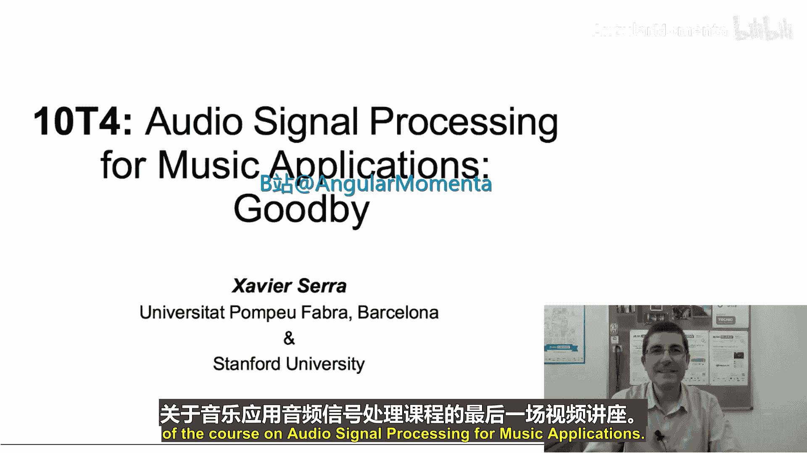
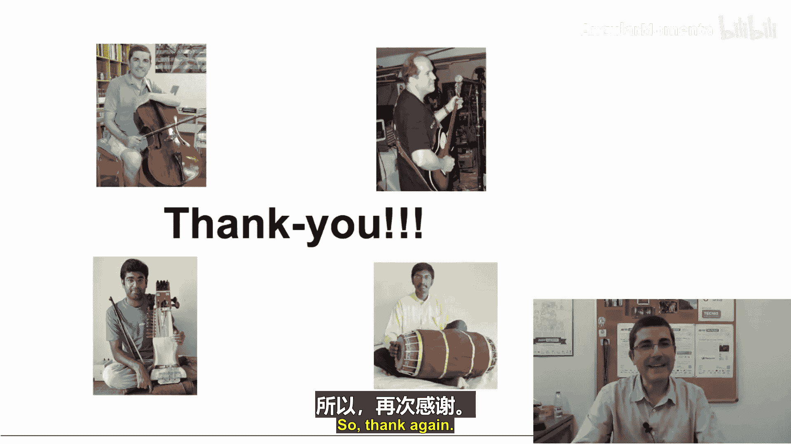
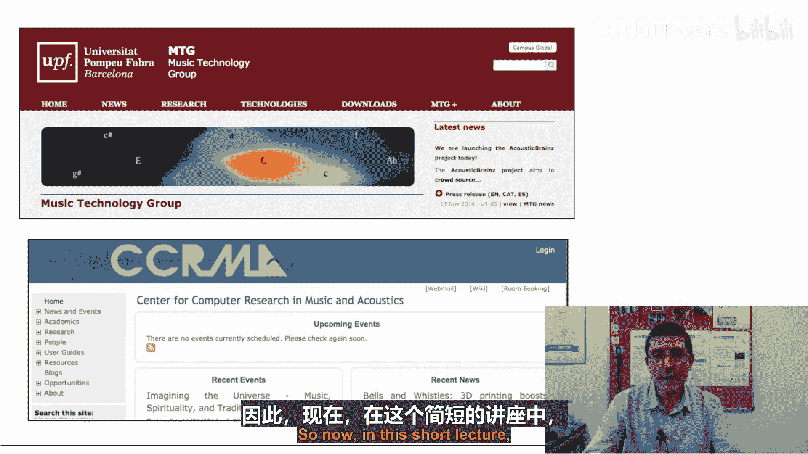
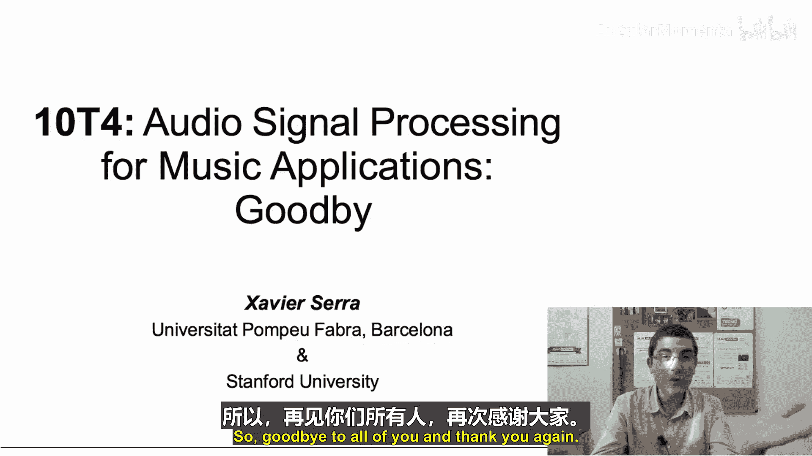

# 072：课程总结与后续学习指南 🎓

在本节课中，我们将对《音乐应用中的音频信号处理》这门课程进行总结，并为希望深入学习的同学提供后续的学习方向与资源指引。

## 概述

这是本课程的最后一个视频讲座。首先，我想对所有坚持完成课程的同学表示感谢，是你们赋予了这次教学实验意义。这是我们首次开设此类在线课程，我们从中学习良多，并希望未来能运用这些经验来改进课程。同时，我们也感谢庞培法布拉大学和斯坦福大学提供的机构支持，以及我们所属的研究团队——音乐技术组和音乐与声学计算机研究中心。

## 后续学习资源指引

上一节我们回顾了课程历程，本节中我们将看看如何在本课程的基础上继续深入学习。以下是关于研究机构、学位项目、学术会议和期刊的一些信息。

### 研究机构

本领域目前已相当成熟，全球许多大学都设有相关研究机构。但由于这是一个跨学科领域，每个研究中心可能因其所属的院系、大学类型以及教职人员的兴趣背景而各有侧重。因此，在接触或试图加入某个中心之前，理解其具体背景和“个性”非常重要。

*   **资源链接**：您可以通过访问 **SMcnetwork.org** 网站，在其“资源”部分找到一个关于声音与音乐计算、音乐技术领域活跃研究中心的详细列表。

### 学位项目

在研究生教育项目方面，情况类似。能够提供专注于本领域课程的大型研究机构相对较少。

*   **硕士项目**：
    *   **庞培法布拉大学**：提供**声音与音乐计算硕士**项目。该项目设在工程学院内，具有相应的工程背景。
    *   **斯坦福大学**：提供**音乐、科学与技术硕士**项目。其计算机音乐与声学研究中心隶属于音乐学院，这赋予了项目不同的侧重点和背景。
*   **博士项目**：博士研究通常以论文为导向，因此，只要大学有相关领域的导师，就可以进行博士研究。我们两所大学都拥有大型研究团队，能为博士生提供良好的环境。选择时，关键是要理解特定院系的背景和导师的研究方向。

### 学术会议

参加学术会议是了解领域前沿、与其他研究者交流的重要途径。本领域有几个核心会议：

*   **国际计算机音乐会议**：历史最久，起源于美国，最初聚焦于技术用于音乐创作，现已涵盖计算机音乐的广泛议题。
*   **声音与音乐计算会议**：较新，起源于欧洲，更侧重于技术报告和讲座，反映了工程领域的视角。
*   **数字音频效果会议**：专注于音频信号处理，与本课程内容高度相关，是了解该领域进展的绝佳平台。
*   **音乐信息检索会议**：专注于音乐信息检索领域，涉及音乐描述、音频分析、机器学习等，对于希望利用技术描述音乐的同学非常有价值。
*   **新音乐表达界面会议**：专注于音乐技术中的人机交互方面，虽然本课程未涉及，但对于对交互设计感兴趣的同学是重要会议。
*   **其他综合性会议**：
    *   **音频工程学会**：其会议常包含音频信号处理和音乐技术主题，并涉及工业应用。
    *   **电气电子工程师学会**：其**声学、语音与信号处理国际会议**规模庞大，总有相当部分专注于音乐信息检索和音频信号处理。
    *   **计算机协会**：其**多媒体会议**等也涵盖音频、图像、视频等多媒体数据分析。

### 学术期刊

期刊是了解领域深度研究的重要渠道。本领域有一些代表性期刊：

*   **《计算机音乐期刊》**：本领域最古老的期刊，强调音乐视角，但也涵盖广泛议题。
*   **《新音乐研究期刊》**：尽管名称如此，但非常关注音乐技术与音乐科学，近年来音乐信息检索主题占比很高。
*   **综合性学会期刊**：
    *   **音频工程学会期刊**：发表大量相关论文。
    *   **IEEE音频、语音与语言处理汇刊**：总是包含相关重要文章。
    *   **ACM多媒体计算、通信与应用汇刊**：与本课程讨论内容关联密切。

## 资源查找与入门

要查找上述会议和期刊的具体链接，**SMcnetwork.org** 网站维护了相关列表，是很好的起点。此外，维基百科上关于“声音与音乐计算”的条目虽然可能不够全面，但可以作为了解该领域概况并寻找具体参考文献的入门。

## 总结

本节课中，我们一起回顾了课程，并探讨了深入学习的路径。我们介绍了全球范围内的相关研究机构、硕士与博士项目、核心学术会议以及重要期刊。希望这些信息能为你未来的探索提供指引。

最后，我想再次向所有人致以个人的感谢，感谢每一位让这门课程成为可能的人。特别要感谢Coursera提供了这个出色的平台，使我们能够传授知识并与大家互动。再见，再次感谢大家！