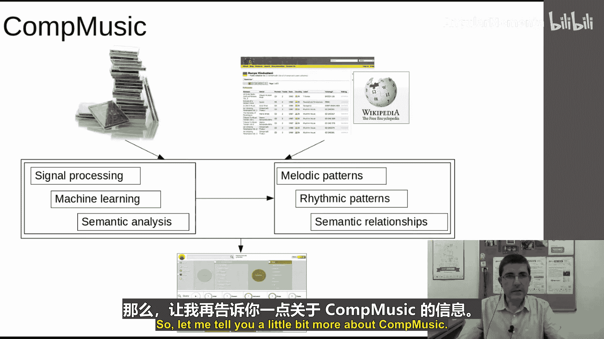
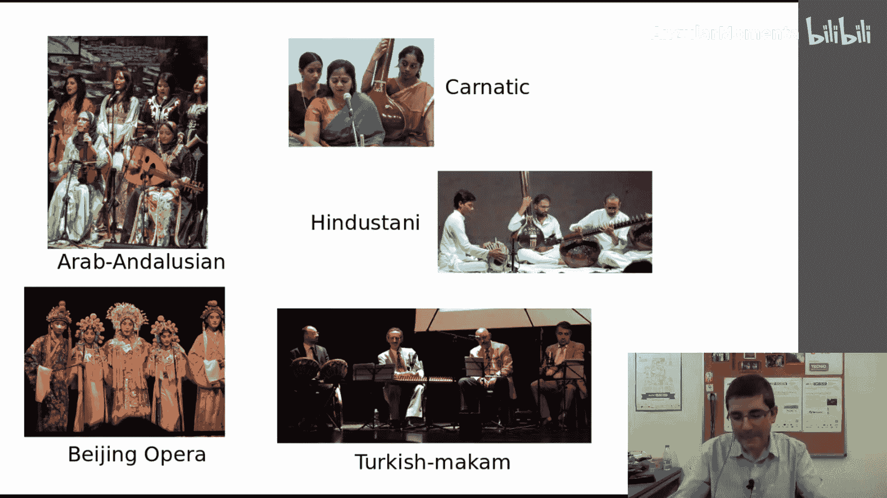
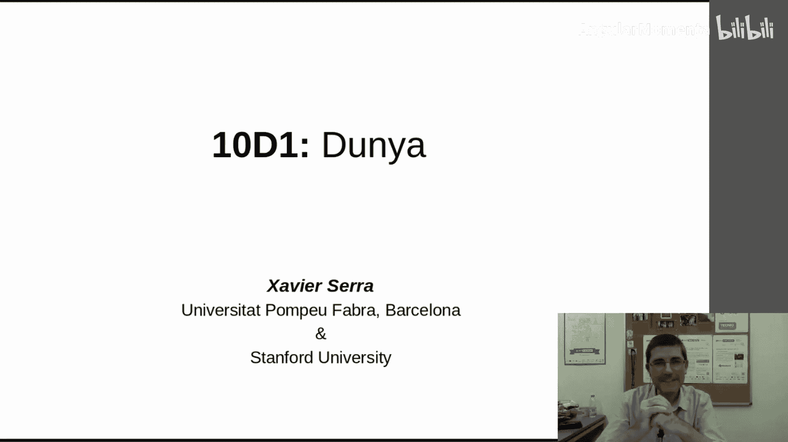

# 073：Dunia - 音乐探索原型系统

## 概述

在本节课中，我们将学习一个名为“Dunia”的音乐探索原型系统。该系统是“Commusica”研究项目的成果，旨在利用音频信号处理、机器学习和语义分析技术，帮助用户探索和理解特定音乐传统的录音收藏。我们将了解该项目的背景、目标、所研究的音乐传统，以及Dunia网站的主要功能和界面。

## 项目背景：Commusica

上一节我们介绍了Dunia系统，本节中我们来看看其背后的研究项目“Commusica”。

Commusica是一个已进行近三年的研究项目。该项目旨在从特定音乐传统的音频录音及相关信息出发，开发能够导航、探索和发现这些音乐的技术。其核心理念是采用**文化特定方法**，即利用对特定音乐传统的已有知识来更好地分析和描述音乐。

该项目选择了五种非西方的、与音乐信息检索领域通常关注的音乐类型差异较大的音乐传统。这些传统研究充分，信息丰富，是挑战现有技术并开发新技术的良好起点。

以下是该项目研究的五种音乐传统：
*   **印度卡纳提克音乐**：来自印度南部的古典音乐传统。
*   **印度斯坦尼音乐**：来自印度北部的古典音乐传统。
*   **阿拉伯安达卢西亚音乐**：来自北非马格里布地区的音乐传统。
*   **中国京剧音乐**：聚焦于京剧中的音乐部分。
*   **土耳其马卡姆音乐**：源自奥斯曼古典传统并在土耳其传承的音乐。

## Dunia 网站导航

了解了项目背景后，本节我们来看看Dunia原型网站的具体界面和功能。

Dunia是一个研究原型网站，可通过URL `dunia.commusica.upf.edu` 访问。网站对公众开放，但音频录音因版权限制，需要申请研究登录账号才能在线收听。

网站主页面提供了通过元数据导航和搜索的功能。用户可以执行标准文本搜索，也可以探索为该音乐传统定义的相关实体。

以下是网站定义的核心实体概念：
*   **艺术家**：表演者的姓名。
*   **音乐会**：演出事件。
*   **乐器**：演奏使用的乐器。
*   **拉格**：旋律框架，公式表示为 **Raga**。
*   **塔拉**：节奏框架，公式表示为 **Tala**。

用户可以点击任何实体（如特定的拉格）进行搜索，网站将返回相关的录音和实体信息。

## 功能演示：以艺术家为例

在介绍了基本搜索功能后，我们通过一个具体例子来演示Dunia的探索流程。

例如，搜索艺术家“Amrutha Murali”。搜索结果会显示她的个人页面，其中包含从网络资源（如专注于卡纳提克音乐的网站Carnatic.com）获取的传记信息。所有元数据都来自MusicBrainz（一个开放的音乐元数据库），项目已将所有这些录音信息录入其中，使其成为人人可用的开放数据。

在艺术家页面，可以看到：
*   **相似艺术家**：基于语义分析（如是否属于同一流派或师从同一位古鲁）建立的相似性关系。
*   **合作艺术家**：曾与该艺术家在同场音乐会中合作演出的艺术家。

点击合作艺术家，可以链接到具体的音乐会页面。音乐会页面列出了该场演出的所有曲目（音轨）、参演艺术家列表，以及**相似音乐会**。相似音乐会通过比较两场音乐会中演奏曲目所使用的拉格和塔拉的重叠程度来确定，从而建立音乐上的关联。

## 录音页面与音频分析

从音乐会页面可以进入具体的录音（曲目）页面。这是展示研究成果的核心界面。

录音页面显示以下内容：
1.  **波形图**：可缩放查看音频波形。
2.  **音高轨迹**：自动从歌曲中分析得出的音高随时间变化的曲线。公式表示为 **pitch(t)**。
3.  **主音指示线**：水平线表示印度音乐中作为参考音高的“主音”频率值。例如，本曲目自动分析出的主音是G，频率为196 Hz。
4.  **背景色频谱**：显示整体音色的频谱图，提供音乐音色的可视化概览。
5.  **音高直方图**：位于左侧，显示整首歌曲的音高分布。它揭示了歌曲中哪些音高被更加强调，是表征特定乐曲或歌手对某个拉格演唱音准的一种方式。

用户可以在播放音频的同时，观察这些可视化分析结果如何与音乐同步变化。

## 相似性探索与未来方向

最后，我们来看看Dunia系统在音乐探索方面的核心目标与未来方向。

录音页面的底部展示了**相似录音**的探索功能。这是系统的核心目标之一：探索歌曲内部以及跨歌曲的相似性。

目前，系统初步实现了在整个卡纳提克音乐录音收藏中，基于**音高直方图**的形状来寻找相似歌曲。系统会表征当前歌曲的音高分布形状，然后寻找在其他歌曲中关键方面可能相似的形状。

例如，系统可能找出同一拉格下被识别为有些相似的歌曲。这为用户提供了基于音乐内容本身（而非文本标签）进行导航和发现的可能性。

未来的目标是开发更复杂的探索模式，允许用户以更深入的方式导航音乐收藏，并确保这些探索方式对特定的音乐传统具有实际意义。

## 总结

本节课中，我们一起学习了Dunia音乐探索原型系统。我们了解了其背后的Commusica项目及其文化特定研究方法，熟悉了Dunia网站通过元数据实体（如拉格、塔拉、艺术家）进行导航的功能，并深入查看了录音页面提供的多种音频分析可视化（如音高轨迹、音高直方图）。最后，我们看到了系统基于内容相似性进行音乐探索的初步尝试及其未来发展方向。这个原型展示了如何将本课程所学的音频信号处理等技术，应用于构建有助于理解和探索特定音乐文化的实用工具。