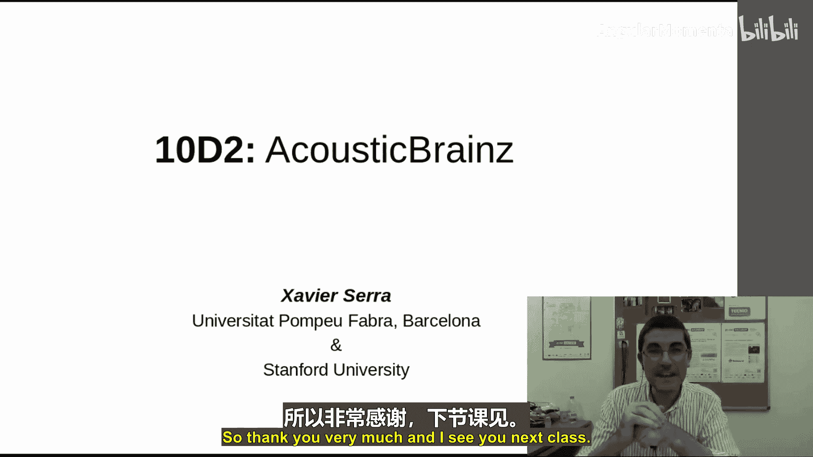

# 074：AcousticBrainz 介绍 🎵

在本节课中，我们将介绍一个名为 **AcousticBrainz** 的新兴项目。该项目由音乐技术组与 MusicBrainz 合作开发，旨在通过众包方式收集和分析音乐录音数据，以建立一个可用于研究和探索的大型音乐特征数据库。


---

## 项目概述与目标

AcousticBrainz 是一个旨在收集音乐分析数据的倡议。这些数据来源于对音乐录音的分析，并由公众提供。其目标是尽可能多地收集数据，以创建一个可用于多种目的的音乐数据语料库，主要用于研究，也可用于不同方式的探索。

在音乐相关数据的研究中，一个主要困难是音频录音的获取。由于版权问题，音频录音不易获得，也无法被收集和共享用于研究。AcousticBrainz 的解决方案是通过众包来分发代码，让用户在自己的计算机上分析他们拥有的音乐收藏，然后上传分析结果数据。

为了实现这一目标，需要两个基本组件：
1.  一种能够唯一识别每首被分析录音的方法，以便获取该录音的所有元数据信息。这个组件由 **MusicBrainz** 提供。
2.  实际的音频分析功能，用于提取音频特征。这个组件由 **Essentia** 音频特征提取器提供。

---

## 项目进展与统计数据

自项目启动以来，AcousticBrainz 已经取得了显著进展。在短短几周内，已成功分析了超过一百万首曲目。

下图展示了自九月中旬以来数据收集量的演变过程：


项目初期，用户需要自行编译代码，使用门槛较高，因此数据增长缓慢。最近一周左右，项目提供了预编译的二进制文件，使得分析过程更加简便，从而迎来了数据的第二次快速增长。

图表中的顶部线条代表分析曲目的总数，浅绿色线条代表唯一曲目的数量（排除了不同格式或压缩版本的重复项）。目前，唯一曲目数量已接近80万首。


---


## 核心组件一：Essentia 音乐特征提取器

Essentia 是一个音频分析工具包。AcousticBrainz 使用了其中的“音乐特征提取器”。该提取器旨在提取可用于描述和表征音乐的低层级音频特征。

以下是 Essentia 音乐特征提取器的界面示例：


该提取器会输出一个 JSON 文件，其中包含整首音乐曲目的所有特征值及其统计信息。


JSON 文件结构示例：
```json
{
  "metadata": { ... },
  "lowlevel": {
    "spectral_centroid": { "mean": 1500, "var": 200 },
    "mfcc": [ ... ],
    ...
  },
  "tonal": { ... },
  "rhythm": { ... }
}
```


此外，AcousticBrainz 服务器还会基于这些低层级描述符，运用机器学习方法和分类技术，提取一些高层级描述符，并为曲目分配标签，以服务于更高层次的任务。


---


## 核心组件二：MusicBrainz 元数据库

MusicBrainz 是一个运行已久的项目，致力于收集音乐的元数据。它就像一个音乐百科全书，以开放许可的方式共享所有数据。

以下是 MusicBrainz 收集的部分统计数据：


MusicBrainz 的核心实体包括艺术家、发行版本、音轨和作品等。例如，它拥有约90万位艺术家的信息和约7000万首音轨的信息。AcousticBrainz 的分析上限正是这些在 MusicBrainz 中标识的音轨。


每个实体（如艺术家、音轨）都有一个唯一的标识符（MBID）。当引用特定音轨或艺术家时，只需引用其对应的 MBID，即可在所有相关服务或资料库中唯一地识别该实体。这是组织所有分析数据的绝佳方式。


---

## 实践操作：为音轨添加标识并进行分析

上一节我们介绍了 AcousticBrainz 的两个核心组件。本节中，我们通过一个具体例子来演示如何为音轨添加 MusicBrainz 标识符并进行音频分析。


我们以钢琴家 **Kimiko Douglas-Ishizaka** 演奏的《哥德堡变奏曲》录音为例。

首先，在 MusicBrainz 中搜索这位艺术家，找到对应的发行版本和音轨。每个音轨都有其唯一的 MBID。


例如，我们复制其中一个音轨（如第一变奏曲）的 MBID：`f`**`xxxxxxxx-xxxx-xxxx-xxxx-xxxxxxxxxxxx`**（此处为示例ID）。


接下来，需要准备两个工具：
1.  **AcousticBrainz 提交工具**：用于分析音频特征的命令行程序。
2.  **MusicBrainz Picard**：用于为本地音频文件添加 MusicBrainz 标识符的图形化工具。


以下是使用 Picard 为本地 MP3 文件添加标识符的步骤：
*   将《哥德堡变奏曲》的 MP3 文件导入 Picard。
*   通过“聚类”功能将曲目分组。
*   在 MusicBrainz 数据库中手动查找并匹配对应的发行版本。
*   将匹配到的元数据（包含所有音轨的 MBID）保存到本地 MP3 文件的标签中。


完成标识后，使用 AcousticBrainz 提交工具分析整个目录：
```bash
./acousticbrainz-submit /path/to/goldberg-variations/
```
该工具会调用 Essentia 音乐特征提取器分析每个音轨，并将结果数据上传至 AcousticBrainz 数据库。

---

## 查看与分析结果


分析完成后，我们可以在 AcousticBrainz 网站上查看结果。

在 AcousticBrainz 网站输入特定音轨的 MBID，页面会显示来自 MusicBrainz 的元数据以及分析得到的声学数据。


显示的数据包括：
*   **低层级数据**：完整的 JSON 格式音频特征描述符。
*   **高层级数据**：通过机器学习模型推断出的信息，例如调性、乐器、情绪等。


此外，页面还尝试根据元数据链接到 Spotify、Deezer 或 SoundCloud 等流媒体服务，以便在线播放该录音（可能不是原始版本，但是同一作品）。


---

## 项目意义与资源获取


AcousticBrainz 是一个刚刚起步但令人兴奋的项目。它综合运用了我们课程中讨论的许多音频分析技术，并将其应用于分析海量音乐、理解大型音乐资料库的复杂场景中。


对于用户而言，既可以贡献自己音乐收藏的分析数据，也可以利用已有的数据。AcousticBrainz 网站提供了所有已分析数据的下载链接，包括低层级和高层级描述符的压缩包，并会随着数据增长持续更新。

相关资源链接：
*   **AcousticBrainz 官网**：`https://acousticbrainz.org`
*   **MusicBrainz 官网**：`https://musicbrainz.org`
*   **MusicBrainz Picard 工具**：`https://picard.musicbrainz.org`
*   **Essentia 音乐特征提取器**：`https://essentia.upf.edu`

---



本节课中，我们一起学习了 **AcousticBrainz** 项目。这是一个通过结合 **MusicBrainz** 的元数据标识和 **Essentia** 的音频分析能力，以众包方式构建大规模音乐特征数据库的倡议。我们了解了其运作原理、核心组件，并通过一个实例演示了如何为音轨添加标识、进行分析并查看结果。该项目为音乐信息检索和音频信号处理研究提供了宝贵的开放数据资源。