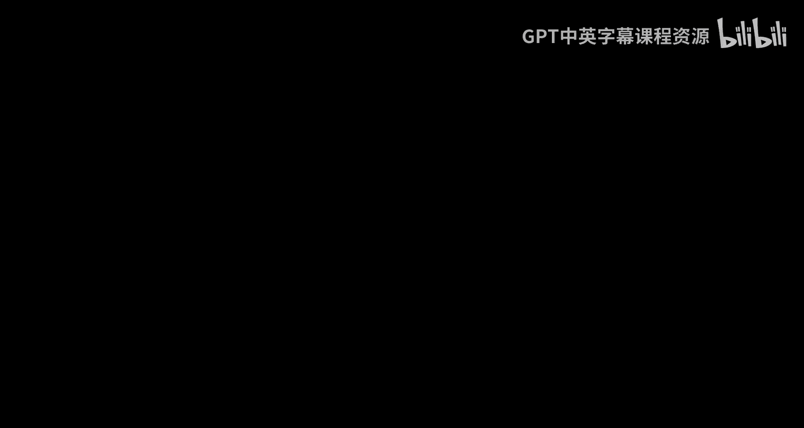
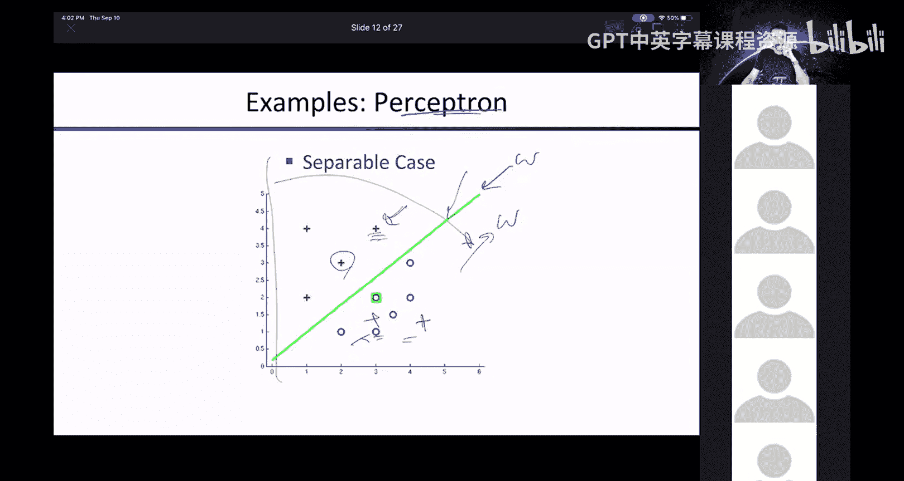

# USC《机器学习系统｜CSCE585 Machine Learning Systems 2020》中英字幕（Claude-3.5 p01 -01-Lecture 3.1 - Perceptrons and Logistic Regression.zh_en -BV1Xc9bYVEC6_p1-

Okay， hello everybody， I hope you can hear me though。Could you please confirm。I can hear it。没吧。

 thanks。So。Today， the plan is to start something。New in 5，85。

 something different that you have seen so far。 So we。Turn a gear toward mor Toium mathematics。

 right？So so far， we had some interesting lectures。On。More practical aspect of how we can。

Build reliable and dependable machine learning systems。

But today our focus today and the next few weeks， our focus is very much different right。

 so we want to understand some basic of mainly。The foundation of deep learning。That' that's the goal。

 so I would like to go and discuss。Some very basic theory。

 some basic stuff that build the foundation of deep learning in the next several weeks and we start really with basic stuff。

So today we will mainly look at perceptance and logistic reparations。

Mainly discussing about linear algebra and some mathematics behind learning for these simple classifiers。

 mainly looking at linear classifiers。And then once we finish discussion about percept and logistic regression。

The plan is then to discuss。Two different world。 One world is about。

Building such classifiers by probabilistic models， so something like naive base。

Because I would like you to understand what are two different。

Interrelated votes for any sort of classifiers or machine learning， right？

One view is probabilistic view where we。Discuss the way of learning some naive base and creating some probabilistic models and reasoning about the decision by building this probabilistic model。

 and then we go to more neural network and stuff right and we discuss some foundation of neural networks by building smoothly from these foundations right？

So more specifically today， the plan is to discuss about linear classifiers。Where we。

Input were typically represented by x。It could be。For example， in this particular case。It takes。

And then we have a feature vector。Which。Athematicically is a simple vector。

That each location has a feature value right， and each of these location in this vector is associated to。

One of the features。Of the model， okay。So this transition。Is basically。

We have some sort of model right in abstract。Okay。And then。Based on this feature vector。

 we are going to make a decision。Okay。For example， in。Binary classifier， the decision is very simple。

As two classes。Right typically。That。You can call it positive negative class。It depends on the domain。

 for example， if you're building a classifier for classifying whether it text。Is it a spam or not。

 so you can call it a spam or hand， right？Or could be other sort of。Doomain。

 if your input is an image。嗯。Then the same process， you get some sort of feature vector。

And you want to turn up to a decision。Whether。What is inside this image in this？Chaさ。Basically。

 you might be interested into learning whether in your image it two or not or。

What is the digit inside this image， right？The number of classes。

 if you're interested to learn what is inside the image。

 you have basically 10 different classes from zero all the way to9 Okay so it really depends on your application and。

And X， the input space。And then we may have different number of classes。

 but we start off here by assuming that we want to build a binary classifier。哎。

So within this high level overview， we have two different processes going on。

 one is turning this input to the feature vector basically。

Getting what these numbers should look like。O。It is。Which has its own process， right？

And depends on the type of technique。The process would be different。Right， for example， for building。

诶。Naive base typically we need a probabilistic model。And in na base， typically， the case is that。

You specify some list of features， for example， in this case。You specify like some very。

So basically you manually specify these features。And these are not learn features。

 you manually design these features， you manually come up with these features right so you want to have like whether you have a word like free in in in this text or not whether your name appeared in this。

Text， this text is， basically we are talking about the image text。

Whether you have any misspelled wall in this text， whether this email come from your friend and other features that。

You thought well and you came up with this list of features， right？On the other hand。

 in neural networks， these features are learned， so the whole architecture。

Basically and the key benefit of neural network is that these representations and these features are automatically learned from data and that's the key difference between something like naive base or a linear classifier or multiclass classifier or。

Some other version of traditional machine learning models and the new。

Typee of machine learning models like deep neural networks， right？So in one hand。

 you have manually designed features， on the other hand these features are learned from data。

That's that's basically the key difference and then you want to tell this。

Features but some magic into a decision and the key focus of these lectures。ul be on the other side。

 so we assume that this part we are given this feature vector。

 we know the value of these feature vectors， and then our task is to basically do this magic。

 turning this feature vector to a decision， whatever it is， depending into that space。

Do you have any question about this？Because this is important to see the difference and。

And clarifyar assumptions that we will be talking from now on。嗯。So。

There are some loose connection between basically the neurons inside our brain and the very how perceptor works。

So in neurons are basically what we have in our brain。

 we have so many like 100 billion number of neurons typically in our brain。

 human brain depends on the type of animal， this number would be different and this is the overall structure of a neuron in our brain so we have。

Some places that we get input signals， right。嗯。Then the right where we get the input signal to the core part of the neuron。

 in this case， nucleus and the task of nucleus is to make that decision。

Inputs are fed into these nucleus and this nucleus decide。

What kind of signal it want to fire to the out right。

 what kind of signal it wants to send out through axon to basically other connected neurons to to this。

Okay， so these inputs， you can think about。For example， these input。

 some of these inputs might come from the other connected neurons。

Or maybe from some of our sensor inputs such as。Eyes， hairs， like true voice， through a smell。

 through many other type of input， sensor input， or like most of them may come from the other。

Connected neurons。 and， and each of these。Neurons each of these dendrite have different strands of connection。

Some of them are loosely connected， some of them are basically has a。More strength in the connection。

 so we have different types of dendrite。And these different types basically affect the way how these nucleus decide about the out。

And these connections typically are true synapses right， so these synapses connect。

 you can think about this as connectors between different neurons in your brain that basically connect different neurons and create network of neurons right in our brain。

 basically we have one version of neural network going on there。Any question about this？

So so you can you can connect it to mathematics here as well， right。

 so you can define these inputs as some sort of。啊。Values and some weights。 Okay。

 so these inputs may come from some。Vals to this and each of these might have a weight right I mentioned that this strength could be different so we can imagine that this connection we could assign some different weights。

Here， so like， you could。You could consider here， right some of these。Again。

 with different weights that is showing the strength and here you could assume that this nucleus decide based on evaed。

Average of these inputs， right？And the weight typically is shown through thet product of F。We w。Or。三。

Overweighted average of F。啊。And this is the way how you represent it mathematically。

So you have some weighted average for producing the output that this will go out to the other connected neurons in the brain。

Okay， so this is this is the way how it works and this is loosely connected with the way how neural network can。

More simple version of this in linear classifier boxs。So we have。

Some inputs represented as featured values， again， if you look at this。

We are talking about this part， right， We are talking about that we have the feature values as input and we want to produce the。

The decision， right right， so we are not。Talking about how to produce the。The feature value itself。

 we will talk about that later on， but now we mostly talk about this。So we have some future values。

Each feature has a weight。And we need to produce some activation based on some overweightrated average of these feature values。

The activation is represented by this dot product between weights。And feature values。

 so this activation， you see that is associated to a specific weight predictor。For a specific。Input。

Okay， X again， is input。W is ava。And the vacant average， which is represented here。

Is determining or defining the activation value associated to debate？So。In this situation。

 what part of this is learning， what we are going to learn because。Make sure you understand this。

 future values are given， we cannot change them， we cannot learn them are given to us。

So the only thing that remains is to learn some weight。

That produce this activation and produce the decision of the model correctly。

So that these Ws are the things we are going to let。So for example， based on this activation。

We could consider if the activation value is positive。

Then the decision would be associated to the positive class one of those class so we are talking about binary classifier here。

 so we have positive class negative class。Okay， very simple， so if the activation is positive。

Then we associated to the positive class。 If it is negative。

 this can be associated to the other class。 So this is one way you can produce the。The decision。

 based on。The exact value of the activation， okay。So basically。

 this is the way how your model produce the output。And you can represent it in a block diagram。

 again， it is very much connected to here as a weighted sum each which different weight。

And this produce the decision， either positive or negative class。

And this is basically the very how your model decide based on the activation that is produced here。

 So it's very simple。Auttheomaically。Very simple and as straightforward。

Do you have any question here？Make sure that you。Kely about everything because this is the foundation of neural networks。

So I would like you to understand clearly these foundations when it gets more to that financial start。

So let's have an example。In this case。你。We have a specific weight vector， right。And and。

And we want to basically the learning procedure is to figure out the right weight vector that produce the right decision for the model。

 so the key is to learn actually this correct weight vector based on a learning procedure that we are going to discuss now okay。

So these are your。Feature values， right， and and。All of these post feature values and the ratess。

Or you can think about it mathematically as a vector right vector in a multidimensal a space depending on the size of your feature space okay so if you have for example。

 two features。Like you can represent it on two dimension on a space like this if you have more。

This feature。Wetter and this bait vector lives in。More dimension are the spaces that obviously we cannot represent it here on two dimension。

 but you can imagine it mathe。はい。So these are vector， mathematical vector that we are talking about。

And then right so in this case， this is you have one a specific example that here in this case。

 you get， okay， for this a specific example， you have。2。Whats啊。H？

iss basically written as free right you in this email that you received or associated to this particular example。

 there is no mentioning of your name， two misss spelllls and not coming from one of your contacts。

 right？啊。So obviously there is some misalignment between this feature value and your weight vector。

 so your weight vector basically determining okay， what are the importance of each of these features for you okay in this case you're taking free if you have a vote free。

 meaning that this is most probably a spam so you put a high value for this basically feature associated to this feature。

嗯。If you see your name in the text， you want to decrease the probability of being a spa。

 so the positive chaos in this case is meaning that this is a spa image if you have misscallling this is。

More probable that coming from a spam， but you want to put less weight comparing if you have a free in your text。

And if it comes from your friend， one of your contact in your email account。

 then you want to associate relatively high that this is not an span。

 so this is the way how you can interpret about this weight vector。Okay。

So the dimension of this wave vector is the same dimension as your feature vector in this case。诶。

So if you think about this， so you see that in this example， you have two two number threes。

 two misscal。And if you do the do product between these two， you see that。What you get is for。2 plus。

The next one is zero， right plus。2 plus0。Okay， so this is positive。It is。Okay okay。

And that's why you see the alignment between these two。 So in the vector space， these are aligned。

 so meaning that the。The decision for this particular example。

 so this particular example is actually a span。Al right。

 at least this model thinks that this is as done。 Okay。

 This is the way how model thinks because it has a specific rate。Oh。And。Obviously。

 these are coming from your data from X1 and the current way with this page。

 the model think that this is a spam， it might be the case that this is not actually a spam。

But the mother currently thinks that it is a。And you get another example right this is another feature vector associated to x2 no free mentioning you see your name。

 you see one misspa coming from your friend so this is probably not as right and you see that if you do the product you get zero。

Plus minus。One， right。呃。One of。us3 okay。So， this is。-3。And this is associated with negative colors。

 which is。Modern thinking that this is not as and that's why you see that。Like these are not aligned。

 There's no alignment between the weight vector and。And these feature vector and typically like。

If you want to visualize it， you could consider a hyper planee like orthogonal to this。Feature。So。

 you could consider。Hyperpalae here。A vector， if a vector lives here， right？

These are belonging to the positive case if a vector lives here。Its belong to the negative。

Do you have any question about this？Yeah， I have a question。嗯。And so this type of vector。

Type of evaluating the input versus you know， your site conditions。

 this only works for a binary decision。So， but it's and so anything where you're deciding between two things and。

I guess my question is， does it work if you're deciding between any two things or only if two things that are mutually exclusive。

 like if the two things add up to 100% or is it just when you have two choices period？

That's a very good question， so where you have two choices， right？

We will go shortly to multi classification where you might have more than two choices right。

 you might have three classes， you might have four ksses。

But we started from binary class classifier and where you have two basically this joint choices like in this case like a spa or ham could be like male female right。

 could be cancerous， not cancerous kind of thing， for example。

 for a classifier determining whether like this tissue is a cancerous tissue or not， right。

Binary classification right and you have so many of these binary classification cases that is out there。

 but we start from this because that making sense out of this and visualizing this is so intuitive and。

We understand it well because when it gets to multi class cases， it becomes less intuitive to es。

Right， I guess I probably misphrase my question， but。So for this example。

 I understand why this works well for binary for a binary case and how it is that super easy I understand。

 but I guess my question is why is it possible for you to use the same technique。

 but to set ranges or does a vector style like this only work for binary or is it just like best for binary and reusing it in this example because it's intuitive or could you say like if the dot product was less than negative three。

 send it to one make one decision but if it's between negative three and one make another decision and if it's greater than one make another like I guess。

Is it necessarily binary with with the weight vector or are we just using a binary case because it's the most intuitive to understand？

Actually， the latter， right， because it is。Most intuitive to understand。

 but I think your question will be clarified when we get to multiclass right so when you see the differences and how you could make sense of going from multiclass to two classes to like three classes right this transition I would say help you to understand why this particular case of binary classified makes sense and why it is so intuitive because then they a lot less intuitive with multiclass。

But yeah that this is a very good question thanks for asking it because then it makes things a lot than we transition to this transition right I mean also in theory you could set up a pretty complicated。

Model that only uses binary decisions， but it's just interconnected binary it's like a bunch of binary decisions based on different parts of the。

Of the input I guess that's just like me thinking abstractly。

 but right maybe you are thinking about maybe you could split a multiclass to several binary classifier then then that that doesn't work maybe you could but then。

That would become a。You know。Because the mathematics behind multi classes would be yeah well connected。

 but slightly different the way how we have mathematics behind multiple classes。啊。It's not。

s straightforward to splitter multiclass through several primary classification。They're different。

 right？This is what。 Yeah， okay， I got you。可以啊。So let's discuss about the decision rules， right。

 because these decision rules determine the decision made by the classifier and typically here we have some again。

 some examples of two different kinds for binary a classifier， some of them belong to one class。

 the other one belong to the other class。And。Really。

 when we say learning is so simple as separating these two classes。So when we say learning。

 we learn something， we typically it boils down to。こ典です。Separator。Between classes。

The separatory is really the decision boundary that you need to learn from data， So you have data。

You need to learn this thing。And this is the result of your learning what we call basically the decision boundary of your model or your classifier。

啊。So it' simple as that and you really learn from learn this。Decision boundary from your data。

And in this case， like your data is so much easy and separable killingly by even a linear linear decision boundary。

 so you see that this is a linear decision boundary is not you know nonlinear and when it comes to linear models versus nonlinear models like this is the way。

How it looks来。嗯。Okay， so so here you are talking about the binary decision rule。

 we have some examples， these are the points here right。

An weight vector is a hyper plane that we discussed， right， which one side correspond to one k。

 the other side correspond to negative class。Okay， so and here， like imagine that you have two。啊。

2 features， right， to make it easy。Then then you want to。To have。Separator。

 this is the decision boundary， this is a linear separator between your classes， right。

 which this part you can correspond to a negative class。I thing the other side you want to。

Basically associated to the positive class。Okay， so and the learning really looks like， okay。

 in this two dimension on the space。How I want to move this decision boundary。

 like whether I want to move my decision boundary here or maybe。Here。

Or maybe like here like so and at the end it is like since it is linear。

 it like is a hyper plane right that lives in this high dimensional spaces in this case。

 two dimensional spaces and you have some flexibility to move it around。あ。

And this is you can correspond it to the complexity of your decision boundary。

 So like this is linear is so simple， your decision boundary。 and when we get to。

More nonlinear models like deep neural networks， these become。Obviously nonlinear。

 the decision boundary is nonlinear， you have different sort of contextity for your models。

So you can make a sense of out of this。If you want to。Any question about this？周啲啊。

The learning really boils down to updating the ratess， Okay， so here again。嗯。Here， in this case。

 updating rates is like learning， where should we put。This hyperclaim this separator。

 linear separator and how we should do that， what is the mechanism。

Behind the learning and what it means learning from。Daタ。Okay， so far。

 we have not discussed about learning yet。 just。Try to make a sense out of the decision by assuming that we already have some learned weight vector。

But now we want to discuss， okay。How the learning itself looks like and what it means by learning。

But it means what we mean by learning from data。And this points down location how to update this weight。

This is。This is simply the core concept behind learning。

This is a very simple procedure for learning a binary perceptron。Again， this is the。

A specific model that。He started perceptioncept， with very simple。Moother。

And this is the learning procedure for learning this。The core concept。

 when we discuss about some other type of model， even neural network。

 you see that like the whole concept is very much similar， the underlying mathematics is。

More or less the same， it's some like small differences， but。The thing that you learned here。

Its core， would they stay the same like for the rest of the stuff？So we start by like。

Some initialization， typically thes are initialized by zero。Oh。So for each， we look at each example。

 the training in a。We classify with the current weight。

 so this is the current rate that we have started by zero。啊。

And then like for each example that we have。We look whether。This example， given this weight。

As being classified correctly or not。How we can make sure this has been classified correctly or not。

This is very easy because we talk about training in a。When we say training in a sense。

We have the supervision we have the correct label for each instance。

 so we know that this is actually not a spam This is a spa These are basically。

Training examples that you know it's labeled， the ground truth， you know the ground truth。

And we use these ground rules as your supervision， and that's why we call this supervised learning。

Because we have the supervision for learning， we know the correct label， we know the correct signal。

 and we use this signal to update your rate vector or to update your decision boundary or to do your learning all of these are the same okay。

Make sure you understand these terminologies because these are important。嗯。And then。啊。

You look at each example。One by one if。If the decision that was made by your classifier。

 why represent。The decision made by your classifier， remember， what was that？W was。How。

 how you determine the decision。Simple， right， so you calculate the activation。

How you calculated the activation for this particular example， given weight。So you have the weight。

 the same weight， you have example。 This is the example you calculated the dot product of。第一个照。Right。

F。嗯。Sorry。😔，You have to wait you minutes。So you calculated that product between W and your feature。

Vs， right。And this activation once you get it so you look at so how based on this activation you determine the what right so if the activation is like larger than zero you want to say that y is。

诶。minus1 is activation。Its negative。 You want to say that is why。It's plus， something like that。Okay。

So this isで。The， the label that is。Given by your model， this is different from via star。

 what is lifestyle star， your ground truth。Okay， so there could be technically difference between your ground truth that you use as your signal for supervising your training。

 and this is the decision that has been made or created by your model， so there is differences。

But if the decision that has been made by your model is correct？So obviously。

 you don't want to make any update to your mate。Okay， because your mother is good enough。

Good enough for what。For this particular example， and so you need to repeat that for all examples。

 right， not enough for one example， you need to repeat that the whole process is here for all examples。

If the啊。Example， right， for example in this case， like was this right if the example is wrong。

 then you need to adjust adjust your model right here in this case。Your rate was okay。

 but in this case。啊。The groundund truth says that there is a divergence。

 The ground truth says that this is negative。But your model says that this is positive because it belongs to this part of the decision boundary。

 the other side。啊。So this is wrong， basically in this case， y is not equal to y star。Okay。

 and because of that， you want to adjust the weight vector。So you need to move。

 move this toward this， maybe like。Making this like this。

 like you want to do some adjustment of this decision boundary in order to make it correct for this particular exam。

RightAnd you go to all example。To do this adjustment。Okay。😊，Is there any question here？

Next is how mathematically we will do this adjustment。Give us one minute， think about this。

 what I have said， we will continue next， how we'll do this adjustment mathematically。One minute。

Okay， is there any question？So now let's review。How this learning looks like。

 What is the mechanism for。Doing this updates to debate vector in order to say that we have learned from these examples。

Okay， so we get it gets a little bit more math stuff right so again we start by zero and then we classify the the current rates right。

 meaning that we calculate this stock product and we get。The result of the model。And。In the future。

 in the space of vectors。It means that that if。Your weights and feature vector are aligned。

 this is positive right you know that from linear algebra feature if two vectors are aligned。

 the result the dot product between these two are positive， if are not aligned。For example。

 in this case， the dog product is negative。And again， this is given you can。Not learn it。

 What you learn is W。Or what you update is W so in this case no change you are fine。

 if wrong you need to adjust the weight vector by adding or subtracting from this feature vector sorry from the weight vector by some value from your feature vector right？

So， for example， you can do this so you can update。Your weight vector right by adding this。

Term and the dot product between。Wre star， this is。The correct label。Of this particular example。

 right？In this case， it's minus1。Right？And dot product with your feature weight， right。

 So basically you， if the weight， if this this particular case for this particular example。

 if the decision made by your model is incorrect， you need to do this adjustment to your。Very。Right。

And this is very simple， right？Oh。Meaning that if you want to make a sense out of it。

 meaning that if。If your'。If you're。Your weight vector for this particular example is not aligned with your feature vector。

 you want to like move it in this high dimensional the spaces in the space of dimensionality again depends on the size the dimensionality of your weight vector and feature vector right you want to make it aligned with this particular example right so you basically move this along to make it aligned for this particular。

For this particular case， right？So it's basically meaning that you move around this big vector in this space so in this case。

In this case， what you have here is。Is basically you want to move this weight vector by this adjustment right。

 so this adjustment telling you that this weight for this particular example should not well aligned with the F。

Because the decision。Ifvo star is negative， it belongs to the negative class。

 but this current vector that you have for this particular example producing the positive class。

 so it's basically is well aligned to this F so you need to move it away or this particular example and the way how you move it away is to add this since Vo star in this case is negative meaning that you subtract this feature。

Values from the current values of your rate and this will move basically this weight vector away from F in this case。

ok 啊。Does it make sense？So for example， in order to make a sense out of it。So， take think of it on。

Let's make a sense out of it here。So啊。You updated W with Ws W prime。And then you now。

 after this update， you want to get the do product with F。Right。You want to see what you did with。

It's your model， after this update。Okay， this is the way the way how we can think about this。

And see what we get really。 so what we get is that。Let's replace W in what you had before。Right。So。

 we replace。W pro with W。我 is star。Douck F。Okay。This is what we did， simple as that。

And then we get WF。わ wasです。阳光飞。Or was this， what this represent？Any volunteer？

I'm waiting for you guys。我比较华人。No volunteer。It's very easy。有合你。

It's not a good sign that we don't have any volunteer。So I called you guys。It's different。

Do you want to say something about this？有。Are you listening？Apparently， the family is not listening。

So how about Cody？Do you have something to say here？You're asking aboutW dotted with F。嗯。That。

 I believe represents how far。Like。When you dot two vectors that represents whether or not to。

It gives you like， I guess how far in the same direction they're going。So w。f。

Kind of gives you an indication of like how far off one vector is from another。

 I believe yeah yeah but what was。What was this before， This was。Before this update。

Because were talking about W， W was。Before this update， right， what was this represent？

Before the update， I don't believe I'm following。Before the like this is a training step， right？Yes。

 so before this this one a step updateake right before this one a step update。Like we have W， right。

 and we update W by something。This is the thing that we updated， right？啊。Like this is come on。

 this is very simple W product or F was the decision that has been made by the model before this update simple as that right so fast reaction。

Yeah， it was past prediction， right， and this past prediction was incorrect， right？

So we wanted to update that hopefully with this correction。We make it somehow more correct。

Right we make some correction into the decision that has been made by the model right so this is like your the decision by your past model so basically if this was W。

Accademy， there is。So。This was your W， this was your F。

And these were aligned for this particular example。

 your via start your through label saying that this is negative， right。

 but like this dot product was somehow positive。Okayケ。Its the W。That F was positive。

 So you want to to make the correction by like。Doing something and this is the correction you make。

 so you're doing Voya star。Doock。F。Dot F。This is is the correction that you make to your model。

So this part， you know that this is positive， okay？Vya star is negative， negative one。

So meaning that this correction， we basically whatever value this has。

 we are stopped trackinging this with from the previous。Actation， right so we had some activation。

We subtracted something from that， so this activation was positive。

 meaning that the model would give you the positive class as a result。So obviously。

 this is not good enough， you want to subtract something from it。And。The way I was subtracted you。

 you added this term Y star。f。So obviously， this should make sense。

 and here we made a sense out of it because like we expected that the training would。

Sotract something from the current activation because the current activation doesn't make sense for this particular example。

And this is the way how stop traction works。Does it make sense？I believe so。ok啊 so basically。

We move this weight vector。A bay from your feature letter。

We the hope that your model next time after this correction。

 make a correct activation and decision for this particular exam。And this was one example。

 you need to go through all examples。Maybe this correction， like。

Make some of some other decision for the other examples incorrect and you need to go through all of them to make sure that。

The model would make a right decision for all of them。At least for your training。

 because this is the only thing that you have。Okay， so this is F is the hyperplane。

And I like you play with this weight until。Until you get it right。

So in this case you have some examples， these are like examples that again。Training example。

 in this case， you see that obviously there is a separation。

 linear separation between these two sets of examples。

 so you should be able with a perceptron to separate that。

Then you might get started with this weight， this is your。Doub。

 this is your hyper plane that you're starting， okay？And。And then。

You want to adjust this weight until you get it right， obviously it is not。They're right， you know。

The right weight because you got some example incorrectly right so you need to adjust it along the weight right and this is the way how how it works right so previously the weight was living somewhere you had this example in order to maybe it was here right。

Considering this example， you need to move it to to make a decision correctly for this example。

 so you need to move it here right so this is the update that you made and then and then。

With that update you needed to consider this， you need to make this adjustment to make this correct right and so on then you have this you need to adjust it again so this video around until you get it right so then you have this example you need to adjust it and then。

Until until you get everything correct right so this weight vector should move around this in this case like you have two dimensional space like we could not visualize it for more than two dimensions。

But this is basically the the mechanism， how it works and how it looks like this this was a learning procedure when we say learning is not like。

Something crazy is simple as that， right you move around your weight vector until you get this decision boundary。

 correct。To separate these two glasses from you。And this is basically the whole mechanism behind binary classifier。

 how to learn a simple perceptorron to separate out two different classes the next would be moving to multiclass decision。

And how to learn classifier when we have。More than two classes。The intuition。

 the keytuition is the same we do the same sort of updates to the weight vectors。

But let's go into the detail of these in the next lecture because this transition is also important and we want to go into the detail to make some intuition this binary classifier is。

It's very easy， it's intuitive， but this multi class classifier is less intuitive。

 so let's stop here。I would wait for a few minutes and then。If you have any question。Please do ask。

What we have done with this lecture today。Thanks。Thanks。

Oh there were there were actually there was a question in the chat， I think there might have been。

Benjamin is asking if your model predicts incorrectly will it keep using the same training example until it gets？

The example， right or in。It just moved on after making a correction。Yeah。

 your training examples are fixed。I'm not sure I understand your question Benjamin， could you speak？

Bja can you can you ask your question very。I'm not sure I found there several with。But basically。

 your training examples are fixed。啊。Or you assume that it is fixed。哦。

And you make this correction until。You you were able to find this separator。

You might have the case that。Like there is no convergence guarantee here。So， maybe。

Maybe you cannot like if you do this forever， if you have cases， like you have this thing here。

 right？You买 have this。Examples here。So obviously with binary classify。

 you cannot separate out this because there's no hyperpae that could separate this line， right？

You have to leave you have to stop somewhere unless like you want to go for it and that's why there is no conversiongence guarantee here。

 but if your data is linearly separable if will'll find it with this procedure with converge to a hyper plane in order to separate them linearly。

Okay， yeah， that makes sense。S。That's a good question。Any other question？If not， then。Well， dawn。

 thanks。谢 one。

