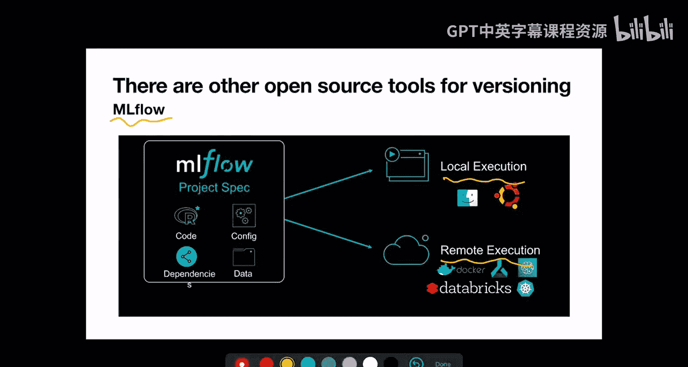
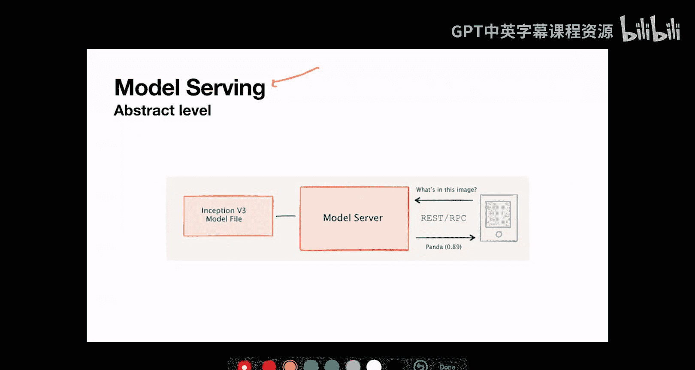

# USC《机器学习系统｜CSCE585 Machine Learning Systems 2020》中英字幕（Claude-3.5 p02 -02-Lecture 2.1_ Designing Computer Systems for Machine Learning.zh_en -BV1Xc9bYVEC6_p2-

Hello everybody， today we are going to talk about a very exciting and important aspect of machine learning systems。

 but before going into the detail of this important aspect。

 let's recap what we have already covered about machine learning systems。

 we started by looking at algorithmicqui。We saw that how important it is and if we don't care or if we don't design algorithms that basically。

Do not have important properties then what it means what would be the societal implication of such algorithms if we disclose such algorithms at a scale。

how we need to look at different aspects of such algorithms right so it is important to define these properties。

 especially bias how we could define it mathematically how we could ensure that the algorithms have such properties and the other aspect of it。

 we will go into the detail of algorithmic bias in one another lecture。

 but at least we covered the high levelve overview of algorithmic bias and then we look at the robustness。

So。We discuss how easy it is to fool AI systems， at least we know that there exist standard algorithms。

 optimization algorithms that you can produce some perturbation to the input data。

 and then easily full AI system to recognize a stop sign as a speed limit。

So these algorithms are standards and actually it's not really difficult to fool AI system。

But obviously， people are working on to make these algorithms or systems more robust against such adversarial attacks。

And then we looked at AI and compute， we discussed at the beginning of machine learning error。

The more focus was how we could improve the accuracy and still it is the case。

 but in terms of compute now we are in the era that we obviously need orders of magnitude。

 more compute in order to achieve the level of accuracy we need。

 the difference between the state of the art， and yesterday algorithm is actually not that huge。

 it could be even less than one% accuracy， but to achieve that a state of the art we need to put in a lot of compute because models become more and more parametric especially deep neural networks are highly parameterized and in order to train them。

We require a lot of compute and that is also the compute aspect of AI system is also important and we discuss that in detail。

Previously。So now today we are going to talk about another very important aspect of machine learning systems。

 which is designing machine learning system， what it means is that so I'm sure you have heard or at least in your life you've built a system。

 whether a software system， physical system or anything。

 a chemical application could be any sort of system without an engineering process without a design process building any system would not be systematic。

There are many issues any designer needs to think about and needs to address。

 including machine learning system， machine learning system。

 building machine learning system could be you could think about as a。Software system。

 but there are essential differences between non machine learning system and machine learning system that we are going to talk about these today。

 so basically without having or addressing important design issues of machine learning system wouldn't be possible to build such system in the first place or you could try to build such system but you would face consequences and you need to pay much more cost。

ok 啊。People obviously have looked at this， and I'm sure you thought about this。

 at least you try to build。She learning model for your research and essentially the difference between how you build a model in your computer locally and how you could produce a them there would be a gap between these tool so you can obviously build a simple model。

 even a very complicated model on your laptop locally。

 but it doesn't mean that you could deploy that on a server and you could expect that many end users or able to use that and and able to solve the task with this model。

For example， chip， surveyed。Many practitioners， and asked them about。Important aspect of。

Designing or building machine learning system and she published a very interesting report that I highly recommend you guys to look at it。

 to read it， so I would like to highlight few。In order to motivate what I'm going to discuss today。

 for example， she asked what are the hardest questions that？

Basically for designing machine learning system people have faced。

 some practitioners answered with some very interesting aspect highlighting very interesting aspect of designing such system。

 for example， Ravi year mentioned that candidate。It is important to break down an open ended problem into simple components。

 into essential or smaller building blocks in order to solve the system。

And also identify which blocks require ML and which blocks or which component may not necessarily need any ML。

So for billion。He is highlighting a very important aspect of machine learning system。

 it means that any machine learning system could have many different building blocks。

 but not all of them are。Related to any sort of models。

 so this is very important we provide I will discuss some specific example about this。

Also another interesting aspect， the metric， so here he mentioned that many candidates know about model classes very well like linear model decision trees and so on because yeah。

 they could memorize these information， but there are so many other。Aspect about our system。

 for example， data cleaning， data preparation， logging， evaluation metric inference。

which is about model deployment future stores and so many other aspects。

 which not necessarily all candidates know about these aspects。

 and it is important to know about these aspects and how to approach them。

Another interesting answer would be from Ilia， he mentioned that basically。

Imion about defining the problem， identifying relevant metrics and basically understanding deeply what ML can do and cannot。

 ML method can change every year， but solving problem stay the same。And this is true， right。

 every not only every year， every few weeks， you will see a totally new technique。

But the way how you could solve is problem。And problem basically the way how you approach a problem。

 the way how you solve it is the same， right？It's not the case that every week you face a total new problem。

 the problems are essentially same as games。W change。

 but the core aspect of the problem would stay the same。

 it is important to know how to solve such problem using even ever changing techniques。

So these were some very important aspects that these practitioners highlighted。

 also a very important paper， several years ago came out of Google discussing hidden technical depth in machine learning systems。

 so they looked at several different machine learning system and they came off with some very interesting observations。

In this case。You see that there are for any machine learning systems。

There are so many different components and the ML code that people typically talk about and know about is actually a small part of such system There are components for data collection for data verification for resource management。

 for serving for monitoring for analysis， for process management。

 for feature extraction and also configuration， So there are actually so many other different components that are as critical and even more important than the ML code itself and by ML code meaning that the the particle part of the code that。

That you can train a model and build a model and get some prediction out of it。

They look at some very important technical depth that accumulate for MLL system， for example。

 data dependency， model complexity。Reproderibility of such model testing aspect of monitoring of the system。

 configuration issue and some external changes， these are very important aspects of ML system and if we do not have systematic process for them。

 if we do not think trolley if we do not have used proper tools for them。

 obviously we cannot scale the system and these are important aspects that we are going to cover。

Obviously we cannot cover all of them today and I'm not planning to discuss all of them today， but。

We will cover most of it within this course。We also looked at some important system issues in ML systems and by system issue and you can look this paper up。

 it was done by one of my former students and some other colleagues。So。You can think about。

I sees them。Basically。Of different layers when we talk about system we don't not necessarily mean a software actually the hardware aspect of the system is also very important between software and hardware obviously exist some middleware between these two important layers that take care of the communication between software and hardware so basically we are talking about a stack。

Here you have some harder layer。You have deployment and we have this CPU memory， GPU and so on。

And we have some OS kernelnel， this is what I'm talking about in middleware。

 and obviously we have some software part which basically consists in code that you write for the task at hand。

Right， for example， you could think about a video encoder， some databases and so on。

 so basically when we talk about the system， we mean the combination of software。

 hardware and middle。So we looked at different systems issue， for example。

 API mismatch compiler and connection error， memory allocation error and so many other important issues。

 these are also very important and we need to have more understanding， specifically what it means。

 how different they are in machine learning systems and also the other type of systems that。

Non machine learning systems。Whether， for example， in machine learning system。

 we face more memory allocation issues or less， what it means whether for a machine learning system。

 we need to have a specific tools to take care of memory leak。

 for example these are some very important and systematic aspect of building system。

 so if you identify these important issues， we need to build a proper tool for them to help developers to manage such issues and can resolve this issue during the design process。

So more specifically， when we talk about production。

We need to have a process and this process actually is not trivial we typically start with preparing the data。

For any task which entails machine learning， the office in data data is very important in building machine learning system without data。

 is not actually possible to think about it， yes there are basically approaches for collecting data for preparing data but basically dealing with data essentially is the most important aspect of any machine learning system。

 but again， machine learning system is not only about data that exists some other aspects like code an other aspect that we are going to talk about。

 but typically we start by the data and then we create a model。And probably。These two。

Eeps of building machine learning， you already family of it， and this is typically the tool process。

 two part that any MR researcher or family of it and then you go to companies， like Google， Facebook。

Then you get to know that beyond building code and dealing with data there exists some other aspect which are even much more important than these two steps。

 what are those steps， yes here we have basically the evaluation， and model tuning。

 we have then the deployment aspect of the model， for example， when we train our model。

 when we evaluate the model， and when we make sure that we have a good model。

 then we need to deploy it， where to deploy it， how to deploy it。

 whether this deployment scale to several hundred user thousand user million users。

 these are the questions that come into place and then。

You need to get the prediction from your model， you need to monitor the performance of the prediction and also then you need to manage your models and do some versioning because you need to update the model you need to revise your model you need to throw away your model and so on so there are so many other steps for building such system in production right so obviously you typically don't deal L withDs steps in research and that's the difference between what you expect in research and what you expect in production and hopefully the goal of this ML system course is to also talk about these important aspects and get you ready to build such system in practice。

So again， when we talk about machine learning system， we need data， this is essential， we need model。

 this is essential， but also we need code and the important thing is that all of these aspect in production。

 when we go to the production would change， so all of these are important aspect of building an EML system。

You can think about different issues， different things that you need to consider for every single aspect like for example。

 when we talk about data， the volume of data is important， the sampling is important。

 the schema is important when we talk about the model。

 the algorithm that we take into account are important。

 the model training and the experiments are important。Code the configuration， for example。

 bug fixing and requirements are becoming very important。

 so these are different issues associated with each aspect of building such systems。Okay。Okay。

 and then let's imagine that you have some data and you have a particle model in mind。

 like a support with machine， a random forest or whatever it is。

 you code and you build basically a particle model， let's say a SPVM model。

 or a deep neural network model。So you now have your model。Again。

 when you want to go to production you need to write some code right what it means is that you need to integrate your model into a particular application you cannot say hey。

 this is the model that I develop use it how can I use it how how can I give it to an end user。

 obviously end user cannot cannot use the code to do the task and user wants some interface to to for example。

 get some prediction， for example， she may give you a particular image out of the out of the mobile。

 but the camera and she wants some prediction what it includes in this image on the floor。Example。

 very quickly， otherwise， you wouldn't use your application right。

 so typically we need some piece of code that。include basically consume this model and use it for any sort of task in production for example。

 you might want to deploy this model behind a HTML interface and the user would submit some data and she wants some prediction out of it right this is one way but you could imagine there so many other way that user can interact not necessarily through data through HTML but you could imagine through a camera through a voice through a sensor。

 so many different aspect that user might want to interact with the application and get some prediction and use the model as a part of the prediction。

And then。Now the design process。Contains some challenges so let's discuss these challenges right so when we talk about so the process that we just talk about it involved the data preparation right。

Then we need some data engineer to prepare this data to label the data。

 and then we need some data scientists to work on the model itself to what it means is that obviously。

Data scientists needs to look at the data and see okay。

 what kind of what type of model is appropriate for this data， okay。

 how many data points I require to build such model？How often I need to update the model。

 obviously you cannot have a static model， your model needs to change based on new data。

 how it looks like， so obviously the data scientists need an interface constantly to consume new data in a pipeline but the concern of data scientists is absolutely different from the concern that data engineer has and the concern of these two are obviously different from ML engineer or developer who basically write some piece of code HTML or other sort of code that consume the model okay they don't really care what this model looks like or what kind of model it is they want to get something done so they develop some piece of code software and they consume this model in their code to do。

accomplish some task okay and then the concern of these ML engineers are totally different right so data scientists if data scientists like developer model that is2 gigabyte and they want to deploy on small devices right obviously this doesn't work right so the concern of the data scientists obviously if it is like getting the most accurate model then this would produce a large。

Moother and if the concern of these ML engineers is to get the fastest prediction as possible。

 then this is in contradiction with the concern of the data scientists。

 so we are now talking about different concern of each team typically production in ML systems for building ML systems。

 different people needs to work on different aspects as we just discussed we have data engineer。

 we have data scientists， we have ML engineer developers and then they have totally different concern and these are important aspects that needs to be taken care of which。

Without any any proper process， we would face。Massive problem there。

And then then you could think about ML pipeline right。

 so what it means is that typically in a particular pipeline。

We are talking about the process that takes the data and code as inputs right here we have the data and we have some code and produce a trained ML model as the output right so we have。

We have some model here， which。Which comes with a particular format。

 obviously we can get some metric about the。Accuracy， for example。

 of this model and some other aspect of this between this process usually we need some data processing in between like e splitting data for example。

 to some validation and training data so we have some data processing or some feature engineering in between but typically we are talking about a particle pipeline it's not like one shot process it's a pipeline that involve multiple different aspect of these and for this we actually require some tools that that can help us to do。

Important an aspect in a。In a systematic way， for example。There are so many tools。Like for example。

 one important aspect of building ML system is to configure ML pipeline， so for example。

 for software systems， we have Git right to do the versioning of the code， in ML system， beside code。

 we have data we have metrics we have obviously code。

 we have model all of these needs to be taken care of， so we need to have some。

Some tool like Git that do the versioning of the model itself， do the versioning of the metrics。

 do the versioning of the code itself and basically or part of the model a the deployment aspect also collaboration with other part of the team。

 so there are so many much more different aspects than we had before that for others in this systematically we require proper tooling to take care of these without any proper tooling。

 it wouldn't be it wouldn't be actually possible to do these tasks properly。

In this case the tool that I'm talking about here is DVC that track ML models as well as data sets right so for example here you see DVC and。

Basically for basically doing some particular task here。

 you want to specify some dependencies right with this switch and then you sorry in this case right so in this case this is the dependency we are talking about and this is the output that we are talking about right and this is the input input format that you give to the DVC。

And you can， you can basically this BBC。A tomate。Part of or all process that involve your pipeline。

 so there exist such tools that actually facilitate。Basically different。

 so basically that facilitate this process that this ML pipeline that we just talked about。

So you can you can create file， you can commit particular version of your data， not only data。

 but also your model。As well as your code， as well as your metrics and so on。

And there are some comments like。PVC repro command。DVC push， DVC push， similar。

 very similar to what you have done with Git。To push to publish some of these models to some externalized storage right very similar to the process that we had on it。

 but obviously there are differences because like when we talk about data when we talk about models is we talk about different sizes。

Code was mainly text one size of the content now here we have huge data。

 we have huge model sizes that obviously we need proper storage for a storage there。

RightSo very similar to Git right now you have basically Gits， you see。

 we were dealing with the small contents， but here now we have large contents and these DVC can take care of that mainly by exploiting external data storage like S3。

 for example， mainly cloud storage that we are talking about。

So essentially it's very much in power with kidss， but there are differences。

 design differences between these two different tools。Obviously。

 beside the Inlicit there exists some other tools， for example。

 Paderm is another tool that you use basically containers to execute different steps of the pipeline。

 for doing some data vigeoning for doing some data pipe， lineage and so on。

 mainly using the container technology but essentially you can think about solving more or a similar task with different combination of technologies。

 but they are addressing more less similar issues， or tools such as MLflows。

 which you can use for for example， defining different file formats to execute in locally。

or on remote remote processes right and each of these tools obviously they have some interface。

 some of them expose a specific API for doing the task。

 some of them they give you some CLI tools right command line tools that you can attract and work with。

 but essentially you can think about it as a tool that always think about something like Gi but with more capability to manage content beyond code because you always have data you always have models you do't not have only code for ML system and that's what it means。

So let's stop here now， we have obviously some other content that hopefully we'll talk about tomorrow。

 including model serving， but for now let's stop here and we'll talk more detail tomorrow。

Thank you very much。

