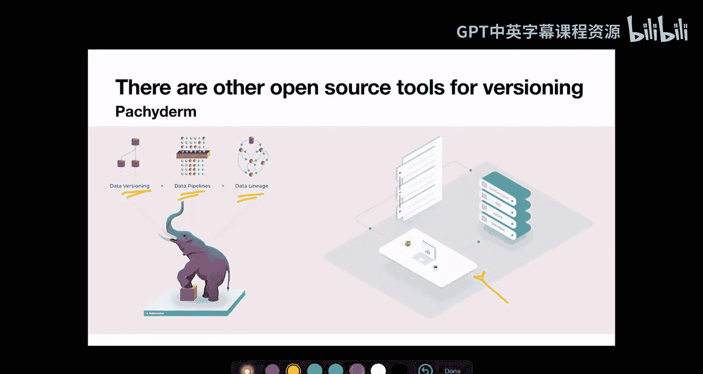
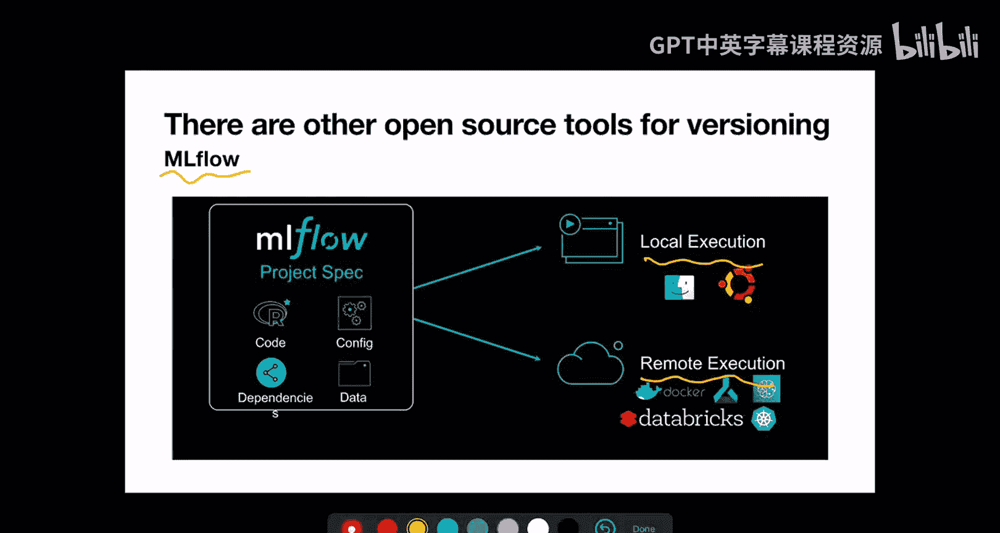
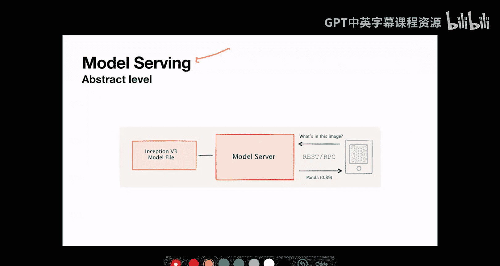

# 机器学习系统：第2.1讲：为机器学习设计计算机系统 🖥️

在本节课中，我们将要学习如何为机器学习系统进行设计。我们将探讨构建一个可投入实际使用的机器学习系统与在本地进行模型研究之间的关键区别，并了解其中涉及的核心组件、挑战和必要的工具。

## 概述

上一讲我们讨论了算法偏差、鲁棒性以及人工智能与计算的关系。本节中，我们来看看构建机器学习系统的设计过程。我们将了解到，一个完整的机器学习系统远不止是模型代码，它还包括数据处理、部署、监控等多个关键环节。

## 系统设计的重要性

构建任何系统，无论是软件系统、物理系统还是化学应用，如果没有一个工程化的设计流程，都将是非系统性的，并会带来诸多问题。机器学习系统也不例外。虽然你可以将机器学习系统视为一种软件系统，但它与非机器学习系统存在本质区别。

## 实践中的挑战

为了理解设计机器学习系统的难点，我们可以参考行业实践者的调查。以下是他们指出的几个关键方面：

*   **问题分解**：将开放式问题分解为简单的组件或基础构建模块至关重要。需要识别哪些模块需要机器学习，哪些则不需要。
*   **关注范围**：许多从业者非常了解模型类别（如线性模型、决策树），但对数据清洗、数据准备、日志记录、评估指标、推理（模型部署）、特征存储等其他系统方面了解不足。
*   **问题本质**：定义问题、识别相关指标、深刻理解机器学习能做什么和不能做什么是关键。机器学习方法可能每年都在变化，但解决问题的方式是相对稳定的。

## 机器学习系统的技术深度

一项来自谷歌的重要研究揭示了机器学习系统中隐藏的技术深度。研究表明，对于任何机器学习系统，都包含许多不同的组件。人们通常谈论和了解的“ML代码”（即训练模型和进行预测的部分）实际上只是整个系统的一小部分。

系统还包括数据收集、数据验证、资源管理、模型服务、监控、分析、流程管理、特征提取和配置等组件。这些组件与ML代码本身同等关键，甚至更为重要。

研究还指出了机器学习系统积累的一些重要技术深度，例如：
*   **数据依赖性**
*   **模型复杂性**
*   **模型的可复现性**
*   **系统测试方面**
*   **监控**
*   **配置问题**
*   **外部变化**

如果没有系统化的流程和合适的工具来处理这些问题，系统将无法扩展。

## 系统栈与生产流程

当我们谈论“系统”时，指的是软件、硬件和中间件的组合。这包括硬件层（如CPU、内存、GPU）、操作系统内核（中间件）以及软件层（为手头任务编写的代码，如视频编码器、数据库等）。

更具体地说，当讨论投入生产时，我们需要一个流程。这个流程通常始于数据准备。对于任何涉及机器学习的任务，数据都是构建系统的基石。然后我们创建模型。这两个步骤是任何机器学习研究者都熟悉的。

然而，当你进入像谷歌、Facebook这样的公司，你会发现在编写代码和处理数据之外，还存在其他甚至更重要的步骤。这包括评估、模型调优、模型部署（部署在哪里、如何部署、如何扩展到数百万用户）、获取预测、监控预测性能以及管理模型版本（因为你需要更新、修订甚至废弃模型）。在生产中构建系统涉及如此多的额外步骤，这正是研究与生产之间的差距。

## 核心组件与挑战

因此，一个机器学习系统需要三个基本要素：**数据**、**模型**和**代码**。重要的是，当进入生产环境时，所有这些方面都可能发生变化。每个方面都需要考虑不同的问题，例如：
*   **数据**：数据量、采样方法、数据模式很重要。
*   **模型**：所选算法、模型训练和实验很重要。
*   **代码**：配置、错误修复和需求管理变得非常重要。

## 设计流程中的挑战

设计过程本身也充满挑战。通常，不同角色的人员负责不同部分：
1.  **数据工程师**：负责准备和标注数据。
2.  **数据科学家**：负责研究数据、选择合适的模型、确定所需数据量、规划模型更新频率。他们的核心关切通常是获得最准确的模型。
3.  **机器学习工程师/开发者**：负责编写代码（如HTML界面或其他应用），将模型集成到具体应用中，供最终用户使用。他们的核心关切可能是获得最快的预测速度。

这些团队有着完全不同的关切点。例如，数据科学家可能追求高精度而产出庞大的模型（如2GB），而机器学习工程师若想将模型部署到小型设备上，这就会产生矛盾。如果没有适当的过程来协调这些不同的关切，将会面临巨大的问题。

## 机器学习流水线与工具

我们可以将整个过程视为一个**机器学习流水线**。这个流水线以数据和代码作为输入，经过处理（如数据分割、特征工程），最终输出一个训练好的机器学习模型。

为了系统化地管理这个涉及多方面的流水线，我们需要专门的工具。对于软件系统，我们有Git来进行代码版本控制。但在机器学习系统中，除了代码，我们还有数据、指标和模型本身，所有这些都需要进行版本控制和管理。

以下是解决这些问题的工具示例：

*   **DVC (Data Version Control)**：这是一个类似于Git的工具，但专门用于跟踪机器学习模型和数据集。它可以自动化流水线中的部分或全部过程，允许你提交数据、模型、代码和指标的特定版本，并使用类似`dvc repro`、`dvc push`的命令进行操作。它主要通过利用外部云存储（如S3）来处理大型内容。
*   **Pachyderm**：另一个工具，使用容器技术来执行流水线的不同步骤，处理数据版本控制和数据沿袭等问题。
*   **MLflow**：一个用于管理机器学习生命周期的平台，可以帮助定义文件格式，并在本地或远程进程上执行任务。

这些工具都提供了特定的API或命令行界面，其核心思想类似于Git，但具备管理代码之外内容（如数据和模型）的额外能力，这正是机器学习系统所需要的。

## 总结

本节课中，我们一起学习了为机器学习设计计算机系统的核心概念。我们认识到，一个可投入生产的机器学习系统是一个复杂的工程，涉及数据、模型、代码三大支柱，并需要协调数据工程师、数据科学家和机器学习工程师等多个角色的工作。我们探讨了系统中隐藏的技术深度、生产流程中的额外步骤（如部署、监控、版本管理），以及支持这些流程的必要工具（如DVC）。理解这些设计原则和挑战，是构建健壮、可扩展的机器学习系统的第一步。

下一讲，我们将继续深入探讨模型服务等更多细节。