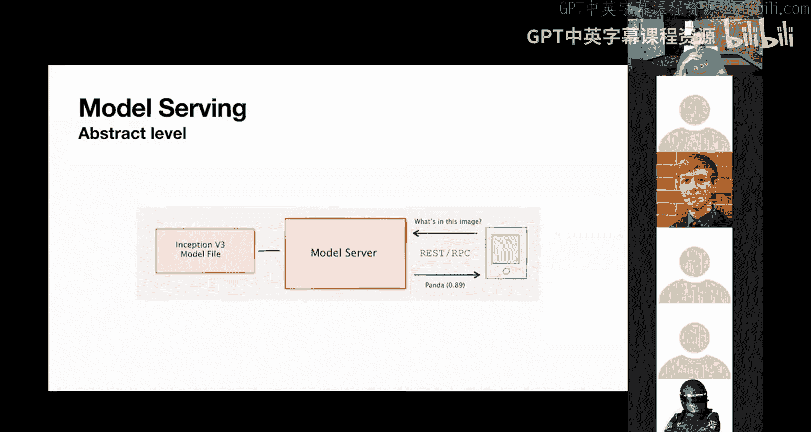
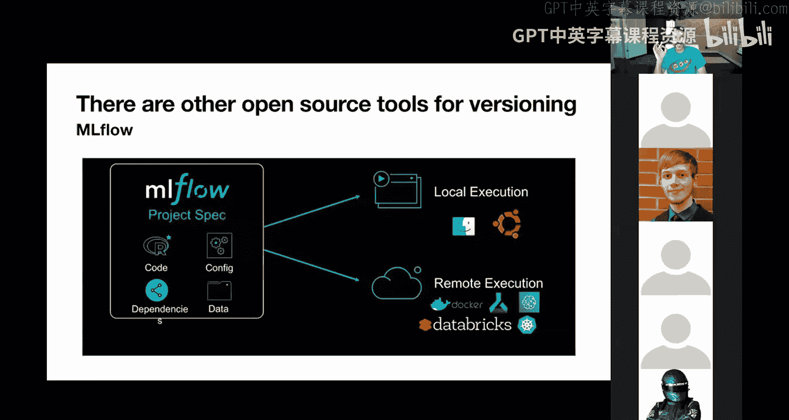
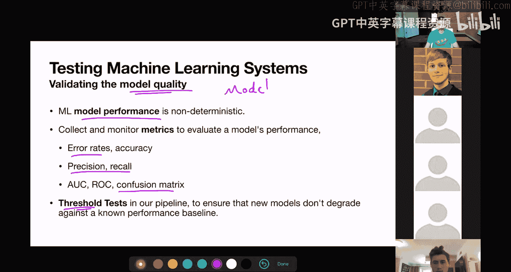

# USC《机器学习系统｜CSCE585 Machine Learning Systems 2020》中英字幕（Claude-3.5 p03 -03-Lecture 2.2_ Designing Computer Systems for Machine Learning.zh_en -BV1Xc9bYVEC6_p3-

Were start chocolate。So before we start， do you have any question for me？You want to laugh。

I any questions？Yeah， I had a question it wasn't really about。

Anything you gave in the lecture it was something posted on the piazza。

 another student had posted it。Someone's notes I think from Stanford。

 but I was on a machine learning system。Design course and。They had this note。About。

Once you've about like once you've designed this like machine learning model。

That you should intentionally like try to overfit like a small batch of your data。

 which I just thought was something interesting because I。

Always thought of overfitting as something I want to avoid like the plague so I thought。

That was kind of an interesting like concept， I guess I was wondering like they're saying like if you're if your model can't overfit a small amount of data。

 then there's something wrong but they didn't really go into De because I was curious if you had any knowledge of that。

Right， maybe I can provide some comments about the part so I guess like any model。

 any machine learning model essentially should be able to overfe andm overfitting meaning that like the model may memorize everything that you give to the model as the training right so if I typically parameterized model have this capacity to memorize memorized data so maybe the comment was related to this if the model is not able to memorize in the situation where you feed a lot of data and like。

Maybe you did not provide any regularization for the model and the model would。

Not basically overfit to the data， maybe something wrong。

 but I'm not sure whether this is like the correct answer because I haven't read that part。

If you have more information， let me know。But maybe theyre referring to this point。Sure。

 it's a bit out of what field I guess。

Okay， let's start， so I think you guys， I posted the lecture last night。

 right the lecture that I supposed to gave on Tuesday。

And today， the plan is to continue about another aspect of。machine learning systems。

 so yesterday I discussed this design process for machine learning that we need some methodology for designing such systems because essentially there are inherent differences between machine learning systems as a category of software systems and basically what we call AI or ML systems right so there are studies showing that there are inherent differences between these two and we need a specific processes to accommodate these differences and make sure that we are having a systematic process for designing such system and making sure that we get the quality of of the system that we expect it to be somehow you。

mightight already have taken courses such as software engineering in the past。

Talk upon some of these relevant issues so now today i'm going to talk about yet another important aspect of field learning system。

It is about a mother serving。I think somebody needs to mute itself。With。So please check if yeah。

 I think it's Andrew。So model serving is a very important issue， right？

When we say machine learning model， we are talking about a specific type of model like in this case。

 for example you see in section V3 Inception V3 is a particular type of deep neural network with a specific architecture you define the specification of this architecture right you have some data you train it and you get a model which has a specification a particular representation right so you can think about it as。

Basically a file right which has a specification you can even open it and look it okay you see a bunch of parameters that are specified and they have some values right so at the end of the training you have some model file and this could be in different formats right it depends what compiler you use but whether you use Tensorflow or you use Pytor or anything right so at the end of training you have a model file which you need to deploy number okay and when we talk about what learning system again I mentioned this many。

 many times for now。You are now talking about a specific model because we want to have a system that users can interact with it and use the system。

 so we need to we need to deploy this particular model somewhere where we call server in this case we call model server an end users。

So in this case right could be a user that has a mobile sending some images and asking what is in this image and the task of this model obviously is to predict what is in the image right and the model says that okay with  89% is a panda in this image and this interaction could basically happens by a specific protocol in this case is rest RpC which is a specific protocol for interacting with this model there okay。

So again， we have a model file that we trained me in our laptop。

Using whatever compilepier we used like Tensorflow or P in order to make it usable for end user we need to deploy it somewhere and this is called model server and then end user will interact through a particular protocol with this model server okay I hope this is clearia do you have any question about this。

P， I'd like you to go about the last explanation concerning the inception， the model7。

One request that I have， howeverever that wants to ask question， if possible。

 please share your video so I would like to see who is asking。

So that would be excellent if you could do that。 So I was saying you。

 you made some statements in the last what in the last thing you said now。

 trying to explain the model file the files was was I was asking if you could， please repeat that。

Yes， for sure， so basically again to clarify we have a model that we trained on our computer using a particular compiler。

 we need to deploy it somewhere again like in production previously you write some code。

 C++ code in order to make it usable for somebody else in like other type of software system。

 what you do is that you deploy the code on a server。

 is very similar thing but to some extent is different， the challenges would be different。

 the type of server would be different but you could associate with that kind of scenario where you write code you deploy on some server previously like if you had the web app。

 you deploy it on HTTP server okay。Here is the same。

 you have a model server which has a specific infrastructure requirements and so on。

 and then the users basically interact with this server not with your code because like the code has doesn't have the required endpoint so this model server has a specific endpoint that。

Are defined precisely that the end users are able to interact with the send request right and get response back so is that very much similar to HTTP server if you're a family of it。

So that's at the abstract level， but there are some particular technologies that enable this。

 for example， Tensorflow which is the particular ML compiler has a component is called a Tensor fellow serving so again the process is you could think about it as a training process and the serving process one slice right so Tensorflow you obviously could use the the APIs for training your model feeding the data and at the end you get a Tensorflow model okay。

啊。And then you could think about like having multiple models and all of this could happen in your laptop right locally so you're going to start Tensorflow use the API write some code trainer model and you get a file or something and then you use Tensorflow serving to basically to to interact with you one so this is again a particular technology particular type of server that enable this Tensorflow serving is one of those there are other type of servers that you could use and and do the same task here right。

Let me clarify what are the other scenarios right so it really depends on your use case on particular use case that you have for these purpose right so for example you could think about a web application in this case so you might think about okay I have a web application then then what I need is to yeah I use Tensorflow to have a model and then I use a technology like flask to put the model behind flask flask again is a kind of it expose some APIs to interact through web Port right and then and then you could use like from the application application side you could use technologies such as A。

in order to get define some form to interact with this application that you define right so this is the client side of team this is the server side right this is your server side。

And this is your client side。This is again， much remind you about this basically traditional web application development that you have this server side and client side and you need to have a specific protocol for these interactions with your server and you have obviously some。

HtML stuff that you can define your forms and everything right so again this is about ML system that has several different components one of these components is your model that does the prediction so this is about web app but web app is not the only application scenario you could think about you could think about okay you might want to have an internet of things right it means that you have devices like camera okay so this is one of those things that you have and then you have some IoT devices that get information from the camera and does some processes some processes means that okay for example we want to we want to。

To predict。What。Is in the scene that the camera has captured。

Okay you might want to deploy part of the model on these IoT devices or on the other hand。

 you might want to use some cloud services typically there are multiple deployment scenario you could think about some of these IoT devices are so small that you cannot fit a particle model into these devices but but you are able to interact with the cloud in order to get the prediction sometimes if the latency is important you may want to deploy everything in your device to get the prediction as fast as possible it really depends on the scenario that you have but typically this is a combination of local serving and some cloud services in this case Google Cloud okay so you may want to use some cloud storage some of。

M engine services which are available either for training and for saving storing the model， right？

So basically， this is the scenario where you can think about serving for IoT devices。

Right but again IoT is not the only application scenario you could think about there are numerous of them right you can think about stream processing systems okay it means that you have a stream of events coming into your system through some monitoring processes okay and you need to do these predictions。

Regularly， once the stream comes and one stream could be like a stream of like video， Okay。

 the video that you capture from a camera is a stream of scenes that you want to do the prediction regularly。

 even with low latency， it could be the case when you have some several sensors deployed on different part of an environment and you want to get this stream of data from your sensors and do some。

Data analytics right to see to predict events that might happen in the future in near future or you may want to think about a stream as the data that comes from your smartwatch okay so when you do some physical activity it collects information regularly from your body and then。

There might be some application using ML to do some prediction so there are many different scenarios that are relevant to stream processing systems。

 and then even within this scenario， this particular stream processing system。

 you can think about deployment different way there are， for example。

 one way to deploy everything into one place， for example， you could use CAfka。

 Kafka is a technology that enable stream processing like collecting data like doing some post processing analysis if you want to and then you could use Tensorflow engine deploy。

Into one place exactly the place that you deploy Kafka and some databases to do the prediction right so this is the scenario where you deploy everything into one place。

Right could be like your watch。Okay， could be。Your camera could be a tink right some other cases maybe your model is large enough that you need another server。

So you deploy this on another server， this could be an edge server。

 this could be a larger server that you basically interact with it by sending request and getting some response back in order to do the prediction is there any question？

Was there any question here？Please don't be sure I ask your question if you have any。

 so basically this is the scenario where you can think about stream processing scenario。

 but again stream processing systems are not the only category of systems。

 there are so many other scenario， but I just wanted to give you some examples in what situations model serving is needed and how they look like because it is very important to do this model serving properly using appropriate technologies for these。

And here again， that is a trade of a space， right， So if you have。

So many millions of users contacting your server then is the same case， right you。

Resources to be able to respond back with the latency that you require for your application。

 because as more requests you get the latency would be increased and your customers。

 your end user wouldn't be happy if you respond back。

Veryry late right even if you increase the latency by like one second on average。

 your customer would go somewhere else and use other applications right at the scale。

 these are very important issues like for companies like Facebook or Google using like ML stuff right for the services so these are important questions how to make sure that we get the right latency for ML applications。

Okay， there is a question， so is the model on the left meant for smaller inputs data and the right is for larger more rigorous data。

You could think Da， but like the proper way you could think about is the case where。

These input events are。Coming at a higher rate。Okay。

 so if your input events coming at a higher rate from so many different sources and these sources could be users could be sensors sending these events to your device and so on。

 then if you deploy Tensorfer on the same device， maybe you don't have enough resources to respond to this predictions。

Especially if you want to predict like for each event what is what is in there， okay。

 then this would。Obviously you have limited resources in one place。

 so in this scenario you could think about a larger server that is lot larger than this or even you could think about multiple servers right so you could think about multiple server doing the same the same kind of task here okay。

And then probably if you have multiple server， you need a load balancer in between to decide whatsoever at the moment。

 I need to send in the request。Does it make sense？And if you have question。

 I would prefer if you ask it verbally。Rather than me looking at questions。Okay。

 let's look at some details how these different variation of model serving could look like。

One type of model serving is embedding the model which is very simple right you treat the model artifact as depend right that is basically packaged traditional。

In a traditional way in a specific package format， right？

And then you have a combination of application code and the model itself。

 you package everything together andbed embed code beside your model into a v package right so this is simple because you can treat your model as similar very similar to your code and you can ship it。

The way how you do the shipping like the code itself， right。

 so you do not need to treat model in this case in a different way than you used to do with the code itself。

Okay so that is one scenario of but there are other scenario that you can think about right in this case like deploying the model as a separate service right so in this case you need a wrapper to wrap the model and obviously for this you need to you need to basically consider specific specific endpoints for your service okay and these endpoints are needed for remote invocation of the service as we saw before right so you treat so in this case where we had。

For example here like we have a specific endpoint for each of these interactions right for each of these interactions we have endpoints in this case also we have endpoint for each of these okay so in this case the client knows what endpoint to call and the call is actually is through rest ATs okay so knows。

What address this endpoint is located and the client should know what protocol should use to contact this address okay so we have a specific address for this endpoint and we have a specific protocol for calling this endpoint。

And this is what is called wrapping right so you have a particular rapor for for your service and this is the case where typically happens for。

For model deployment okay， so deploying as a separate service is probably the most popular way to treat model as to deploy model。

 okay。Or you can treat model similar to the data， okay？

And there are some benefits of doing this because then you could your server could consume this model at run time。

 okay， so this facilitate。Somehow。Regular changes into your model。 Okay， so when you。

 when you have a model that could change at any time。 So once once you treat your model as a a data。

 So So basically。At real time， your deployment environment could consume this model and get the latest version of the model for prediction okay sometimes it is needed right if you could think about any ML system if you treat model as a constant over time。

 you do a lot of task but your model remain the same and you don't really want that in some scenario maybe you want to have regular update to your model so your server consume the latest version of your model okay you want to regularly improve your model and you want to regularly use this latest version of your model after it has passed the initial test obviously。

So。If you treat this model as data， obviously you have the capabilities to consume the latest version of your model。

In production and that's in some scenarios are actually very important。

And there are obviously technology to enable this right， one of those technologies is onyx。

 Onyx provide a kind of exchange format for ML。Models啊。

And what it means is that within this exchange format it has both specification and runtime engines。

 it means that you may use Pyths， you may use cafe， you may use like other libraries for your mother。

 okay。And then。Then you want to again deploy somewhere and you don't want to be very much constrained about what should I use for your training like should I use Tensorflow or Pytorch right so if you have a way to separate that from the deployment from the production environment。

 then you are free to use anything that you could use Pytorch and use Onyx to convert that to whatever deployment environment you have and this could be a server a mobile a cloud application a robot that like each of these might have heterogenious resources like some of which might have only CPUU some of which might have only GPU or FPGA or any type of any type。

OfComp micro architectures， right， so it really depends so it really。

Make the transition from training to deployment very small。Once you have such interop capabilities。

 you can separate your training from deployment， you can use whatever you want。

For training your model， for building your system， and we can shift it out to any format using these kind of intermediate representation。

Do you have any question about this？I guess I do have a bit of a question， not super I don't know。

 so Onyx like you exchange out a network。So does that， I guess？

Does that mean you're going to have some kind of downtime， I guess， or does it somehow seamlessly？

Or exchange。So。So this exchange basically happens like at your design time right so you have some infrastructure。

 you train your model， you use onx to to exchange it to a representation that can be consumed for your deployment environment right so this means that you know that what is your deployment environment。

 you know that okay my deployment environment is this or maybe you know that like you have multiple different environments right。

So， so if you use like imagine the case that you use， you use Tensorflow， if you don't have this。

 imagine that you don't have this， okay， and then you use Tensorflow。エビーユー。Wrote sample library。

To basically。To get your model that you develop with Tensor follow and deploy on December。O。

A server with a specific architecture， okay？You did one month of work and you did that， that's good。

But then now you have a situation that you have a new user customer that wants。

Their application to deploy it in mobile， right？Then like extra work， you need to transfer this。

 you need to do some extra work to transfer this to your mobile device。

And every time you have a new environment， you need to like do this and do this and then like。

That's right， like you develop all of these。Transformation and then what happens is that another team in your company start using Pythology。

And they need to develop their own library for this transformation right so it is a really much constraint and hassle to do all of these transformation for a specific type of model because these type of model are different the specification of the model are different essentially so what happens is that like the benefit of something like onX is that they did this work for any type of training framework and deployment one that already。

Okay， so you don't need to do this transformation。By yourself。

 you could use this on its technology that it has like runtime and the design time environment in order to do this transformation and get your model deployed on any type of deployment environment。

And obviously the onyx is ecosystem that can be extended once new deployment environment and once new training framework has appeared okay。

 but this is another concern and by the way this onyx is not the only interop availability library there are others as well but。

There exists such interoperability library that facilitate this transition from training to the production？

Does it make sense？Yeah， yeah， thank you。是。Yes。Is there any other questions before we move on to a different thing？

So the next thing that is important is basically testing， testing machine learning system， okay。

Because。There always be。Some differences between。How you train your model and how you。Use your model。

 Okay， you train a model using a data set that you have， and then you ship it out and。

You have some customer users to use your model， basically your model will be consumed by an application that this application will be used by。

Many different end users right that this is the typical scenario that for ML systems happen。诶。And。

Regardless of what this scenario would look like， you always have this contract between the model and the consumers okay。

 and there always be。Differences between what you have in in training and what you will face at deployment time。

 and these differences are not really trivial。 These are important to。

To think and make sure that we have。Caappabilities to make sure that the system would operate as it is expected。

 so testing becomes important for these kind of systems。

AndThere are like many different aspects of testing for ML systems that we are going to briefly talk about now because like again。

 when we talk about ML obviously， yesterday， we talk about this ML is not only the model we have model。

啊。pl。啊。デタ。And plus。Cold， okay。So we have these three different entities for an ML systems， right？

And we need to make sure that we have testing capabilities to ensure the quality of the systems are met。

Okay。So yeah， like again， about data， we need to validate the data that we have right what it means is that like the data we may need to look at okay what structure this data have right and validate our assumption about valid values for this data structure。

 okay， right for example。Is there any question？Josa， do you have any question？那的。O。So。

We need to check whether the values of these。Data entities are within an expected range or maybe sometimes checking whether these are not or not or or some other checks right that you might know right whether these data point that has data in it whether the data is specified within the required format if not you need to do some transformation so testing about these formats also is important about data point but also then features right you need to have unit tests to check whether these features are。

Basically calculated correctly， meaning that whether these numbers that you get for these features that you use in your model are normalized。

 for example。 So for example， if you have a feature that should have a value between0 and one。

 then if it has 1。2， then something is wrong Okay， So obviously。

 if you have like a calculated feature， you have this invalid value。

 then obviously you cannot expect that your model does the correct。 Okay， and some of these， these。

This situation really happens and become subtleer。Like for example。

 when you have this situation maybe you don't get any error and this is really happening for ML systems。

 you don't get any error and then you see that okay your prediction doesn't make sense okay and like figuring out what has been wrong one way again is this unit test that makes your life a lot easier if you know about a specific constraints of some features for example these features should be between zero and1 then you write a unit test to check it automatically for you and if something is wrong it tells you okay maybe the source of error is here。

Okay， so these are some the good practices for making sure that like you don't have wrong values or if you have。

Some encoding like one hot encoding vectors where you have you need to have a vector of like all zeros。

 like in one place one， for example， this is one hot encoding typically happens for like your。

Like your。Output， right or some other situations， right so。

Here means that like in this case right so each of these locations indicate one particular class so for each this is associated to one input obviously this means that like what you have seen is a cat or something right like here this location indicates dog。

Or some other stuff， right？But if you have like something like this。

Something is wrong because like prediction could not be cat or you know， like apple。

so he's something wrong and like you know that you should have like always one， I mean。

 if you have these cases， it's always like one of these hot encoding， right？

So these are like very simple unit tests that you can write code and check automatically for your data。

 or maybe sometimes you want to check for missing values。So these are like important。Test。

That you can write code， automate it to make your life a lot easier。Then when you face an issue。

 you have some infrastructure for you to help you to find or localize the source of a bug。Okay。

 so these are very much important aspects of building an ML system。Right， but。

Data validating data is is one one thing。There are some other aspects that。

You also need to think and do testing。When it comes to component integration， Okay， for example。

 you want to to integrate different services， Okay， then different services， you have some interface。

 they need to。Like interact with each other through these endpoints。

 then you want to do contract testing okay to validate whether。

These interfaces are really compatible with each other or not。

 So contract testing is one way to validate this this。Interaction。Okay。

Or you want to have a situation that。For example， for model deployment right。

 you export your model to a specific format you want to deploy it on in your production。

 you want to have a test to make sure that this exported model would be able to be deployed on your production before even trying to deploy it it right so。

So these are basically one way to think about it， okay？

So validating this integration because of the differences between different components are obviously very much important for for ML system but again there are some other situation that you need to think about like model quality okay so this previous one is more about code aspect okay this is about the model aspect of the system right so you want to have some metric to measure your performance okay for example。

 the error that you that your model make precision recall confusion matrices right and typically you might want to have a threshold like for example。

 if your accuracy became below。9%， then you need to look at detailing why that has happened。And'm。

 I'm。Automating that through some tests that can indicate to you， okay。

 there is something wrong specifically in production is of utmost importance right is very much useful when you want to go into the production and making this automation。

 make your life a lot easier for dealing with any unexpected situation。And obviously beside this。

 you want to think about some other aspect that we have discussed about bias and fairness okay so you may want to test it against baseline slides right you may want to look at your data through a slices right in terms of race。

 gender region， whether you have the same distribution or not like and there are tools like facets。

 for example， or other tools that look at this data from different slices and you can see the distribution in your data because like if your data is huge。

 you can obviously cannot look at it data by data。Like see the indicated problem。

 you need to have a tool to visualize the distribution for you okay， if you have a tool that。

Visualize the distribution between different genders in your data， then you can see okay。

 my data is not balanced， okay， then you can figure out maybe I need more training data from like different region right to make my data set more balanced than I don't have problem in terms of fairness or bias in my system。

So these visualization tools， making sure that at least you can do some checks。

 you can do some validation to find the source of any problem that you might face in your system。嗯。

And obviously， again， you might want to think about tests like integration tests， okay？Typically。

 this matters when。You have。Basically differences between training and serving， right？

You might use a training data set that might be different from what you really expect to see in production okay because like the end user obviously do not send you the training example that you train the model they send like whatever data they want to so then then you need some sort of test in production to give it to your production team to make sure that your model would not give nonsense prediction typically like there are way to。

To for example， to have some holdout data that you have not used in your training and then the production team can use this holdout data to do some checks in production to check the model performance against these holdout data sets after actually it's been integrated into the backend。

嗯。So and you can think about these as like integration test。Ba。

 companies have been using for traditional software systems。Is there any question about testing？

And again， I would like to emphasize testing is。It's very very important aspect of ML systems because without testing。

 not only in production， but even in research， you face a lot of problem。Then I。When I do myself。

 some of these。And also students like they see like they do a lot of experiments and at the end they look at the results it doesn't make sense right and then we find out okay like we had some。

Calculated features that was basically out of the expected value or we had some input data which basically was incorrect invalid。

 right specifically to give you an example like we had。Ying， for example。

 did a lot of experiments like some of some of them， like we look at the result and like。We see that。

 Okay， this doesn't make sense， right， and then。And then like we you't find out， okay。

 there is a problem， for example， in the training because when we pertubed the images。

 it was perturbed too much and。All the features in the input example was gone。

 so obviously we cannot expect the model learn entity。嗯。And in that case， in those cases。

 the prediction was random okay， so so obviously having a unit test to check these invalid invalid cases would make the life of。

Reseearcher or also the in production is even much more important。 it enables some。

It facilitates basically the process and to find out the source of a bug or a fault a lot easier for these production systems。

Is there any question？嗯。Very about。The other aspect of ML system that I would like to talk about now is about experiments tracking and this is basically you could imagine as a very tool to have a tool to observe your system progress while it is doing the task。

 meaning that capturing and displaying the metrics that you care about and then then this tool you can think about it as a governance tool that enable the production people to promote a service into a production right after observing it's doing fine right。

 so you can run many different experiments in parallel and observe the performance and then you can decide the people the production。

ho can decide， okay， this can be used in production， okay。

 because it's doing right at the moment or looking at it even in the production and decide okay。

 this model is not performinging well， you can take it out from the production。So。These like。

Basically， tools can enable。can basically think about this as visualization tools right that basically look at different gi branches of your system yesterday we talk about tool like DVC that can fetch and display these metrics in your experiments okay from different branches or tags in your Git and basically help the developers or production people to decide whether these services could be promoted into production or not。

For example， like this is ML flow， you can basically use this in order to monitor your particular model in this case。

 a random forest right with particular version and you can observe that， okay。

 these are some metrics。Like R to a score or your error metric to observe how good it is currently based on how many runs and in what day it was basically have been trained or so on so you can gain a lot of。

A lot of insight from this visualization to decide， okay。

 this model is good enough I can make it do production or no you can feed it back to the developers that this model is not good enough and you need to figure it out why。

Any question about this？Okay， the last thing that we will talk about today is about modern deployment。

Okay which is the case where we can think about a different way that you can deploy your model using the serving infrastructure that we just talk about。

 but there are different ways to think about to think about deploying such model in production。

 okay you might want to have multiple models at the same time。

 because because of many different reasons for example， you might want to have multiple models。

 maybe they have different performance and performance of these different may vary different。

And you want to have different models to make sure that your production system would continue working without any issue over their lifetime。

 okay？Or you may want to think about the scenario where you have some shadow models。

 you have some models that work in production and you have some models that is that are shadow once they reach the point that you can rely on these models or they become reliable。

 you can ship it into the production or promote it into the production when you observe their performance over a period of time so you might want to promote them into the production right or you may want to think about some competing models。

 the scenario is also very much happening in production where where you have different competing models。

 have different structure they may like one of them。Would be。Random forest。

 the other one might be a support vector machine or deep know network and then obviously they perform differently and then you may want to test based on the observation that you get at deployment time and deployment time obviously user send different。

Different type of data okay and the performance would value over time obviously so you want to have some AB test to test and maybe to take out some of these competing models right for example in this case like you might have a supervisor to decide okay。

 how these models for predicting like。like the type of the dog right how lucky for example。

 in this case is that like how cute the dogs are right and in this case then when you have a model that says okay no one likes this dog maybe you want to take this out right and you have like infrastructure for doing that right you have a model supervisor that that can either automatically you can define some rules here right or some engine that get the quality of the models and do some reactions like the reaction could be taking out the the model right but not by cutting this。

Basically this link， meaning that this model supervisor won't route the request to this endpoint anymore once you cut this out。

And there are infrastructure for enabling that。Right。

So and you can think about a different way of automating that on the fly by observing the performance of the system。

And deciding how to do this change in your infrastructure in your production， even autonomically。

 this could be done by human， but typically in scenario in production， this should be done。

 this should be done autonomously and this is by itself is。A learning task， learning。

When and how to do this change okay， and like people are working on this as a learning learning task right because like you want to observe some performance data and then you might want to learn a policy to decide。

 okay， this model can be taken out from the production okay。Does it make sense？Okay， let's stop here。

Oh。So to recap， basically， we talk about modern serving。自己。

Which means that like having the model trained separately how we can serve it。

 what available technologies are to serve it in production， okay。嗯。

And then we talk about some testing approaches to make sure that。We can。

Have the right qualities for the system and we have some automation for doing this in a systematic way。

And then we also looked at the model deployment， okay。啊。

And how what are the different way that we could think about deploying a model in production。

 what are the available strategies？か。What are the scenarios that we can we might face in production。

 especially these are very much important in companies such as Facebook， Google， they use a lot like。

So were 100。Types of models for different tasks in different systems consumed in different way。

 obviously we need some some。Some infrastructure， some systematic way to facilitate this。啊。

Is there any question here。Actually， yes， I have one question also I apologize my my camera is not working on my laptop。

 but this is not my question， but this is someone in the classes' named D Scott。

 he asked what advice do you get for debugging ML models？嗯。Debugging it depends how we can define it。

 right， but if by bulk here we mean like。嗯。Checking whether we get the right accuracy or not， yeah。

 these are these were some of the way you could think about it right。

 so specifically when it comes to。To the data itself， right， you want to make sure that you。

Your data is al right in terms of like expected range of the data， right， about some exception that。

You might have in your data about the values of the features that you calculated， right。

 specifically like if you use like。Traditional pipeline。

 you have some automation to start from your data and calculate your features right and then based on your feature you use your prediction you do your prediction okay。

啊。Even like if you use like neural network， right？For prediction。

You may want to look at some of these intermediate features that has been learned in your network and check whether they make sense or not。

 whether you expect that。If you have some expectation about the learned representation then you can you can check that automate that okay。

 you can extract this intermediate feature automatically。

 you can write some code to check whether these learned representation are basically lyinging on a specific range or not obviously you can look at it like manually but this become comparison if you want to。

Do it like every time so you can write some code the advice that I have is writing some code to automate this process。

 specifically when it comes to data and model itself， Okay， obviously when it comes to。

To the production， these had to be automated， otherwise。

 like you cannot manage it at a scale that you want you cannot do any of these tasks manually so these。

Testing。spec testing for machine learning system is very。Oh。So how can I say， so is the area？

Testing for software system is a kind of mature area it' very important，' still like a research area。

 software engineering， but testing for ML system is very new there are differences in the way how we test the ML system and like。

There are not。Much experience for testing M our system。This is a very growing area。

 fast growing area， and people are looking at it， both from their research perspective。

The tools that。ML developers needs to have to facilitate these testing。Mainly visualization tools。

 for example， but doing this。Having this automated。Is， is the way to go。Thank you。Sure。

Is there any other questions？Actually， I'm sorry， I have one more question if you don't want me asking so I don't want to jump too far ahead。

 but like if you're working with like a multi layer model and it's formed of like multiple perceptrons on each layer。

 are you able to like change the weight for each type of data input for each perceptron to see how it looks back the data to see whether it's balanced to your likings or not。

嗯。I didn't get your question。 So you mean that。After you learned your representation， you want to。

How how do you change your data。I might be using the wrong terms， it like。

There's like a different weight associated with different inputs of data， so if for race and gender。

 there might be a different weight associated with when you're analyzing a picture。

 do you understand what I'm saying？Oh， I see。 So you。

 you want to have a different way to like associate weights to your data data points。 Yes。

 that's right meant。 Yeah， you could， you could， I mean there are some。Methods that if you。

 if you believe that some part of your data sets are more important， they are like， for example。

 Budhist tracking approaches， right， you want to use Buddhist tracking to。

to basically enhance your training。And also， you could think about weighting your input data specifically if you're working on a regime that you have very limited data。

There exist some of those cases， like when you're dealing with medical data， right。

 you have very much limited data。You need to have a way to learn a reasonable model using these limited data。

Yeah， you could， but there are some alternative approaches as well。どあった。Makes sense。Yeah， it does。

Is there any other questions？Yeah， actually flying off of that I was thinking that kind of reminded me something I was thinking about I had a question in a previous lecture we I'd asked about。

Conflicting objectives so like when you'd have conflicting objectives in machine learning models。

 so situation where you've got like accuracy versus bias。I was thinking about how like。

I think similar to what I think what was a JJ was asking。You could， I guess like。

Haves something similar to like regularization parameters， maybe attached to。

Your inputs maybe so like。You could。Penalize the model， I suppose for like for using certain。

Maybe sensitive metrics like gender or whatever， and then you could。

So it's like this way I guess what I'm trying to get at is whether that's like I guess a valid method for。

Balancing that that conflict is like you're not you're not getting rid of it but you want to you want the model to try not to use that yeah exactly exactly that's an excellent point right especially for dealing with these cases where where you want to force your model for example not to memorize。

Specifically not to use。Explicit feature in your data， right， for example， gender， right。

 you could use some of their regularization approaches， right。

 you could but you could also do some other techniques， right， for example， if you have。Like gender。

 you want to like。You want to use something coding right。

 you want to hide that from model with some approaches right。

 you want to use some other right privacy approaches that has been developed in this domain， right。

Which basically there are some techniques beside regularization that you could use in order to like somehow hide this information from your model。

 regularization is a way that like forces your model to not exploits specific features in。

Espec right so but that's an excellent point right and especially this is important when you're dealing with a trade when you have a trade of a space here。

Is there any other questions？呃。I just want to ask， how can we have access to the video？一緒？

Access to what。ああ、二十。你来。啊。Viview of this recordeder lecture you mean， yes， yeah。

 I will share it okay。嗯。Okay， if there is no question， then have a good day。Talk to you soon。

てけ。A you。