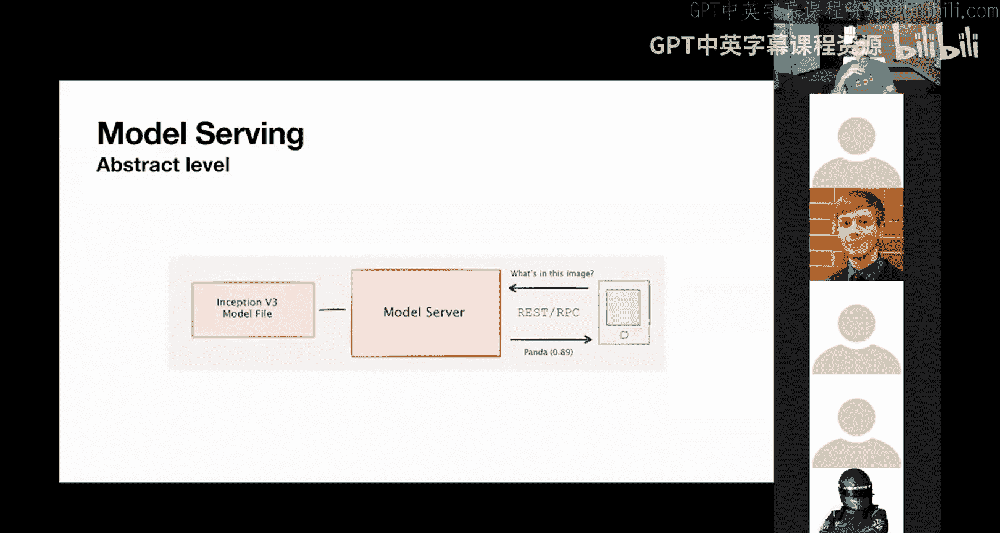
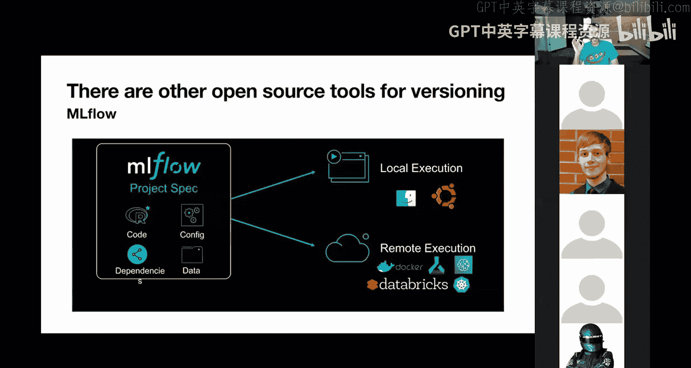
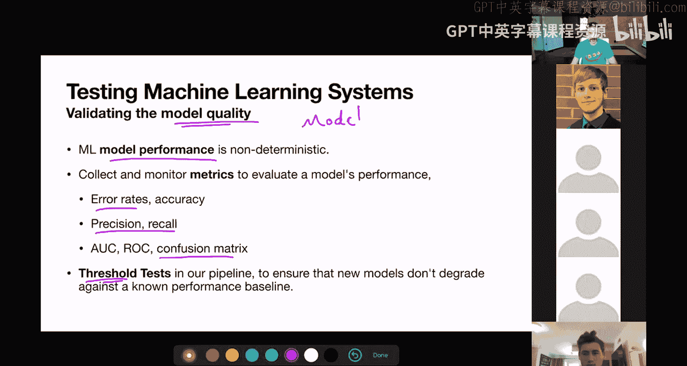

# 机器学习系统：2.2：为机器学习设计计算机系统

## 概述
在本节课中，我们将要学习机器学习系统的另一个重要方面：模型服务。我们将探讨如何将训练好的模型部署到生产环境中，使其能够被最终用户使用。我们还将讨论机器学习系统的测试、实验跟踪以及模型部署的不同策略。

---

## 模型服务简介
上一节我们介绍了机器学习系统的设计过程。本节中，我们来看看如何将训练好的模型提供给用户使用，这个过程称为模型服务。

当我们谈论机器学习模型时，我们指的是一个具有特定架构和参数的实体。例如，Inception V3 是一个具有特定架构的深度神经网络。你使用数据训练它，最终会得到一个模型文件，其中包含了所有学习到的参数。

这个模型文件需要被部署到某个地方，我们称之为**模型服务器**。最终用户通过特定的协议（如 REST RPC）与这个服务器交互，发送请求并获得预测结果。

这个过程类似于传统的软件部署：你编写代码，将其部署在服务器上（如 HTTP 服务器），用户通过网络与服务器交互。对于机器学习系统，你需要一个专门的模型服务器来处理模型的预测请求。

---

## 模型服务的不同场景
模型服务的具体形式取决于你的应用场景。以下是几种常见的部署场景：

*   **Web 应用程序**：你可以使用 TensorFlow 训练模型，然后使用 Flask 等框架将模型包装成 Web API。前端应用（如使用 JavaScript）可以通过这些 API 与模型交互。
*   **物联网设备**：你可能拥有摄像头等 IoT 设备。根据设备能力和延迟要求，你可以选择将模型部署在设备本地进行快速预测，或者将数据发送到云端服务器进行处理。
*   **流处理系统**：系统需要持续处理来自传感器、视频流或智能手表的数据流。你可以使用 Kafka 等技术处理数据流，并将模型部署在同一位置或单独的服务器上进行实时预测。

随着用户请求量的增加，确保低延迟和高可用性变得至关重要。这可能涉及使用负载均衡器和多个服务器。

---

## 模型服务的实现方式
将模型投入生产有几种主要方式：

*   **嵌入模型**：将模型文件视为应用程序的依赖项，与应用程序代码一起打包。这种方式简单，将模型视为普通代码处理。
*   **部署为独立服务**：这是更流行的方式。模型被一个包装器包裹，该包装器暴露特定的 API 端点。客户端知道这些端点的地址和协议（如 REST），并远程调用它们来获取预测。
*   **将模型视为数据**：在这种方式下，部署环境可以在运行时动态加载和使用最新版本的模型。这便于模型的持续更新和迭代。

为了实现不同训练框架（如 PyTorch, TensorFlow）和不同部署环境（服务器、移动端、云）之间的兼容性，可以使用中间交换格式，例如 **ONNX**。ONNX 提供了一个通用的模型表示格式和运行时引擎，使得你可以用任何框架训练模型，然后轻松地将其部署到多种目标环境中。

---

## 机器学习系统的测试
由于训练环境和生产环境之间存在差异，对机器学习系统进行测试至关重要。一个机器学习系统包含三个核心部分：**模型**、**数据**和**代码**，每一部分都需要测试。

以下是测试的几个关键方面：

*   **数据验证**：确保输入数据的结构和值符合预期。例如，检查特征值是否在有效范围内（如 0 到 1 之间），或检查独热编码向量是否格式正确。
*   **特征计算单元测试**：编写自动化测试来验证从原始数据计算出的特征是否正确。
*   **集成与合约测试**：当系统由多个服务组成时，需要测试服务间的接口是否兼容，以及导出的模型能否在生产环境中成功加载和运行。
*   **模型质量监控**：设置自动化测试来监控生产环境中模型的性能指标（如准确率、精确率、召回率）。当指标低于预定阈值时触发警报。
*   **公平性与偏见测试**：使用可视化工具（如 Facets）分析数据在不同维度（如种族、性别、地区）上的分布，检查是否存在数据不平衡，这可能导致模型存在偏见。

在研究和生产中进行系统化测试，可以极大地帮助定位和修复问题。

---

## 实验跟踪
实验跟踪工具对于观察系统进展和管理模型生命周期非常重要。

这类工具（如 MLflow）可以捕获和展示你关心的各项指标。它们允许你并行运行多个实验，比较不同模型版本或分支的性能。生产团队可以基于这些可视化的指标，决定是否将某个模型版本推广到生产环境，或者在模型性能下降时将其下线。

---

## 模型部署策略
在生产中部署模型时，有多种策略可以考虑：

*   **多模型并行**：同时部署多个模型，以确保系统在某个模型出现问题时仍能持续工作。
*   **影子模型**：让新模型作为“影子”运行，接收真实流量但不影响实际决策。通过观察其在一段时间内的性能，再决定是否将其提升为生产模型。
*   **竞争模型与 A/B 测试**：部署多个具有不同架构的模型（如随机森林 vs. 深度神经网络），让它们处理部分流量。通过 A/B 测试比较它们的性能，并根据结果动态调整流量分配或淘汰表现不佳的模型。
*   **自动化模型管理**：可以构建一个**模型监督器**，根据实时性能指标自动执行策略，例如将请求从性能下降的模型路由开。这本身也可以被构建为一个学习任务。

这些策略对于像 Facebook、Google 这样大规模使用机器学习模型的公司尤为重要。

---

## 总结
本节课中我们一起学习了机器学习系统设计的核心环节——模型服务。我们了解了什么是模型服务及其重要性，探讨了 Web 应用、IoT 和流处理等不同场景下的服务方式。我们还介绍了嵌入、独立服务以及 ONNX 交换格式等具体实现手段。

此外，我们深入讨论了机器学习系统测试的各个方面，包括数据验证、单元测试和公平性检查，并强调了自动化测试的重要性。最后，我们了解了实验跟踪工具的作用以及多模型、影子部署和 A/B 测试等高级部署策略，这些对于构建健壮、可维护的生产级机器学习系统至关重要。