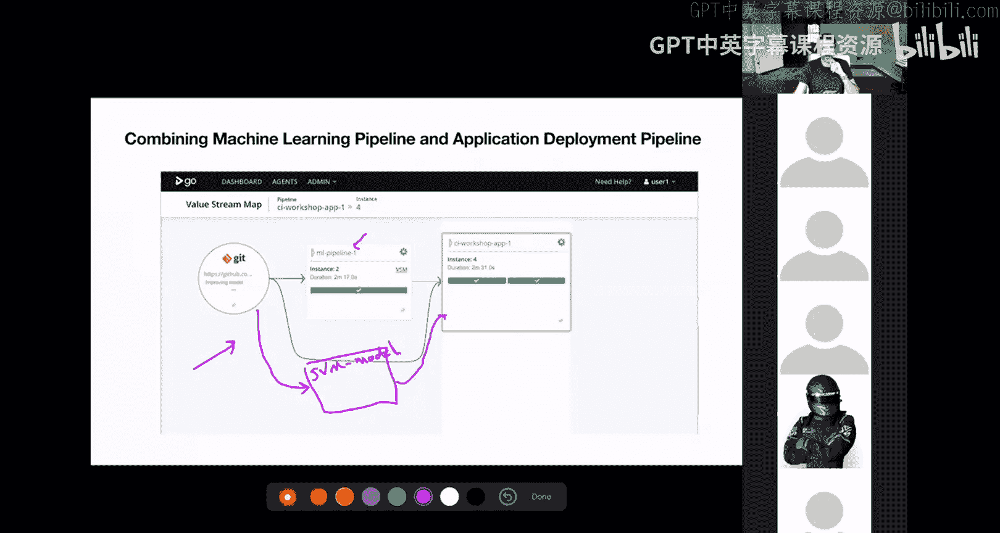

# USC《机器学习系统｜CSCE585 Machine Learning Systems 2020》中英字幕（Claude-3.5 p04 -04-Lecture 2.3_ Designing Computer Systems for Machine Learning.zh_en -BV1Xc9bYVEC6_p4-

嗯。Okay。Hello， I hope you can hear me well。Can you please confirm。Yeah。Very well， O。Sounds good。嗯。

So today our plan is to go through also yet another important aspect of M pipeline。

 so if you remember。In the last lecture， we talk about some of very important aspects of any machine learning pipeline。

 right？And again， this is related to the fact that。

We have when we talk about ML here we mean an ML system that we can build systematically。

 so for that we need appropriate processes in place。The last lecture we reviewed， for example。

 model deployment， model serving， which is very important because once we hip our model we want to。

I con see。That what broke。Please make sure that your mic is off。

So we need to make sure that basically our model is consumed by an application which many users will be going to use so we need to consider different features for for example。

 for model serving as a platform to make sure that the model will be served appropriately and can scale well we have also looked at for example。

 testing ML systems when it is used in practice behind the scene how we can make sure that we can get the right quality and by quality we mean both in terms of functional aspect of the system and also nonfunctional aspect in terms of performance we review some of the。

Machine learning testing approaches。Now， today， we want to look。

From the orchestration perspective right， so so far we have discussed basically bits and pieces。

 we have discussed what are the building blocks of these ML pipeline now since we have everything in place。

 we know these individual components of an ML pipeline，We now we want to discuss okay。

 how to orchestrate them， how to put them in one place as a pipeline and what we can do with this orchestration okay so now。

Today， the plan is to discuss the orchestration aspect of this。Yeah。

 so the orchestration is what we want to discuss and let's describe what the orchestration means so here visual describe that we have different components in place and we need to build a pipeline that this pipeline works together very well。

So one important aspect for any system， not only machine learning system。

 but for any software system is infrastructure because we need resources。

 we need computing and data resources to deploy the system。

So we need some provisioning infrastructure， you could imagine as a server or a cloud resources or services。

 or anything that we can execute the model and the application of somewhere。

 right there are so many different resources out there。

 especially in cloud platforms that we can use as an infrastructure to provision the system there。

 okay？啊。And this provisioning is needed for different aspects of the ML system。

 both in terms of training and also in terms of deploying in terms of serving and also monitoring the the metrics from the system while it's running。

 so provisioning of the infrastructure is important also we need component in place for building testing and deploying the data pipeline。

 we know that for any ML application we need data， so we need to have the data pipeline that fit the data to the model while it is operating。

Also， we need to have the testing and validation in place。

And this testing and validation is important， especially in cases where we have multiple different versions of these ML models in place。

😊，And we discussed in the last lecture that at some point we need to either replace the current model with the newer version of of the model or。

Or maybe we need to take the current model off replace it with a better model right so or totally different types of model we discuss about like the cases where we have some Bangkok models and these Bkok models typically are updated while the system is operating on the new data that coming into the system so these models are is going to be evaluated on the fly in order to decide either autonomously or by human to to basically provisioned or and replacing the current version of the model with the be the new model so we need to have these testing and validation in place。

And obviously we need some sort of deployment to the model server okay。

 so when we talk about orchestration meaning that we need to do all of this in an orchestrated fashion is not randomly done it needs to be done with appropriate tools。

And this pipeline basically needs to be defined and be in place otherwise。

All of these needs to be done manually， which doesn't escape well。So there are available tools。

 not only for ML systems， but also for any software systems that does this job and these sort of tools called continuous integration and delivery tools。

You might have heard about Dev op。So these continuous integration and delivery are also known as CI and CD。

 these are appropriate tools that facilitate this pipeline。

So at the abstract level we need to have some build process as well as some testing and release process this build process is the case where we have some source code。

 these are the source code of the system， obviously we need to build this source code。

In order to be ready for packaging， integration， testing， staging and production， okay。

 so all of these process you can look it as a pipeline that needs to be in place in order to to be deployed in the production of server。

Basically facilitating all of the important aspects of ML system。

Do you have any question with respect to this orchestration？た。飞飞就嗯。

Just stop me and ask your question as always， right？

So basically this is about continuous integration and delivery as a pipeline。

 but let's look at some details， how does it look like。With a particular ML systems， right？And again。

 that these CICD tools are for are designed for any type of system。

 but in particular here we are talking about machine learning systems so a simple in the simplest way for for machine learning we might have a pipeline for the modeling itself where we train and evaluate different ML models we discussed about this aspect also we need to execute some tests in order to make sure that it has the right quality in order to promote it and we have available tools for example we discussed about these DVC tool that is out there and you you can push。

A particular model when you decide that this model is ready publish it as a separate artifact right so it DVC push。

Take your model as a model basically and' preparing and package it and release it as a package that can be consumed at any time by a particular application to be used as a part of as a part of a so basically this ML pipeline taking care of the model preparation and this deployment pipeline again is for building and testing the application code and now that this。

Deployment again， here we are not talking about。Ml as a model we are talking about the application code again。

 make this separate when we are talking about this ML system we have the application side。

And we have the a model。So this model will be consumed by the application and this application is the endpoint where users contact。

ok。So。So this part， the ML pipeline is related to the model。This is related to the application part。

 and you need to to。To make these two park is as a separate entities。

 as a separate artifact that is going to be treated differently， right？Or basically。

 you could imagine that you have multiple different models。That will be consumed by。我嘅。ok 。

Any question about this？So for example。This is one particular。

The dashboard that shows you how this pipeline looks like right so in a particular tool in this case go is a basically one of those continuous integration and delivery tools。

That you can do this tasks right so for example， you can define your ML pipeline。

By defining is that the whole process that we discussed。

 you need to define with the domain specific language， how this looks like okay。

Very particular details， right。So this tool provide or expose some domain specific language to define each part of the whole pipeline as well as individual components right so for example here we are talking about the ML pipeline here we are talking about the application itself and here Git is basically where the code exists so developers commits the code obviously on Git you define basically here。

Basically where the code is located how to fetch the code。

 what a specific version of the code is going to be fetched what branch of the gi this pipeline should look for the latest version of the code or particle version of the code that we are interested in so all of these。

Basically needs to be defined as a part of this particular pipeline and again this is one particular tool。

 there are so many different tools out there that facilitate this obviously with with different language with different capabilities with different facilities to define this so you have basically some domain and specific language to。

To define each pipeline to compose pipelines right so you have some arrows here basically showing how the composition of this pipeline should work right so you have some arrow for example here。

Here， meaning that this app also needs to look for some specific branches in the code in order to fetch maybe some part of the system and here ML pipeline maybe we look for other branches that the model exists。

And you can also define how many instance。You are going to use basically this is related to the infrastructure that we discussed。

And you get some。Some data， like how long did it take for preparing this in a。

 right and some other basically data or info that you can collect from the dashboard。嗯。

And this pipeline is very simple but food gets complex。

When you look at the real pipelines inside different， you know for example。

 Google these pipeline basically are super complex themselves right it has multiple many different。

Element each element is pipeline when you pick inside each of these components。

 you see a lot of details where the code exists， right what metric for example。

 this component needs to measure from from the application where the resources are located。

 how many instances do I need to have。And so many other information that you can define and find other bodies。

And the composition is also very important， okay， where the information come from and how to compose each of these pipeline together to orchestrate them appropriate。

Any question about this？He， I had a question。y各。So I was actually kind of wondering if you could go over what do you think the。

Biggest differences in terms of you challenges or some complexities you might come into when you're going through the continuous integration process with the machine learning project versus a more traditional software engineering project。

So I guess how are they different and you know， what are some things that you think are the biggest challenges？

In a machine learning project。That that is a very good question I'm going to discuss about it like later on。

 the next few slides are about these specific challenges。But basically， if I want to highlight。

 I would say。Basically， the monitoring part is very tricky because we have discussed about different you know。

 metrics that an MLL system。We should look for in particular for ML system。

 like we discuss about bias。Right， about the bias and of these models， but。

It is not clear how we want to measure bias for MLC there are so many different definition of particle metrics that some of them they contradict right and it is not super clear one metric in the first place we should use right also when we talk about performance。

 what are those important performance metric。Whether latency is important or energy also is important okay。

 so basically and beside that once even let's imagine that we used we are happy about the particle metric we are using okay and we have measured all of this。

 then it becomes important how we want to use this information right。

What threshold do we want to use if the model passed a certain threshold about model biass。

 we want to take the model off？Right。And how to do that whether we want to do it manually obviously it's time consuming its error Chrome right or we want to define an automated engine to do all of these tasks for us right so for but this is this part has been a lot easier for other type of software systems right because we know exactly how what the performance looks like right first of all。

 bias was not a thing in other type of systems right we know what our important performance metrics right for other type of systems so the monitoring inside was a lot easier for other type of systems which is clearly different。

More challenging to be done for ML systems。Yeah， it seems like you have to work in a lot of gray areas exactly exactly and basically again。

 the definition of metrics are not peculiar and how to automate this is not really easy。

 but people are working on this and the community has made a great progress on this。😊。

That was a very good question， thanks for asking thank you。Good to see you he as well。嗯。啊。ok 嗯。

About ML model monitoring， right， the thing we just discussed。Right。

Once so so here it was about orchestration right many different bits and pieces needs to be orchestrated in a fashion in a systematic way in order to make the process as as smooth as possible and again I would like to emphasize that。

That you are not talking about a small model that you trained on your laptop and you want to use it for just fun no we are talking about ML system that has million users。

And without these processes in place， it's not possible to deliver a good system。

 So these pipeline are needed for。For making a systematic process for delivering ML systems。Again。

 important one important aspect is monitoring that we just discussed and monitoring is basically super important once we have the system in production and we want to decide when we want to roll back we need to define broadback mechanism when we want to take out the current version of the model that is being used in production and how to do that。

So let let's discuss and review what are the bits and pieces for ML monitoring for model monitoring obviously we need to look at the inputs what are the data。

Or basically what kind of data has been used to train the model， right。

 whether we have some particular SQ in the distribution of the model of the data or not。

This basically outliers or changes is important not only for training the model。

 but also for serving the model you might train a very good model and we have discussed it。

That you get a very good accuracy on even your testing data sets that you have right that you have。

 but once you deploy it in the wild， once you deploy it in practice and。

And you look at the result in terms of accuracy， for example。

 of your model using the data that your users stand out and you find out this is not good enough and like。

You look at the reason you want to find out why one way to look at it is that how these data。

That I get from users how different it is with its training data。

We discussed about tools looking into distribution differences， there are mathematics behind that。

 what is， for example， the difference between two distributions right we know that in mathematics there are like for example。

 the divergence metrics。And different metrics for measuring divergence between two distributions。

 right like。The first thing you want to look at how how your distribution。

In the training is different from what you get in production。

So model input is one thing but also output is important right we want to look at the predictions made by the model recommendations that made by the model to understand。

Basically how it performs on real data， not only even the testing data that you have。

 so the model input and output is basically one aspect of model monitoring。But also。

 you want to do more， right， not only you want to。You want to look for some average or distribution differences in terms of input output。

 you want to get some interpretation as well。Model interpretation is also very important。

 you discussed about that， why we need to have model interpretation， because many of these models。

Or black boxes so you train a neural network， you get you feed some data。

 you get some output and like。How the hell this output has been generated right you want to understand how the model works obviously for modeling interpretation even you have black box like neural network it is possible to pick and pick inside and understand how the model may think about this particular example right and this is how the area and research as well explanation and interpretation of the prediction there are metrics and there are tools approaches has been developed in the past few years to understand to give us some understanding right for example。

 metrics such as model coefficient tools such as ELI5 online line that gives you some highle understanding of the model when they do predict。

And to see whether there is any overfitting is going on or bias is going on or not。

 and we will discuss in much detail later on once we。

Go through a particular types of model and one important class of model that in this class we will look at soon is deep neural networks。

 so we will have some lectures about deep neural networks to understand it to build up some intuition。

How they look like from mathematics story side and also how we can build them。

Once we understand how they work， we then could look at how we can get。

Better understanding about like when we can realize that。

The model is overfeed to the data where we can see that the model is biased right but at a high level you can see that for different types of model。

 if you have an image classifier these tools for example， these。

YI 5 gives you this kind of output right so you have a particular。Image in this case。

Of these cats and dog and you want to understand。The output that was given to you by the model。

 why this has been produced like what was the reason how the model taught about this particular example right so it can highlight through okay。

 this part was important to the model right and why the model has predicted that this is，Dog。

 for example， right。So this kind of tools gives you some。Some understanding。

 better understanding of how model thinks about this particular input。

 or you can think about like another model that gives you some basically a model in this case is NLP kind of model and you want to understand what are the important features that was。

Basically used for any any sort of prediction based on the model right so it highlights you the important for example words or less important words。

Right with different weights that basically model was thinking about this particular example when it was fed to the model or you want to get a better understanding of like if you have many different features。

What was the important features inside the model right so these are some I'm sorry it is a small these are some features and then then you want to and you train a model based on these features right let's say a random forest model and then you want to to understand okay。

 based on the coefficient of these features you want to understand which one is more or less important to the model and why right and whether。

You can， you can detect a specific bias from the model or not， so for example。

 one of these features if if like you see that like one of these feature like gender has been。

Very important to the model you should be curious why and maybe there is some bias in the model so this these tools like line。

 for example， give you this understanding about how model thinks about。about particular examples。

 about features that what part of the features that is more important。

 what part is not important at all and why so you cant debug the model。

But before doing any update to the model， you want to first gain a better understanding about the model。

You want to look inside and。Diagnose any profit。Yeah。Any question about this？嗯。

I had a question yeah good ahead。Say like in a say we got like some deep learning model and we used one of these tools here to say highlight some important regions or some important data that。

We decide is not suitable， say you know it's paying attention to features that we don't think it should be paying attention to。

What exactly can you do with that information I mean I guess you can realize that it's wrong。

 but I feel like。For certain models like deep learning models。There's not a whole lot of like。

 you know， there's no going in there and tweaking stuff to like right fix that I was wondering like。

If you could talk about like I don't know what yeah that's you can do it from there yes yes that's a very fantastic question there are like I would call it intervention that you can do to the model if you diagnose the model that it is something wrong。

For example， for example， mom， you might guess that。Maybe your model。

Does need more data Okay your model might be biased because it doesn't have enough data。

So you could collect more data and train or update your model right this is one intervention right and this is the probably the most used intervention in practice。

Right， or。It's costly， but typically when we have a problem in the model。

 most probably you need to look at your data and you can't find a problem there。But beside this。

You have other intervention in the model right so what are those so the most important thing might be regularization maybe you need a better regularizer for your model right with the same data that you have maybe you could do much better if you if you use a better regularizer for your model okay。

This is one thing。There are obviously some other way to do this intervention。

 maybe some of the hyperparameter in your model was not selected correctly appropriate。

 maybe you need to do some hyperparameter tuning to make a better model right that becomes more robust and more fair or more accurate whatever you're looking for。

What else， maybe like for example， for deep neural network。

 you want to look how maybe like the architecture that are chose， it's not。

Appropriate for this type of application or data right maybe you want to like do some changes in the architecture right in the depth or the width of your model。

嗯。来啊。For like models such as random forest you may want to increase your number of decision trees you may want to increase the depth of your decision trees right or make them shallow and increase the number of decision trees right so it really depends on what model you're dealing with and but there are so many different ways you could intervene to fix this issue that you find out so you have two things first you need to find out that there is a issue with your model before that like you cannot do random changes right once you find out then they available intervention to do that right so to list them basically you can add more data。

You can change regularization。You can change hyper parameters。Right， you can change the architecture。

Right， and some other。The intervention that you could do。But typically people start with the data。

 but obviously data collection might not even be possible for some application like I have this amount of data for this medical application that I'm dealing with and I have to leave with that so the other you need to do some other stuff right？

Is it綺？I think so and I guess like those those looking at like the data you're taking in that that would also be like a situation that would lead you to look at like you were mentioning earlier the divergence of。

Of distributions， that was what you were talking about the distributions， I guess。

 like the comparison between the。Data that we see in the training versus。

 I guess what we might see in the real world。That was actually something I was wondering about like how would we look at like？

How would we compare that， I suppose， given that？I'm assuming the data that we。

Trained the model on is more or less what we've got so comparing that comparing the the the like doing some kind of a divergence test there so。

I guess it's unclear to me right， so the divergence is the case where you have。

So obviously this is how you do right you have some training data right and you have some testing data before even you deploy it in production right so this is typical scenario you have some training you have some testing you train your model you test it on your own test data。

And see， okay this looks fine and I get testing accuracy of 95% so it's probably good to go to production you deploy it in the production and you get like after a while after like one month you observe that。

No， it's like。In like。Probably 40% of the time the model got it wrong right so the accuracy is like 60% so obviously this is not something that you expected then your nuated yes so even your testing data that you have。

Is very much different from the actual data that your users send out to the application right so for example。

 imagine that you develop an application to identify like type of flowers right？Use many examples。

 as you can find out。For different type of flowers and then like you you deploy it on like the app repository right and you got many users that use your application and you look at the result and like yeah it's not good enough and you find out you can find out okay the distribution of the hours that you you receive is totally different so。

Like you need to probably use some of those recent examples of your users to enrich your data。

For your training your model and update your model， right。

 this is typically what happens in open kind of。Open applications right where your model obviously it needs to be updated regularly using using the data that is received and like this is important right your your application your ML application it's not the case that and this is one of the differences between ML systems and。

And other type of systems。Your system is dynamic， the model like when you have an app right and you have a model here that used by the app。

 these models needs to be constantly updated， how what frequency what new data you want to use all of which are appropriate questions and has to be defined in in your pipeline you can have your pipeline set up。

You can make the whole process of model updates automated right so you could monitor the performance of your model given the new data that comes right and then you could have a human to label this right and then see okay。

The accuracy is now below a certain thresholds， then the pipeline that retrain your model will be activated autonomously automatically and then the models will be updated regularly each week each day at the end of the day each month depends of depends on the type of application and how dynamic it is how many users it has so many of these aspects are important to define it and pieces the detail of your pipeline right so the model update is also a part of the pipeline right here we had。

Here ML pipeline， I mean this was simple， but you could have so many other components right。

 one of which could be like a pipeline for update， right？One is for monitoring right。

 all of which could be different components or they have they might have if its own pipeline that could be like integrated so obviously you want in the model update you want input from your monitoring pipeline。

In order to make that happen and you want to compose it with your MN pipeline because once。

Once you have the updated model， you want to feed it there， right？

And or directly to your application pipeline， so all of these can be defined in your end to end deployment pipeline using your continuous integration tool to make the whole process automated。

I hope this makes sense。It does， thank you。Any other question？Okay。

 so let's go into some more detail， right。Like for example， in this case， again， related to。

To particular application right you have some features right and then then you have one one model。

 one particular algorithm that does this classification right。

And then you may want to find out what are the important features that the model this particular model has used right to see whether there is some problem with this model or not。

 right？You might also have some other type of model that gives you totally different lists of important features。

 right？That obviously looks like totally different thing because they might have used different data。

 they might have used different regularizer or might have used different architecture。

 they might have used different type of model in the first place， so obviously the features。

 the important features may look like differently。And these type of tools like Ly， for example。

 enable that for you to diagnose your model and understand how this prediction has been done right and like again these are active in research and people are working on this so if you look at for example。

 search for this， it was an important paper published several years ago。

Looking into this explainability of classifiers。Then and how you could trust your model。

And the whole process again is looks like this right so you have a specific model typically these models are most of the cases might be a classifier right。

 but could be other type of model could be like a combination of classifier and recurrence networks or。

Or even regressionation model， it really depends on a particle application that you have。Right。

 and then and then。So you have some data and prediction from your model This is typically the process right so you want to understand the model then you need to。

To get some to feed some data and get some prediction from the model right and then you want to have some explanation right so if the model predicted that this person has a flu then what feature was more important for for the model right you want to。

See what features were important and what features were less important in order to help the human expert to diagnose whether there exists a particular issue with the with the pipeline with the model or not right so this explanation。

Gives us some。Some understanding how the model works。

 but overall this is the overall process so we have a particle model fixed model。

 we give it some data and get some prediction。And then。

You may want tools such as life or so many other techniques and tools to understand。

And they knows any problem。Right。The other aspect is that obviously you deploy it in production and you want to have some rollback mechanism。

So for this， what you need to do is that in production。

 you need to look for the input data and what decision has been made by this by your application by your model and then you need to you need to define some rules right you need to define some thresholdial tool。

To basically say that okay， once this threshold has been passed a certain value。

 I want to replace it with something else if I don't have something else maybe I want to like use some if routes to decide what the altitude look like right in order to avoid some bias and this predefined rule might not be perfect but you can。

You verify them that these rules basically do not。Produce bias outputs， right？

And like most of these are。嗯。I mean， any any model makes mistake， right， no model is perfect。对。嗯。

But keep that in mind。We have and we discuss this right， we have different applications。

 some applications。For example， predicting the type of flowers， right？Maybe if your accuracy。

 like from 95 became 8060。Like nobody dies as a result of this， right？It's fine。

 maybe your user become upset， maybe you lose some users or like maybe people don't do not trust your app if you do not figure out like how to improve your application。

But as a result of this， nobody does， but for certain applications。you cannot。

You cannot have this situation right we discuss about self driving cars， but beyond this。

 like for example， for the type of model that we be use in a spacecraft right？

And that's why you want to have guaranteeees about this。

 so there are existing lineup reserves that working on， for example， verification of ML models。

And these verification like these are formal verification。

 right formal guarantees that these if you have this guarantee。In no circumstances。

 the model would behave unexpectedly right， so you want to have some formal guarantees for this you need to do some verification。

Write some formal verification。So there are basically approaches to investigate this。

Forally using like formal methods to give you some guarantees about like the upper bound of for example。

 your。Your accuracy， lower bound of your accuracy， right， or upper bound of of your model error。

 How to get that is not easy again， right， So， and that's why。It doesn't。

 so many of these formal verification。Do not scale to larger models， right， so you cannot do。

 for example， formal verification on deep neural networks。Right， you might be able to get some。

Offered lower bounds on  errorss。And smaller shallow models， but。

Current approaches do not a scale where， right， but for certain application。

 if you want formal guarantees， that's the way to do it。But for second other applications。

 you could rely on monitoring diagnosis and model update， right？To to make it happen。

 to to make sure that you have processes in place to。

To update and to improve your system and user use it and rely on it and trust it。

So for related to this so you want to look for user actions and measure some rewards right so for example。

 you want to understand whether how user。Right use your product， use your app。RightSo for example。

 you might produce a recommender system。Using M。And then。

Like you deploy this recommender system as a part of like。Amazon， right。

 so Amazon has some recommended system at the back end of their platform， right？So， and you。

 you see that， right， So when you。When you buy a product。

 like you see that like there are some other recommendations going on in Amazon。

These are all ML based right， and then Amazon look for whether you you purchase this recommendation or not。

How often and then this is a feedback mechanism， this is a reward mechanism that Amazon or such company like Google stuff right used to understand user behavior because。

Moware model that you use。Like if nobody uses it， then it's not useful， it's not usable。

 so this is one way to understand user behavior based on recommendation of your model。

To see whether anybody uses it or not。So the user reaction and based on the reward that you can observe from your system is basically important。

And gives you some possibility if you want to roll back your model in production or not。嗯。

Is there any question here？So part of the pipeline also is about monitoring right。

 you need to have tools available there to enable your monitoring and there are some engines for that like EK engine。

ELK is like is a combination of tools that enable monitoring in not only for M but also for traditional applications too right ESS Stan for El searches。

V told。That enable search for you search on bo search on the log that you collected from the system how to you collected the log using a tool like logistash right so logistash is basically providing some API that you can use in your application in order to collect some logs about whatever you're interested in like in traditional application user were interested now the developer very interested set to understand like how。

The application works like by putting special places for logging inside the code right for M you want to understand like the model prediction。

 maybe you want to feed get your log from the model prediction and a it somewhere right you do not want to release your app without some logging capabilities。

So tools like logest cache enable that Kiana for example。

 is another tool that has a UI and you can visualize your log and explore your log in a。

InIn a UI that。That you understand the performance of your application better right so basically you have some inputs right this could be from different parts of your your application could be like part of your code part of your model right and then you have some like ELK tool here for example logist dash and you have some Cubaana UI stuff that you can you can explore and find out so for example here。

It is a particular code ML code right and here like it is at the API by like one particular logger right so it gives you API to send your logger basically what tenant what particular in essence you need to log where is the host and where is the port in there right so to find out about the particular tenantant and then what you want want to specifically log is prediction by your model how to get this prediction like this specific vector that you get out from your model and like what。

B个。Right and you want to emit your log somewhere right so you need to like instrument your code your M code with some logging capabilities to basically。

Log important information here， like the only information， it was locked， it was about a prediction。

 but you could log energy。You could like you could， for example， here。

 you could instrument instrument time like you could put a timer here like I once the time time one is like。

I want to get。Then I started exactly my prediction， right， and how long did it take， right？

And then you want to load these two or the difference differences between these two right。

 you want to understand that prime2 minus prime1。Basically， this is your inference time。

You want to lock basically your inference time， right？To your logger in order to understand， okay。

 how。How good， what was like the inference time for your prediction。

 whether you had a large latency for some reasons？On one particular instance of your application or not。

 right？诶。Typically MLl applications as it discusses multi tenant applications。

 so you may have multiple servers at the back end or even you might。

Deployed your application on the end user side right so there are different deployment paradigm for any systems in particular for M application you might。

Deploy your app， the whole thing on your mobile or you might。

Have an app that everything is deployed on cloud and like the users。

App is just an interface for contacting cloud bepro， right or a combination of this。

So it's multi tenants， meaning that the different components or different models might have been deployed like into different ktases。

 right， different nodes。When we say multi tenants is like。This is tenant one。Tenant 2， tenant3。

 right。啊。So you might have different nodes that you deploy your system there right and you want to have log specifically for each of each right and these like tenants might have different you know capacity。

 different computing capability and so on。So you want to have like log about everything， right。

 without any luck， you cannot diagnose what is the problem。And then you have some。Tools like Kibaana。

 you want to search for your log because like your log is for even for one week， it's like。To。

 too many right， if you have many users like you cannot look into the text file。

And see what is the problem is impossible， you need to have some visualization， right？

Some search capability， right， and some maybe。Like tools here right so for example you might want to have a dashboard。

 you might want to use some with different visualization types right some of them are basically time sensitive right。

Some of them you want to create a distribution of your for example。

 if you collected it in time right you want to visualize it using a distribution and then look at like okay whether the distribution of inference time look bad or looks okay right so for example your distribution of your time might be something like ease right so this means that like。

If this is like the X access is。Is about latency， right。

So you have so many prediction that was okay in terms of latency like 15。Micro second， right。

 but you have some some prediction and good number of them that they have produced like 30 micro secondcon。

And first in terms of first one right and then like this is not good because if。

If some users experience a slow predictions， maybe you will lose customer。

 so visualizing this in the first place helps you to diagnose the system。

 maybe you want to throw out more servers， maybe you want to do some changes in your model。So， again。

 like。This monitoring tool enable this。Any question about this？

Once you have everything can then you have end to end building process right so you have end to end everything。

 you have some stuff， some tools for model building right？So again。

 like we discussed an N is composed of code， some model and data。

 and these are the stuff you want to take care of， some of which are changing。

 like all of which are changing actually， and you want to have tools in place to take care of any。

All the stuff that we discussed so far right so you want to have tool for model building typically you need your some code to train your model on your training data。

 okay。And then the output is to have some candidate models right you push these candidate models somewhere right and then you want to do some model evaluation and experimentation so obviously you need to have some metrics here。

 some test data right so the data is not only your training but test data metrics and so on。

At some point， you have production data as well， okay？嗯。

So the model evaluation help you to choose appropriate models。To be。

Shipped to your production environment right so you want to have mechanisms in place to decide to choose appropriate models and productionize your model in the back end right and this is like again could be human base could be automated could be anything once you have metrics for everything you can technically to automate this process as well。

And then you have some testing going on for testing， obviously you need some code to test。Your。

Your application obviously you also need some test data again， this test data is like。

Basically is basically could be coming from your production could come from the held out data that you have somewhere。

So you can test your application end to end and then。You decide on a particular model to be deployed。

Okay， now you need to have some application code。To compose your model and package it as as basically something that could be deployed somewhere。

 right， so so you have some code plus some model again， this is。

A code that use multiple different models， right？Or one model depends on depend on the application。

Right so once you have all of this， you need to package the whole thing。

So I want to package the whole thing as one artifact or multiple artifacts and deploy it somewhere。

 deploy it in production。And then once you deploy it in production， then it's not finished yet。

 you need to like monitor it right so you need to collect data from your production and use the tool that we just discussed how to monitor ELK。

 for example， tools and to monitor the application end to end from different perspective and then this is the whole process is。

Is there ongoing， right？So it's not like starting from somewhere and ending somewhere。

 but is a loop that needs to be done continuously and this continuously could be like every day like。

Every one week， every one month or even several times a day really depends like how you want to define this the whole process will be to be updated right to be continuous and that's why we have continuous integration and continuous deployment development right and continuous deployment as well so the whole process is continuous so for M building process you want to have continuous process in place to ensure that you get everything right and you make sure that your application is going to be usable safe。

And。And users are happy about that。Any question？So let's finish it here。If you have any question。

 I'm here to answer。Basically we covered。About the process， About the building process。

And we look at every single aspect of this billing process so far。

 so we are done with this part of the course and。And we will be discussing about some。B US stuff。

 probably more touristic， mathematical stuff。So I will stay for a few minutes here if you have any question。

 let me know。If not， you can。高空。Thank you， go位。So there is a question。

 how do you decide when to escape up your mother in production？

That's a good question if by scaling up your model you mean creating multiple instance of your model then that it really depends on what metric you want to what metric you care about right so some metric could be related to performance right for example in first time as an example that I mentioned right and then decide if you have some anomalies in your。

And first time， then you want to increase the number of instances behind your app to make sure that your end user will perceive。

Good performance in terms of like latency and so on。This is one way， but if you also consider。

Some other aspect like fairness and so on then then you need to have processes in place right so how to diagnose the fairness how how to update your model so this is not about scalability it about like updating your model and so on。

Is thisDoes this answer your question？Very good。Is there any other question？

So there is another question to make a model you have to make a container。

 is there any requirement for a specific programming container， not really。

 so you can use whatever you want Mahmo。One question from Suge， we have had several lectures。

 but I am not clear about what we are。Taking about I mean do not have a specific understanding of our lectures is there any cases we can learn yes in the syllabus you see the topics that we are going to talk about right。

So。So you can look for the cllus， there might be some you know changes as we go。

But and you you will see so it really， so the syllabus that I put out there is。

Basically give you some idea about what are the topics we are going to talk about。

 but there might be some changes as we go， so I'm adjusting this。This as we go。

 depending on like the feedback that I get from you guys， so this is。Again。

 this is a course that I want to make it fit for you guys that you enjoy obviously there is a specific like purpose and there is a specific syllabus for this。

But there might be some changes as as we go， depending on like what your interests are and like。嗯。

The kind of thing you would like to understand right so at the abstract layer so at a high level we have some。

Combination of theoretical aspect as well as practical aspect of NlC right so far。

The lectures were mainly covering the practical aspects right which are very important and I had a reason to start from here。

 not jumping into Tory because I wanted to you to have a better understanding of。

 what are the issues， what are the challenges， how anL system look like in company like Facebook。

 Google， what are the processes beyond you know Tory that you need to be aware of。

 you need to know about。And then once we go to the To， more mathematical and stuff。

You know why we are discussing these right so these two aspects are super important for this course right covering practical aspects give you a chance to see beyond Tory beyond like research environment。

 but also we cover Tory as well to give you some tips about machine learning systems right？

I hope it it it。It answered your question， Suge。Can you confirm or or you expect that， Okay。

 that's good。 and you can talk， right， Don't feel shy here。 You can， you can talk if you want。

 That's what I prefer for any questions。So there is another question。

 it will be good if we can get PDF lectures， yes， obviously I will as I said。

I will share this through and I guess you asked this and I answered that before right I will share through through the course website。

Right whenever it is necessary whenever we finished one one like one important aspect of the course right so today we have finished these。

Basically building aspect of MLl system is practical aspect and。

I'm going to finalize the slides today， hopefully later today and。

My plan is to to share it with you within this week when it happened。

 hopefully tonight if I was able to。To finish everything。But I want you guys to have like good。

 at least understandable slides so you can enjoy。So can we use the same pipeline for a project with multimod deployment for a project with more than one model working together？

What changes you have made or deploying them separately？

That's a very fantastic question when you have multimod， yes。So basically。

 you can use the same pipeline if you're talking about this pipeline that we have here。Right。

 so for example， here like。This pipeline like could be extended to support multiple even types of model right so maybe like here you define like one particle type of model like neural network then you can define like similar pipeline for like SVM。

Model， right？Or other type of model。 And then。Then you could define it right you you then need to compose your。

 you know。Compose your application pipeline appropriately to take care of this composition in your app。

 but obviously you can extend your deployment pipeline to take care of multi model and then you need to have monitoring in place to monitor。

each model that you have in production and take care of like model update and everything right but definitely yes。

 these pipelines， deployment pipeline are meant for supporting multiple models。嗯。

Does it answer your question。Great， thanks， thanks for asking this fantastic question。 All of this。

 I love these questions。 like all of these questions are to the point and important。

And keep asking these questions as we go， right， because intentionally。

I want you guys to ask questions interesting questions and hopefully I can answer them this is the way to learn better these are relevant questions that。

That you will face if you work in， you know。In companies in the future those that they do MLL right。

 so try to learn as much as possible in this course。Okay， thanks， thank you guys。

 let's just stop here and see you on Thursday。

