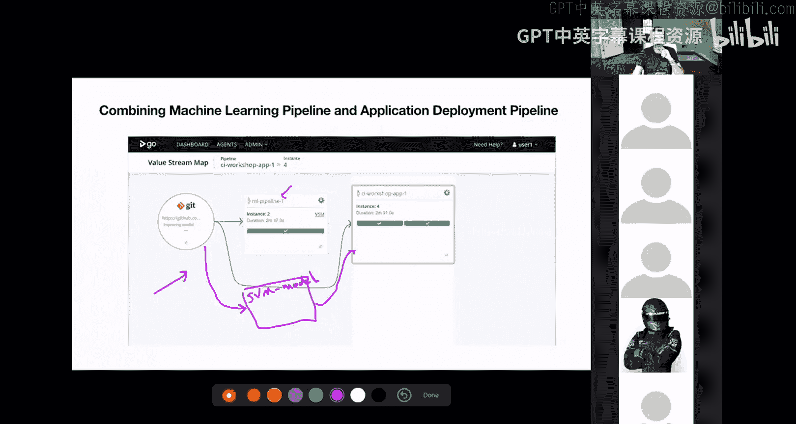

# 机器学习系统：2.3：为机器学习设计计算机系统


在本节课中，我们将要学习机器学习系统构建流程中的另一个重要方面——**编排**。我们将探讨如何将机器学习管道的各个组件系统地组织起来，形成一个自动化、可扩展的端到端流程。

上一节我们介绍了模型部署、模型服务以及机器学习系统测试。本节中，我们来看看如何将这些独立的组件**编排**成一个协同工作的完整管道。

## 🧩 什么是编排？

编排是指将机器学习管道中的不同组件（如数据、模型、应用代码）整合在一起，并确保它们能够作为一个整体顺畅运行的过程。这需要一个系统化的流程，而非手动操作。

一个重要的方面是**基础设施**。我们需要计算和数据资源来部署系统。这包括服务器、云资源或服务，用于执行模型和应用程序。基础设施的配置对于训练、部署、服务和监控都至关重要。

以下是编排需要涵盖的关键组件：

*   **数据管道**：构建、测试和部署为模型提供数据的数据管道。
*   **测试与验证**：在系统运行过程中，对模型进行测试和验证。这在有多个模型版本或需要在线评估新模型（如“影子模型”）时尤为重要。
*   **模型部署**：将模型部署到模型服务器，以供应用程序调用。

为了实现这种编排，我们需要使用专门的工具，即**持续集成和持续交付**工具，通常简称为 **CI/CD**。这些工具为任何软件系统（包括机器学习系统）提供了自动化构建、测试和发布的流程。

## 🔄 CI/CD 管道概述

在抽象层面，CI/CD 管道包括构建过程、测试过程和发布过程。我们从源代码开始，经过构建、打包、集成测试、预发布，最终部署到生产环境。

对于机器学习系统，这个管道可以进一步细分为两个主要部分：

1.  **ML 管道**：负责模型的训练、评估和打包。例如，使用 `dvc push` 命令将训练好的模型打包并发布为一个独立的制品。
2.  **部署管道**：负责构建、测试和部署**应用程序代码**。应用程序是用户直接交互的端点，它会消费ML管道产出的模型。

需要理解的是，模型和应用程序代码是独立的实体，它们作为不同的制品被分别处理和部署。

## 🛠️ 管道工具示例

有多种工具可以实现CI/CD管道。以下是一个使用特定工具（如 GoCD）定义管道的示例：

以下是管道仪表板的示例，展示了如何定义和组合不同的任务：

*   **ML 管道**：定义了从代码库获取模型代码、训练、评估到发布模型的完整流程。
*   **应用管道**：定义了构建、测试和部署应用程序的流程。
*   **Git 集成**：指定了代码所在的分支和版本。
*   **基础设施配置**：定义了运行管道所需的实例数量等资源信息。
*   **监控信息**：仪表板会显示任务执行时长等数据。

真实的工业级管道（例如在谷歌内部使用的）要复杂得多，包含大量组件和详细的配置信息，如资源位置、性能指标阈值等。管道的**组合**方式——即信息如何在不同组件间流动——也非常重要。

## ❓ 机器学习CI/CD的特殊挑战

一个关键问题是：机器学习项目的持续集成过程与传统软件工程项目相比，最大的挑战和复杂性是什么？

最主要的区别在于**监控部分**。对于机器学习系统，我们需要监控的指标更加复杂和模糊：

*   **模型偏差**：如何定义和测量模型的偏差？存在多种可能相互矛盾的定义。
*   **性能指标**：除了延迟，能耗等指标是否重要？
*   **自动化决策**：即使确定了指标，如何设定阈值来自动决定是否回滚或更新模型？这通常涉及大量“灰色地带”。

相比之下，传统软件系统的性能指标（如响应时间、吞吐量）定义清晰，自动化监控和决策也相对成熟。机器学习系统的监控更具挑战性，但社区正在这方面取得进展。

## 📊 模型监控详解

模型监控是编排和运维中的核心环节。一旦系统上线，我们需要决定何时回滚或更新模型。

模型监控主要关注以下几个方面：

1.  **模型输入与输出**：
    *   **输入**：分析生产环境接收的数据分布是否与训练数据分布存在差异。这可以使用**分布散度度量**（如KL散度）进行数学上的比较。
    *   **输出**：监控模型在生产数据上的预测或推荐结果，评估其真实性能。

2.  **模型可解释性**：
    许多机器学习模型（如神经网络）是“黑盒”。我们需要工具来解释模型的预测，理解它为何做出某个决策，从而诊断是否存在过拟合或偏差。
    *   **工具示例**：`ELI5`、`LIME`。
    *   **作用**：这些工具可以高亮显示对分类决策重要的图像区域、文本中的关键词或特征的重要性权重，帮助开发者调试模型。

## 🔧 诊断后的干预措施

当通过监控和解释工具诊断出模型存在问题时，我们可以采取多种干预措施：

以下是几种常见的模型干预方法：

*   **收集更多数据**：如果模型因数据不足而产生偏差，这是最常用的方法。
*   **调整正则化**：使用更好的正则化方法，提高模型的鲁棒性。
*   **超参数调优**：调整模型超参数以获得更好性能。
*   **修改模型架构**：对于深度学习模型，可以调整网络的深度、宽度等。
*   **调整集成模型参数**：对于随机森林等模型，可以调整树的数量或深度。

通常，从业者会首先从数据入手，但如果数据收集受限，则需要尝试其他方法。

## 🔁 数据分布变化与模型更新

一个典型场景是：模型在测试集上表现良好（如95%准确率），但在生产环境中一段时间后，准确率大幅下降（如60%）。这通常是因为生产环境的数据分布与训练/测试数据分布发生了**偏移**。

解决方案是建立一个**自动化模型更新管道**。该管道可以：
1.  监控模型在新数据上的性能。
2.  当性能低于某个阈值时，自动触发重新训练流程。
3.  使用新收集的生产数据（可能需要人工标注）来更新模型。
4.  将更新后的模型集成到部署管道中。

这个更新频率（每天、每周、每月）取决于应用的类型和动态程度。模型更新本身也应作为CI/CD管道的一个组件，与监控和ML管道协同工作。

## 🧪 模型验证与保证

对于某些关键应用（如自动驾驶、航天器），我们不仅需要监控，还需要**形式化验证**来提供保证。

*   **形式化验证**：使用数学方法证明模型在某些条件下绝不会出现意外行为，或给出错误的上界/下界。
*   **挑战**：当前的形式化验证方法难以扩展到大型模型（如深度神经网络），但对于小型模型是可行的。
*   **应用选择**：对于不那么关键的应用，可以依赖监控、诊断和更新流程来确保系统可靠性。

## 📈 用户反馈与奖励机制

监控还应包括**用户行为**。例如，在推荐系统中，可以跟踪用户是否点击或购买了推荐内容。这种“奖励”信号是理解模型实用性和决定是否需要调整模型的重要反馈。

## 🛠️ 监控工具栈（如ELK）

实施监控需要工具支持。一个常见的工具栈是 **ELK**：
*   **E (Elasticsearch)**：用于存储和检索日志。
*   **L (Logstash)**：用于收集、处理和转发日志。需要在应用程序代码中插入日志记录点。
*   **K (Kibana)**：用于可视化和探索日志数据的用户界面。

以下是在机器学习代码中集成日志记录的示例：

```python
# 示例：在模型预测代码中添加日志记录
import logging
from datetime import datetime

logger = logging.getLogger('ml_model')
# 配置Logstash处理器...

def predict(input_data):
    time1 = datetime.now()
    prediction = model.predict(input_data)  # 模型预测
    time2 = datetime.now()
    inference_time = (time2 - time1).total_seconds()

    # 记录预测结果和推理时间
    log_data = {
        'prediction': prediction.tolist(),
        'inference_time': inference_time,
        'tenant': 'tenant_1'  # 在多租户环境中标识实例
    }
    logger.info(log_data)
    return prediction
```

通过Kibana，我们可以将推理时间等指标可视化（如绘制分布图），从而诊断性能问题，决定是否需要扩展服务器实例或优化模型。

## 🏗️ 端到端构建流程总结

将以上所有环节结合起来，就构成了机器学习系统的端到端构建流程：

以下是完整的、循环往复的构建与部署流程：

1.  **模型构建**：使用代码在训练数据上训练模型，产出候选模型。
2.  **模型评估与实验**：使用测试数据、生产数据和定义好的指标评估候选模型，选择最佳模型。
3.  **应用测试**：测试集成了模型的应用程序代码。
4.  **打包与部署**：将应用代码和选定的模型打包成制品，部署到生产环境。
5.  **生产监控**：使用ELK等工具监控生产环境的性能、数据分布、用户反馈等。
6.  **循环与更新**：根据监控结果，触发数据收集、模型重新训练、评估和重新部署的流程。

这个过程是**持续不断**的循环，构成了持续集成、持续交付和持续部署的基础。目标是确保机器学习应用始终可用、安全、可靠，并让用户满意。

## 🤔 问答与补充

*   **何时扩展模型实例？** 这取决于你关心的指标。例如，如果监控到推理延迟出现异常，为了保障用户体验，就需要增加后端模型实例的数量。这与为了公平性等原因更新模型是不同的维度。
*   **容器要求？** 没有特定的编程容器要求，可以根据需要选择任何容器技术。
*   **多模型项目如何使用管道？** 可以扩展CI/CD管道来支持多个模型。可以为每种模型类型定义类似的子管道（如神经网络管道、SVM管道），然后在应用管道中适当地组合这些模型，并为每个模型设置独立的监控和更新流程。



本节课中我们一起学习了机器学习系统的**编排**与**端到端构建流程**。我们探讨了CI/CD管道的概念、模型监控的挑战与方法、诊断后的干预措施，以及如何利用工具栈实现自动化运维。理解这些工程实践对于构建可靠、可扩展的工业级机器学习系统至关重要。