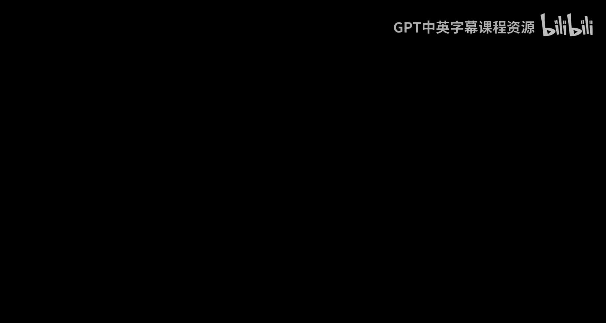
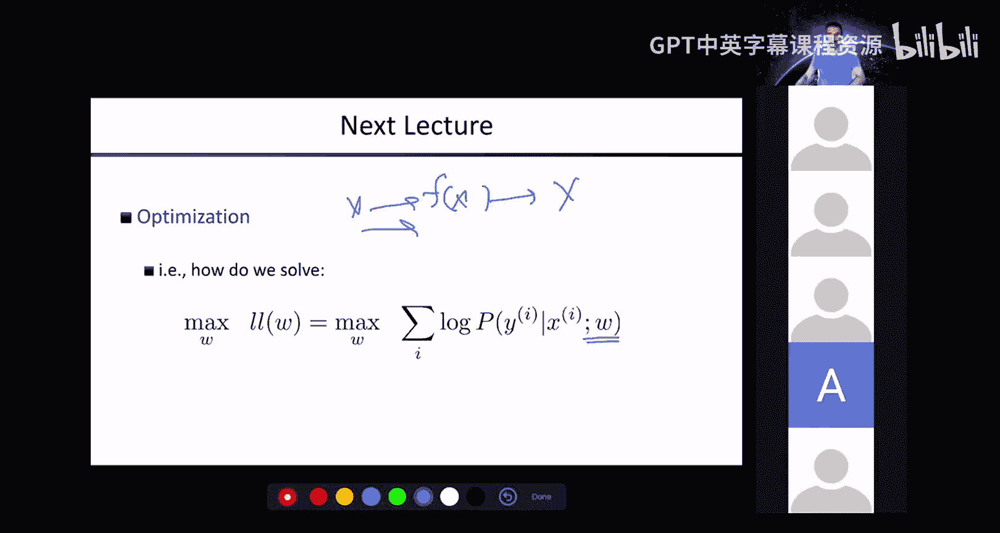

# USC《机器学习系统｜CSCE585 Machine Learning Systems 2020》中英字幕（Claude-3.5 p05 -05-Lecture 3.2 - Perceptrons and Logistic Regression.zh_en -BV1Xc9bYVEC6_p5-

あ。Hey hello。Before we start， do you have any question for me？Well well。

 so if you remember last time we started by going through。Very simple classifier。

 a linear classification。😊，The fundamental approach is called perceptron。

 we started with binary perceptron and we also looked at。

The algorithm that learns the weights for this binary perceptor and if you remember it was very simple。

 the approach was iterative， you start by an initialization of the weight equal to zero and we select each data point training data points one at a time and then we calculate this。

W啊。In a product between W and feature vector， and if it is positive， then the decision is。

Basically the positive class and if this inner product is negative then the decision of the classifier is negative class so it is binary classification they have two classes represented by plus one and negative one very simple and in this iteration if the correct weight for this particular example make the correct decision and y you star represented the correct label for this particular example then we do not need to make any changes to this W but if for this particular example the decision is incorrect we need to adjust the weight meaning that we need to。

Change the， move toward the direction that next time hopefully there's no guarantee for this。

 but hopefully for this particular class， it makes the correct decision and the update was basically adding the inner product between。

Y star and Y star is either a negative class or positive class to the feature。

Vector for this particular example and adding it to the current weight vector so basically meaning that if for for this。

Yeah。Particular feature vector for this particular example。This weight do not produce the right。

Label， we need to move that away from this feature vector in the feature space right we know that it is now that。

The tee between these two is less than 90 degree， so meaning that。

This has a bias toward this feature vector， we need to move it away from this feature vector toward this and the way how we do it basically we subtract this feature vector from from the current W and next time。

This is the W prime or basically the new weight vector for this binary classifier。

So we make an update iteratively， example by example to this weight vector with the hope that after we go through all examples after some iterations。

Basically the classifier makes no mistake for the training data。

 obviously there is no guarantee that it makes no mistake for the testing data。

But we want to do that iteratively until it makes no mistake for training data。

Any question about this？It's a very simple iterative approach。

And this was an example it rate go through each example until it cons to。

To the right weight vector that separate these two classes now we want to look at how we could extend it to multiple classes when we have more than two classes for for these for example。

 here we have three different classes and we want to have a way。

To do the same or a very similar approach to update the V vectors that does this classification for more than two classes。

So it's very simple extension。😊，Okay。For each class we consider a weight vector associated to this class。

 so for example， when we have three classes for each class we consider a weight vector corresponding to that particular class。

And similar the inner product between。Between the weight vector for that particular class multiplying by the feature value it produce the activation for that particular class so for each particular class now we have one activation value that determines。

Basically。How likely it is that the result of this class five points to these particular classes。

And then the way how it predicts we want to， so basically for this。

 we have three different activation， for example， we could have z1， which is w1 F。X， right？Z 2。

 we have W2。F x and Z3。你好 w。F each of these basically are some values， some value， and then。

We select the classifier， select the label as a result that has the highest value of the activation right so it's simple comparison within these three numbers and it produces the label by maximizing this activation there is very simple extension for multiple classes。

Any question about this？So， this is。The way how multiclass classifier works。

 multiclass perceptorron basically works。And if you want to visualize it。

 now we have such decision boundaries that separate out three different classes and this decision boundary again is linear。

 right？So for example， this part belong to class that we call three class number three this region points to the first class and this region points to the second class so this is the way how you could visualize it obviously these are we are not as that these are clearly equal with respect to the space it really depends on particle weights that has been learned some of the weights might be larger sum weights might be smaller and be。

Basically。The size of each W determine a space that belong to this class。The larger this norm is。

The larger the space is basically belonging to this particle class model。

So it really depends on this particular norm of the belt。Just a question。

The clarification just to be clear like that I understand what you're this method。

 so this is effectively just。Several binary classifiers， right。

Each of them has their own weight vector。And。If the values the input this F of x dotted with that weight vector for any given classifier is either like you know perpendicular or you know less。

 I guess， like into the negatives， then it's。Effectively just zero and then we just say that like。

It's not this classification and then we look at the other classifiers。

And then like we would check each of them and then just see like which of them is the largest value。

 right？啊。You could interpret it that way， but when we have multiple classes。

 but when we have two classes， this separator is one line， is one hyperplaylate。

Right and now for these three classes we have three hyperplane。

 we do not have one hyperplane to separate these classes， right？So then for interpreting that。

 you may want to consider， for example， when you have for this weight， you have this separator then。

Then again， like it would be difficult to imagine it that way because then then this is for one one。

One class and then we left with two other classes right。

 so it is really difficult to interpret it with three different binary classifiers。But basically。

 it's better to think about this mathematically now。

Instead instead of thinking that this is really tree binary classifier because it is essentially not we have。

3 classes。嗯。basicallyically for each class， we have a weight vector that determine basically the size of this weight vector determine how large this。

The space is for this particular class。That is distinguishable by these hyperplanes from the other two classes and it is the same really with four classes。

 five classes so in instead of like thinking about like four classes is like four binary classification because it is not and it I mean it maybe possible to imagine it some way but thinking about like each particular class has a way vector it is a lot easier and then we calculate this。

嗯。In a product between vent vector and feature value to calculate the activation for each。

 does it make sense？Yeah， thank you。Any other questions？So again。

 how the learning works is very much similar， nothing much sophisticated here。

 we start similarly to binary classify， we start with an initial weight equal to zero and then we pick up example one by one training example。

 and then we predict the current weight。Basically， when we have an example for this example。

 we have a correct label， right？We have the current weight vector associated to each particular class and then we can calculate ZI。

 the activation for each class， and then we select y as the output of this particular。

Class that is associated to this example， the way how this classify with the current rate things and then basically for example。

 you can think about these are。It is a。W Y， this is WY prime and this is W Y star。

 basically Y star is。It's the correct label for this particular example right so if the decision is correct。

 obviously for this the decision is not correct right because it points to why which is not equal to viata so we need to make some adjustment。

 in this case and the way we do it we really subtract we do the same the procedure is the same we subtract this feature。

Victor。By from this incorrect。Wait， right。So we make some adjustment with two to the weight vector that was。

Produced。So make make sure that you understand this， so this is the label that was。

Produced by the classifier。Which was different。From the correct leg， okay。And this is the label。

 the third label。Which was neither correct， neither considered as true by the class。

 so here we have three classes。Right make sure we understand this so we make adjustment to the label that to the weight vector associated to the label or class that was incorrect so we need to move that away from this feature vector by subtracting this feature vector from this correct so this is the new weight vector associated so this is the W prime y this is associated to label y which was incorrect for this particular example and we need to make some adjustment toward this how we need to do that we need to turn that toward this feature vector so we need to add this feature vector right。

And then move toward this feature vector by updating。Anue到。That willvo star。

 so this is the update that we make to this feature。Right。Does that make sense？你家。I'm sorry。

 I had one question if you don't mind me asking Yeah go ahead so for our feature。

 which is a pink arrow， right， is there a goal after like testing all the given data samples to get as close to Y star or to be exactly like Y star because I feel if it matches up with Y star。

 it might be like overfitting。That's a good question， but for this particular example。

 for this particular visualization， we are only talking about one example。

 right we are talking about the updates。嗯。The way how normal multiclass percept works。

It doesn't have any clue rather than this update rule。How to。

How to adjust this decision boundary in a way that it maximizes the likelihood of making correct decision for the test time。

 it doesn't have any clue。It has a simple update rule。Bates debate。

Until it makes no mistake for all training example， and if such hyperplan such。

Three hyper planes for clay classes doesn't exist， then it doesn't converge at all。So。

 but assuming that it converge it goes through all examples until it makes no mistakes for all examples。

 but it doesn't have any clue rather than this update how to make this adjustment the best possible way。

AndBut Beth， you might have some intuition， how does it look like。

 but it's not the case that it can find the。And good， so like if these examples are given to you。

 you might like find good hyperplanes that is more likely to make correct decisions if you could visualize it in like maybe two or three dimensions。

 even us， we cannot visualize it in more than three dimensions。But we could see that at least okay。

 where to put these hypercols， this naive perceptant doesn't have any clue rather than this update。

 Does it make sense？Yeah， actually that makes sense。

 I just realized that the Y star also like in a real life example。

 right Y star won't be defined for you， so it'll just naturally go in that direction。 Yes， yeah。

 exactly。So again to clarify thisvo star is the correct label for this x。

 and x was this example in this iteration。嗯。Thevo was the label that was predicted by the classifier and this example was not equal to Yyata。

 so what the other class。A white prime was the class that was neither。True， for this example。

 neither guessed by this classifier as a potentially true class right。

 so it was the third class and this is three classes that we have。Okay。

 in four classes right we have two of these kinds in five classes we have three of these kinds right。

 so the classifier teams one class。They correct labor might beD other class。Or might be the same。

I hope this makes sense。So let let's go through one example right this is the case where we have a multiclass perceptron and we are given some sentences as input so these are。

嗯。Our excess。Okay。These are inputs and for each each of these input， we have some。

Correct label and see what are these correct label are So window votes and the classes are a sport politics tech。

Vin the vote。It's easy for us to identify when the vote like is as it should be associated with politics right sopoli。

Is the， so。This is the invoice。W the election again。poliolitics。边你嘅。Theport。케이 these are 내 보였다。

These are。The current rate vector。And for each， we can for each of these example。

 we can calculate F of。嗯。F of x， right？How do we calculate this， we need to calculate the。

The feature value associated to each individual features right so let's have this let's calculate F of x for this first example。

 obviously we should expect that this f of x is a vector with the same size of the vector vector same size。

Okay， you remember that from last lecture， the same size because we want to calculate the inner product。

嗯。So we have a bias term， this is one。Let's a bias1 is always one。嗯。Van， how many men we have one？

How many gain we have zero？The first sentence。How many vote we have one？

How many D you have you have one， okay。And now the norm of this weather is five the same size of this？

Let's ask him that you don't have this， right？嗯。And this is the， again。

 f of x for the first example that we have， and when we do in a product of with this vector。

So is one， the rest are zero， so it produces。Plus one for this weight vector。Okay。

 for this is all zero， so it will be0。For tech is all zero would be zero。So。

What is the label produced by this classify with the current rate？Any， any gift？Sports。

 sport is it correct or incorrect？Definitely wrong。Yeah， it's wrong because the correct label is。

Honestlying right， so it produces the sport。So it's incorrect。

 how we update this and what is the correct level？This value politics， right？Have we update that。

We subtract the F of X from W politics。 Yeah， we do we need to do any adjustment to this export。

So would you do the subtraction to the sports in addition to politics？You tell me。

So we should subtract from export or out to export。

I think we'd subtract from sports because we wanted to steer away from sports and we'd add to politics so it's more likely to match up with politics when you do like the thought products exactly so。

So again look at this so y was the incorrect one so we subtracted f of x from the incorrect label and we added to the correct one okay so we do the same so this is incorrectly subtract this from this what is the updated version。

 so what is the W prime export here。Is0 is minus-1。Is 0 minus-1。换月什么。And for these， it would be1，1，0。

1，1， right do we need to update this？No， I don't think so。

Yeah that's correct we don't update the third class。

 we don't adjust the third class right so we adjust the incorrect label and the correct label。

 the director director of these two。And then we go through the next example。

 so what is the featured vector for this？V， so bias is one， V is one。Ge is 0。Vote is。屎咯。B is one。ok。

啊。What rate I should consider， obviously this updated one， we ignore this。

Like we use the latest weight， so when we do the inner product would be zero minus1。0，0 minus-1。

 it is minus-2， right？Okay correctly。Yes， so for this is one。To。3， right。赢。And for this。

 obviously zero， right， so for this what was the correctly the politics。

What was label that was produced by the current version of the classifier politics politics is it correct yeah its okay。

 do we need to make any change？Yeah， should we reinforce No， I don't think we do anything。No。

 we don't you know， you don't update it don't you don't just at all Okay， okay。

 because it's good to go right for this example， it's good to go for the other example。

 we don't know yet。But currently it's good to go right Okay so you only add so when you get it wrong。

 you both add and some tracks and when you get it right you just don't do it Okay when you get it right like the why change it right if it a't broke don don't fix it we don't need to it's good good enough This is the way it works like the only thing that thecept knows is so is just consider this update to the Victor nothing beyond that。

What's next the third example right， so let's calculate the feature vector for the third example V。

Is bias is one again， v is one。Game is a 0。Vote is 0。 D is。one。嗯。Again， let's consider。

The inner product would be zero minus one。0。是个。-2， right。You calculated correctly。

Was this calculated correctly， I believe so。嗯。Right， and this is， again， the activation， right。

 This is the activation value。This is the Z bag。For this one， this would be one。To。3， right。

And for this one is0。So what is the what is。What is the decision。

 the caifier thinks that this is politics， right？嗯。Right。问。Politics is not the correct answer。

 sport is the correct answer。Okay right， so how we do update here？The same as the first iteration。

 right， So we subtract from the。The incorrect label。

The incorrect label in this class in this case is politics。

 so we need to subtract this is the current rate vector， we need to subtract this。

Sorry that I made a mess yet， but I hope that he can follow so is zero for the first zero。Zero。1。

Right， there。So this is the updated feature rate。And for this one。

 we need to add it up because this was the correct label as well。

So we want to add it would be zero here， one here， zero here， zero， third。-1 and0。ok。啊。

Does't matter the order in which you like the order in which the examples are。

 there is there like a specific reason？That's a good question， doesn' it matter。

For the perceptron as a matter， we do， we go over all examples iteratively to make sure that we can produce the curriculum level for all。

 so are we done here。シピエ dumpプ。I was about to ask whether there was value of running again over the same examples let's ask us should we stop the procedure was that we should go through all until we make sure that like for all it。

Produce the correct label。Do we know that it is correct for all？After we made the adjustment。

We might have broken one of the older ones by updating a newer one right that' that's right so we need to iterate again we don't know yet we may simply just broke the even the correct ones after these updates but let's check。

Let's go back to the first one， the first one， this was the feature vector right and the correct label was politics the export this is now the latest vector vector so would be one zero zero。

us10， so it is zero， okay。The activation is 0。For this one would be 0，0，0。1， zero。

 so it would be one。For this， again， this。Kit as not updated so it is time it is politics， right？

Is it correct？Yep。It is right so now it is correct the second one this is the do we need to make any update obviously not because like good to go the second one is one one so again here it would be one00。

0。zero， so it produces activation of one， right？And for this one it produces the activation。

 so we are considering this on this latest version。Right's all 3，0， and then 0。And then zero。

 so think。A sport。Is the correct label， right？Did we calculated correctly。

Go it be calculated correctly I'm having trouble following where on the which of which of the markings you're on sorry so this is this was the this is the latest weight vectors right these green ones and we are now pointing towards what this and is the activation that was produced for this example so apparently we are correct and the decision is one the activation is one and the activation for the second class basically is is zero right so it thinks that this is a sport for the second example but obviously this is not a sport。

So it's not making the correct decision， we need to make adjustment。

 how to make the adjustment similarly， we want to subtract from the correct labels so we subtract from the correct labels。

 this one would be zero。Would be minus1 would be zero would be minus one would be minus1。Right。

I think we calculated correctly。I love。And for this third one， we do the same。

 we subtract W from this feature vector would be minus1 minus1。Z， one。-1。ok。

And no adjustment to here。And then we go through the third example。

 let's see whether this with this current。Wed better to make the correct decision for this again for the activation would be zero。

 we are looking here， zero。Minus one zero。热咯。-1，-2 in total。For this one would be。M-1， minus-2。热哦热哦。

-3。Each one it selects。Select the sport， right？Is it correct？Is correct， right？

 So for the third example， is correct。Are we done no we want to go ahead because we make one mistake right we make one mistake in this round so we go again until we make no mistake for the first one again we are looking at here and this is the latest feature vector sorry debate vector so it is we should produce the politics so zero minus one zero。

Oops。So is0 minus-1，0 minus2。us3 minus-3 for this。And for this would be。-1， minus-2，0。啊。-1。-2。所以。对。

It is a tie， right？Yeah。So what should you do？Would we just update anyway。

 like assume that we got one of them， we got one of them wrong and the other one right？And then just。

You know， act as though we got it wrong。Yeah， we could so in this case where there is a pie and tie might happen right because these activations are discrete we could consider basically it is incorrect and we update the labels and we go yet another round to see whether it make the correct decision or not right so we go so this is a simple procedure iterative procedure and again there is no guarantee that it convers we may well go forever so we go until the classifier makes no mistake there's no guarantee for convergence and we stop and there is no update needed to be done。

But very simple， right， it is simple procedure。Easy to calculate things the computation is very easy computation that product is always is not computationally。

Heavy， so that product is considered as one of those lightate computations。

Is there any question here？Yeah， I have one tiny question。 so like in in real life examples， right。

 so in the example you just showed us on this PowerPoint slide。

We were only able to get here because sports are the bias of one， which allowed us to like。You know。

 get at least some sort of one somewhere otherwise， if everything was just all zeros。

It would always multi multiply out to be zeros and be even for all of them， right？

Um do like what I'm asking is like how do you get the initial values in the first place for real life examples so the initial value。

 if you are asking for this W are or zero。So if they're all zero and then when we do the dot products。

 we get all zero so no matter what examples sorry so basically we have biased towards something right so we。

So typically we are dealing in one context and that's why we have this bias term right because it is that most of these terms are about sport could be about like politics right so we use bias for doing this making this bias right so if you think that these sentences might be mostly politics we make this zero one it's not this white one。

But these weights are all zero initially。What we make the bias toward the class that meeting。

Might come from like her understanding or domain knowledge， work classes is more probable。

Does it make sense。 Yeah， that answers it pretty directly。 Thank you sure。Any other question？

So it's very simple， let's go through what are the some properties of these perceptance。

So basically we discuss about whether these classes are separable or not right so in this case we know that these two classes are leniently separable right。

嗯。Two or multiple classes are separable if the parameters get the training set perfectly correct right in this example。

 there exists such I perclaim that separate these two classes in this case。

ItIt is not it doesn't exist right， at least not an hyperlate there might be a kind of thing like this。

Or not， sorry even forced。So it might be the case that。Right。Something like边。

Exist decision boundary like this exists， but this is not a linear decision boundary。

So for the linear decision boundary， such high per doesn't exist。About convergence， basically。

If training are separable。In binary case， only in binary place， it converges。

 there is guarantee about that， so there is proof。That it converges。

And actually the number of mistakes， there is proof that there is a maximum number of mistake if basically the two classes are separable。

 right but even in multiple classes such guarantee does not exist so only in binary cases there exists such proof and the maximum mistake that binary perceptorron in these iterative approach makes is basically upper bounded by this value。

 this is the k is the number of features。So is' the norm of W right。

 and deelta is the distance between these two classes right， so the distance here。

I we are talking about this。Right，然后。Delta is basically distance between the maximum。

 the maximum distance between the hyperplanes that could。Separate these two sets， right。

 So when we push away and when we pushed away how far away these to hyper parents are this distance determines how separate they are。

 So obviously it is tight。This upper bound is。Basically larger because it is difficult so when two classes are closer to each other it would be more difficult for any learning algorithm to find such high so it is intuitive to make more mistakes。

RightAnd that's why we have these cases。And K is basically a number of features。

 obviously if number of features are higher， this number of mistakes would be larger intuitively because it needs more computation and it's more likely to get something wrong within this calculation so this is some sense of like why this upper bound makes sense right but we can prove it if。

It's not difficult to approve this。But basically is upper ground on the number of mistakes within this iterative approach right so you remember like how many times we made this mistake or the algorithm made this mistakes so we are talking about here the number of features where like。

One， two， three， four， right， or in general like five with bias。Take by 5。

Divided by something that you don't know， right。Basically the separation。

 the distance between these two high something right， so we can calculate。

This number of upper bank and the number of mistakes。Does it make sense？

So let's have a break for one minute。Wes start in one minute。Okay， is there any question here？Well。

 so let's continue。There are some problems with perceptionceptance。

 obviously it's not a perfect classifier or model。嗯。So obviously one problem is that。

It cannot deal well with noises， especially if the data is not separable。

 you might trash a lot of weight so you might betray over and over again and it may never converge us so that that's a key issue but more importantly is as we discuss there is no。

Guaranteee that it finds。This separation hyper planee or the decision boundary。

 there's no guarantee that it gets it right， right， So if if you are given this task。

 obviously without。Giving you the test data。You definitely prefer this high parent rather than the alternative ones。

But。Perceptron might well decide that this is the hyperpre that divides these two I mean there is no guarantee whether this one or it finds this one or that one but you might well find this one and it has stop there because。

Even this one gets。Ba example correctly。Even though we know that it is not ideal。

 it's very close to one classes， yeah。hi is not ideal because we know that if we stage in between。

 there is more chance that this is a better decision boundary。

 at least based on the knowledge that we know about the training data。ok。So that's one problem。

 but also。There are other issues， especially like with overfitting as well， right？We， we know that。

 I mean， we know that how how。How we could think about overfitting。

 typically the way in machine learning， we do things is that we have one test set。

 we have one heldout data set and we have the training set。

 obviously we want to increase our accuracy over the training data set as we go but we do not want to go forever。

 we want to stop somewhere。This is basically a good place to stop we don't know about the test or at least if we have a test set。

 we should not look at it， but we can use heldout data during our training basically。

We do not use directly held out data for the training， but we could test how。Good。

 the classifier is with respect to the headout data and as soon as it goes down。

 this is basically this elbow point is the right way to stop right obviously if we go this way。

 it increases the accuracy overtraining set， but not necessary over the headout data。

 so this is a sign of overfitting， we do not want to do that。

So it's something that like we have a clue and we know how to do this earlier stopping。

 but more importantly you want to find a way to address these two first issues。嗯。

And actually we have a way to address these two issues by improving by extending perceptone because if you think about this perceptone。

 let's make a sense out of it， right perceptone。Use only knowledge with respect to activations and activations are not probabilities or values。

 right？So the extension over perceptron， so basically you can think about perceptron as non probabilistic。

Approach right is not probabilistic model now we want to make them probabilistic because。

We might have better properties to reason about， especially we can reason about。

We thought you can reason about something like likelihood that give us some intuition。

For some measurable。诶。Think that we could。We could favor this over this， right？

With non probabilistic approach， we cannot。Because have like we only have some crisp values with probabilistic version we do have。

 and that's the way we want to do it。So we want to make them fix them。To make them probabilistic。And。

Somehow we want to have some clue that yeah， even though this is not the best linear boundary。What。

Can we reason in that， okay， mix。One mistake and one mistake is better than two mistakes can we somehow make a sense out of this by some probability probabilities and yes you can basically you can assign probabilities to each classes right so if you move toward this basically you want to assign less probabilityba for。

For these red classes， more probability for blue classes right the other way around is wife Sera。

 you want to make these red classes more probable than the blue class and you have some sort of like。

Probability over。Over two classes， at least within these cases is two classes， right。

 so you can in instead of like。Giving that this is。One， so we are talking about， right。

 we are talking about。One particular example， right in instead of saying that。

This is the class we want to say that。This is 90% this class 10% the other class right we want to have some probability distribution over two classes or multiple classes if we have multi multiple classes in the classifier right so we want to extend this。

Chris。Values01 and that was the way how perceptron works to some probability distribution over multiple classes and we know that in order to have probability distribution the sum over multiple classes should be one right so you know these basic stuff so you want in a way you want to turn this z or activation values to some probabilitybabilities how to do that you have some clue right so you want to say that if this is very positive you want maybe assign a probability closer to one。

 if this is very negative you want to assign probability to zero right。

So this is the way how we could think about this， right？In multi。Multti classes， we also。

You need to see that similar kind of transformation。

 so we need here it transformation function to turn this Z values activation value to some probability with the properties that want we want we obviously want to get the probability distribution so we want to make sure that these to。

Some to one。And we don't get any negative probability because we don't have any negative probability。

 so we want to have these properties right with activation。

 we have negative activation right we want in probability distribution。

 we don't have any negative values right we have only positive probabilities。

 we have something closer to zero even like having a zero probability for some classes。

 it is real right because。To some extent it is probable， but this is close to zero right。

 but having0 for one k is weird or having one is also01 is like the case for this。Normal perceptor。

 right， so we want to turn away from that。So in mathematics。

 we have support function that gives us this transformation。This is how it is represented。

 so if you go this way or if you go to positive infinity， it will converge to one。

To minus infinity converges to zero， this is the mathematical representation so this is the exponentence right and this is the basically this is how how it mathematically is defined right so sigmoid function gives this transformation obviously there exists some other transformation function that gives this probability distribution or have some this kind of probability but sigmoid is well used and is very popular right but make sure that you know that there exists such other transformation mathematically。

And now we want to， since we have this transformation。

 we want to use some properties of these probability distribution to find the best W and we now can think about best。

We right again similarly to perceptone we want to find some w。

 but now we have a reason we have a way to make sense and have some heuristic to reason about the best weight right and this is the way how you could get such best weight so you want to maximize the likelihood likelihood of conditional probability of class label given the example so this is the weights right so this weights are。

Learn and we want to learn it in a way to find a way that maximizes these。okay。

 so this is the output of the learning and this is the way how you formulate it so for all classes you want to maximize the correct label Yi is correct label right again。

In binary classification， we have。Y 0。喂喂。Yeah。1 is correct label。

 or maybe could represent by minus-1。 doesn't matter。 You have two kilolasses。

But one is correct one is is correct one is not correct。

 so you want to maximize the probability lot probability conditional probability that given the input。

And the weight， so these are given， you know the current weight。

And you have selected a particular example， and this is for all X I。

 you want to maximize the probability of the true label， given these input and the weights。

 so you want to find a set of weight or a weight vector to maximizes this large probability。

And this is the how it works right， so it's very simple again you want to mathematically and we know that this maximum likelihood exc is a the in mathematics。

I'm sure in other courses you have encountered。And this is different from like。

So this is the conditional probability， right？Make sure you don't make mistakes with marginal problems this is condition property condition on the input and thes。

A question yeah。So。You said that Y zero is like。Typically going to represent like the wrong wrong answer why one is going to be a right answer can be like however you want it doesn't right but like in this particular example。

You have。You have X I as well and X represents like all of the possible。

 what is it those are all of the training examples， all of the inputs， I guess。

So if I have like I guess it was just a notation thing because I noticed that x has I and y has I so they have the same number of possibilities right okay so this is because there's multiple classification so it's not just that you want have the example you gave with y0 is and y0 and y1 that's just a binary classification。

 but you have multiple this is binary so you have either class positive k or negative class right you have like for this for each example you have your probability distribution your conditional probability distribution has two values one the probability for the class one class one the probability for for。

Minus one to that， so you have two two classes， right one positive right， one negative sorry。

One negative， right。So you want to find the weights that so in this case you might have this weight right。

 so this could be your weight and then for each classes right so for this for example you have a probability distribution that given this current weight。

 given this W right and given this x， this is particular x right， let's consider it x。系咗咯。

X1 right for x1 probability of so you have a probability distribution where it consists of probability of plus one given。

Ex one。And W。Right。And then。Oops。And then， you have。Where is this thing。So， so you have here come on。

 so you have basically probability of plus one given x1。And W and w is the current weight。

 so this is the current weight that we have right assuming that we know w assuming that we know x1。

 we have one probability and we have second probability minus1 given x1 and W so these are the two probability conditional probability distribution for this particular example x1 right right so obviously we want this conditional probability for plus one since this is plus right we want to be like maybe0 95 right。

At this fun point。0，5 right So this means that this is more much more probable that this the correct label is plus one right and it is actually we want to have this kind of case right where it is more probable for one rather than the other So it is culliminating one classes comparing to the other classes right this probability distribution obviously for this is different right for this if this is x2 this P plus one given x2 and W the same W might be for this could be。

Zero point。0，0，2。Right， for probability of minus1 given x2 W might be。0。998， right？

Something like that。Does it make sense？I believe so I was having troubles I was having trouble for a moment reading what the formula really meant but I think I get it yeah so basically it's very simple right so we have two probability distribution。

That're basically showing what is the condition probability given the weights and the。

For this particular example， it's very simple， and we want to maximize this like likelihood。

We want to go over all examples， we want to find the W that really maximizes this larger likelihood of these conditional probabilities。

U that's the way how you would think about it， obviously if you change W。

 each time you get different if you calculate this luck likelihood each time you would get different。

And imagine that like you have many W， right？Like you have many w that you can think about right。

 let's assume that you have infinite compute and you go over all of these W right and calculate all of them。

 assuming that you have some infinite compute。And then you enumerate all of these and get the best。

Obviously， this is not the way you want to do it， but this is one way you can make a sense out right you go over all possible W because this is your variable。

 These are fixed， right， And you know that。The correct label so you know the correct label and you want to maximize this la。

And this is called logistic regression， basically。So now you can reason because now you can。

 you know that for this， you get one。Lve likelihood you for this you get another likelihood likelihood which is totally different value and you can favor this one over this one so now you can reason with the perceptone you could not right so for both you had the same the same procedure and you could not。

Distinguish these two， right， You could not really impercept on distinguish these two because these two gave you the correct。

嗯。A correct answer。I。The way how you could end up in either of two was either by chance。

Or by your initial value of thes， right？You could either get either of these or something effect。

 right？But you did not have any way to。To think or reason above like the best ways。

Or discriminate between these two different rates。But with probability distributions with the conditional poverty and love likelihood of this conditional property。

 you can。嗯。So you can have preference over these。Probilistic decisions， right？

The same for multi class logistic recognition， you have multiple weight vectors， right？And now。

 so you have some weight over each classes， you have this ZI， and now previously with perceptron。

 you got basically you calculated this weight vector。This activation。 And then you。

You selected the class label based on this maximization。

 but with forward do you want to do the same extension， can we do that。

 do we have any transformations？Like Sigmoid， yes， here we have such transformation which is basically called softmax activation。

 so I'm sure you have heard about softmax we are now seeing some technology close to neural networks we are getting there。

So basically these are your original activation， these are basically the probability distribution。

 so like for three class you have these three probabilities。

 obviously is this a probability distribution， how we can say that this is a probability distribution？

Can someone say why this is a problem to this solution？The three possibilities add up to one。

Yet they have to add to one what else。They're mutually exclusive， you can't。

 you're one of or the other or the other。Yeah， this is the same， right？

What other property we should expect from poverty distribution？I just mentioned。For two classes。

So obviously they they should add to one， so when we add them up， right， so it is easy one plus easy。

2 plus easy 3。Divided by E1。Easy to。I the three this is one。

 so when we add them up we get one so this is okay， the second probability。

 the second property of probability distribution is common it' very simple。Yes。

 we should not have any negative。And we know that by definition， if we。Like exponent， everything。

 this is the exponential function， right？So we do not have any negative values here。

Right all positive no matter what even if we go to infinity it converges to zero but it tends to all positive it is no negative value right so this is property of E easy if we have Z here right so if we go that way it。

It is going。Up very quickly， goes this way， it converges to zero slowly。嗯。

And it is noise transformation， softm because it be。Z1， larger than Z 2。Right， then。

Easy one is a lot larger than easy to。So this is a nice property we want to get because we want。

To discriminate the true label， we do not want to mess up with labels。

 it typically wants to have a discriminative classifier。

 so it prefers one class over the other classes。Right。

Unless the activation of these three classes is very close to each other right。

 but most of the time we want to have like something like 0。90。05。And 0。05， something like that。

Well we want one class to be a lot larger than the other two。

And this transformation gives us that property right。

 typically one activation is larger than the other two， and even if it is larger in a small amount。

 then we exponent that the distance in the probability distribution become larger。

So this has some nice property and that's why it is。嗯。

Yeah it is common to have this and then really we do the same so we want to maximize the likelihoodli of this。

We do the same procedure， the same naive procedure that we want to iterate over all weights to maximize this。

 obviously we don't have infinite compute but for now think that way and this is called multiclass logistic regression but for now let's stop here and then we'll talk next lecture how to do that in a proper way so now。

We reviewed some classified perceptron and logistic regression for two classes and multiple classes next time。

We discuss about how to learn this or how to do learning for this type of classifier and also some variation of this classifier in a probabilistic way so we discuss naive base to give you an alternative of probabilistic model rather than basically talking about going from input to feature rates。

And they're producing the output we discussed this part as well， right？

Some probabilistic models to reason and make a sense out of it before we get to the neural network and stuff。

 right， but I guess it's becoming we are getting close to the neural network。But lets us stop here。

 talk to you on Thursday。Thanks。

Thank you。