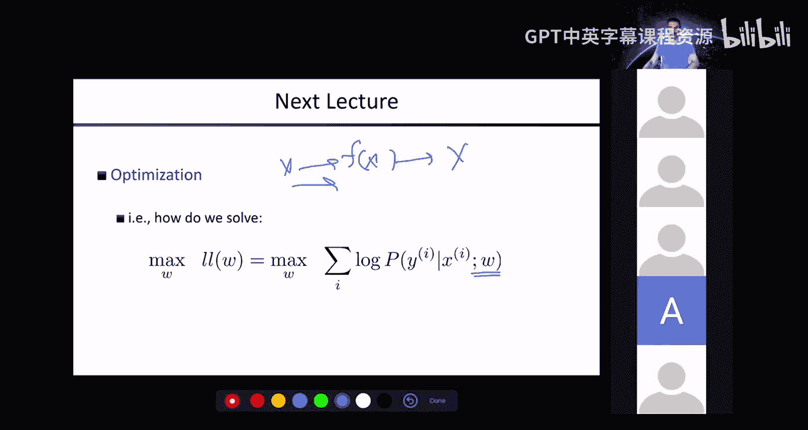

# 机器学习系统：3.2：感知机与逻辑回归 🧠

在本节课中，我们将要学习两种基础的线性分类器：感知机和逻辑回归。我们将从简单的二元分类开始，逐步扩展到多类别分类，并探讨如何将非概率模型转化为概率模型，以获得更好的理论性质和性能。

## 感知机：二元分类

上一节我们介绍了分类器的基本概念，本节中我们来看看一个非常简单的线性分类器——感知机。感知机的基本思想是找到一个权重向量 **W**，通过计算输入特征向量 **F(x)** 与 **W** 的内积来进行分类决策。

其决策规则如下：
*   如果 **W · F(x) > 0**，则预测为正类（+1）。
*   如果 **W · F(x) < 0**，则预测为负类（-1）。

感知机的学习过程是一个迭代算法。以下是其核心步骤：
1.  初始化权重向量 **W** 为零。
2.  遍历每个训练样本 **(x, y*)**，其中 **y*** 是真实标签（+1 或 -1）。
3.  使用当前 **W** 对样本 **x** 进行预测，得到预测标签 **y**。
4.  如果预测正确（**y = y***），则保持 **W** 不变。
5.  如果预测错误，则按以下规则更新权重：
    *   **W = W + y* · F(x)**
    这个更新规则的含义是：如果权重向量对当前样本做出了错误判断，我们就将其向该样本的特征向量方向（若真实标签为正）或相反方向（若真实标签为负）调整，以期下次能做出正确判断。

这个过程不断重复，直到所有训练样本都被正确分类，或达到预设的迭代次数。

## 感知机：多类别分类

理解了二元感知机后，我们来看看如何将其扩展到处理两个以上的类别。多类别感知机的基本思想是为每个类别 **c** 都维护一个独立的权重向量 **W_c**。

对于输入 **x**，我们为每个类别计算一个“激活值”：
**z_c = W_c · F(x)**

分类决策不再是看正负，而是选择激活值最高的类别作为预测结果：
**预测标签 y = argmax_c (z_c)**

学习过程与二元情况类似，但更新规则稍有不同。当对一个样本 **(x, y*)** 预测错误时（预测标签 **y ≠ y***）：
1.  对于**错误预测的类别 y** 的权重向量：**W_y = W_y - F(x)** （使其远离当前样本）。
2.  对于**真实类别 y*** 的权重向量：**W_y* = W_y* + F(x)** （使其靠近当前样本）。
3.  对于其他所有类别，权重保持不变。

以下是一个文本分类的简单示例，类别为“体育”、“政治”、“科技”：
*   初始权重全为零。
*   句子“选举投票”的真实标签是“政治”，但当前模型可能错误地将其分类为“体育”。
*   更新：从“体育”的权重向量中减去该句子的特征向量，并向“政治”的权重向量中加上该特征向量。
*   然后继续处理下一个样本，并重复此过程，直到模型在训练集上不再犯错或达到收敛。

## 感知机的局限性与改进方向

虽然感知机简单直观，但它存在一些明显的局限性：
1.  **对噪声和非线性可分数据不友好**：如果数据不是线性可分的，感知机算法可能永远无法收敛，会在某些样本上反复犯错。
2.  **找到的决策边界可能不理想**：即使数据是线性可分的，感知机也可能找到一个“勉强”分开所有数据的边界，而这个边界可能非常靠近某一类数据点，泛化能力较差。它没有机制去选择一个“最大间隔”的、更稳健的边界。
3.  **容易过拟合**：如果持续迭代直到训练误差为零，可能会严重过拟合训练数据，在未见过的测试数据上表现糟糕。

解决这些问题的核心思路之一是引入**概率框架**。感知机输出的是确定的类别标签（0或1），而概率模型输出的是属于每个类别的**概率**。这使我们能够量化预测的置信度，并使用更丰富的数学工具（如最大似然估计）来寻找最优的模型参数，而不仅仅是找到一个能分开数据的任意解。

## 逻辑回归：引入概率模型

为了克服感知机的局限性，我们引入逻辑回归。逻辑回归可以看作是感知机的概率化版本。对于二元分类，我们希望模型输出样本 **x** 属于正类的概率 **P(y=+1 | x, W)**。

我们需要一个函数将激活值 **z = W · F(x)**（可正可负）映射到 [0, 1] 区间，并且是单调的。**Sigmoid函数** 正是这样一个函数：
**P(y=1 | x, W) = σ(z) = 1 / (1 + e^{-z})**

当 **z** 趋近正无穷时，概率趋近于1；当 **z** 趋近负无穷时，概率趋近于0。这样，我们就得到了一个合法的概率分布。

我们的目标不再是简单地减少分类错误，而是寻找一组权重参数 **W**，使得模型为所有训练样本的真实标签赋予的**联合概率（似然）最大**。这被称为**最大似然估计**：
**最大化 ∏_i P(y_i* | x_i, W)**
其中 **y_i*** 是第 **i** 个样本的真实标签。

通过最大似然准则，我们可以在所有能完美分类数据的权重向量中，选择一个为训练数据赋予**最高似然值**的向量，这通常对应着一个更合理、泛化能力更强的决策边界。

## 逻辑回归：多类别分类（Softmax回归）

将概率化的思想扩展到多类别，我们就得到了多类别逻辑回归，或称 **Softmax回归**。

首先，我们为每个类别 **c** 计算激活值 **z_c = W_c · F(x)**。然后，使用 **Softmax函数** 将这些激活值转换为一个概率分布：
**P(y=c | x, W) = e^{z_c} / (∑_j e^{z_j})**

Softmax函数确保：
1.  每个类别的概率都在0到1之间。
2.  所有类别的概率之和为1。
3.  它具有“放大”效应：最大的激活值对应的概率会被进一步增强，使得概率分布更倾向于某一个类别，这符合分类任务的需求。

多类别逻辑回归的学习目标同样是最大化训练数据的似然：
**最大化 ∏_i P(y_i* | x_i, W)**
这里 **P(y_i* | x_i, W)** 就是通过Softmax函数计算出的、样本 **i** 属于其真实类别 **y_i*** 的概率。

---

本节课中我们一起学习了线性分类的两大基础模型：感知机和逻辑回归。我们了解了感知机如何通过简单的迭代更新进行二元和多类别分类，也认识到了其作为非概率模型的局限性。随后，我们探讨了如何通过引入Sigmoid和Softmax函数，将感知机转化为概率模型——逻辑回归，从而能够利用最大似然估计来寻找更优的模型参数。这为我们接下来学习更复杂的模型和优化算法奠定了重要的基础。