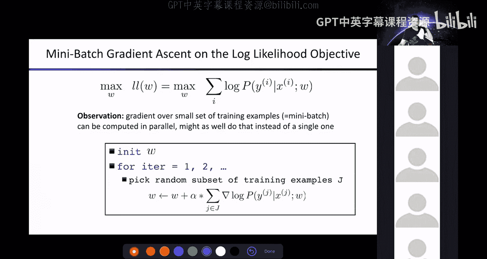

# USC《机器学习系统｜CSCE585 Machine Learning Systems 2020》中英字幕（Claude-3.5 p06 -06-Lecture 4.1 - Optimization and Neural Networks.zh_en -BV1Xc9bYVEC6_p6-

道。

Hi everybody。Nice talking to you again so today the plan is to start talking about optimization right so if you remember last time。

Basically， we， you start talking about these very simple linear classifiers。

 where we have some feature values in this case， for each feature。

 basically each of these features have a certain weights associated to them。

So you have some weights and you want to。Estimate some activation value and we talk about this inner product between the weights and feature vectors and this is the vector not we calculate these ZIs right for for the activations and we have this。

😊，You for binary classifier， depending on whether this activation is positive or negatively decide which class it was predicted based on this class。

 this simple classifier， so we talked extensively about this binary class。

So I presume you are very clear about this binary classifier and also we started talking about multi class classifiers where we have more than two classification。

We started by giving some non probabilistic classifiers and then we noticed that there are some with non probabilistic classifiers because we don't have any means to distinguish between a good decision boundary and a bad decision boundary。

 even though both might be okay， so we talk about how to turn these activation functions into some。

Probability distribution， where we can reason about these probability distribution in a principle。

B and that was the key。 We turned this activation into some sort of probability distribution。

 and the key reason is that we have theory， We have the whole probability and statistics to give us some principled way to reason about these probability distribution。

 so we could do a lot better with probabilitybabilities in this sense。And we ended up by thinking。

 okay， how we can find the best rate， Because this is the key aim of。

Reasoning about what is the best decision boundary。

 We formulated this maximum log likelihood that we want to maximize this value， this log likelihood。

Where these probabilities， condition are probabilities。

 conditions on the input and the current rates， and we want to find best weight that maximizes the probability of these training data。

Right。That was the key aim and we talked about the sigma function in this case which was logistic regression and then we talked about multiclass logistic regression where all of these are the same and we use here basically these transformation which are called softmax activations。

 simple transformation， and we mentioned， okay， these are good transformations because first of all。

 these are。啊。Probability distribution， this transformation have has the key characteristics of a probability distribution。

 None of them are negative and all sum to one。 So this is okay。

 and it has nice property that gives us。So basically this transformation points to the make the most likely class closer to one with the characteristic of exponents that we talk about where for example。

 if one z1 is larger than Z2 after exponenting this this easy one is a lot larger than E2。

And as a result， one of these classes， the probability get close to one。

 the others get close to zero， and again none of these is actual zero。

 but very close to zero and one of those unless these are these activations are very。

 very close to each other， then they might be like 30% each if you have three classes。What。

This situation is unlikely。And basically again， similar to binary classification。

 the question is that what is the best date we want to have for this case that maximizes this。

Like like liquid for us。Again， we had this naive intturusition， okay， if you have infinite compute。

 maybe you can go over and enumerate all possible weights， but obviously this is not IDLV。

Neither have infinite compute nor if we had wanted to do that。

 so we want to have a principal way to find these best double。That's wait。

 do you have any question about this？I have one tiny question， it' a little bit of a silly question。

 but is the E natural E？Yes， yes， yes yes。Yeah， good question。But。T think it could be。I mean。

 that is。Not really。你ed嗯。But in most cases， this is naturally。

And then we talk about log also is the same。Any question about this。We go。

 so now in this lecture we want to talk about optimization。

How we can solve this optimization in a principle way using the。The tools that we have in。

Calcu us to help us to do this optimization。So in the AI class， we had one version of optimization。

 we have multiple versions of optimization， most of which were related to the case where variables are discrete。

😊，Meaning that， for example， in CSB cases each variable was discrete in a sense that， for example。

 in the chess example。The variables was X。And avoid location of each。Each of those。

Rock or whatever you had on the chess book in map coloring。

 the variables was assigned to the possible colors that you could assign to each variable。

 So these variables where discrete in that sense， right。

 So you could randomly initialize somewhere and you could do hill climbing。

 meaning that you move to to basically the best neighboring estate。

And then you do this it creativeatively until you resolve all the conflicts and you get to the point where you do not have any conflict meaning that you're done。

 you solve this CSB。But again， this was the case where。We have these discrete variables in this case。

 the variables that we have we are dealing with are not discrete right so we are talking about the weight like in this case in2D could be pointing to any direction。

And could be off any let。So in 2D， we know that this is not discrete。Continues the space。

 So we are talking about continuous variables。Which this procedure of hill climbing doesn't work。

 so we need something better than hill climbing， at least something that give us a signal。

 you can think about the heuristic that give us a signal。

 which direction you want to go from the current direction that you have。Right。

 so basically in this case。So when we have discrete variables at any location， we could enumerate。

All possible。Neighboing estate， so we could technically enumerate， even though the whole possible。

 we do not want to enumerate all possible state space of this problem because this could be exponentially large right。

 so in CSB even if we have likela。20 binary variables we have in total to over 20 status space。

 So this is。This is huge。 I mean， still， we cannot anumerate one by one。

 but at any location at any estate， we could locally， like if we are here。

 we could look at the neighboring estate and we could go over all of them because。This is。

This is possible because we have some local structures。

You remember we discussed about this local quality in CSP。

 which we were exploiting for generating coming up with algorithms that could solve a CSP for us so has we exploit this interesting structure of CSB in the AI course。

 but here like when we talked about W0。The neighboring Ws。Doesn't have this locality structure。

 we could have infinite number of possible other ws we could get from this W0。

 so it's not possible to enumerate all of them。We could get anywhere so this is not really possible well unless we have some some way to reason。

 which is the topic the topic of this lecture Do you have any question about this。

So the topic that we will discuss today， you encountered in Calculus， even in high school。

 so is not new for you， but is still interesting so you could think about。

Like W is these weights you have right， and you could now assume that you're having a one dimensional。

Space right so your weights could point to different vector， but in one dimension。

 still you have infinite， even in one dimension you have infinite number of vectors and you want to reason for these weight vectors and you have a function G you want to optimize in this case you want to maximize the same could be apply for minimizing this function。

 but let's imagine that we have G and we want to maximize this G。

 meaning that you want to find a weight vector at certain value that gives you the highest value within the domain right so we are talking about a domain that。

This w could come from right so this is the domain of w right from minus infinity to positive infinity this is the situation we are talking about and this function's let's also discuss about some other assumption。

 this function is a smooth。Okay， this is one implicit assumption that you have meaning that you do not have like something like this。

 so your function is smooth。Like this， these implicit assumptions are needed for the stuff that we will talk today。

So you start from some initial value the same way， you start from W0， and then you want to think OK。

Where can I move right， you could move either this way or that way。Both directions are are possible。

 Then let's， let's think that you move as slightly， right， So， for example， imagine that you。

You're located in。 let's imagine that way。 Imagine that you cannot see。Surrounding you， okay。

And you're located。In some mountains， right。And your goal is to go to the summit of this mountain。

 okay。You cannot see your surrounding。What you are given。Something。Basically。

 that tells you the heights of any location that you go there， right？

 So you could move and you could read。Basically， by GPS or something， what height you're located。

 And then by that， you could reason， Okay， intuitively。

 you could reason what direction you want to move， right。

 So you go to multiple locations surrounding you。 And then you decide， okay。

The direction that leads you to the highest increase in heart is the direction you want to moving and that's the intuitive sense you can get out of this so let's reason between this one0 situation obviously in one0 you can move either to the left。

Or to the right okay， you go a little bit to the left in this case。

 you would move to w0 minus h H is the little be move or you could move to w0 plus h。

And then based on evaluating， so with GPS， you could evaluate， okay。

 what is Gw0 plus H and what is GW0 minus h？And then you could read them， okay。If this is higher。

 I want to move into this direction。 This is the way how you could think about it and you could do iteratively until you get to the summit。

 right。So啊。Basically， you want to take the derivatives in calculus。

 you know that this is associated to the derivative of the function G in this case and。

And the way how you could reason about this is that you basically calculate this linear approximation to any point that you are in so at any point in this case。

 if you do this， you move a little bit here， a little bit here， you calculate the difference。

 you divide it by sorry。You're divide it by this length， so you calculate the G W0 plus H。

Minus g W0 minus h， and then you divide it by the amount of move between these two locations。

 which is2 h in this case， and then this is called the gradient of the function in W0。Okay。啊。

So basically you evaluate the derivative of this function。So this is the this is the notation。

 you you want to first， you do not want to move very fast。 you do not want to jump。

 you want to move a little because if you move。If you jump， maybe that is becoming very noisy。

That is not a good approximation maybe become very noisy so you want to move a little bit and then you want to calculate this change and then you call this the derivative of the function we can w0 and based on this signal so think about this derivative as a signal that gives you the direction you want to move。

 so for example， if this derivative is positive it means that you want to move to the right。

 if this is negative so for example， if you are here， if you do the same。

 you calculate this so the derivative becomes negative so。So your。

 you want to move to the left in instead of moving to the right， but at any location if。

If this derivative is positive， you want to， for example， in this case， if you， you want to maximize。

 you want to move to the right。 and we do this iteratively until。

Until you don't get any signal and signal means that you are here and then this is zero right。

 so mean that。You， you do not。Change the location because at this point， you're in a local optimal。

 right， There is no guarantee that this is global optimal because you could end up well here。

 depends on where you started if you started here and you do the same procedure。

 you may well end up here， right， But if you would have started here。

 you definitely would end up here doing this same procedure and。

You are lucky because you got to the global opt。Do you have any question about this？

Thiss is simple calculus that you learned in high school。不会。ok。

Let's continue that was 10 the same here for 2D 2D means that the domain omega is two dimensional so you have W1 and W2 right so you could call it W you have a vector of2 dimension right you could think about this W1 this W2 and then you want to reason the same way now are you are located in 2D dimensions right so at any location you could move to the left to the right。

To the left or any of these directions， right， So you have more variability where what direction you want to move you。

 you， you can move anywhere between 2D。 So you have more freedom for movement。嗯。

And then you want to reason with the same kind of。W that we did for one0 for 2D kind of case。

 which is really similar if you extend the same derivative into multiple dimensions。

So you do the same， so your function is now in instead of one coordinate。

 it has two coordinates W1 W2 you could represent it so this W1 W2 again。

 like make sure you understand this or each coordinates or the coordinates for your function so you could represent it by Gw each W could be。

W 1， W2。 So you need to make sure that you understand these notations， right。

 And the way how you want to reason about this is is。To do really the same procedure。

 nothing very different， but now you're in multidis where。

You calculate the gradient now you need to reason about each coordinate separately the question is that so when when you are here the question is that that for each of these right for each of these locations meaning that。

How much you want to move toward W to how much？You want to move toward W1， right。

 so you want to have a way too reason about post coordinates。

How much I want to move toward each coordinate and then you could see based on this calculation what direction you will end up right。

 so this is for W2， this is for W1 and then based on calculation we get the vector where you will end up。

Okay， so you want to make an update to W1 and W2。Based on the signal that you get。

 this is the gradient with respect to W1。 You want to see if you change W 1 a little bit。

How much the function value will change？Right and based on this change。

 this variation across this direction， this dimension， W1， you decide， okay。

 this is the amount of change I want to incur in W1 and the same for W2。

 this is the amount of change that I want to incur to W2 in this case and you want to have a way to control that right。

 so you want to have a way to。To adjust your jump， right， maybe if you want to learn fast。

 you want to adjust it very quickly。In the AI course we discussed about this learning rate。

 if you want to learn very fast， you need to and if you rely on this signal and you think that this is a good signal。

 you want to move fast but that has a danger maybe if this is very noisy。

 you may end up in a bad location， so you want to have a mean to adjust this learning rate depending where you are。

 if you think that youre very far away from the optimal value so if you be conservative at the beginning it's not good at the beginning you do not want to be very conservative。

 but if you're close to optimal value， you do want to be conservative because you do not want to jump over the optimal value。

 so you can see it here probably more easily，In this case。So if you are here right。

 you want to have larger alpha， maybe it's okay to move further away。

 but if you are here if you have large alpha， then maybe if you want to move this way。

 if you have a large alpha， maybe in a set of here you end up here and then you jump over the optimal value and you get lost again you need to come back so really depends where you are and then you can adjust this alpha learning rate。

 depending on how feel you are close to the summit or far away from the summit。Does it make sense？

Any question about this。Very well。 So this is simple， right， and in vector notation。

You represent this with。This notation， meaning that you now your W has multiple dimensions and this is the notation for gradient right So the gradient has multiple coordinates one with respect to each coordinate So this is so this is this notation is for partial。

Very you you。And this is for notation for gradient。

The difference is that in the gradient is a vector of partial derivative。

 So at each location of this gradient， which is a vector， you have one partial。

Divative of of the function that you want to maximize or minimize。And then， this is basically。诶。

Kind of inner product of learning rate to this gradient vector。 Like then you could adjust it。

 depending on。Coordinate basis as well， right， So you could change Al in a way that you want to maybe move faster in in one of the coordinate and the other coordinates。

 So you could have this flexibility as well。Any question about this？

I hope you are able to follow what I'm saying。If you have any question。

 please do let me know because these are important。And we will build on top of this。

Notion for neural networks。Then you can think about this。You can visualize this moves in 2D。 Again。

 this is like when you have multiple。Dimenssions， this is x1， x2。

 and your function depends on x1 and x2。Okay， you start from here。

 you take the derivative with respect to both and then next you move here depending on the gradient of G with respect to w and the amount of alpha that you consider for this。

 it leads to here， and then like you could imagine this as。Maybe w zero。

Then this is your W1 and this is your W2。It is your double and so on until you get。

To this point which is the summit of this function So these are the contours of these obviously this located in 2D。

 but these are the contours showing that these old values are the same， right？

As you move toward the center， you have this kind of shape right so as you move toward the center。

 your function values becomes higher within this2D dimension。And in this case。You notice that。

Some of the jumps are larger， right？ Some of the jumps are。Basically。Some of the jobs are。

A smaller right so in this case at the beginning again depending on the adjustment to your alpha。

 the learning rate， at the beginning you want to rely on the signal more so。You move faster。

 but as you approach the summit， you want to be more conservative because you do not want to jump over this。

And like maybe you need to move back again here toward the center。

 so you have alpha to adjust dynamically depending on what iteration you're in。

So basically you could like consider in decreasing this alpha value iteratively。

 and this is like the iteration。Of your algorithm for optimization。Yeah。

 this is this is typically the scheme that you can think about it。 and this is why you again。

 this is important why you want to do that because you do not want to。

Miss the the optimal point by any chance。Any question about this？Yeah。

 I one small question so like in your original two dimensional graph you showed in the previous slide right where if you're doing a slope analysis on that。

The slide before that， I'm sorry。For this human don know。

 the slide before this where you had like multiple hills。 Yeah， cause you have multiple maxims。

 right， How do you know like， when to stop。Increasing or decreasing your alpha。

 because that might be just be a local maximum， not the global maximum。Right。Yes。

 you do not but with this procedure like you cannot reason really anything about whether you ended up in local or global optim and this procedure doesn't guarantee any anything about this right it really depends where you start it right so if you stop from here if you choose your alpha very carefully you definitely would end up here。

 if you choose your alpha maybe quite sometimes you end up here。The same for this case， right？啊，上月呢。

Depends where how it if you start here， right。I mean， like。So if you're start here。

 imagine that at the beginning you're。You select a very large alpha。Right， so you move here。

 you move here， so you decide to move here， and then you choose a really large alpha and then you jump here。

RightThen you're lucky because like you could well end up here because you had a very big jump。

But your clueuluis， really， you cannot do that anytime maybe you started from here and if you do the same。

 maybe you end up here。Right yeah that makes sense to me so basically the choice of alpha is important。

You may be the choice are fine initialization， right。

 where you started and how you chose your alpha depending on the signal that you get from the gradient。

But that was excellent questions， thanks for asking。Now。Let's take a break here for one minute。

 then we will continue from here。this is also important。One minute。Is there any here。Very well。

 so now let's discuss。What is the steepest direction， right， to reason。Whether this signal。

 this gradient。Really gives us the steepest direction to move for disease。Not really the best choice。

 right， so we want to get a sense out of this。So let's let's discuss about this， right。

 so imagine that。We， we have the choice to to move this amount， Del amount。

AndDeica lives in the same space as double。So if W is two dimensional Delta is also two dimensional。

 is one dimensional Delta is also one dimension。And then let's let's think that this is two dimensional really。

So if if we have a。Choice， right， So you could think about this as the。Delta， right。

 that you can move at any。Right， you could from this point， you could move any point here。Right。

 depending on your choice， this is。Definitely， you definitely。Your move。

 you will end up stronger here if you have this。Consts。That you do not want to go beyond this eelon。

 right， And the epsilon is a small amount that we can think about。

 So with with the first order Tayloror expansion， we can approximate what is。The function value啊。

Within this。Area， right。And this means that you're familiar with Taylor expansion。

 the first order because you can think about second order， third order。

 you know that as we increase the order， this approximation becomes more accurate。

But let's imagine we consider this first order Tayloror expansion， meaning that。诶。

If you want to estimate GW plus deta， you can think about GW plus。Basically the first derivative。

Of function g with respect to w1 multiplied by delta 1。

 basically the first coordinate of the delta plus the first derivative of g with respect to Dlta 2 multiplied by the amount of。

Move that you took with respect to deelta to coordinate the second coordinate of deelta。

 so you could have this approximation， this is the function value at G W plus deelta and then the steepest so theres steepest direction within distance。

is。You want want to maximize this value right so this is the so basically we are looking at the functional values here。

We want to find which point， what point。Between this is the largest or maximizing function function G this within this case。

 right。And then you can think about this， right， Let's， let's reason about this。

 So you here you have， you have one one vector， which you know， it's norm， which is at maximum。

 It has the norm of epsilon， right， and you have。Another vector that you multiply with this。

 so you multiply this， we know that by this in order to maximize this。

Like if we we are multiplying to two vectors， basically we want both of them to be aligned with each other that's obviously the maximum value you could get if you're multiplying two vectors if these two vectors are fully aligned this is the maximum value you could get out of this。

Out of this multiplication of these two vectors。Right。

And we can really construct this right so so here we could construct Dta in a way to be fully aligned with with a how to do that。

 you could obviously create such thing， we know that the length of。

Delta should be excellent because we are given this concept。

 we do not want to have larger or smaller Dlelta， right。

 We are given maximum maximum deelta so we could construct this。

Delta to to have the same norm as epsilon right So if you take the norm of deelta in this case。

 so this norm is one。 so this is epsilon that that you could get right so you could construct this delta in a way to give this property。

 so in this case， you can you can construct this delta in a way that give you this property right。

 how to do that。 So in this case you want to fully align it with this gradient which is a vector。

So you do the same for this was the solution for any arbitrary vector a here you have the gradient so you do the same so basically you divide this gradient with respect to its norm。

 so basically you know how to calculate this norm it depends on type of norm。

 if you are talking about L2 norm， it's easy we want to。To to calculate， for example。

 if this is gradient， we want to calculate。A1，82。你关了。82。

Right so this is the norm in L this is L right， but you could you could think about different norms as well。

 so this is the way how you construct D so you construct。

Dta that is fully aligned with respect to this gradient。

 and this is the steepest direction you will get from。From。From here， right， So you see that。

 you easily see that。If you follow。Whatever signal， whatever direction that gradient tell you。

 this is the best choice。 So you would not have any better other choices that you could get from anything else rather than following what gradient tell you what direction to go。

So this is the best advice you could get or the best signal that you could get in order to get the best next value if you want to do this adjustment。

Do you have any question here？Yeah， I had a question Yeah what exactly So you said a is a vector。

 but what what does a actually represent I think I might have must that or。Something。

A is a vectorect， right？😊，So， in this case。We wanted to， so let me see。So we wanted to have。诶。

In this case， we wanted to maximize the inner product of beta。With a。

 right and a is an arbitrary vector， right， So if we change a。

 obviously we get a different in different value as a result of this inner product。

 So here we get by changing a。We get different value， right？And then by calculus， the reason。

What is the best A that I can maximize this value。 And this is the way how you could reason about that。

 right， So if you have， in this case， you know what is the norm of Den。 So you could construct this。

 So basically， you could construct this。By dividing this because you do not want to。

 you do not want to really。Basically， in this case。

 you do not want to move beyond this this epsilon that are given to you， right， So you have this。

Limit your you have this flexibility to at max move this amount。 Now。

 since you are given this flexibility by reasoning over this， you want to see， okay。

 what is the best choice that I can come up with。Since we have already this this estimation and the best choice is really is to in order to have this right。

 so think about this right so we know that since we have this。

We want to maximize this function value。 So the best choice is to really。

Maximize each each of these and each of these you could think about like you have two vectors right。

 in order to maximize this， we want to fully align them。

So we exploited the knowledge about first order expansion of retailor seriesius and the knowledge that if we move toward the gradient it gives us the best choice here right so the best choice in order to align delta is to take the gradient in this case。

I hope it makes sense。I know that that answers my question I actually had another question It was just a notation thing I guess you had a you've got up there at the top of the slide just max and under that you've got Delta colon and then you've got a delta with like a superscript and a subscript I was I'm guessing that some。

Kind of。啊。There are like that's that's saying that like delta is the sum of like I guess two vectors I mean delta is a vector right so it's the sum of like two other vectors I guess that are。

Probably both restricted to some axes， I guess， so like and this is a two dimensional delta， right。

 exactlyly Delta is two dimensional in this case， right， So the first coordinate is Delta 1。

 The second coordinate is Delta 2 right， so we have。We have two two dimension for Delta。 So Delta is。

2， so if you could think about this， right？ So this is Delta。 So you can think about this Delta1。

And there。2， in this case， right。So' white。Handwriting is awful。 But you get a sense， right。

 and the norm of this is you， you want to to have a specific norm， which is maximum episode， right。

Does it make sense？Or哪姐。Well so the I guess I understand sort of like what the the subscript is。

 the superscript is that just sort of is that the the domain I guess that it lives in is that so like that tells us that it's an R2 or。

I see that they both have two as a superscript。Yes， yes， yes， exactly。 So this means that。

We we live in two。Two dimension， right， This is。啊 so比啲啊。If we have， so this means that this。

 this meaning that we。We we calculate the norm of deelta in L2， right in L2。

 like if we have even three dimension。If therefore is three dimension， then the norm in L2 would be。

What would be one。Plus，2。Plus 3， right。This is the way how we calculate in N2 right if you change the L2 to something else l infinity。

 then this formula would be different right or n0 would be different。But typically， in。

In this course， we mainly talk about L2 norm。But really， in vector cancu us。

Hope that you had intuition in other courses in calculus that you could define different norms depending on on the space that you live in and different norms could give you different properties that you want to resemble all these vectors right。

 but this。Superscript means that we are calculating。Basically， they L to no。 Does it make sense。

It's just an exponent， correct， I mean， it's just， it's Delta 1 squared plus Delta 2 squared。 Yes。

 is is a square， yes。Oh， okay， got it， yeah。All right， yeah， that makes sense。So basically啊。

Because in every。In how。In Hilbert' space， you can think that we have a ball right and ball is defined by this right。

 but in some other norms， this could be maybe something else right。

 could be this or could be this depend on really the norm you want to define， but then two is really。

Is default norm that。We know how to calculate that and easy。Any other question about this？

And to go from here right， so from two dimension to n dimension now you do the same so here you can have。

A gradient that is at each coordinate， you have the same partial derivative in a similar sense。

 and then you could do the same procedure very similar way if you want to turn the whole thing into an algorithm。

 computer science， we know that we are， I mean， so far so good for mathematics。

 but if we want to turn that into algorithm， we to we want to stop somewhere and then we have an iterative approach。

 we stop from an initialization， we multiply the gradient of G at any point by considering a specific learning rate which might be adjusted or might be constant throughout this procedure and we want to update W based on this very。

which is called gradient ascent or gradient descent if you want to minimize the function depending on what objective you have right really these are the same gradient accent you want to maximize the function gradient descent you want to minimize but the procedure is the same you do the exact same procedure and you could adjust this learning if you want to explain what is the intuition behind that。

And really， this is a crude adjustment， really Ruol Tom says that maybe depending on the update between W。

 you consider some value between 0。1 to 1% of the。This is a rough idea about how we want to like offer。

So obviously， you， if you， I just sleep very。If you go above 1% of。Change in in W is。

It's not why it's not good because like you're moving ahead of the signal that youre getting right and if this signal is noisy。

 then these updates become noisy too， right？Let's， let's stop here。

And then next time we talk about mainly how so far， basically we discussed about the key idea behind。

Gradian ascent or disscent。 Basically， we know how to maximize We now have。A procedure。

 algorithm that give us the power of maximizing。Is a。Concept， right。

So we want to we want to the procedure here， it was generic for any function。

 but the function that really for this course we care about for classifier。

 we have a probability distribution， we have a conditional probability distribution and we define a function based on this log loglihood we want to maximize this with respect to W so we subute here this function log likelihoodlihood。

 we take the gradient of this conditional probability and we want to do this procedure we basically we plug in this function。

 a specific function GW for the whole procedure the gradient absent is as generic so it's not only for obviously is not only for this。

Discuminative models like multi class logistic regression。

 but for any functions right now we only care about。These type of discriminative models。

 and we want to go into some some details how how we can do this and what are the consideration。

 what are the basically some details that we need to consider specifically how to。

How to select samples， how many samples we select at in iterations。

 make a sense out of like a specific function that we want to maximize and get the best result for this type of model。

So let's stop here and next we go into detail of this。Hopefully from Mexico。

 you will hear about the projects， right？So we we wrote some protocols。

 so we would share some more details from next week about the about the project that you will be doing throughout this course。

 so stay tuned。3儿子。Have a good weekend and enjoy。

Let's stay safe。